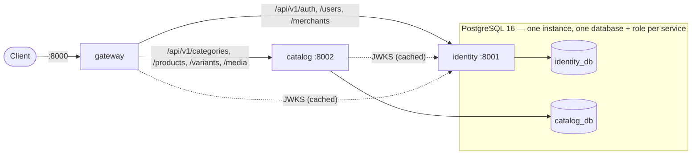

# SmartRetail

SmartRetail is a distributed commerce platform built as a structured learning
assignment. Part A covers the commerce core (identity, catalog, orders,
inventory, events, observability). Part B adds a GenAI layer on top
(retrieval, a shopping assistant, merchant content generation).

**Status: Milestone 1 (Foundation & Core Services)** is implemented. That
covers the gateway, the identity and catalog services, the shared platform
library, PostgreSQL and the local Docker Compose stack. Later milestones add
services according to the delivery phasing in each RFC.

The design is specified in [docs/rfcs/](docs/rfcs/). Read
[RFC 0000](docs/rfcs/0000-architecture.md) first. The assignment itself is in
[docs/](docs/README.md).

## Architecture (Milestone 1)



- **gateway** is the only public entry point. It handles route matching,
  early JWT rejection with coarse role checks, `X-Request-ID`, CORS, size
  limits and upstream error normalisation, and serves the aggregated OpenAPI
  document. It owns no data and makes no authorisation decisions.
- **identity** owns users, roles (`customer`, `merchant`, `admin`), merchant
  profiles, Argon2id credentials, RS256 access tokens, rotating refresh tokens
  with reuse detection, and JWKS.
- **catalog** owns categories, products, variants, URL media and the product
  audit trail. It enforces ownership, visibility, optimistic concurrency
  (`version`) and the product status state machine.
- **common** (`smartretail_common`) holds mechanism only: settings, JSON
  logging, RFC 9457 problem details, pagination, the async DB session,
  `DomainEnum`/`DomainEnumText`, JWT verification and `require_roles`, and
  health checks. It holds no domain vocabulary (rule R8, enforced by a test).

Every service verifies tokens itself, locally, from the public key or a cached
JWKS. Each service has its own database and role, and a role cannot connect
to another service's database. No foreign key crosses a service boundary: a
product's `merchant_id` is a token claim, not a reference to an identity row.

The original milestone text used course/student/instructor wording. It maps
to product/customer/merchant, as explained in
[docs/milestones.md](docs/milestones.md).

## Quick start

Requirements: Docker with Compose v2, `make`, `openssl`. Python 3.12 is
needed only for tests and linting.

```bash
make up        # creates .env and the RS256 key pair, builds, starts, waits until healthy
make migrate   # runs each service's Alembic migrations to head
make seed      # admin, 2 approved merchants, 2 customers, a category tree (idempotent)
```

Open <http://localhost:8000/docs> for the aggregated API docs.

| Seeded account | Password (`.env`) |
| --- | --- |
| `admin@smartretail.local` | `SEED_ADMIN_PASSWORD` |
| `merchant1@smartretail.local`, `merchant2@…` | `SEED_DEMO_PASSWORD` |
| `customer1@smartretail.local`, `customer2@…` | `SEED_DEMO_PASSWORD` |

```bash
TOKEN=$(curl -s localhost:8000/api/v1/auth/login -H 'content-type: application/json' \
  -d '{"email":"merchant1@smartretail.local","password":"change-me-demo-password"}' | jq -r .access_token)
curl -s localhost:8000/api/v1/products -H "Authorization: Bearer $TOKEN" \
  -H 'content-type: application/json' -d '{"sku":"TEE-1","name":"Tee","base_price":"19.00"}'
```

Other targets: `make down`, `make reset` (also deletes volumes), `make logs S=catalog`, `make ps`.

### Keys

`make keys` (run by `make up`) writes an RSA-2048 pair to `keys/`, which is
gitignored, and records its kid as `JWT_ACTIVE_KID` in `.env`. The private
key is mounted into identity only; every other service gets only
`jwt_public.pem`. The files are mode 0644 so the non-root container user can
read them. This setup is for local development only.

## Development

```bash
python3.12 -m venv .venv && make dev-install
make lint      # ruff (lint + format check) and mypy
make test      # starts a throwaway Postgres on 127.0.0.1:55432, runs every package's suite
make test-e2e  # the Milestone 1 journey through the gateway; needs `make up migrate seed`
```

Integration tests run against real PostgreSQL. Each suite creates its own
database and migrates it to head with Alembic. The migration tests also run
`head → base → head` and `alembic check`.

### Repository layout

The full map, including the layout every service follows, is in
[docs/file-structure.md](docs/file-structure.md).

```
docker-compose.yml   Makefile   .env.example   pyproject.toml (ruff/mypy config)
common/         smartretail_common + tests
services/<svc>/      main.py, app/{router.py, core/, <entity>/, …}, alembic/, tests/
ops/postgres/init/   databases, roles and grants
scripts/keys.sh      RS256 key generation
tests/e2e/           smoke test through the gateway
```

Services are organised by entity. Each `app/<entity>/` holds its ORM model
(`models.py`), its business rules (`repo.py`) and helpers such as the state
machine. Only the HTTP contract is versioned: `app/<entity>/v1/routes.py`
deals with HTTP only and `v1/schemas.py` holds the Pydantic request/response
models, which are the API contract. `app/router.py` only includes the entity
routers and owns the `/api/v1` and entity prefixes, so every URL can be read
there. Cross-entity infrastructure lives in `app/core/`. The ORM is never
exposed directly. See [docs/file-structure.md](docs/file-structure.md).

## API overview (Milestone 1)

All routes are under `/api/v1` on the gateway. Errors are
`application/problem+json` (RFC 9457). Lists are
`{items, total, limit, offset}`, and a `limit` above 100 is clamped to 100.

| Area | Endpoints |
| --- | --- |
| Auth | `POST /auth/register`, `/auth/login`, `/auth/refresh`, `/auth/logout`; `GET /auth/jwks` |
| Users | `GET/PATCH /users/me`, `POST /users/me/password`; admin: `GET /users`, `GET/PATCH /users/{id}` |
| Merchants | `GET/PATCH /merchants/me`; `GET /merchants/{id}` (approved only, unless owner/admin); admin: `GET /merchants` |
| Categories | `GET /categories` (`?view=tree\|flat`), `GET /categories/{id}`; admin: `POST`, `PATCH`, `DELETE` |
| Products | `GET /products` (filters `category_id, merchant_id, q, min_price, max_price, status`; `sort`), `GET /products/me`, `GET /products/{id}`; merchant/admin: `POST /products`, `PATCH`/`DELETE /products/{id}`, `POST /products/{id}/status`, `GET /products/{id}/history` |
| Variants & media | `POST /products/{id}/variants`, `PATCH`/`DELETE /variants/{id}`, `POST /products/{id}/media`, `DELETE /media/{id}` |

Product rules:

- Products start as `draft`. In Milestone 1 they can move between `draft`
  and `inactive`, and to `archived`, which is terminal.
- `published` returns `501` until the Temporal publishing workflow arrives
  in Milestone 2.
- Every product write must send the current `version`. The version
  increments on every change, including changes to variants and media.
- A stale `version` returns `409`.
- Non-published products are visible only to the owning merchant and to
  admins. Everyone else gets `404`.

## Technology

Python 3.12, FastAPI, SQLAlchemy 2 (async) with asyncpg, Alembic, Pydantic
v2, PyJWT (RS256), argon2-cffi, httpx, PostgreSQL 16, Docker Compose, pytest,
ruff and mypy. Kafka, Temporal, Celery/RabbitMQ, Redis, MongoDB, MinIO, the
OpenTelemetry stack and pgvector join in later milestones (see
[RFC 0001](docs/rfcs/0001-platform-and-shared-infrastructure.md)).

## Milestone 1 decisions and deviations

Places where the RFCs left a choice open or disagreed with each other, and
what was chosen:

- **Gateway route for `PATCH /merchants/me`.** RFC 0002 routes
  `/merchants/*` for GET only, which would leave an M1 identity endpoint
  unreachable. The route was added as bearer · merchant.
- **Suspended merchants.** The suspended-merchant check at login and refresh
  (RFC 0003 I9) is active now, because an admin role change can already
  suspend a profile.
- **JWT leeway.** A single `JWT_LEEWAY_SECONDS` setting (default 10s)
  replaces the gateway and identity having separate values.
- **Postgres databases.** Postgres creates only the M1 databases and roles.
  Later milestones extend `ops/postgres/init/`.
- **Email addresses.** `.local` and `.test` addresses are accepted, so the
  seed accounts from RFC 0003 validate.
- **Archived products.** Writes to an archived product return
  `409 product-archived`.
- **Deferred to Milestone 3.** These are deliberately absent for now:
  `/metrics`, tracing, rate limiting, the outbox and events.
