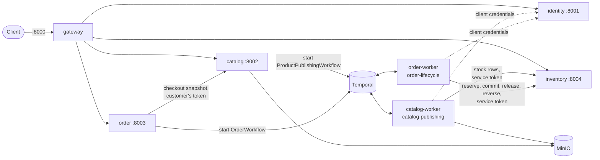

# SmartRetail

SmartRetail is a distributed commerce platform built as a structured learning
assignment. Part A covers the commerce core (identity, catalog, orders,
inventory, events, observability). Part B adds a GenAI layer on top
(retrieval, a shopping assistant, merchant content generation).

**Status: Milestone 2 (Core Business Logic)** is implemented on top of
Milestone 1. Products are published by a Temporal workflow, orders run as a
Temporal saga with compensations, inventory reserves stock without overselling,
and checkout is idempotent. Later milestones add services according to the
delivery phasing in each RFC.

The design is specified in [docs/rfcs/](docs/rfcs/). Read
[RFC 0000](docs/rfcs/0000-architecture.md) first. The assignment itself is in
[docs/](docs/README.md).

## Architecture (Milestone 2)



- **gateway** is the only public entry point. It handles route matching,
  early JWT rejection with coarse role checks, `X-Request-ID`, CORS, size
  limits and upstream error normalisation, and serves the aggregated OpenAPI
  document. It owns no data, makes no authorisation decisions, refuses
  service tokens and never routes `/internal/*`.
- **identity** owns users, roles (`customer`, `merchant`, `admin`), merchant
  profiles, Argon2id credentials, RS256 access tokens, rotating refresh tokens
  with reuse detection, JWKS, and the client-credentials grant that gives the
  workers short-lived `typ=service` tokens.
- **catalog** owns categories, products, variants, media and the product
  audit trail. **Publishing is a workflow**: `POST /products/{id}/status
  {"status":"published"}` returns `202` and starts `ProductPublishingWorkflow`
  (validate → process media → build search document → create stock rows →
  mark published). The last step is the only one that makes a product public,
  and it is one transaction; any failure returns the product to `draft` with
  the reason in `GET /products/{id}/publish-status`.
- **inventory** owns stock, reservations and an append-only ledger. Rows are
  locked in a fixed order with bounded waits and retries, and a `CHECK`
  makes oversell impossible even for a buggy writer. Expired reservations
  are swept back into stock.
- **order** owns orders, their payment and shipment sub-state, and the
  idempotency keys. `POST /orders` with an `Idempotency-Key` snapshots the
  products from catalog, persists the order and returns `202`;
  `OrderWorkflow` then reserves stock, charges, commits, ships and confirms,
  compensating in reverse (release, refund, reverse-commit) when a step
  fails. Payment and shipping are deterministic fakes behind interfaces.
- **catalog-worker / order-worker** run each service's workflow and
  activities from the service's own image, with that service's database role.
- **common** (`smartretail_common`) holds mechanism only: settings, JSON
  logging, RFC 9457 problem details, pagination, the async DB session,
  `DomainEnum`/`DomainEnumText`, JWT verification, `require_roles` and
  `require_scope`, the transactional outbox writer, idempotency helpers, the
  service-token client, Temporal helpers and health checks. It holds no domain
  vocabulary (rule R8, enforced by a test).

Every state change writes its outbox row in the same transaction. In
Milestone 2 the rows accumulate; Milestone 3's relay publishes them to Kafka.

Every service verifies tokens itself, locally, from the public key or a cached
JWKS. Each service has its own database and role, and a role cannot connect
to another service's database. No foreign key crosses a service boundary: a
product's `merchant_id` is a token claim, not a reference to an identity row.

The original milestone text used course/student/instructor wording. It maps
to product/customer/merchant, as explained in
[docs/milestones.md](docs/milestones.md).

## Quick start

Requirements: Docker with Compose v2, `make`, `openssl`. Python 3.12 is
needed only for tests and linting.

```bash
make up        # creates .env, the RS256 key pair and the worker secret; builds, starts, waits
make migrate   # runs each service's Alembic migrations to head
make seed      # accounts and categories; then 6 products published through the workflow,
               # stock, and 4 orders through the saga (idempotent)
```

`make up` starts both Compose profiles, `core` and `workflow`
(`PROFILES=--profile core make up` starts Milestone 1 alone). On an existing
volume it creates any missing databases first, so no reset is needed.

| URL | What |
| --- | --- |
| <http://localhost:8000/docs> | Aggregated API docs |
| <http://localhost:8080> | Temporal UI, namespace `smartretail` (port `TEMPORAL_UI_PORT`) |
| <http://localhost:9001> | MinIO console (`MINIO_ROOT_USER` / `MINIO_ROOT_PASSWORD`) |

| Seeded account | Password (`.env`) |
| --- | --- |
| `admin@smartretail.local` | `SEED_ADMIN_PASSWORD` |
| `merchant1@smartretail.local`, `merchant2@…` | `SEED_DEMO_PASSWORD` |
| `customer1@smartretail.local`, `customer2@…` | `SEED_DEMO_PASSWORD` |

Place an order as a seeded customer, for a seeded product:

```bash
TOKEN=$(curl -s localhost:8000/api/v1/auth/login -H 'content-type: application/json' \
  -d '{"email":"customer1@smartretail.local","password":"change-me-demo-password"}' | jq -r .access_token)
PRODUCT=$(curl -s 'localhost:8000/api/v1/products?q=NW-TEE' | jq '.items[0].id' -r)
VARIANT=$(curl -s localhost:8000/api/v1/products/$PRODUCT | jq '.variants[0].id' -r)
curl -s localhost:8000/api/v1/orders -H "Authorization: Bearer $TOKEN" \
  -H "Idempotency-Key: $(uuidgen)" -H 'content-type: application/json' \
  -d '{"items":[{"product_id":"'$PRODUCT'","variant_id":"'$VARIANT'","quantity":1}],
       "shipping_address":{"name":"Cara","line1":"1 Main St","city":"Springfield",
                           "postal_code":"10001","country":"US"},
       "payment_method":"tok_ok"}'
# → 202 {order_id, order_number, status: "pending"}; poll GET /api/v1/orders/{id}
```

`payment_method` `tok_decline`, `tok_timeout`, `tok_flaky_2` or
`tok_refund_fail`, and postcode `00000` or `99999`, steer the saga down each
failure path.

Other targets: `make down`, `make reset` (also deletes volumes), `make logs S=catalog`, `make ps`.

### Keys

`make keys` (run by `make up`) writes an RSA-2048 pair to `keys/`, which is
gitignored, and records its kid as `JWT_ACTIVE_KID` in `.env`. The private
key is mounted into identity only; every other service gets only
`jwt_public.pem`. The files are mode 0644 so the non-root container user can
read them. This setup is for local development only.

## Development

```bash
python3.12 -m venv .venv && make dev-install
make lint      # ruff (lint + format check) and mypy
make test      # starts a throwaway Postgres on 127.0.0.1:55432, runs every package's suite
make test-e2e  # journeys through the gateway, incl. 50 orders for 10 units; needs `make up migrate seed`
```

Integration tests run against real PostgreSQL. Each suite creates its own
database and migrates it to head with Alembic. The migration tests also run
`head → base → head` and `alembic check`. Workflow tests run the real
workflows and activities on Temporal's time-skipping test server (downloaded
on first use), inject a failure at every step, and replay each history to
check determinism.

### Repository layout

The full map, including the layout every service follows, is in
[docs/file-structure.md](docs/file-structure.md).

```
docker-compose.yml   Makefile   .env.example   pyproject.toml (ruff/mypy config)
common/         smartretail_common + tests
services/<svc>/      main.py, app/{router.py, core/, v1/<entity>/, …}, alembic/, tests/
ops/postgres/init/   databases, roles and grants
scripts/keys.sh      RS256 key pair and the worker's client secret
scripts/seed_demo.py demo products, stock and orders through the API
tests/e2e/           journeys through the gateway
```

Services are organised by version, then by entity. `app/v1/<entity>/` holds
the entity's ORM model (`models.py`), its business rules (`repo.py`), helpers
such as the state machine, and its handlers: `routes.py` deals with HTTP only
and `schemas.py` holds the Pydantic request/response models, which are the API
contract. A later version, `app/v2/<entity>/`, holds only the files it changes
(handlers, schemas, and `repo.py` if its rules differ) and imports the rest,
models included, from v1 by name. `app/router.py` only includes the routers and
owns the `/api/v<N>` and entity prefixes, so every URL can be read there.
Cross-entity infrastructure lives in `app/core/`, which is not versioned. The
ORM is never exposed directly. See [docs/file-structure.md](docs/file-structure.md).

## API overview

All routes are under `/api/v1` on the gateway. Errors are
`application/problem+json` (RFC 9457). Lists are
`{items, total, limit, offset}`, and a `limit` above 100 is clamped to 100.

| Area | Endpoints |
| --- | --- |
| Auth | `POST /auth/register`, `/auth/login`, `/auth/refresh`, `/auth/logout`; `GET /auth/jwks` |
| Users | `GET/PATCH /users/me`, `POST /users/me/password`; admin: `GET /users`, `GET/PATCH /users/{id}` |
| Merchants | `GET/PATCH /merchants/me`; `GET /merchants/{id}` (approved only, unless owner/admin); admin: `GET /merchants` |
| Categories | `GET /categories` (`?view=tree\|flat`), `GET /categories/{id}`; admin: `POST`, `PATCH`, `DELETE` |
| Products | `GET /products` (filters `category_id, merchant_id, q, min_price, max_price, status`; `sort`), `GET /products/me`, `GET /products/{id}`; merchant/admin: `POST /products`, `PATCH`/`DELETE /products/{id}`, `POST /products/{id}/status`, `GET /products/{id}/history` |
| Publishing | merchant/admin: `POST /products/{id}/status {"status":"published"}` → `202`; `GET /products/{id}/publish-status` |
| Variants & media | `POST /products/{id}/variants`, `PATCH`/`DELETE /variants/{id}`, `POST /products/{id}/media` (URL), `POST /products/{id}/media/upload` (multipart, ≤ 10 MiB), `DELETE /media/{id}` |
| Orders | customer: `POST /orders` (`Idempotency-Key` required) → `202`; customer/admin: `GET /orders`, `GET /orders/{id}` (with timeline), `POST /orders/{id}/cancel`; merchant: `GET /orders/merchant` (own lines only); admin: `POST /orders/{id}/shipment/status`, `GET /orders/{id}/workflow` |
| Inventory | public: `GET /inventory/{variant_id}`; merchant/admin: `GET /inventory`, `PUT /inventory/{variant_id}` (`If-Match`), `POST /inventory/{variant_id}/adjust` (`Idempotency-Key`), `GET /inventory/{variant_id}/movements` |

Product rules:

- Products start as `draft`. They move between `draft` and `inactive`, to
  `archived` (terminal), and to `published` only through the publishing
  workflow, via `publishing`. While a publish runs, writes to the product are
  `409`. A change that would leave a published product incomplete is `409`.
- Every product write must send the current `version`. The version
  increments on every change, including changes to variants and media.
- A stale `version` returns `409`.
- Non-published products are visible only to the owning merchant and to
  admins. Everyone else gets `404`.

## Technology

Python 3.12, FastAPI, SQLAlchemy 2 (async) with asyncpg, Alembic, Pydantic
v2, PyJWT (RS256), argon2-cffi, httpx, Temporal (Python SDK 1.9, server
1.25), MinIO with Pillow, PostgreSQL 16, Docker Compose, pytest, ruff and
mypy. Kafka, Celery/RabbitMQ, Redis, MongoDB, the OpenTelemetry stack and
pgvector join in later milestones (see
[RFC 0001](docs/rfcs/0001-platform-and-shared-infrastructure.md)).

## Milestone 1 decisions and deviations

Places where the RFCs left a choice open or disagreed with each other, and
what was chosen:

- **Gateway route for `PATCH /merchants/me`.** RFC 0002 routes
  `/merchants/*` for GET only, which would leave an M1 identity endpoint
  unreachable. The route was added as bearer · merchant.
- **Suspended merchants.** The suspended-merchant check at login and refresh
  (RFC 0003 I9) is active now, because an admin role change can already
  suspend a profile.
- **JWT leeway.** A single `JWT_LEEWAY_SECONDS` setting (default 10s)
  replaces the gateway and identity having separate values.
- **Postgres databases.** M1 created only its own databases and roles; each
  milestone extends `ops/postgres/init/` (M2 added order, inventory and
  Temporal's).
- **Email addresses.** `.local` and `.test` addresses are accepted, so the
  seed accounts from RFC 0003 validate.
- **Archived products.** Writes to an archived product return
  `409 product-archived`.
- **Deferred to Milestone 3.** `/metrics`, tracing, rate limiting and event
  publishing. (The outbox rows themselves arrived in Milestone 2.)

## Milestone 2 decisions and deviations

Each is a row in the owning RFC's decision register (§3.2.1).

- **One worker per owning service** (PLT-D33). `catalog-worker` and
  `order-worker` run from their service's image instead of one shared
  `temporal-worker`: every service's package is `app`, so one process could
  not import two of them, and one database role per process is then true by
  construction. This answers RFC 0001's Q-PLT-1.
- **Publishing activities call the service layer in-process** (CAT-D27), not
  catalog's internal routes, since the worker is catalog's own process.
- **MinIO image** (PLT-D34). MinIO no longer publishes images; the stack uses
  `bitnamilegacy/minio:2025.7.23`, which also creates the bucket at start.
- **Existing volumes** (PLT-D35). `make up` re-runs the idempotent database
  init, so an M1 volume gains the M2 databases without `make reset`.
- **Service-client secret** (IDN-D25). Identity accepts a `sha256:` digest of
  the 256-bit worker secret, so `make keys` can generate it with `openssl`.
- **Order task queue** is `order-lifecycle` (ORD-D28), the platform's name.
- **Schema brought forward**: `search_document` and `outbox.client_id` in
  catalog (CAT-D28), `notified_at`, `origin_client_id` and the idempotency
  expiry index in order (ORD-D29). The ORD-1 refund path is implemented now,
  because the M2 saga needs it (ORD-D30).
- **Inventory** keeps transitions in `state_machine.py` (INV-D26), checks a
  reserve replay under the stock locks (INV-D27), skips the fast reject for an
  order that already holds reservations (INV-D28), and follows the order
  workflow's retry policies (INV-D29).
- **Stack rationale** (ARC-D28–ARC-D35). Why FastAPI, Python 3.12,
  SQLAlchemy with `asyncpg`, Pydantic, Alembic, `httpx`, Uvicorn and Docker
  Compose were chosen, and what was rejected for each
  ([mentor review 2026-10-12 §1](docs/reviews/mentor-reviews.md#1-why-fastapi-and-the-rest-of-the-stack)).
- **Everything in its entity folder** (ARC-D27, CAT-D32, ORD-D34). Workflows,
  clients and providers moved under `products/` and `orders/`, and the
  `Idempotency-Key` model into `orders/`
  ([§2](docs/reviews/mentor-reviews.md#2-every-file-in-its-entity-folder)).
- **Version-first layout** (ARC-D23, changed). Every entity moved to
  `app/v1/<entity>/`, with its handlers in `routes.py` and `schemas.py`. A later
  version holds only the files it changes and imports the rest from v1. The
  workers now start with `python -m app.v1.<entity>.workflows.worker`
  ([mentor review 2026-10-13](docs/reviews/2026-10-13-mentor-review.md#1-version-first-layout)).
- **Review traceability** (ARC-D36). A decision a review changed says so in its
  register row, with what it was before. Every RFC has an amendment log that
  links the review behind each change
  ([§3](docs/reviews/mentor-reviews.md#3-every-change-traced-to-its-review)).
- **Still to come, as phased**: presigned media URLs (CAT-D29), events on
  Kafka, the Redis idempotency fast path, the HMAC carrier webhook, and
  `resume_unstarted_orders` — until then an order accepted while Temporal is
  down stays `pending` (ORD-D33).
