# Architecture diagrams

This page puts every architecture diagram in one place, answering
[mentor review of 2026-10-13 §6](reviews/mentor-reviews.md#review-of-2026-10-13):

1. a **top-level** diagram of how the services talk to each other, with the
   protocol on every edge;
2. one **internal component** diagram per service, showing how the parts inside
   a service call each other.

Every diagram is drawn from the code: the boxes are real modules under
`services/<name>/app/`, for all eight services.

Each service RFC keeps its own diagram index (§3.1) with its sequence, state and
data diagrams. The business flows that run across these components are in
[business-flows.md](business-flows.md). The messaging mechanics are in
[messaging-and-consistency.md](messaging-and-consistency.md).

**Legend for edge labels:**

| Label | Meaning |
| --- | --- |
| `HTTP` | Synchronous REST/JSON over HTTP |
| `SSE` | Server-sent events stream |
| `gRPC` | Temporal client and worker protocol |
| `Kafka` | An event through the outbox and relay, asynchronous, key = aggregate id |
| `AMQP` | A Celery task through RabbitMQ |
| `SQL` | asyncpg to the service's own database only |
| `S3` | Object storage API to MinIO |

---

## 1. Top level: how the services communicate

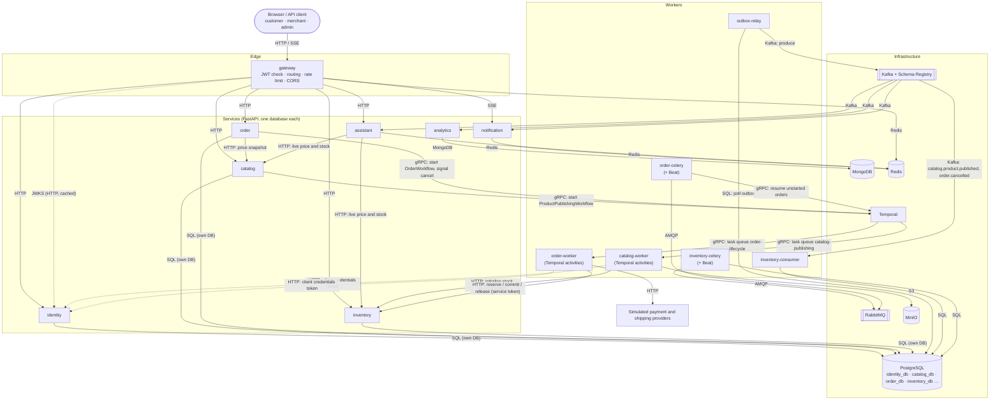

The two rules this diagram shows:

- **Synchronous calls are few and point one way.** The gateway calls a service.
  Order asks catalog for a price snapshot. Workers call inventory with a service
  token. No service calls back up that chain, so there is no request cycle.
- **Everything else is asynchronous.** Processes go through Temporal (gRPC).
  Facts go through Kafka, always out of a service's own outbox. One-shot jobs go
  through RabbitMQ.

No service reads another service's database. Each role can only `CONNECT` to its
own database (rule R1).

### 1.1 What runs per Compose profile

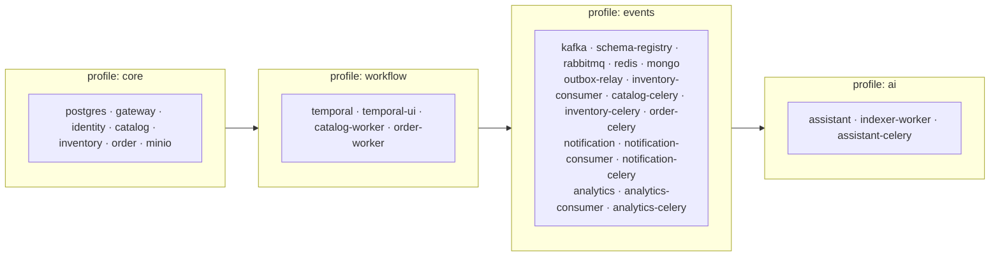

---

## 2. Inside each service

Every service follows the same entity-first layout ([RFC 0000 §3.1.1.7](rfcs/0000-architecture.md#3117-module-structure-inside-a-service)):

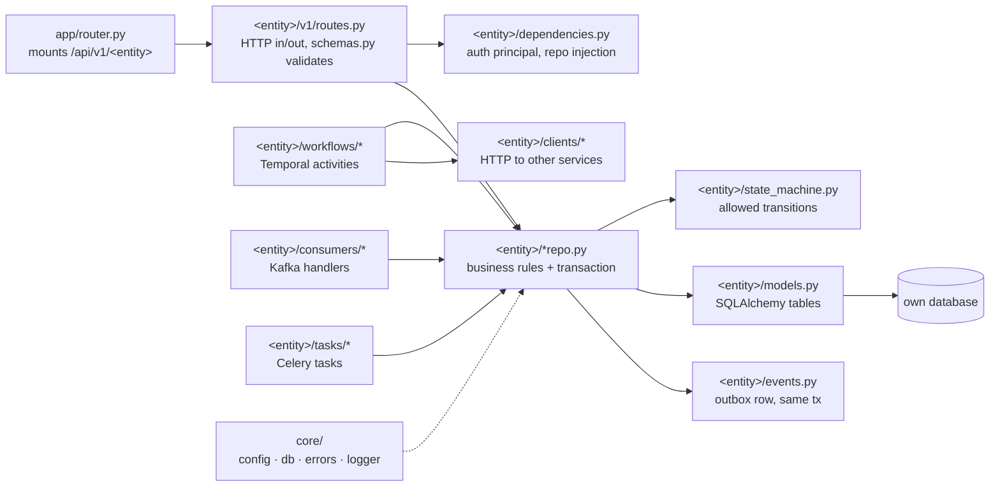

The rule is that **routes, activities, consumers and tasks are all thin entry
points into the same repo**. A business rule lives in one place no matter how
the request arrives.

### 2.1 gateway

The gateway owns no database. It is a pipeline in front of the services.

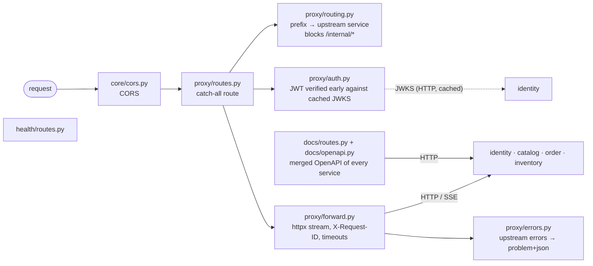

See [RFC 0002](rfcs/0002-gateway-service.md) for the request pipeline stages.

### 2.2 identity

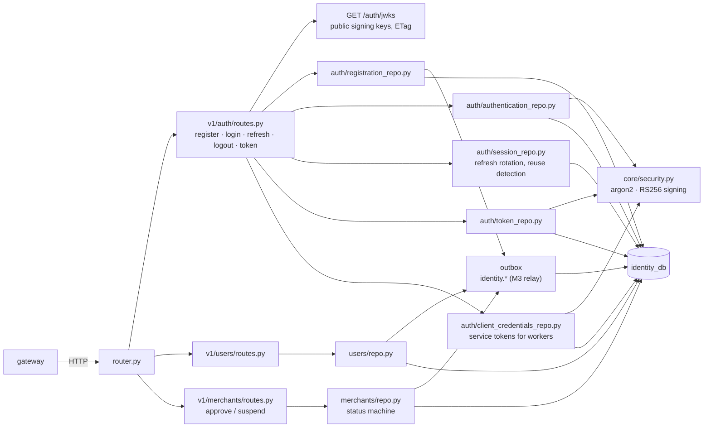

See [RFC 0003](rfcs/0003-identity-service.md).

### 2.3 catalog

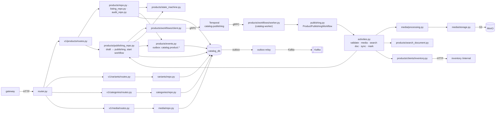

See [RFC 0004](rfcs/0004-catalog-service.md).

### 2.4 order

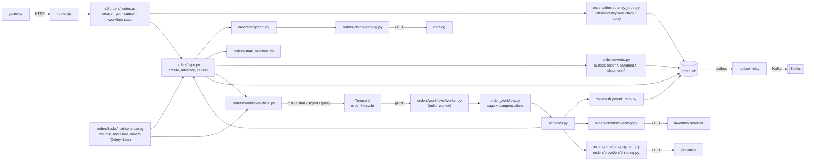

See [RFC 0005](rfcs/0005-order-service.md).

### 2.5 inventory

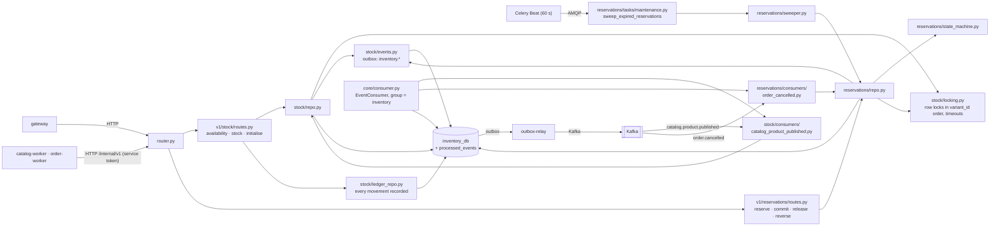

See [RFC 0006](rfcs/0006-inventory-service.md).

### 2.6 notification

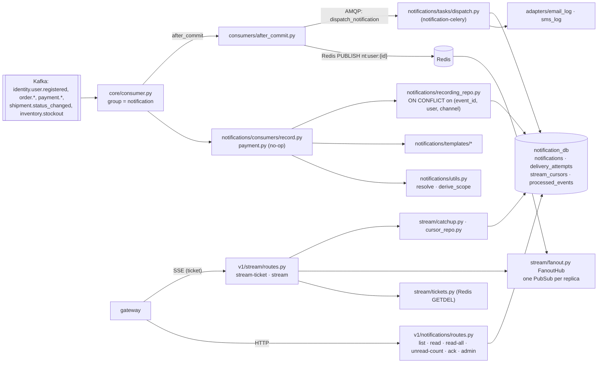

See [RFC 0007](rfcs/0007-notification-service.md).

### 2.7 analytics

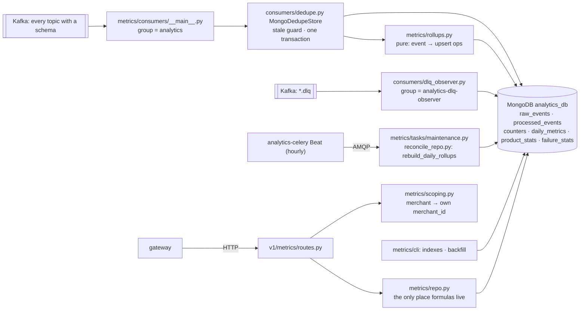

See [RFC 0008](rfcs/0008-analytics-service.md).

### 2.8 assistant

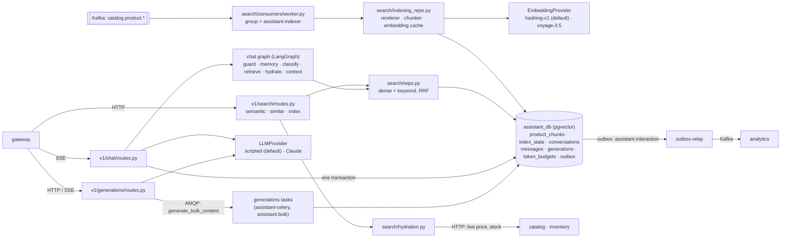

See [RFC 0009](rfcs/0009-assistant-service.md).
