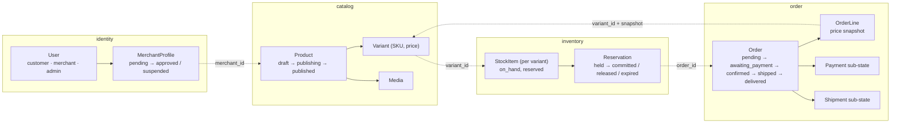
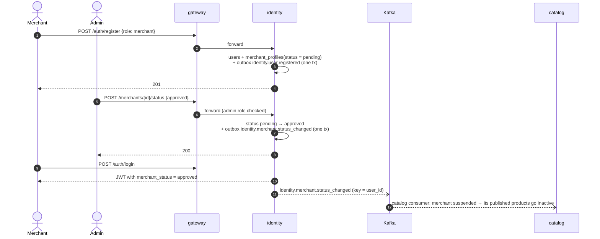
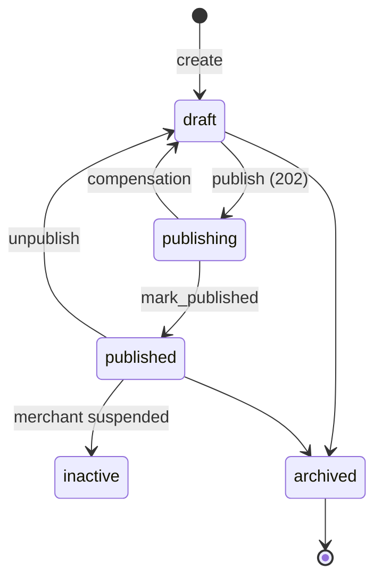
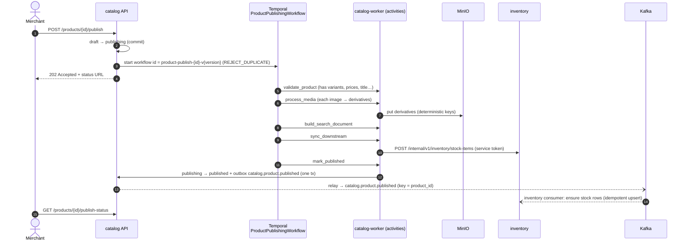
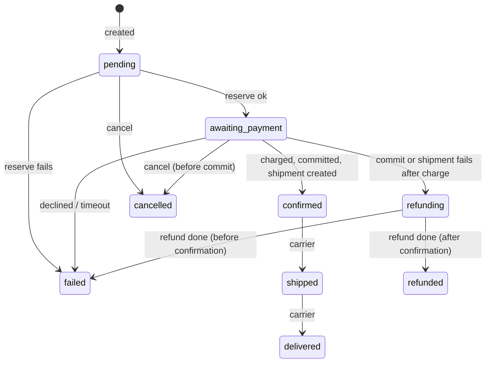
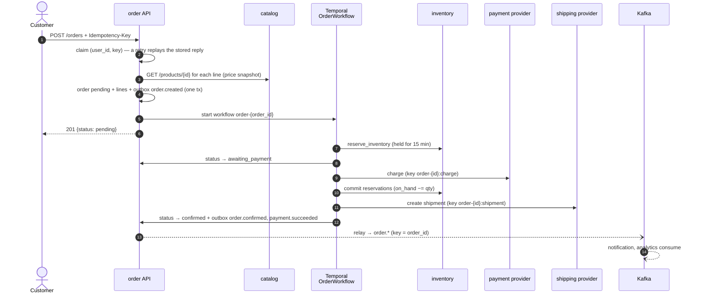
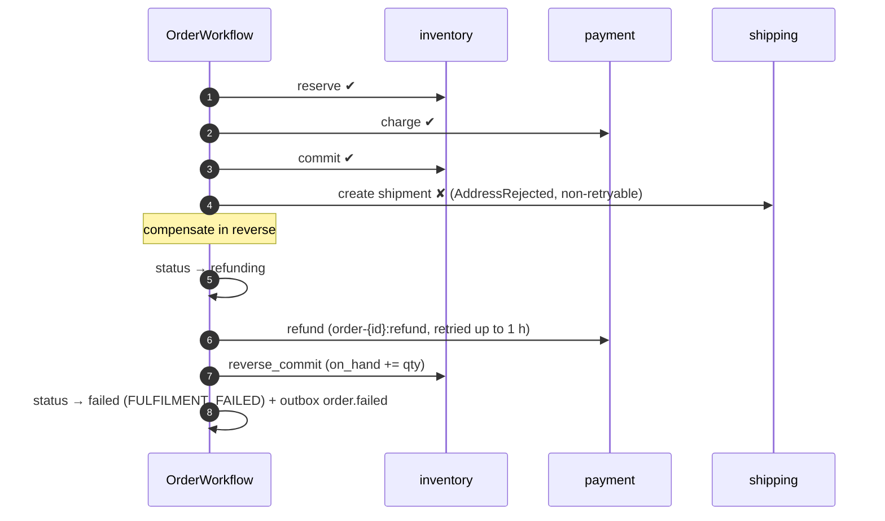
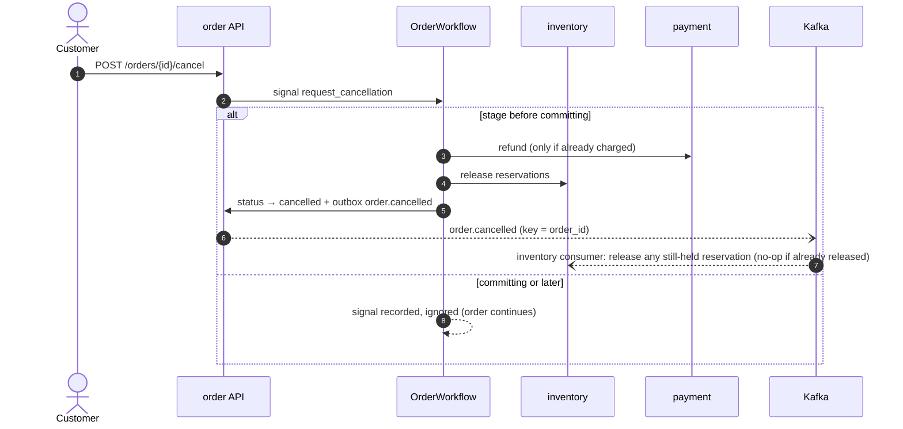
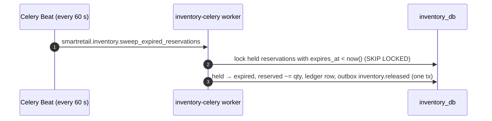

# Business flows

This page walks through SmartRetail's business logic from start to finish,
answering [mentor review of 2026-10-13 §5](reviews/mentor-reviews.md#review-of-2026-10-13).

Each flow names:

- who starts it;
- which service owns each step;
- what state changes;
- which event comes out;
- what happens when a step fails.

The service RFCs hold the full rules; each step links to the owning section.
[RFC 0000 §3.1.1.6 Critical flows](rfcs/0000-architecture.md#3116-critical-flows)
is the short version of this page.

| # | Flow | Started by | Services |
| --- | --- | --- | --- |
| 1 | [Merchant onboarding](#1-merchant-onboarding) | Merchant, then admin | gateway, identity → catalog, analytics |
| 2 | [Product publishing](#2-product-publishing) | Merchant | catalog, Temporal, inventory → indexer, analytics |
| 3 | [Browse and ask](#3-browse-and-ask) | Customer | gateway, catalog, inventory, assistant |
| 4 | [Checkout (the order saga)](#4-checkout-the-order-saga) | Customer | order, catalog, inventory, payment and shipping providers |
| 5 | [Checkout failures and compensation](#5-checkout-failures-and-compensation) | The saga | order, inventory, providers |
| 6 | [Cancellation](#6-cancellation) | Customer or admin | order, inventory |
| 7 | [Reservation expiry](#7-reservation-expiry) | Schedule | inventory |
| 8 | [After the order: shipment, notification, analytics](#8-after-the-order) | Carrier, events | order → notification, analytics |

The domain in one picture: who owns which entity, and how the entities refer to
each other across services.

---

## 1. Merchant onboarding

A merchant registers. An admin approves them. Only an approved merchant can
publish products.

| Step | Rule | Owner |
| --- | --- | --- |
| Registration | Email is unique. A merchant starts `pending`. There is no `rejected` state: rejection is `suspended` | [RFC 0003 §3.1.1.3](rfcs/0003-identity-service.md) |
| Approval | Admin only. Repeating the current status is a no-op with no event | RFC 0003 |
| Suspension | Revokes every live refresh session. Catalog takes the merchant's published products to `inactive` (product transition T8) | RFC 0003, [RFC 0004](rfcs/0004-catalog-service.md) |
| Gating | Catalog trusts the `merchant_status` claim in the access token ([`common/smartretail_common/auth.py`](../common/smartretail_common/auth.py)). Catalog does not call identity on every request | RFC 0000 §3.1.1.4 |

**Failure paths**

- **Identity down.** Login and registration fail. Requests that already hold a
  valid token are unaffected, because services verify the JWT locally with JWKS.

---

## 2. Product publishing

A merchant creates a product in `draft` with variants and media, then publishes
it. Publishing has several steps that touch several systems, so it runs as a
Temporal workflow.

| Step | Rule | Owner |
| --- | --- | --- |
| Start | Only from `draft` or `inactive`. The `publishing` state is committed *before* the workflow starts. If the start fails, the product goes straight back to `draft` | [RFC 0004 §3.1.1.4](rfcs/0004-catalog-service.md) |
| Validate | A business rule failure is non-retryable and goes straight to compensation | RFC 0004 |
| Media | Each image is retried on its own. A permanently broken image marks that media `failed`; the product can still publish if the rules allow it | RFC 0004 |
| Stock | Inventory creates `stock_items(on_hand = 0)` for each variant. The call is idempotent, and so is the Kafka consumer that later sees the same event | [RFC 0006](rfcs/0006-inventory-service.md) |
| Publish | The status change and the event are one transaction (outbox) | [messaging §4.1](messaging-and-consistency.md#41-inside-one-service-the-state-change-and-its-event) |

**Failure paths**

- **Any step fails after its retries run out.** The compensation
  `record_publish_failure` sets `publishing → draft` and records the reason. It
  retries for up to 24 h. The merchant sees the reason through
  `publish-status`.
- **Inventory is down during `sync_downstream`.** The activity retries under its
  policy, then the workflow compensates. The product is never `published`
  without stock rows.
- **The worker crashes mid-workflow.** Temporal resumes at the same step on the
  next worker. Activities are idempotent: media keys are deterministic, and
  `mark_published` returns early if the product is already published.

---

## 3. Browse and ask

| Step | What happens | Owner |
| --- | --- | --- |
| Browse | `GET /products` with filters; only `published` products and `ready` media are returned. Results are cached in Redis for 60 s, and a `catalog.product.updated` event clears the cache | RFC 0004 |
| Availability | `GET inventory /availability`: `on_hand − reserved`. Cached for 10 s | RFC 0006 |
| Ask the assistant | Retrieval over the indexed catalog (pgvector + keyword). Price and availability are fetched live from catalog and inventory, never from the index. The answer streams over SSE | [RFC 0009](rfcs/0009-assistant-service.md) |
| Indexing | The `assistant-indexer` consumer reads `catalog.product.*` and re-embeds the product | RFC 0009 |

**Failure paths**

- **The indexer is down.** Events wait in Kafka. The product is still
  browsable, and the assistant's index catches up when the indexer restarts.

---

## 4. Checkout (the order saga)

| Step | Rule | Owner |
| --- | --- | --- |
| Idempotency | Same key, same body: the first reply is replayed. Same key, different body: 422. Still in progress: 409 | [RFC 0005](rfcs/0005-order-service.md) ORD-D34 |
| Price snapshot | The order stores the price at checkout. A later price change does not touch existing orders | RFC 0000 A13 |
| Reserve before charge | The cheap failure (out of stock) comes before the expensive one (a charge that would need a refund) | RFC 0005 B4 |
| Reservation | One row per `(order_id, variant_id)`, held for 15 minutes. Every forward step fits inside the TTL | [RFC 0006](rfcs/0006-inventory-service.md) |
| Commit | Turns `held` into `committed` and reduces `on_hand`. Only after payment succeeds | RFC 0006 |

---

## 5. Checkout failures and compensation

Each row is a real branch in
[`order_workflow.py`](../services/order/app/v1/orders/workflows/order_workflow.py).
Compensations run in reverse order of the steps that succeeded.

| Fails at | Cause | Compensation | Final state | Reason recorded |
| --- | --- | --- | --- | --- |
| Reserve | Not enough stock | — (nothing done yet) | `failed` | `INSUFFICIENT_STOCK` |
| Reserve | Inventory down after retries | — | `failed` | `INVENTORY_UNAVAILABLE` |
| Charge | Card declined | Release reservations | `failed`, payment `failed` | `PAYMENT_DECLINED` |
| Charge | Timeout (the charge may have gone through) | Refund (keyed, so safe if nothing was captured), then release | `failed` | `PAYMENT_TIMEOUT` |
| Commit | Reservation expired, or commit failed | `refunding` → refund → release | `failed` | `RESERVATION_EXPIRED` / `COMMIT_FAILED` |
| Ship | Address rejected, or carrier down | `refunding` → refund → **reverse commit** (stock back) | `failed` | `FULFILMENT_FAILED` |
| Notify | Notification failed | None. The order is confirmed regardless; a null `notified_at` makes the failure visible | `confirmed` | — |

**Order created, but the workflow never started.** This is the commit-then-start
gap ([messaging §4.3](messaging-and-consistency.md#43-the-gap-between-the-two-and-how-it-is-closed)).
`resume_unstarted_orders` runs on Celery Beat. It finds `pending` orders older
than 30 s that have no workflow, and starts them. The workflow id is
deterministic, so a double start is rejected harmlessly.

---

## 6. Cancellation

- Cancellation is honoured only **before stock is committed**. After that,
  cancelling is a refund flow, not an undo.
- The inventory consumer on `order.cancelled` is a safety net. Normally the
  workflow has already released the stock, and the consumer's release is a
  no-op. If an order was cancelled by a path that bypassed the workflow, the
  consumer makes sure no stock stays held.

---

## 7. Reservation expiry

Stock held by a stuck or abandoned order must not stay locked forever.

- If the order later reaches **commit**, the commit finds the reservation not
  `held`. The workflow gets `reservation-not-held` and compensates: refund,
  then `failed`.
- The sweep is safe to run twice. Each expiry is re-checked under a row lock, so
  two sweeps never expire the same row twice.

---

## 8. After the order

| Event | Who reacts | Effect |
| --- | --- | --- |
| `order.confirmed`, `payment.succeeded` | notification | The customer gets an in-app notification, pushed over SSE ([RFC 0007](rfcs/0007-notification-service.md)) |
| `shipment.status_changed` (carrier webhook → order) | notification, analytics | The order moves to `shipped`, then `delivered`, and the customer is notified |
| `inventory.stockout` | notification, analytics | The merchant is told a variant hit zero |
| Every event | analytics | Rolled up into daily metrics in MongoDB: revenue, conversion, stock movement ([RFC 0008](rfcs/0008-analytics-service.md)) |

None of these consumers is called by the producer. Order does not know that
notification or analytics exist. That is the reason these steps are Kafka events
and not more steps in the saga: a slow analytics service can never delay a
checkout.
