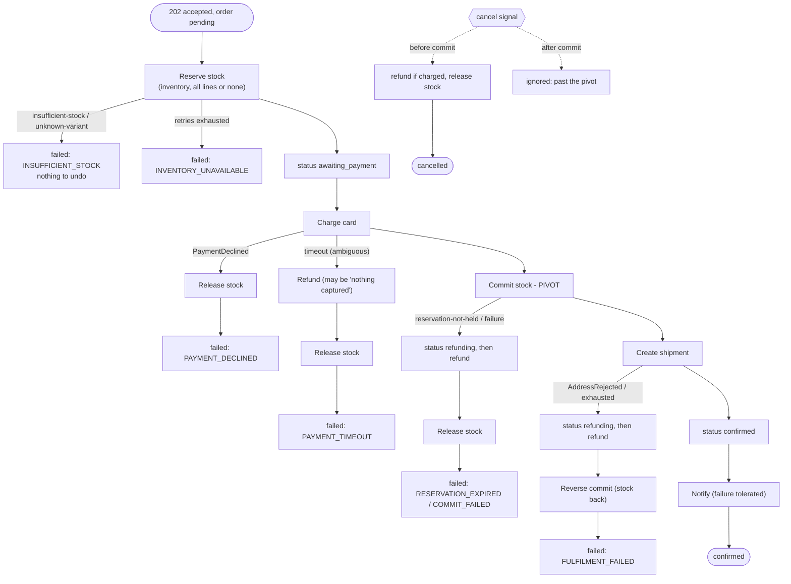

# Distributed systems and failure modes

This page answers the [mentor review of 2026-10-20](reviews/mentor-reviews.md#review-of-2026-10-20).
It covers:

- where SmartRetail is asynchronous and where it is not;
- how one service calls another;
- how retries work at each layer;
- the saga pattern, in detail and as we use it;
- a catalogue of failure cases and what the system does for each;
- the scalability bottlenecks, ranked;
- why the stock row keeps a `reserved` counter beside the reservation rows;
- which tests prove each claim.

[messaging-and-consistency.md](messaging-and-consistency.md) covers Kafka
partitioning, offsets, dedupe and the outbox. This page builds on it and does
not repeat it. The RFCs remain the binding version of every decision; each
section names the decision IDs it relies on.

**Contents**

1. [Where the system is synchronous and where it is not](#1-where-the-system-is-synchronous-and-where-it-is-not)
2. [How services call each other](#2-how-services-call-each-other)
3. [Retries, layer by layer](#3-retries-layer-by-layer)
4. [The saga pattern](#4-the-saga-pattern)
5. [Failure cases and how each is handled](#5-failure-cases-and-how-each-is-handled)
6. [Scalability bottlenecks](#6-scalability-bottlenecks)
7. [The reserved counter and the reservation rows](#7-the-reserved-counter-and-the-reservation-rows)
8. [Tests that prove it](#8-tests-that-prove-it)

---

## 1. Where the system is synchronous and where it is not

**Short answer.** Checkout is asynchronous. `POST /api/v1/orders` does four
things, then answers **`202 Accepted`** with the order in `pending`:

1. it claims the idempotency key;
2. it snapshots prices from catalog;
3. it writes the order and its `order.created` outbox row in one transaction;
4. it *schedules* the `OrderWorkflow`.

The client does not wait for stock, payment or shipping. It follows the
`Location` header and polls `GET /orders/{id}`, or receives a notification.
Everything after the 202 runs on a Temporal worker, pulled from a queue.

The mentor's impression ("every order runs at the same time without any queue")
comes from the fact that the queue is not one we wrote. It is the Temporal
**task queue `order-lifecycle`**. Each accepted order becomes a workflow
execution. Its steps are *tasks* on that queue. The `order-worker` processes
pull tasks at the rate their concurrency limits allow (ORD-D37). A burst of
1,000 orders is 1,000 accepted rows and 1,000 scheduled workflows. They wait on
the queue, durably, and are drained at the workers' pace. None is lost if a
worker dies; another worker, or the same one restarted, resumes it from its
history.

### 1.1 Every hop, classified

| Hop | Kind | Who waits | Where it is defined |
| --- | --- | --- | --- |
| Client → gateway → order `POST /orders` | **Sync** HTTP | The client, for the 202 only | RFC 0002 routing, RFC 0005 §3.1.2.2 |
| order → catalog price snapshot | **Sync** HTTP, inside the checkout request | The checkout request (2 s timeout) | ORD-D9, A13 |
| order → Temporal `start_workflow` | Sync call, **async work** (returns once scheduled) | The checkout request (5 s timeout); on failure the order is still accepted | ORD-D35 |
| Temporal → order-worker (`OrderWorkflow`) | **Async**, task queue `order-lifecycle` | Nobody; the workflow runs on its own | ORD-D37, PLT-D13 |
| order-worker activity → inventory `/internal/v1/inventory/reservations…` | Sync HTTP *inside an async activity* | The activity only; the client is long gone | ORD-11 |
| order-worker activity → payment / shipping providers | In-process fakes, same shape as an HTTP provider | The activity | A9, B10 |
| Any service → `outbox` row | Same DB transaction as the state change | Nobody extra | A11, PLT-D5 |
| `outbox-relay` → Kafka | **Async**, polling every 500 ms | Nobody | PLT-D6 |
| Kafka → consumers (inventory, notification, analytics, assistant-indexer) | **Async**, consumer groups | Nobody | A12, ARC-D13 |
| Celery Beat → workers (sweeps, resume, reconcile, media) | **Async**, RabbitMQ work queues | Nobody | PLT-13 |

Two hops run inside the checkout request and could slow it: the catalog
snapshot and the Temporal start. Both are bounded by timeouts. Neither blocks
the order forever:

- a catalog failure returns 503 *before* anything is written, so the client can
  simply retry;
- a Temporal failure leaves the order `pending`, and `resume_unstarted_orders`
  starts it within a minute (ORD-D35).

### 1.2 Checkout, as a sequence

```mermaid
sequenceDiagram
    autonumber
    participant C as Client
    participant G as gateway
    participant O as order API
    participant Cat as catalog
    participant DB as order_db
    participant T as Temporal
    participant Q as task queue order-lifecycle
    participant W as order-worker (N replicas)
    participant I as inventory

    C->>G: POST /api/v1/orders + Idempotency-Key
    G->>G: per-IP limit, JWT, per-user order_create limit (GW-7)
    G->>O: forward
    O->>DB: claim idempotency key
    O->>Cat: GET product (price snapshot, 2 s)
    O->>DB: BEGIN; order pending + items + outbox order.created; COMMIT
    O->>T: start_workflow(order-{id}) - returns when scheduled
    O-->>C: 202 Accepted {status: pending}, Location
    Note over C: the client is done; it polls GET /orders/{id}
    T->>Q: workflow task
    W->>Q: poll (at most max_concurrent_* per replica)
    W->>I: reserve (activity, retried by Temporal)
    W->>W: charge, commit, ship, confirm (activities)
    W->>DB: status changes + outbox rows
```

### 1.3 What a burst looks like

Take 500 customers who press "Buy" in the same second.

1. **Gateway.** Each customer may create 30 orders a minute (`order_create`,
   GW-7). A script hammering from one account gets `429` with `Retry-After`
   after the 30th. Different customers are independent.
2. **order API.** Each request does one indexed insert for the key, one catalog
   read and one short transaction. It holds a DB connection for milliseconds
   (pool: 10 + 20 overflow per process). All 500 get `202` and are `pending`.
3. **Temporal.** 500 workflows are scheduled. They sit on `order-lifecycle`
   until a worker polls them. This is the queue.
4. **order-worker.** Each replica runs at most 50 activities and 50 workflow
   tasks at once (ORD-D37). Three replicas drain 150 activities at a time. The
   rest wait their turn, in Temporal, not in memory.
5. **inventory.** Each reserve locks the stock rows it needs, `FOR UPDATE`, in
   `variant_id` order. Reserves on *different* variants run in parallel.
   Reserves on the *same* variant queue on that row lock, which serialises them
   on purpose: that is what makes oversell impossible.

The orders do not "all run at the same time". They are all *accepted* at once,
which is cheap. Their work is then *queued*, and its parallelism is set by
configuration rather than by load.

---

## 2. How services call each other

| Caller → callee | Transport | Auth | Timeout | Retries | Idempotency on the callee |
| --- | --- | --- | --- | --- | --- |
| gateway → any service | HTTP proxy (httpx, 100 connections per upstream) | The user's JWT, forwarded unchanged | Connect 2 s, read 10 s (30 s upload, 120 s stream) | **None.** A proxy never retries a request it cannot prove is safe; the client owns the retry, with an `Idempotency-Key` where it matters | — |
| order API → catalog | HTTP (httpx), inside the checkout request | The *user's* token | 2 s | One retry on a connect error only | Read-only |
| order-worker → inventory | HTTP from Temporal activities | Client-credentials service token, scope `inventory:internal`, cached and refreshed at 80 % of its lifetime; a 401 drops it | 10 s per call | **Temporal's `RetryPolicy`** for the step ([§3](#3-retries-layer-by-layer)) | Reserve: `UNIQUE (order_id, variant_id)`, and a replay returns the existing reservations. Commit, release and reverse are no-ops on a repeat |
| order-worker → payment / shipping | In-process provider interface | — | The activity's `start_to_close` | Temporal | Provider idempotency keys `order-{id}:charge`, `:refund`, `:shipment`. The charge/refund dedupe is in `payment_attempts`, shared by every replica (ORD-D36) |
| catalog-worker → inventory | HTTP from an activity | Service token | 10 s | Temporal | `INSERT … ON CONFLICT DO NOTHING` |
| Any service → another service's *state change* | **Kafka event**, never a call | — | — | Consumer retry, then DLQ | `processed_events (group, event_id)` |

**Are internal endpoints asynchronous?** The `/internal/v1/…` routes are
ordinary HTTP. The *caller* is what makes them asynchronous with respect to the
user. Only Temporal activities and the catalog workflow call them, never a
request the user is waiting on. Each call is still synchronous within its
activity. That is deliberate: the activity needs the answer (reservation IDs,
or a 409 for no stock) to decide the next saga step. Making the call
fire-and-forget would need a second reply channel, and that is the problem
Temporal solves already.

**Why HTTP and not a message for order → inventory?** The saga needs a
yes-or-no answer before it charges a card. A request/reply over Kafka would
need a correlation ID, a reply topic, a timeout and a matching table, which
rebuilds HTTP badly. Kafka carries *facts* other services react to (A12).
HTTP from an activity carries *commands* whose answer the saga needs (ORD-11).

**What protects the callee.**

- Inventory sets a 2 s lock wait and a 5 s statement timeout per transaction.
- Contention gets three short retries inside inventory, then a `503
  inventory-contended`, which Temporal then retries with backoff.
- There is no circuit breaker. Temporal's backoff (1 s doubling to 10–60 s)
  already stops a dead dependency from being hammered. Because the activity is
  retried rather than the user request, nobody is waiting while it is down. A
  breaker is the next step once there are real external providers
  ([§6](#6-scalability-bottlenecks)).

---

## 3. Retries, layer by layer

A retry is only safe if repeating the operation cannot do it twice. Every layer
below retries an operation whose target dedupes it.

| Layer | What is retried | Policy | Why it is safe |
| --- | --- | --- | --- |
| **Client** | `POST /orders` | The client's choice; the gateway's `Retry-After` on 429 and 503 | `Idempotency-Key`. The same key and body replay the stored response. The same key with a different body returns `422`. A request still in flight returns `409` with `Retry-After: 1`. A claim left in progress for over 30 s may be taken over (ORD-7, ORD-8) |
| **order → catalog** | Price snapshot GET | One retry on connect error | Read-only |
| **inventory, inside one request** | A transaction that hit a lock timeout (55P03), deadlock (40P01) or serialisation failure (40001) | 3 attempts, 25 ms jittered base, then `503 inventory-contended` | The whole transaction rolled back, so nothing happened yet |
| **Temporal activities** | Every saga step | Per step, below | Every activity is idempotent by key (§2) |
| **Kafka consumers** | Handler failure | 3 attempts with jittered backoff, then the topic's `.dlq`, and the offset is committed. A dependency outage waits (0.5 s up to 8 s) *without* using up attempts | `processed_events` is written in the handler's transaction |
| **outbox relay** | Unacknowledged rows | Every poll, until Kafka acks | The producer is idempotent (`enable.idempotence`, `acks=all`); consumers dedupe by `event_id` |
| **Celery tasks** | `OSError`, `OperationalError`, `DependencyUnavailable` | 3 retries, jittered, capped at 60 s. `acks_late` + `reject_on_worker_lost` redeliver a killed worker's task | Every scheduled task is written to be safe twice (the sweep re-checks under lock; reconcile is read-only) |

**Temporal activity policies** (`services/order/app/v1/orders/workflows/order_workflow.py:51-58`):

| Step | Per attempt | All attempts | Max attempts | Backoff | Not retried |
| --- | --- | --- | --- | --- | --- |
| Reserve | 10 s | 60 s | 5 | 1 s → 10 s | `insufficient-stock`, `unknown-variant` |
| Status writes, notify | 5 s | 300 s | unlimited | 1 s → 30 s | `IllegalTransition` |
| Charge | 15 s | 60 s | 3 | 1 s → 10 s | `PaymentDeclined` |
| Commit stock | 10 s | 300 s | unlimited | 1 s → 30 s | `reservation-not-held` |
| Create shipment | 15 s | 120 s | 5 | 1 s → 15 s | `AddressRejected` |
| Every compensation | 15 s | 3,600 s | unlimited | 2 s → 60 s | — |

Three rules decide these numbers:

- **Business refusals are never retried.** No stock, a declined card and a bad
  address are answers, not faults. The HTTP mapping in
  `smartretail_common/temporal.py` treats a 4xx as non-retryable, except 401,
  408 and 429.
- **The forward path fits inside the reservation TTL.** The forward steps'
  totals add up to about ten minutes. The reservation lives fifteen. So a
  merely slow workflow never has its stock swept away under it (ORD-10).
- **A compensation that gives up is worse than one that is late.** Refunds,
  releases and reversals retry for an hour. If inventory is down that whole
  time, the expiry sweep returns held stock anyway
  ([stock-release-safety-nets.md](stock-release-safety-nets.md#3-three-layers-of-release)).

---

## 4. The saga pattern

### 4.1 What a saga is

A business operation that spans several services cannot use one database
transaction. Here the services are inventory (stock), the payment provider
(money) and shipping (fulfilment). Each owns its own data, and a two-phase
commit across them would need every participant to support prepare/commit and
to hold locks while a coordinator decides. Payment providers do not offer
that, and holding a stock lock while a card is charged would serialise every
sale of a product behind the slowest bank.

A **saga** replaces the one big transaction with a sequence of *local*
transactions, `T1, T2, …, Tn`. Each one commits on its own, in its own
service. For every step that has a visible effect, the saga defines a
**compensating transaction** `Ci` that semantically undoes it. If step `Tk`
fails, the saga runs `Ck-1, …, C1` in reverse order. The result is not
isolation but **eventual consistency with a guaranteed end state**: every
order ends `confirmed`, `failed` with everything undone, or `cancelled` with
everything undone.

Key terms:

| Term | Meaning | In our saga |
| --- | --- | --- |
| **Compensatable step** | Can be undone by a later action | Reserve (undo: release), charge (undo: refund) |
| **Pivot step** | The go/no-go point. Once it commits, the saga only moves forward | **Commit stock**: after it, the cancel signal is ignored |
| **Retriable step** | After the pivot. Must eventually succeed, so it is retried | Ship, then confirm, then notify (a notify failure does not fail the order) |
| **Semantic compensation** | Not a rollback: a new transaction with the opposite business effect, recorded in history | A refund is a new provider operation. A reversal is a `compensation` ledger row that adds stock back. The original rows stay |

**Orchestration or choreography.**

- **Choreography.** Each service listens for the previous service's event and
  emits its own (`order.created` → inventory reserves → `inventory.reserved` →
  payment charges …).
  - For: no central component.
  - Against: the flow exists only as the union of every service's
    subscriptions. Nobody can answer "where is order X stuck?". Timeouts and
    compensation are spread across services.
- **Orchestration (chosen).** One component, `OrderWorkflow`, calls each step
  and decides the next. The flow is one readable function. Its state is the
  Temporal history, so a crashed orchestrator resumes exactly where it was.
  Timeouts, retries and compensation sit next to the steps they guard.

  The cost is a dependency on Temporal, a single-node cluster here
  ([§6](#6-scalability-bottlenecks)). Binding: ARC-D11, ORD-D1. Kafka is still
  used, but for *facts after the fact* (notification, analytics, the
  inventory safety net), not to drive the saga.

### 4.2 Our order saga



| Step `Ti` | Effect | Compensation `Ci` | When `Ci` runs |
| --- | --- | --- | --- |
| Reserve | `held` reservation rows; `stock_items.reserved += q` | Release: `held → released`, `reserved -= q` | Charge declined or ambiguous, commit failed, or cancel before the pivot |
| Charge | Money captured | Refund, keyed to the charge. If nothing was captured, the outcome is `nothing_captured` | Ambiguous timeout, commit failed, shipment failed, or cancel after charge |
| Commit (**pivot**) | `held → committed`; `on_hand -= q`, `reserved -= q` | Reverse: `on_hand += q` with a `compensation` ledger row; the reservation stays `committed` | Shipment failed, or operator termination after the pivot |
| Ship | Shipment created | None. It is the last fallible step, and a failure here is compensated by refund + reverse | — |
| Confirm, notify | Status row, outbox event, notification | None | — |

### 4.3 The hard cases inside the saga

- **Ambiguous charge (timeout).** A timeout does not tell us whether the bank
  captured the money. Retrying the charge is safe (same idempotency key). But
  if all retries time out, the saga *always* issues a refund keyed to the
  charge. The provider answers either "refunded" or "nothing captured". Both
  are safe outcomes, so a timeout never leaves money taken for an order that
  failed.
- **Cancel races the pivot.** The cancel signal is accepted only while the
  workflow is in a cancellable stage (reserving, awaiting payment, charging).
  The workflow checks it *between* steps. Once the workflow has reached the
  commit, the API refuses the cancel (`409 past-cancellable-point`), and the
  signal handler ignores it as well. One narrow window remains. The API
  queries the stage, sees it is still cancellable and answers `202 requested`,
  but the workflow passes the pivot before the signal lands. The signal is
  then ignored and the order confirms. That is why the API answers
  `requested`, not `cancelled`: the client reads the real outcome. Closing the
  window would mean replacing the signal with a Temporal *Update*, which
  accepts or rejects synchronously (ORD-Q4). Either way the order is never
  half-cancelled.
- **Operator termination** (a Temporal cancel). Before the pivot it behaves
  like a customer cancel. After it, the workflow refunds and reverses, and
  ends `failed / OPERATOR_TERMINATED`.
- **A compensation that keeps failing.** A refund the provider keeps rejecting
  leaves the order in `refunding`, visible and alertable. The workflow keeps
  retrying for an hour. It does not pretend the order is finished.

### 4.4 What a saga gives up, and how we compensate for it

A saga has no isolation. Other readers can see the intermediate state between
steps. In our flow:

| Anomaly | Example | Countermeasure |
| --- | --- | --- |
| **Dirty read** | A dashboard counts a `pending` order as revenue | Analytics counts revenue only on `order.confirmed`; a `pending` order is not a sale |
| **Lost update** | Two orders both "see" the last unit | The reserve takes a row lock and the DB `CHECK on_hand >= reserved` holds. Only one reserve can win (INV-D6) |
| **Stuck intermediate state** | A worker dies with stock held | Temporal resumes the workflow. The 15-minute TTL sweep and the `order.cancelled` consumer are the second and third layers of release |
| **Non-repeatable read** | The price changes between browsing and checkout | The price is snapshotted onto the order at checkout (A14). The saga never re-reads it |

---

## 5. Failure cases and how each is handled

Each row gives a question the mentor might ask, what happens, the mechanism,
and the test that proves it.

| # | What if … | What happens | Mechanism | Proven by |
| --- | --- | --- | --- | --- |
| F1 | The customer double-clicks "Buy" (two identical requests) | One order. The second request replays the first response, or gets 409 while the first is in flight | `Idempotency-Key` claim, PK `(user_id, key)`; workflow ID `order-{id}` with `REJECT_DUPLICATE` | `order/…/test_checkout.py::test_ten_parallel_requests_with_one_key_make_one_order` |
| F2 | Two customers race for the last unit | Exactly one reservation. The other order fails `INSUFFICIENT_STOCK`; no card is charged | `FOR UPDATE` on the stock row + `CHECK` | `inventory/…/test_races.py::test_last_unit_goes_to_exactly_one_of_many_orders`; `test_reservations.py::test_fifty_parallel_reserves_on_ten_units_yield_ten`; e2e `test_fifty_orders_for_ten_units_confirm_exactly_ten` |
| F3 | Inventory is down when the order reserves | Reserve retried 5 times over 60 s. If inventory recovers, the order proceeds. If not, the order fails `INVENTORY_UNAVAILABLE`; nothing was charged | Temporal `RESERVE` policy | Workflow unit tests (stub activities) |
| F4 | Inventory is down during a compensation (release) | The release retries for an hour. Meanwhile the stock stays held; at worst the 15-minute TTL sweep returns it | `COMPENSATE` policy + expiry sweep | `stock-release-safety-nets.md` scenario D; sweeper tests |
| F5 | The worker crashes after the charge, before the commit | Another worker (or a restart) replays the history and continues at the commit. No second charge: the charge activity's result is in history, and a re-run dedupes on `payment_attempts` | Temporal durable execution + ORD-D36 | `test_order_workflow.py::test_worker_killed_mid_order_resumes`; `test_payment_store.py::test_a_restarted_worker_sees_the_earlier_charge` |
| F6 | Two worker replicas run the same charge (an activity retried on another replica after a timeout) | One charge, one reference | `payment_attempts` row: first writer wins (ORD-D36) | `test_payment_store.py::test_two_replicas_charging_at_once_charge_once`; e2e `test_resilience.py::test_two_worker_replicas_charge_each_order_once` |
| F7 | The payment provider times out | Charge retried up to 3 times. If it is still ambiguous, refund (or "nothing captured"), then release; `failed / PAYMENT_TIMEOUT` | Ambiguous-charge rule (§4.3) | `test_payment_timeout_is_refunded_as_ambiguous` |
| F8 | The provider is flaky (fails twice, then works) | Charged once, on the third attempt | Retry + idempotency key | `test_flaky_provider_charges_exactly_once`; `test_flaky_attempts_are_counted_across_replicas` |
| F9 | The card is declined | No retry; stock released exactly as it was | Non-retryable `PaymentDeclined` | `test_decline_releases_stock_exactly_as_it_began`; e2e `test_declined_payment_restores_stock` |
| F10 | The reservation expires before the commit (the workflow was very slow) | Commit refused with `reservation-not-held`. Refund, then `failed / RESERVATION_EXPIRED` | Status, not the clock, decides (INV-D13) | `test_expired_reservation_refunds_after_charge` |
| F11 | The sweep and the commit race on one reservation | Exactly one wins. Either committed and the sweep finds nothing, or expired and the commit gets 409 | Both lock the same rows; the sweep re-checks under the lock | `test_races.py::test_commit_and_expiry_sweep_race` |
| F12 | The customer cancels while the saga releases or commits | Before the pivot: one release, stock back once. After it: cancel refused (`409`), or, in the narrow window after a `202 requested`, ignored by the workflow so the order confirms (ORD-Q4) | Cancellable stages; release is idempotent | `test_cancel_while_reserving`, `test_cancel_while_charging_refunds`, `test_cancel_after_the_cancellable_point_is_refused`; `test_races.py::test_commit_and_release_race_exactly_one_wins`; e2e `test_resilience.py::test_cancel_racing_the_saga_ends_consistent` |
| F13 | The saga's release and the `order.cancelled` consumer's release race | Stock comes back once | The consumer releases only rows still `held`, under the lock | `test_races.py::test_saga_release_and_cancel_consumer_release_once` |
| F14 | The address is undeliverable (after the commit) | Refund, reverse the commit (stock back), `failed / FULFILMENT_FAILED` | Post-pivot compensation | `test_rejected_address_refunds_and_reverses_the_commit`; e2e `test_undeliverable_address_refunds_and_reverses` |
| F15 | The refund keeps failing | The order stays `refunding`; retried for an hour; visible to operators | `COMPENSATE` policy | `test_stuck_refund_leaves_the_order_refunding` |
| F16 | Temporal is down at checkout | 202 anyway. The order is `pending` with no run ID; `resume_unstarted_orders` starts it within a minute of Temporal returning | ORD-D35 | `test_temporal_down_still_accepts`; `test_resume_unstarted.py`; e2e `test_an_order_accepted_while_temporal_is_down_is_resumed_by_celery` |
| F17 | Catalog is down at checkout | `503`. The idempotency claim is released, so the client's retry starts clean; nothing was written | Snapshot before the write | `test_catalog_down_releases_the_claim` |
| F18 | Kafka is down | Writes still succeed; events wait in the `outbox` table. The relay publishes them when Kafka returns, in per-aggregate order | Transactional outbox (A11) | `test_events_relay.py::test_a_broker_error_rolls_the_batch_back` |
| F19 | The relay crashes after Kafka acked but before it marked the rows | The rows are sent again. Consumers skip them by `event_id` | At-least-once + `processed_events` | `test_events_consumer.py::test_a_redelivered_event_is_skipped_but_still_committed` |
| F20 | A consumer crashes after its effect, before committing its offset | Impossible to half-apply: the effect and the dedupe row commit in one transaction. On redelivery the event is skipped | `dedupe.py` | Consumer tests above |
| F21 | A poison message (cannot be decoded, or fails 3 times) | Sent to `<topic>.dlq`; the partition continues. Replayed by hand with `make dlq-replay` | DLQ | `test_after_three_failures_the_event_is_dead_lettered_and_committed`, `test_an_undecodable_message_is_dead_lettered_at_once` |
| F22 | One outbox row cannot be published | Only that aggregate's later events wait; other aggregates flow | Poison row holds its aggregate only | `test_a_poison_row_holds_its_aggregate_but_not_others` |
| F23 | Celery Beat is down | Sweeps and the resume job pause. Stock stays held longer, and stranded orders wait longer, until Beat returns. The saga's own releases still work. The in-process sweeper can be switched on as a fallback | Three release layers | `stock-release-safety-nets.md` scenario F |
| F24 | Redis is down | Rate limits fail open (requests are admitted and the log says `failed_open`). Nothing else on the order path uses Redis | GW-D12 | `test_ratelimit.py::test_redis_down_fails_open` |
| F25 | Identity is down | The workers' cached service tokens keep working until they expire. Then the activities retry under their policy. User JWTs are verified locally, with no call to identity | Local RS256 verification; token cache | `common/…/test_auth.py`, `service_token` tests |
| F26 | A bug or a hand-written SQL update makes `reserved` disagree with the reservation rows | The daily reconciliation logs the variant and its values. It does **not** fix it; a human adjusts through the ledger | `reconcile_inventory_ledger` (INV-D23, INV-D32) | `test_reconcile.py::test_injected_drift_is_reported_and_not_corrected`; e2e `test_resilience.py::test_the_ledger_reconciles_after_concurrent_traffic` |
| F27 | A flash sale on one product (thousands of reserves on one row) | Reserves for that variant run one at a time on its row lock. Losers get `409` quickly once stock is gone, thanks to the unlocked pre-check. Under heavy contention some get `503 inventory-contended` and Temporal retries them | Row lock, fast-reject pre-check, bounded lock wait | `test_races.py`, `test_reservations.py` (50 vs 10) |
| F28 | A merchant cuts stock while customers reserve | The `CHECK` holds. The adjustment is refused (409) if it would drop `on_hand` below `reserved` | Same row lock + `CHECK` | `test_races.py::test_stock_reduction_racing_reserves_never_oversells`, `test_set_on_hand_racing_reserves_keeps_the_check` |
| F29 | Two reverses of one commit arrive at once | Stock returns once | Reversal checks for an existing `compensation` ledger row under the lock | `test_races.py::test_reverse_twice_at_once_returns_stock_once` |
| F30 | One user floods `POST /orders` | After 30 in a minute, `429 rate-limited` with `Retry-After`. Other users are unaffected | GW-7 `order_create` | `test_ratelimit.py::test_concurrent_burst_admits_exactly_the_limit`; e2e `test_resilience.py::test_one_customer_flooding_checkout_is_throttled` |
| F31 | Postgres restarts | In-flight transactions roll back. Every caller retries: Temporal activities, consumers (the dependency-outage wait), Celery (`OperationalError` autoretry). Requests in progress get 5xx and the client retries with the same key | Retry layers (§3) + idempotency | Covered by the retry tests per layer |
| F32 | The network splits order-worker from inventory mid-call (the request reached inventory, the reply was lost) | The activity times out and retries. Inventory sees the same `(order_id, variant_id)` and returns the existing reservation; nothing is reserved twice | Reserve replay check after the lock (INV-D27) | `test_reservations.py::test_reserve_then_replay_then_conflict` |

---

## 6. Scalability bottlenecks

Ranked by how soon each would bite under growth. "Now" is what this
repository does today; "next" is the change we would make, and the signal
that would justify it.

| # | Bottleneck | Why it limits | Now | Next step | Signal to act |
| --- | --- | --- | --- | --- | --- |
| B1 | **Hot SKU row lock** | Every reserve of one variant serialises on its row | Short transactions (one row lock, ms); unlocked fast reject when sold out; bounded lock wait plus retry | Split hot stock into N bucket rows (reserve from any bucket with stock), or one queue per hot SKU feeding a single reserver | `inventory-contended` rate or lock-wait p95 on one variant |
| B2 | **Single Temporal node** (`auto-setup`, one Postgres) | Every order's state goes through it | Fine for development and the assignment's load | A Temporal cluster with history shards sized for the load, or Temporal Cloud | Workflow schedule-to-start latency rising |
| B3 | **order-worker throughput** | One replica runs at most 50 activities at once | Limits explicit (ORD-D37). Replicas are safe now that payment dedupe is shared (ORD-D36). `--scale order-worker=N` | Autoscale replicas on `order-lifecycle` schedule-to-start backlog | Schedule-to-start p95 > 1 s |
| B4 | **Catalog in the checkout request** | Catalog latency is checkout latency; an outage means 503 | 2 s timeout; at most 8 concurrent GETs; one retry | A local price projection in order, fed by `catalog.product.published` events, so checkout reads its own DB | Catalog p95 or error rate showing in checkout latency |
| B5 | **One Postgres server for every service's database** | Shared CPU, IO and connections (300) | Separate databases and roles (R1); pools of 10 + 20 per process | Split the busiest databases (order, inventory) onto their own servers; add PgBouncer; read replicas for the public stock read | Connection saturation or CPU |
| B6 | **One uvicorn process per service** | One event loop per service | Async I/O throughout | `--workers N` or more replicas behind the gateway; every service is stateless | CPU-bound request latency |
| B7 | **outbox-relay**: one container, one leader per DB | Publish throughput per database; a single point of failure for event latency | Leader advisory lock, so a second replica is a hot standby; 100-row batches, polls again immediately when a batch is full | Run 2+ replicas for failover; switch to CDC (Debezium) if the polling lag grows | Outbox lag (oldest unpublished row age) |
| B8 | **Kafka: 3 partitions per topic** | At most 3 consumers per group in parallel; each handles one message at a time | Keyed by aggregate, so order holds per entity | Raise the partition count (a key-hash remap, so do it during a quiet period); batch consumption | Consumer lag |
| B9 | **order-celery concurrency 1; resume job does 100 per minute** | After a long Temporal outage, recovery is slow | Enough for local load | Raise concurrency and batch size; run until empty instead of one batch | Count of stranded `pending` orders after an outage |
| B10 | **Gateway** | Every request passes through it | Stateless; the rate limit is shared in Redis (GW-7), so it scales by replica | More replicas behind a load balancer | Gateway CPU |
| B11 | **No circuit breaker on outbound HTTP** | A dead dependency costs a timeout per attempt | Temporal backoff caps the attempt rate; nobody waits on it | A breaker around real external providers (payment, shipping) | Real third-party providers |

B3 and B10 were real gaps until this review: the worker ran on SDK defaults,
a second replica could double-charge, and the edge had no order limit. They
are now fixed.

---

## 7. The reserved counter and the reservation rows

**The concern.** `stock_items.reserved` and the `reservations` rows both say
how much stock is held. That looks like two sources of truth.

**What is actually there.** The `reservations` rows are the source of truth
for *which* order holds *what*. `stock_items.reserved` is a **denormalised
aggregate** of them: invariant I5, `reserved = Σ quantity of held
reservations`. It exists so that `available = on_hand − reserved` can be a
stored generated column, and so that the database itself can enforce
`CHECK (on_hand >= reserved AND reserved >= 0)`. Every write path changes
both, in one transaction, under the same stock-row lock:

| Operation | Reservation row | Counter | Ledger row |
| --- | --- | --- | --- |
| reserve | insert `held` | `reserved += q` | `reserve (0, +q)` |
| commit | `held → committed` | `reserved -= q`, `on_hand -= q` | `commit (−q, −q)` |
| release / expire / consumer release | `held → released/expired` | `reserved -= q` | `release`/`expire (0, −q)` |
| reverse | stays `committed` | `on_hand += q` | `compensation (+q, 0)` |

**Options considered**

| Option | For | Against |
| --- | --- | --- |
| **Keep the counter, maintain it in the same locked transaction, prove it with a daily reconciliation (chosen, INV-D32)** | `available` is O(1), stored and indexable (the merchant "low stock" listing filters on it). The DB enforces "never oversell" with a `CHECK`, independent of application code. Reads never scan reservations | Two places to update. Mitigated: one repository owns every write, every write is in one transaction, and reconciliation detects any drift |
| Drop the counter; compute `SUM(quantity) WHERE status='held'` when needed | One source; nothing can drift | Each reserve must still lock the stock row, or two reserves both see room, so the lock (the real cost) stays. Every availability read becomes an aggregate over reservations. The `CHECK` cannot express a sum over another table, so the oversell guard moves into application code. The generated `available` column is lost |
| Keep the counter, maintained by a DB trigger on `reservations` | The application cannot forget it | Hidden logic. The trigger's row lock order is outside our lock-order rule (INV-D7), which risks deadlocks. Harder to test and to reason about |
| Event-source stock from the ledger only | The ledger is the only source | Every read folds history; far heavier than the problem (rejected earlier in INV-D2) |

**Why the counter stays.** Removing it does not remove the hard part: the row
lock that serialises reserves of one variant is needed either way. Removing it
*does* remove the cheapest and strongest guard, the database `CHECK`. The cost
of the counter is the risk of drift. That risk is closed three ways:

1. one write path, in one transaction;
2. tests that check I5 after every operation, including the race tests;
3. `reconcile_inventory_ledger`, which runs daily, reports any drift and never
   corrects it (INV-D23).

The job was designed in RFC 0006 but not built until this review; it is built
now. *Revisit if* reconciliation ever reports drift that a code path, not a
hand-written SQL change, caused.

---

## 8. Tests that prove it

| Claim | Test |
| --- | --- |
| Oversell is impossible under concurrency | `inventory/tests/integration/v1/reservations/test_races.py`, `test_reservations.py` (50 vs 10), e2e `test_fifty_orders_for_ten_units_confirm_exactly_ten` |
| One winner per conflicting pair (commit/release, commit/expire, saga/consumer release, reverse/reverse, adjust/reserve, set/reserve) | `test_races.py` |
| I5 and I6 hold after every operation; drift is detected, not corrected | `test_reconcile.py`; every race test ends with `find_drift() == []` |
| Exactly one charge across retries, replicas and restarts | `order/tests/integration/v1/orders/providers/test_payment_store.py`, `test_order_workflow.py` |
| Every saga branch and compensation | `order/tests/integration/v1/orders/workflows/test_order_workflow.py`, workflow unit tests with stub activities |
| A burst is throttled per user at the edge, not globally | `gateway/tests/integration/test_ratelimit.py` |
| Worker concurrency is explicit | `order/tests/unit/v1/orders/workflows/test_worker_options.py` |
| Messaging: dedupe, DLQ, relay ordering, poison row, leader lock | `common/tests/test_events_consumer.py`, `test_events_relay.py` |
| End to end through the real stack | `tests/e2e/` (`make up migrate seed && make test-e2e`) |

Coverage before and after this review is recorded in the
[review's test section](reviews/mentor-reviews.md#8-test-depth-race-conditions-and-full-flows).
