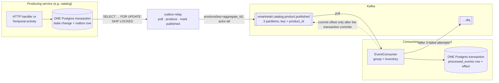
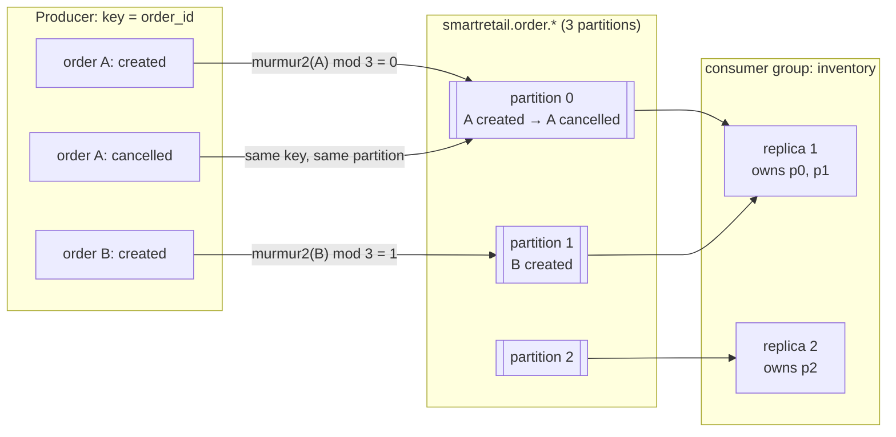
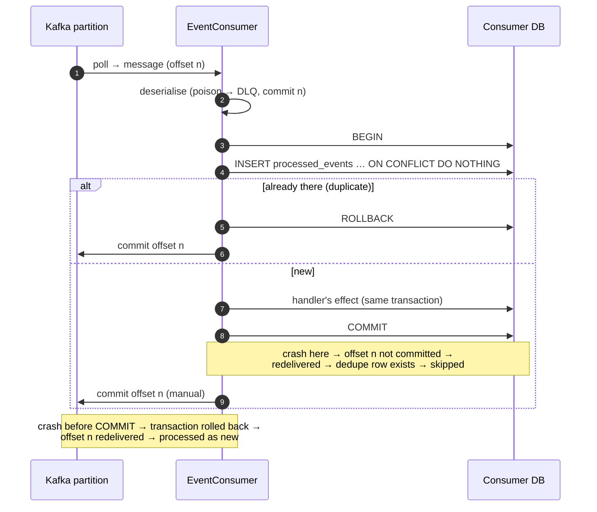
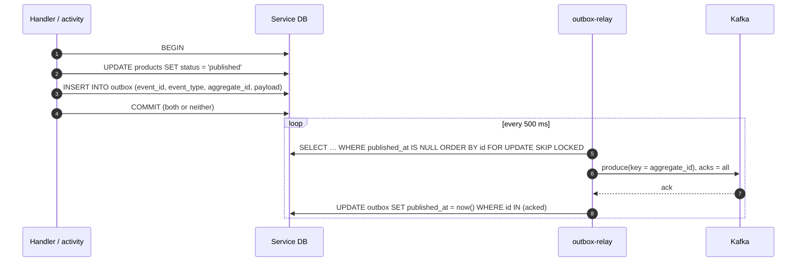
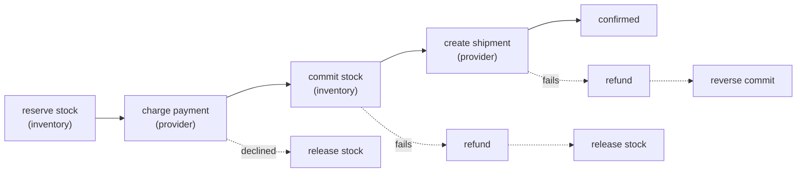
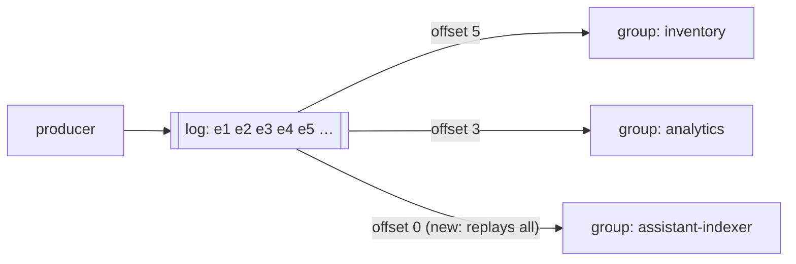
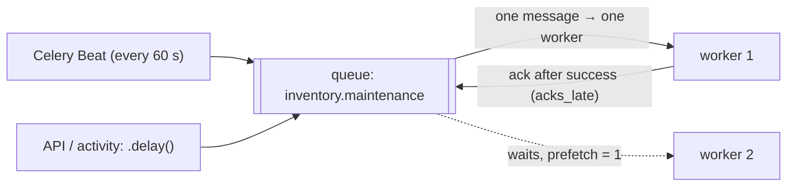
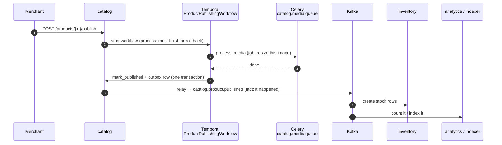
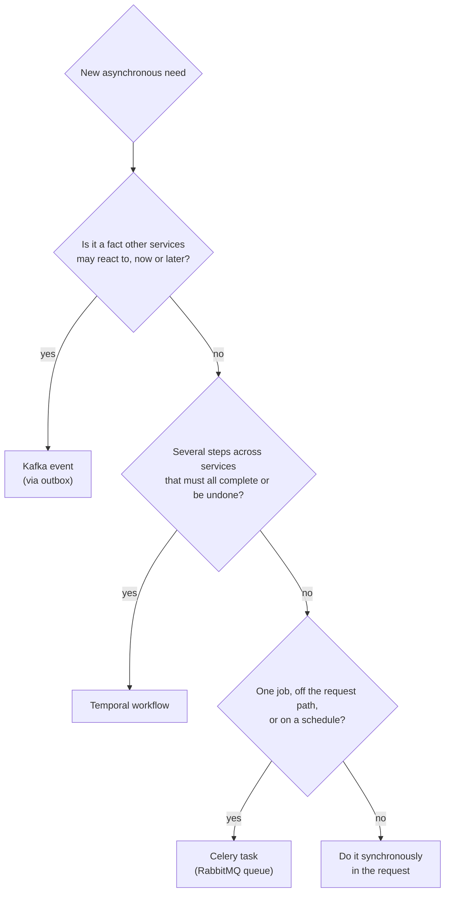

# Messaging and consistency

This page answers the questions from the
[mentor review of 2026-10-13](reviews/mentor-reviews.md#review-of-2026-10-13)
about Kafka, RabbitMQ, Celery and Temporal:

- how events are partitioned;
- when an offset is committed and when a message is retried;
- what happens to a duplicate;
- how a change stays atomic across a database and a broker;
- how each queue works;
- why the platform uses more than one messaging tool.

Each section opens with the short answer, then explains the mechanism, then
names the alternative and why it was not used. The binding versions are the RFC
rows linked at the end of each section. This page puts them in one place.

| Review point | Section |
| --- | --- |
| §1 Kafka partitioning, which method | [1. Partitioning](#1-partitioning) |
| §2 Kafka commit and retry, on what basis | [2. Offset commit and retry](#2-offset-commit-and-retry) |
| §3 Duplicate events from retries | [3. Duplicates](#3-duplicates) |
| §4 Atomicity | [4. Atomicity](#4-atomicity) |
| §8 Queue methodology | [5. How each queue works](#5-how-each-queue-works) |
| §7 Why Kafka *and* RabbitMQ, and Celery, and on what basis | [6. Why each tool](#6-why-each-tool) |
| What runs today | [7. Implementation status](#7-implementation-status) |

The whole event path in one picture:

---

## 1. Partitioning

**Short answer.** We use **key-hash partitioning**. Every event is produced with
a key, which is the id of the entity the event is about: `product_id`,
`order_id`, `variant_id` or `user_id`. Kafka's default partitioner takes
`murmur2(key) mod partitions`, so every event for one entity lands on the same
partition. Kafka guarantees order within a partition, so **all events for one
order are consumed in the order they happened**. Events for different orders run
in parallel on different partitions.

**Why this matters.** Take `order.created` then `order.cancelled` for the same
order. A consumer that sees them in the wrong order would act on a cancelled
order as if it were live. With the key equal to `order_id`, both events are on
one partition, and one consumer in the group reads them in sequence.

| Topic family | Key | Why that key | Consumers (group) |
| --- | --- | --- | --- |
| `identity.*` | `user_id` | A merchant's status changes must apply in order | `catalog`, `analytics`, `notification` |
| `catalog.product.*` | `product_id` | published → updated → unpublished for one product must not be reordered | `inventory`, `analytics`, `assistant-indexer` |
| `order.*`, `payment.*`, `shipment.*` | `order_id` | The whole lifecycle of one order is one ordered stream | `inventory` (cancel), `notification`, `analytics` |
| `inventory.*` | `variant_id` | Stock for one variant is one ordered stream | `analytics`, `notification` |
| `assistant.interaction` | `conversation_id` | Turns of one conversation stay in order | `analytics` |

**The numbers.** Each topic has 3 partitions and replication factor 1, because
the local stack runs a single broker. Three partitions are on purpose. With one
partition, the per-key ordering design would never be exercised, and multi-
partition rebalancing would never be tested. A consumer group can run up to 3
replicas; Kafka assigns the partitions among them using the
**cooperative-sticky** strategy, so a rebalance moves only the partitions that
must move.

**Where the key comes from in code.** The outbox row has an `aggregate_id`
column. The relay uses that column as the Kafka key. Producers set it in
[`services/catalog/app/v1/products/events.py`](../services/catalog/app/v1/products/events.py),
[`services/order/app/v1/orders/events.py`](../services/order/app/v1/orders/events.py)
and [`services/inventory/app/v1/stock/events.py`](../services/inventory/app/v1/stock/events.py).

**Alternatives rejected.**

| Method | Why not |
| --- | --- |
| Round-robin (no key) | Spreads load evenly, but loses all ordering: `order.cancelled` can be consumed before `order.created` |
| Custom partitioner (e.g. by merchant) | One large merchant becomes a hot partition, and it gives nothing the entity key does not already give |
| One partition per topic | Total order, but no parallelism, and multi-partition behaviour is never tested |
| Global ordering | Not needed: no business rule depends on the order of events for *different* entities |

Binding: [RFC 0000 §3.1.2.3](rfcs/0000-architecture.md#3123-event-catalogue) (C3), ARC-D13;
[RFC 0001 §3.1.3.3](rfcs/0001-platform-and-shared-infrastructure.md#3133-kafka-topic-configuration), PLT-D8.

---

## 2. Offset commit and retry

**Short answer.** Auto-commit is **off**. The consumer commits a message's offset
only after one of two things has happened:

- the message's effect has been durably committed to the consumer's own database;
- the message has been parked on the dead-letter topic.

Retry decisions depend on **what kind of failure** it is, not on a fixed count
alone.

**Why not auto-commit.** With `enable.auto.commit=true` the client commits
offsets on a timer, whether or not processing finished. Suppose the consumer
crashes after the timer fires but before its database write commits. The offset
says "done", the effect never happened, and the event is lost. Committing by hand
after the transaction moves the risk the other way. A crash can then only cause a
**re-delivery**, and re-delivery is handled by dedupe ([§3](#3-duplicates)).

**The basis for retrying.**

| What failed | Example | What the consumer does | Why |
| --- | --- | --- | --- |
| The message cannot be read (poison) | Avro deserialise fails, or the event type is unknown | Send to `<topic>.dlq` at once, then commit the offset | Waiting will not fix a malformed message. A poison message must never stop a partition |
| A dependency is down | Database lock timeout, or a downstream service unreachable (`DependencyUnavailable`) | Roll back, **pause the partition**, back off from 0.5 s up to 8 s, then retry. The attempt is **not counted** | The message is fine; the world is not. Dead-lettering would only mean replaying it by hand later |
| Anything else (a transient error) | An unexpected exception in the handler | Roll back, count the attempt, retry with exponential backoff, at most 3 attempts. Then send to `<topic>.dlq` and commit the offset | A bounded retry absorbs a blip. After that, park the message so the rest of the partition keeps flowing |

A dead-lettered message keeps its original key, value and headers. It gains
these headers:

- `dlq.error.class`
- `dlq.error.message`
- `dlq.attempts`
- `dlq.consumer_group`
- `dlq.failed_at`

Replay is a deliberate action (`make dlq-replay`), never automatic, because
replaying a poison message automatically is an infinite loop. A replayed event
that had in fact succeeded is harmless, because of dedupe.

**Producer side (the relay).** The producer sets `acks=all`, so the broker
acknowledges only once the write is replicated. It also sets
`enable.idempotence=true` with `max.in.flight.requests.per.connection=5`, so the
broker drops the producer's own internal retries and they are never reordered.
The relay marks an outbox row published **only after Kafka acknowledged it**. If
the broker or the registry fails, the relay rolls back the batch and retries with
backoff from 0.5 s, doubling up to 30 s. Rows stay in Postgres meanwhile, so a
Kafka outage never blocks checkout.

Binding: [RFC 0001 §3.1.1.6](rfcs/0001-platform-and-shared-infrastructure.md#3116-kafka--schema-registry)
(producer and consumer configuration), the consumer flowchart in RFC 0001 §3.1.1.1,
PLT-D5, PLT-D6.

---

## 3. Duplicates

**Short answer.** We accept that a message can be delivered more than once
(**at-least-once**), and make every consumer **idempotent**:

1. Every event carries a unique `event_id`.
2. Before acting, the consumer runs
   `INSERT INTO processed_events (consumer_group, event_id) … ON CONFLICT DO NOTHING`.
   The primary key is `(consumer_group, event_id)`.
3. This insert and the effect run **in the same database transaction**.
4. If the insert hits a conflict, the event was already handled. The consumer
   rolls back, commits the offset and moves on.

This works because the row and the effect commit or roll back together. There
is no moment in which the effect is done but the row is missing, or the row is
written but the effect is missing.

**Where duplicates come from, and what stops each one.** Duplicates are not only
a Kafka problem. Each place that retries has its own guard. Most of these
already run today.

| Duplicate source | Guard | Where |
| --- | --- | --- |
| The relay crashes after Kafka acks but before it marks the row published, then republishes on restart | `processed_events` dedupe in the consumer | `common/smartretail_common/events/dedupe.py` |
| The consumer crashes after its commit but before the offset commit, so the message is redelivered | Same | Same |
| A replay from the DLQ of an event that had in fact succeeded | Same | Same |
| A client retries `POST /orders` (double click, network retry) | `Idempotency-Key` header. `(user_id, key)` is claimed with `ON CONFLICT DO NOTHING`; a retry gets the stored reply back, and a different body with the same key gets 422 | [`services/order/app/v1/orders/idempotency_repo.py`](../services/order/app/v1/orders/idempotency_repo.py) |
| The same workflow is started twice | Temporal workflow id `order-{order_id}` with `REJECT_DUPLICATE` | `services/order/app/v1/orders/workflows/client.py` |
| Temporal retries an activity after a timeout | The provider gets a deterministic key, `order-{id}:charge` / `:refund` / `:shipment`, so the provider dedupes | `services/order/app/v1/orders/workflows/activities.py` |
| A reservation is retried | Unique `(order_id, variant_id)`, so the second attempt returns the first reservation | `services/inventory/app/v1/reservations/models.py` |
| A status transition is replayed | A transition to the state already in effect is a no-op | `OrderRepo.advance`, `mark_published` |
| The relay produces twice within one session | Idempotent producer (`enable.idempotence=true`) | `common/smartretail_common/events/producer.py` |

**Compacted topics need one more rule.** `catalog.product.published` keeps the
latest event per key forever. A replay can therefore reach events older than the
30-day `processed_events` retention. Handlers of compacted topics must also be
idempotent **by state**, as an upsert. Inventory's stock initialisation is an
`INSERT … ON CONFLICT DO NOTHING` for this reason.

**Why not Kafka exactly-once?** Kafka transactions make *Kafka → Kafka* pipelines
exactly-once. Our effects are Postgres writes and, later, emails, and Kafka's
transaction cannot include them. Dedupe in the effect's own database is the only
mechanism that covers the whole path.

Binding: [RFC 0000](rfcs/0000-architecture.md) A11, ARC-D12, ARC-D15;
[RFC 0001](rfcs/0001-platform-and-shared-infrastructure.md) PLT-D5.

---

## 4. Atomicity

There are two different atomicity questions.

### 4.1 Inside one service: the state change and its event

**Short answer.** We use the **transactional outbox**. A service never writes to
its database and then publishes to Kafka, because two writes to two systems can
half-succeed. It writes the state change and an `outbox` row **in one local
Postgres transaction**. A separate `outbox-relay` publishes the rows afterwards.

| Crash point | Dual write (`db.commit(); kafka.send()`) | Outbox |
| --- | --- | --- |
| Before the DB commit | Nothing happened, which is fine | Nothing happened, which is fine |
| After the DB commit, before the publish | **State changed, event lost forever**: inventory never learns the product exists | The row is in the outbox; the relay publishes it later |
| After the publish, before the relay marks the row | — | Published again on restart, absorbed by dedupe ([§3](#3-duplicates)) |

The writer is
[`common/smartretail_common/outbox.py`](../common/smartretail_common/outbox.py).
It adds the row to the caller's session and never commits by itself. Callers
include catalog's `publishing_repo.py`, order's `repo.py` and inventory's
`reservations/repo.py`.

The relay works like this:

- `FOR UPDATE SKIP LOCKED` lets two relay replicas share a table without taking
  the same row.
- A Postgres advisory lock keeps one active relay per database, so order across
  batches is preserved.
- A row that cannot be serialised is held per aggregate, so later events for
  that aggregate are not published out of order.

### 4.2 Across services: one business operation

**Short answer.** We use **no distributed transaction**. A business operation
that spans services is a **saga run by Temporal**. Each step is a local
transaction in its owning service. If a later step fails, Temporal runs the
**compensations** of the earlier steps in reverse.

Checkout is the main example
([`services/order/app/v1/orders/workflows/order_workflow.py`](../services/order/app/v1/orders/workflows/order_workflow.py)):

Temporal stores the workflow's progress durably. If the worker dies mid-saga,
another worker resumes at the same step. The question "where is order X?" is
answered by a query (`GET /api/v1/orders/{id}/workflow`), not by piecing
together logs. Compensation activities retry for up to an hour, because a
compensation that gives up is worse than one that is late.

### 4.3 The gap between the two, and how it is closed

The order service commits the order and then starts its workflow. These are two
systems, Postgres and Temporal, so a crash between them leaves an order that is
`pending` and has no workflow. The fix is `resume_unstarted_orders`, a Celery
Beat task (ORD-9). It runs periodically and does the following:

- It finds `pending` orders older than 30 s with no `workflow_run_id`.
- It starts their workflow.
- If the workflow already exists (`REJECT_DUPLICATE`), it treats that as
  success.

This is the outbox idea again, with the order row playing the outbox row's part.
Catalog has the same pattern. It compensates on the spot: a failed start returns
the product to draft.

**Alternatives rejected.**

| Option | Why not |
| --- | --- |
| Two-phase commit (XA) across services | Couples every service's availability to every other's. Kafka and Temporal do not take part in XA anyway |
| Dual write | Loses events on a crash (table above) |
| Kafka transactions | Cover Kafka only, not the Postgres write |
| CDC (Debezium) instead of a polling relay | Removes the polling, but adds a connector cluster and WAL configuration. The polling relay is about 200 lines we can test; CDC is the upgrade path if latency matters |
| Choreography (services react to each other's events) instead of a saga | No single place shows where an order is stuck, and compensation logic is spread over six consumers |

Binding: [RFC 0000](rfcs/0000-architecture.md) A10, ARC-D11, ARC-D12;
[RFC 0001](rfcs/0001-platform-and-shared-infrastructure.md) PLT-D1;
[RFC 0005](rfcs/0005-order-service.md) ORD-9.

---

## 5. How each queue works

The three tools look alike from far away: "something puts a message in, something
else takes it out". They behave differently.

### 5.1 Kafka is a log

A Kafka topic is an **append-only log** split into partitions. Reading does not
delete anything. Each **consumer group** keeps its own bookmark (the committed
offset) per partition. Messages stay for the retention period (7 days), or
forever on compacted topics.

- **Fan-out at no cost.** Inventory, analytics and the indexer each read every
  `catalog.product.published` event, at their own pace, with no copying.
- **Replay.** A new consumer group starts from `earliest` and reads history. A
  consumer that was down catches up from its offset.
- **Scaling inside a group.** Partitions are divided among a group's replicas,
  so parallelism is at most the partition count.
- **Ordering per partition**, so per key ([§1](#1-partitioning)).

### 5.2 RabbitMQ (with Celery) is a work queue

A RabbitMQ queue holds **tasks waiting to be done**. Each message goes to
**exactly one** worker (competing consumers), and it is **deleted once the
worker acknowledges it**. Nobody else can read it later.

- **Late acknowledgement** (`task_acks_late=true`). The worker acks after the
  task finishes, not when it receives it. If the worker is killed mid-task,
  RabbitMQ redelivers it to another worker. That is why every task must be
  idempotent.
- **Prefetch 1** (`worker_prefetch_multiplier=1`). A worker takes one task at a
  time, so a 30-second media job does not hoard tasks that idle workers could
  take.
- **One durable queue per workload**, for example `inventory.maintenance` or
  `order.maintenance`. A burst on one queue cannot starve another. Messages are
  persistent and survive a broker restart.
- **Beat** is Celery's scheduler. It puts a task on a queue on a timetable, for
  example every 60 s.
- **No DLX.** After its retries run out, a task is logged as failed. The owning
  service's domain record (a failed delivery attempt, a still-`pending` order) is
  the audit trail.

### 5.3 Temporal task queues are a durable process

Temporal also has "task queues", but what it stores is a **workflow's event
history**: which steps ran, with what result. Workers poll the task queue
(`catalog-publishing`, `order-lifecycle`) for the next step. Temporal does the
following:

- retries each activity under its own policy;
- times out activities that hang;
- resumes the workflow on another worker after a crash;
- answers queries about its current state.

What it offers is not "deliver this message" but "**finish this process, or
compensate it, and tell me where it is**".

---

## 6. Why each tool

**Short answer.** They answer three different questions. Using one tool for
another tool's question is a known anti-pattern.

| | **Kafka** | **RabbitMQ + Celery** | **Temporal** |
| --- | --- | --- | --- |
| Question it answers | "**This happened.** Whoever cares should react, and I should not need to know who." | "**Do this job** soon, off the request path, and retry it if it fails." | "**This multi-step process** must complete or compensate, and I need to know where it is." |
| Model | Log, pub/sub | Work queue, point-to-point | Durable workflow / saga |
| Who receives | Every consumer group | Exactly one worker | Workflow worker |
| After consumption | Kept (7 days or compacted) | Deleted | History kept (7 days) |
| Replay or new consumer reads history | Yes | No | No (re-run the workflow) |
| Ordering | Per key | None (and not needed) | Steps run in code order |
| Retry | Consumer base: 3 attempts, then DLQ | Per task: `autoretry_for`, backoff, `max_retries=3` | Per activity: retry policy, timeouts, compensation |
| Schema governance | Avro + Schema Registry, `BACKWARD` | None (ids only, JSON) | Typed workflow input |
| Producer knows the consumer? | **No** | Yes (it names the task) | Yes (it names the workflow) |
| In SmartRetail | Domain events: `catalog.product.published`, `order.cancelled`, `inventory.stockout`, … | Scheduled sweeps (expired reservations, unstarted orders, dedupe retention); media processing; notification dispatch; bulk AI generation | Product publishing, the order saga |
| Wrong for | Orchestrating a saga: no workflow state, no compensation | Broadcasting facts: no fan-out, no replay, no schema | Broadcasting facts to unknown consumers; one-shot jobs (too heavy) |

**One feature, all three tools.** Publishing a product uses each tool for its own
job.

- The **process** (validate → media → search doc → stock → publish, with
  roll-back to draft on failure) needs durable state and compensation, so it
  runs on **Temporal**.
- **Resizing an image** is one idempotent job with a retry. Giving it a
  workflow of its own would be too heavy, so it runs on **Celery**
  (`catalog.media`). The activity enqueues it and waits for the result over
  RabbitMQ, so Temporal still owns the retry and the compensation.
- **"Product X is published"** is a fact that three services react to, and the
  catalog should not know or care which three. It goes on **Kafka**.

**The basis for choosing, as a decision flowchart.**

**"Kafka and RabbitMQ both move messages. Why not one of them?"**

| Option | What breaks |
| --- | --- |
| **RabbitMQ for everything** | Events are deleted once consumed. A consumer added later (the indexer, an analytics backfill) cannot read history. Fan-out needs one queue per consumer, declared by the producer, so the producer must know its consumers. There is no schema registry. |
| **Kafka for everything** (tasks too) | No per-message ack or retry. One slow media job blocks every message behind it on its partition, because Kafka redelivers by offset rather than per message. No scheduler (Beat). No per-task time limits. Parallelism is capped by the partition count. |
| **Celery chains instead of Temporal** | A chain keeps no durable state. If the worker dies after "charge" and before "commit", nothing knows the order is half done, and nothing runs the refund. |
| **Temporal for everything** | Temporal is heavy for a one-line sweep, and it cannot broadcast to consumers it does not know. |

Part A's tech stack names all of Kafka, RabbitMQ/Celery and Temporal. What has
to be defended is that each has a distinct job that the other two do badly.

Binding: [RFC 0000](rfcs/0000-architecture.md) A12, ARC-D11 and the justification
table in §3.2.2; [RFC 0001](rfcs/0001-platform-and-shared-infrastructure.md)
PLT-D10 and §5 Alternatives 1–6.

---

## 7. Implementation status

| Piece | Status |
| --- | --- |
| Transactional outbox writer (catalog, order, inventory) | Running since Milestone 2 |
| Temporal: publishing workflow and order saga, with compensations | Running since Milestone 2 |
| `Idempotency-Key`, `REJECT_DUPLICATE`, provider keys, unique reservations | Running since Milestone 2 |
| Kafka (KRaft) + Schema Registry, topics and DLQs from `catalogue.json` (`make topics`) | Milestone 3 |
| `outbox-relay` for identity, catalog, order, inventory and assistant | Milestone 3 |
| `EventConsumer` base: pluggable dedupe store (Postgres `processed_events`, Mongo for analytics), manual commit, retry, DLQ, waits on outages | Milestone 3 |
| `inventory` consumer: `catalog.product.published`, `order.cancelled` | Milestone 3 |
| Write-time payload validation: the outbox writer refuses a payload that does not match its Avro schema | Milestone 3 |
| RabbitMQ + Celery: `sweep_expired_reservations`, `resume_unstarted_orders`, `sweep_processed_events` | Milestone 3 |
| `process_media` on the Celery `catalog.media` queue, result over RabbitMQ (`rpc://`) | Milestone 3 |
| `make dlq-replay`; CI schema-compatibility check against `main` (`make schemas-check`) | Milestone 3 |
| `notification` consumer: order, payment, shipment, stockout and registration events → notifications, live over SSE (Redis fan-out) | Milestone 3 |
| `analytics` consumer (MongoDB, every topic) and its DLQ observer | Milestone 3 |
| `assistant-indexer` consumer (`catalog.product.*` → pgvector), and `assistant.interaction` produced | Milestone 3 |
