# RFC 0002 — `gateway` Service

| | |
| --- | --- |
| **Owner** | @muhammad.adnan |
| **Collaborators** | SarwanAhmed |
| **Status** | **DRAFT** · IN-REVIEW · DONE |
| **Created** | Sep 29, 2026 |
| **Supersedes** | The gateway content of [archive/0000-system-architecture.md](archive/0000-system-architecture.md), [archive/0001-foundation-and-core-services.md](archive/0001-foundation-and-core-services.md), [archive/0003-events-and-observability.md](archive/0003-events-and-observability.md), [archive/0004-retrieval-layer.md](archive/0004-retrieval-layer.md), [archive/0005-ai-assistant-and-streaming.md](archive/0005-ai-assistant-and-streaming.md), and [archive/0006-service-decomposition-and-data-model.md](archive/0006-service-decomposition-and-data-model.md) |
| **Depends on** | [RFC 0000 — Architecture](0000-architecture.md) · [RFC 0001 — Platform and Shared Infrastructure](0001-platform-and-shared-infrastructure.md) · [RFC 0003 — `identity`](0003-identity-service.md) (token format, public key) · every upstream it routes to: [0004](0004-catalog-service.md), [0005](0005-order-service.md), [0006](0006-inventory-service.md), [0007](0007-notification-service.md), [0008](0008-analytics-service.md), [0009](0009-assistant-service.md) |

> **Reading note.** This RFC specifies the `gateway` — the single public entry point at `:8000` — in full: its routing table, its early token rejection and coarse role checks, correlation and trace headers, `X-Client-Id` handling, CORS, rate limiting, SSE pass-through, aggregated OpenAPI, health, upstream timeouts, error normalisation and request size limits. It is the one service with no store, by deliberate exception to the ownership test. Cross-cutting rules — the ownership test, boundary rules R1–R8, the authentication/authorisation split, decisions A1–A14, API conventions and the event envelope — are defined once in [RFC 0000](0000-architecture.md) and are referenced here, not restated. Redis, the OTel stack and `common` (JWT verification, problem details, logging) are hosted and specified in [RFC 0001](0001-platform-and-shared-infrastructure.md).

---

## Contents

1. [Title](#1-title)
2. [Overview](#2-overview)
   - 2.1. [Goals](#21-goals)
   - 2.2. [Non-goals](#22-non-goals)
3. [Solution Overview](#3-solution-overview)
   - 3.1. [Specification](#31-specification)
     - 3.1.1. [Architectural changes](#311-architectural-changes)
       - 3.1.1.1. [Responsibility and boundaries](#3111-responsibility-and-boundaries)
       - 3.1.1.2. [Domain model](#3112-domain-model)
       - 3.1.1.3. [State machines](#3113-state-machines)
       - 3.1.1.4. [Workflows and async jobs](#3114-workflows-and-async-jobs)
       - 3.1.1.5. [Dependencies and degradation](#3115-dependencies-and-degradation)
       - 3.1.1.6. [Configuration](#3116-configuration)
       - 3.1.1.7. [Observability](#3117-observability)
     - 3.1.2. [API changes](#312-api-changes)
       - 3.1.2.1. [Endpoints](#3121-endpoints)
       - 3.1.2.2. [Role matrix](#3122-role-matrix)
       - 3.1.2.3. [Events produced](#3123-events-produced)
       - 3.1.2.4. [Events consumed](#3124-events-consumed)
     - 3.1.3. [Data/schema changes](#313-dataschema-changes)
     - 3.1.4. [Breaking changes](#314-breaking-changes)
     - 3.1.5. [Action Plan](#315-action-plan)
   - 3.2. [Rationale](#32-rationale)
     - 3.2.1. [Decision register](#321-decision-register)
     - 3.2.2. [Reasoning](#322-reasoning)
   - 3.3. [Tradeoffs](#33-tradeoffs)
     - 3.3.1. [Challenges and Open Questions](#331-challenges-and-open-questions)
4. [Dependencies/blockers/known issues](#4-dependenciesblockersknown-issues)
5. [Alternate solutions](#5-alternate-solutions)
6. [Production readiness](#6-production-readiness)
   - 6.1. [Scalability and Fault tolerance](#61-scalability-and-fault-tolerance)
   - 6.2. [Security considerations](#62-security-considerations)
   - 6.3. [Deployment strategy](#63-deployment-strategy)
7. [Test Plan](#7-test-plan)
8. [Impact Analysis](#8-impact-analysis)
9. [Useful Links/References](#9-useful-linksreferences)
10. [Related tickets/issues](#10-related-ticketsissues)
11. [Notes](#11-notes)
12. [Comments](#12-comments)

---

## 1. Title

**The `gateway` service — SmartRetail's stateless public edge: routing, early token rejection, correlation and tracing, device-id pass-through, CORS, rate limiting, SSE pass-through, aggregated documentation, and uniform upstream error handling.**

The gateway is a hand-written FastAPI proxy on port `8000`. Every public route in the platform is versioned under `/api/v1` and reached through it ([RFC 0000 surface map](0000-architecture.md#3121-surface-map)). It owns no data, contains no business rule, and is never the security boundary: every service behind it re-verifies the token and makes its own authorisation decision (A5).

---

## 2. Overview

Eight services each expose an HTTP API. A client — browser, mobile app, test harness — should not need to know eight ports, and several concerns must be applied identically to every request regardless of which service answers it:

- a correlation identifier generated once and carried everywhere (A8, C12);
- CORS, which a browser applies per origin, not per service;
- rate limiting, which must count across services and across replicas (C13);
- early rejection of unauthenticated or obviously unauthorised traffic, so that floods of bad tokens are cheap;
- streaming pass-through for the two SSE surfaces (notification push, assistant answers), which fails silently if any proxy on the path buffers;
- one documentation page for the whole API;
- one error shape for the failures no upstream can report itself — the upstream being down, slow, or broken.

Duplicating these into eight services multiplies both code and drift; hiding them in a proxy configuration nobody reviews hides the decisions ([archive/0000](archive/0000-system-architecture.md) §5 Alternative 7; [archive/0006](archive/0006-service-decomposition-and-data-model.md) §3.1.1). The gateway is the one place they live. Its existence is the only exception to the ownership test, and the exception is bounded by one rule: **the gateway holds no business logic and no database**, and any authorisation decision requiring domain knowledge stays in the service that owns the resource.

### 2.1. Goals

| # | Goal | How it is verified |
| --- | --- | --- |
| GW-G1 | One public entry point: every `/api/v1` route in the platform is reachable at `:8000`, routed by path prefix to its owning service | Route-table test enumerates every prefix in [§3.1.2.1](#3121-endpoints) and asserts the upstream; E2E suite runs entirely through `:8000` |
| GW-G2 | Missing, malformed, expired, wrongly-signed, or service-scoped tokens are rejected at the edge with RFC 9457 `401`/`403`, without a network call to `identity` | Unit and integration tests per rejection reason; a test asserts zero calls to `identity` on the request path |
| GW-G3 | The gateway is never the only check — every upstream is safe to call directly | For each role-gated route, a test calls the upstream directly (bypassing the gateway) with a disallowed token and asserts the upstream's own `403` |
| GW-G4 | Every response — success, upstream error, gateway error — carries `X-Request-ID`, whose value is the OTel trace ID, and `traceparent` | Response-header assertion across the whole E2E suite; one request's trace ID appears in gateway and upstream log lines |
| GW-G5 | Rate limits enforced per route class, across replicas, returning `429` problem details with `Retry-After`; fail open on Redis failure | Threshold, window-recovery, per-scope-isolation and Redis-down tests ([§7](#7-test-plan)) |
| GW-G6 | SSE is passed through unbuffered: the first frame reaches the client as soon as the upstream writes it | Measured through the gateway: notification push within one second of consumption; assistant time-to-first-token p95 < 1.5s over 20 requests |
| GW-G7 | A client disconnect is propagated to the upstream immediately, so an abandoned assistant stream stops costing money | Fake-provider cancellation record asserted after a client disconnect through the gateway |
| GW-G8 | Upstream failures are normalised: `502`/`503`/`504` as RFC 9457 problem details, never a hang, a stack trace, or a bare proxy error page | Fault-injection tests: upstream stopped, upstream slow, upstream returning garbage |
| GW-G9 | One aggregated OpenAPI document and `/docs` page for the whole platform, degrading gracefully when an upstream is down | `/openapi.json` contains every upstream's paths; with one upstream stopped it still serves the rest and marks the missing one |
| GW-G10 | The gateway owns no state: any replica serves any request; no database, no local session, no sticky routing | Two gateway replicas behind Compose; rate-limit counters are shared; killing one loses nothing but its in-flight requests |

### 2.2. Non-goals

| Excluded | Why / where it lives instead |
| --- | --- |
| Authorisation decisions that need domain knowledge — ownership, merchant scoping, "may this merchant edit this product" | The owning service ([RFC 0000 §3.1.1.4](0000-architecture.md#3114-authentication-and-authorisation-split)). The gateway only checks "is there a valid token" and a coarse route-level role |
| Token issuance, refresh, revocation, key custody | `identity` alone ([RFC 0003](0003-identity-service.md)). The gateway holds the public key only |
| Any database, cache of business data, or response caching | No store by design. Browse and inventory read caching is done by `catalog` and `inventory` in their own Redis keyspaces ([RFC 0004](0004-catalog-service.md), [RFC 0006](0006-inventory-service.md)) |
| LLM token budgets | `assistant` ([RFC 0009](0009-assistant-service.md), E10). The gateway limits *request rate*; `assistant` limits *spend* |
| SSE stream authentication (ticket redemption), catch-up, heartbeats, per-user stream caps | `notification` ([RFC 0007](0007-notification-service.md), C18–C22). The gateway only passes the stream through |
| Generating `X-Client-Id` | The client mints it (C21). The gateway validates shape and passes it through |
| WebSockets | No surface needs bidirectionality (E4, C15). The gateway does not support `Upgrade` |
| TLS termination | Plain HTTP inside Compose; TLS is an environment concern outside scope ([RFC 0000](0000-architecture.md) §6.2) |
| Response compression | Not needed at local scale, and a compression middleware is precisely the component that buffers `text/event-stream` (GW-6) |
| Circuit breakers | Not built; timeouts and fast connect failures cover the current upstream count. Recorded as GW-Q2 |
| Service-to-service traffic | In-network callers (`temporal-worker`, `order → catalog`, `assistant` hydration) call services directly on the Compose network, not through the public edge |
| Load testing and performance targets | None specified in Parts A or B; capacity statements in §6.1 are structural |

---

## 3. Solution Overview

### 3.1. Specification

**Diagram index.** Every diagram in this RFC, by kind. The gateway has no persisted entity, so its one state diagram is the in-memory stream lifecycle, and its data diagram shows caches and counters rather than tables.

| Kind | Diagram | Section |
| --- | --- | --- |
| Component | Position in the topology | [§3.1.1.1](#3111-responsibility-and-boundaries) |
| Component | Internal components | [§3.1.1.1](#3111-responsibility-and-boundaries) |
| Flow | Request pipeline, stages 1–10 | [§3.1.1.1](#3111-responsibility-and-boundaries) |
| Flow | Auth-policy decision | [§3.1.1.2](#3112-domain-model) |
| Flow | Upstream response handling | [§3.1.2.1](#3121-endpoints) |
| Sequence | Public key refresh (JWKS mode) | [§3.1.1.4](#3114-workflows-and-async-jobs) |
| Sequence | Fixed-window rate limit | [§3.1.1.4](#3114-workflows-and-async-jobs) |
| Sequence | OpenAPI aggregation | [§3.1.1.4](#3114-workflows-and-async-jobs) |
| Sequence | Proxied, authenticated request | [§3.1.2.1](#3121-endpoints) |
| Sequence | SSE pass-through with client disconnect | [§3.1.2.1](#3121-endpoints) |
| State | Proxied stream lifecycle | [§3.1.1.3](#3113-state-machines) |
| Data | Route table, key cache, rate-limit counters and headers | [§3.1.3](#313-dataschema-changes) |

#### 3.1.1. Architectural changes

##### 3.1.1.1. Responsibility and boundaries

**Position in the topology.** The gateway is the only public port. It talks to Redis for rate-limit counters only, and passes the two SSE surfaces (`notification`, `assistant`) through without buffering.

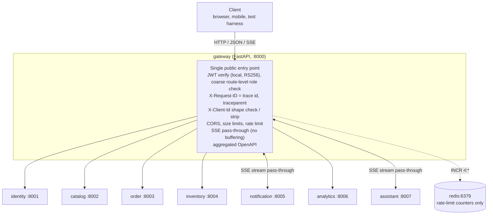

**What the gateway owns and what it does not.**

| Owns (behaviour, not data) | Does not own |
| --- | --- |
| The public route table: prefix → upstream, per-route auth policy, rate-limit classes, timeout class, body limit | Any row, document, or durable fact. It has no database and writes nothing that outlives a rate-limit window |
| Early token rejection: signature, expiry, algorithm, shape — local, against the cached public key | Token issuance, refresh, revocation, or the private key (`identity`) |
| Coarse route-level role checks (a *necessary* condition, never a sufficient one — GW-1) | Ownership, merchant scoping, visibility rules, state-machine guards (the owning service) |
| Correlation: `X-Request-ID` generation and echo; the edge span and `traceparent` injection | The trace backend and exporter configuration ([RFC 0001](0001-platform-and-shared-infrastructure.md)) |
| `X-Client-Id` shape validation and pass-through | Recording `client_id` in the outbox, the envelope field, `origin_client_id`, delivery scope (producers and `notification`) |
| CORS policy for the whole platform | — |
| Request-rate limiting and its `429` responses | LLM token budgets and their `429` (`assistant`); the 3-streams-per-user cap (`notification`) |
| Streaming pass-through for `text/event-stream`, disconnect propagation | The SSE frame contracts, ticket redemption, catch-up, heartbeat (`notification`, `assistant`) |
| The aggregated OpenAPI document and `/docs` | Each service's own OpenAPI, which it generates |
| Normalising failures no upstream can report: `502`, `503`, `504`, `413`, edge `401`/`403`/`404`/`429` | Every other error, which the upstream produces as RFC 9457 and the gateway passes through unchanged |

**Ownership-test row** (from [RFC 0000 §3.1.1.2](0000-architecture.md#3112-the-ownership-test)):

| # | Candidate | State it would own | Invariant | Independent change | Distinct profile | Verdict |
| --- | --- | --- | --- | --- | --- | --- |
| 1 | `gateway` | none | — | yes | edge concerns | **Service, by exception** |

It fails test 1 — it owns no state — and is a deliberate exception. Cross-cutting edge concerns (routing, early token rejection, correlation IDs, CORS, rate limiting, aggregated OpenAPI) must live in exactly one place; the alternatives are duplicating them into eight services or hiding them in a proxy configuration nobody reviews. **The exception is bounded by a rule: the gateway holds no business logic and no database, and any authorisation decision requiring domain knowledge stays in the service that owns the resource.** A reviewer who finds a domain literal (a product status, an order state, a merchant approval check) in `services/gateway/` has found a defect.

**Which rules and decisions bind it.**

| Rule / decision | How it applies to the gateway |
| --- | --- |
| R1 — a service reads and writes only its own database | Trivially satisfied: there is no database, and the gateway has no Postgres or Mongo credentials at all |
| R3 — a fact has exactly one writer | The gateway writes no fact. Rate-limit counters are ephemeral and are not facts in the R3 sense |
| R4 — cross-service reads go through an API or event | The gateway reads nothing from any service except each upstream's `/openapi.json` and the identity JWKS, both public HTTP surfaces |
| R5 — synchronous cross-service calls only where the caller cannot proceed | Proxying is not a cross-service call in the R5 sense — the gateway is on the client's request path, not a caller with a question of its own. It never calls two upstreams for one client request |
| R7 — a service may not require another to be up to serve reads it has data for | Token verification is local, so `identity` being down does not stop the gateway admitting authenticated traffic |
| R8 — `common` contains no business rule | The gateway uses `common` for JWT verification, the claim model, problem details, logging and tracing. The route table lives in `services/gateway/app/proxy/routing.py`, not in `common` |
| A4 — RS256; `identity` is the only signer | The gateway holds the public key only |
| A5 — every service re-verifies the token; the gateway rejects early and is not trusted | Defines the gateway's authorisation role. It forwards `Authorization` unchanged and never substitutes its own assertion (GW-5). (Archive 0001 recorded the same decision as its local A6.) |
| A6 — async all the way down | `async def` handlers; `httpx.AsyncClient` for upstream calls; `redis.asyncio` for counters |
| A7 — RFC 9457 problem details everywhere | Every response the gateway originates is a problem detail produced by the shared `common` handler (GW-11) |
| A8 — `X-Request-ID` in, `traceparent` out | The gateway is where the correlation ID is generated and first echoed |
| C11, C12 — trace context over HTTP; the trace ID replaces the request ID | The gateway creates the root server span and makes `X-Request-ID` an alias of its trace ID (GW-10) |
| C13 — Redis for gateway rate limiting | The only reason the gateway talks to Redis |
| C15, E4 — SSE, not WebSockets | The gateway supports streaming HTTP responses and does not support protocol upgrade |
| C19 — stream tickets instead of bearer headers on `EventSource` | The stream route has auth policy `ticket`: the gateway performs no bearer check on it and redacts the ticket from logs and spans (GW-18) |
| C21 — `X-Client-Id` is a correlator, never an identity | The gateway validates its shape, strips a malformed value, and never generates one or uses it for authorisation |

**Internal module layout.** The gateway follows the platform's entity-first layout ([RFC 0000 §3.1.1.7](0000-architecture.md#3117-module-structure-inside-a-service), [file-structure.md](../file-structure.md) §4–§5), with what it does not need left out. It owns no API contract, so it has **no `v<N>/` folders**: the `/api/v<N>/...` paths it accepts are rows in `proxy/routing.py` and are forwarded unchanged (the docstring of `app/router.py` records this). It owns no store and no domain, so it has no `models.py`, no `repo.py`, no `core/db.py`, no `core/enums.py`, no consumers and no `alembic/` — that absence is itself the structural statement of the ownership-test exception. Its "entities" are its three concerns: `health/` (operational probes), `docs/` (aggregated OpenAPI and Swagger UI) and `proxy/` (route table, edge auth, forwarding, upstream errors, and the catch-all route). `app/router.py` only includes their routers, and includes `proxy` last so the operational routes win. Correlation (`X-Request-ID`) and the RFC 9457 handlers come from `common`'s `install_platform`; the gateway adds only its edge CORS middleware, in `core/cors.py`.

```
services/gateway/
├── main.py                # create_application(): settings, route table, one pooled httpx client
│                          # per configured upstream, OpenAPI aggregator; lifespan loads the JWKS
│                          # (fails startup with no key); EdgeCORSMiddleware, then install_platform
├── Dockerfile
├── pyproject.toml
├── app/
│   ├── router.py          # includes only: /health, then /openapi.json + /docs, then the catch-all proxy
│   ├── core/
│   │   ├── config.py      # GatewaySettings (pydantic-settings over common), validated at startup
│   │   ├── cors.py        # allow-list CORS; preflight answered at the edge; headers on errors too (GW-19)
│   │   └── logger.py      # JSON logging over common
│   ├── docs/
│   │   ├── openapi.py     # OpenApiAggregator: concurrent fetch, namespacing, TTL cache (GW-15)
│   │   └── routes.py      # GET /openapi.json, GET /docs
│   ├── health/
│   │   └── routes.py      # GET /health, GET /health/ready (GW-16)
│   └── proxy/
│       ├── routing.py     # the route table (the single declarative source of §3.1.2.1),
│       │                  # Policy, RouteRule, RouteTable: most-specific pattern, then method
│       ├── auth.py        # enforce_policy(): auth policy + coarse role check over common JWT (GW-1..GW-3)
│       ├── forward.py     # header hygiene; streamed request and response bodies; no retries (GW-6, GW-14)
│       ├── errors.py      # gateway-originated problem types: 404, 405, 413, 502, 503, 504 (GW-11)
│       └── routes.py      # catch-all /{path}: route match → auth policy → forward → relay
└── tests/
    ├── unit/proxy/test_routing.py
    └── integration/test_gateway.py
```

This is the Milestone 1 tree. Stages that land in later milestones ([§3.1.5](#315-action-plan)) are added beside the concern they extend, not as new layers: correlation-as-trace-ID, size limit and rate limiting as edge middleware in `core/` ([file-structure.md](../file-structure.md) §5); `X-Client-Id` handling and the SSE relay in `proxy/`; `/metrics` as an operational route beside `health/`.

**Components.**

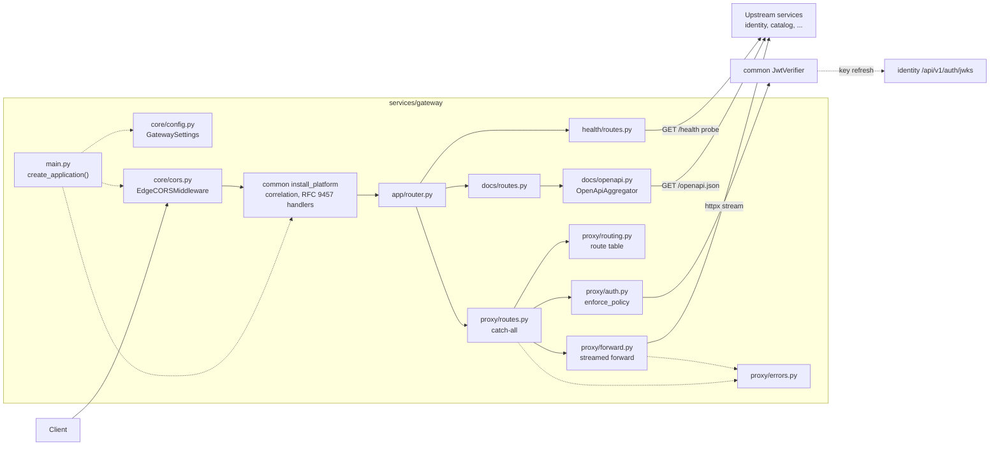

**The request pipeline.** Order matters: cheap, identity-free checks run first so that abusive traffic is rejected before any signature is verified, and per-subject limits run after authentication because they need the verified `sub`.

| # | Stage | Rejects with | Notes |
| --- | --- | --- | --- |
| 1 | Correlation | — | Start the edge server span; set `X-Request-ID` to its trace ID (GW-10). Everything after this stage — including every rejection — carries both headers |
| 2 | CORS preflight | — | `OPTIONS` with `Access-Control-Request-Method` is answered here and never proxied (GW-19) |
| 3 | Route match | `404 route-not-found` | Longest prefix, then method. Paths outside the table — including internal-only paths (GW-4) — never reach an upstream |
| 4 | Size limit | `413 payload-too-large` | `Content-Length` checked up front; chunked bodies counted while streaming (GW-14) |
| 5 | Per-IP rate limits | `429 rate-limited` | `default` and the anonymous classes (`login_ip`, `search_anon`, `chat_anon`). Exempt: the notification stream (GW-7) |
| 6 | `X-Client-Id` | — (never rejects) | Validate `^[A-Za-z0-9_-]{8,64}$`; strip if malformed (C21) |
| 7 | Auth policy | `401 invalid-token` / `403 forbidden` | Per the route's policy (§3.1.1.2); service tokens refused (GW-3) |
| 8 | Per-subject rate limits | `429 rate-limited` | `login_email`, `order_create`, `search_user`, `chat_user`, `generate`, `notif_ack` |
| 9 | Forward | `502` / `503` / `504` | Header hygiene, streamed bodies, per-class timeouts (GW-6, GW-11) |
| 10 | Relay response | — | Pass-through; SSE relayed frame-by-frame with no buffering; disconnect propagated (GW-12, GW-13) |

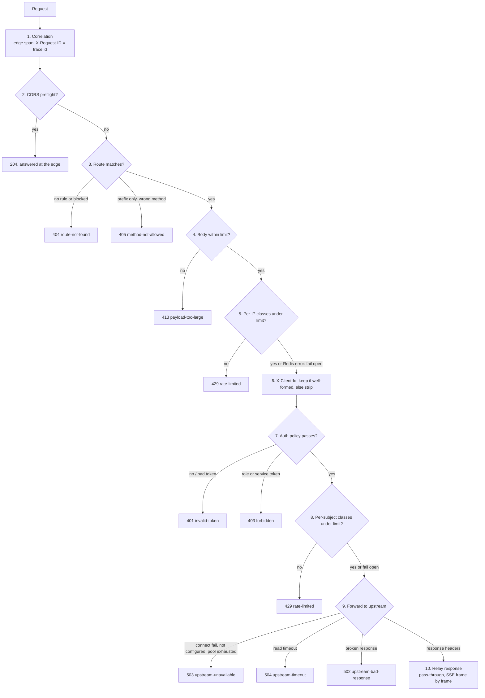

**Decisions specific to the gateway.** These extend, and do not contradict, A1–A14 ([RFC 0000 §3.1.1.5](0000-architecture.md#3115-cross-cutting-decisions-a1a14)).

- **GW-1 — Coarse checks are necessary conditions only.** A route-level role rule in the gateway may deny a request the owning service would also deny; it may never deny one the service would allow, and a gateway *allow* is never an authorisation. When the right rule depends on the row (owner, merchant scope, visibility), the gateway checks only authentication and leaves the rest to the service. This is what keeps the gateway's table from drifting into a second, divergent policy.
- **GW-2 — On optional-auth routes, a present token must be valid.** Public routes whose behaviour depends on the caller (`GET /products`, `/assistant/chat`) accept anonymous requests, but a request that *presents* a bearer token that fails verification is `401`, not silently downgraded to anonymous. Downgrading would show a merchant with an expired token the public view of their own catalogue and hide the fact that they need to refresh.
- **GW-3 — Service tokens are refused at the edge.** A token whose subject is a service (`sub: "service:…"`, carrying a `scope` claim and no user role — issued by `identity` from the client-credentials grant) is rejected with `403` on every gateway route. Service tokens exist for in-network callers only; a service token arriving from the public side is either a leak or a misconfiguration. Upstreams independently reject service tokens on user-facing routes.
- **GW-4 — Internal-only routes are not routed.** Every internal route in the platform lives under `/internal/v1/*` (for example `catalog`'s `/internal/v1/products/{id}/publish/*` and `inventory`'s `/internal/v1/inventory/reservations*` and `/internal/v1/inventory/stock-items`). They are called by `temporal-worker` and `celery-worker` on the Compose network with a service token. The gateway routes only `/api/v1/*`, so any `/internal/*` path answers `404` at the edge. This is defence in depth on top of the owning service's own scope check, and it is the reason internal routes do not appear in the public OpenAPI. Because the rule is a prefix, a new internal route needs no gateway change.
- **GW-5 — Identity is never forwarded as a header.** The gateway forwards `Authorization` unchanged and does not inject `X-User-Id`, `X-User-Role` or any other identity header; it strips any inbound `X-User-*` or `X-Internal-*` header so that no upstream can be tempted to trust one. Claims come from the verified token only (A5). An early design sketch had the gateway inject `X-User-*`; that is superseded by this decision.
- **GW-6 — Stream everything, buffer nothing, compress nothing.** Request bodies are streamed to the upstream and response bodies streamed to the client for every route, not only SSE routes, so there is no buffering path to forget to disable. The single exception is `POST /api/v1/auth/login`, whose body (≤ 16 KiB) is read to extract the email for its rate limit (GW-8) and then forwarded byte-for-byte. Bytes are never re-serialised — the HMAC-signed shipment webhook depends on it. The gateway applies no response compression and passes an upstream's `Content-Encoding` through untouched.
- **GW-7 — Rate limiting is a fixed-window counter in Redis, shared across replicas, and fails open.** Described in [§3.1.1.4](#3114-workflows-and-async-jobs) and [§3.1.2.1](#rate-limit-classes). Per-IP classes run before authentication, per-subject classes after. A Redis error admits the request, because a cache outage must not become an outage.
- **GW-8 — The login email is a rate-limit identifier, not stored PII.** The per-email login key uses `sha256(lower(trim(email)))` truncated to 32 hex characters, so Redis never holds an address. An unparseable body falls back to the per-IP limit alone and is forwarded for `identity` to reject.
- **GW-9 — The client IP is the socket peer.** `X-Forwarded-For` is honoured only when the peer is in `GATEWAY_TRUSTED_PROXIES` (empty by default: the gateway *is* the edge locally). Otherwise any client could rotate its apparent IP to escape per-IP limits.
- **GW-10 — `X-Request-ID` is the trace ID; the edge starts the trace.** The gateway starts a new root trace for every request by default and echoes its 32-hex trace ID as `X-Request-ID` (C12). An inbound `traceparent` from the public side is recorded as a span link, not adopted as parent, unless `GATEWAY_TRUST_INBOUND_TRACEPARENT=true`. An inbound `X-Request-ID` that is itself a valid, non-zero 32-hex trace ID is adopted as the new trace's ID, so a client that supplies a correlation ID sees the same value echoed; any other inbound value is kept as the log field and span attribute `client_request_id` and the generated trace ID is used.
- **GW-11 — Failures the gateway originates are RFC 9457; failures the upstream reports pass through.** An upstream response with `Content-Type: application/problem+json` is relayed unchanged whatever its status. A `5xx` from an upstream whose body is not a problem detail (a crashed worker's plaintext `500`, for instance) is wrapped in one, preserving the status. Transport failures map to `502`/`503`/`504` ([§3.1.2.1](#error-normalisation)).
- **GW-12 — A stream that breaks mid-flight ends with an explanation.** If the upstream connection fails after SSE headers have been sent, the gateway writes one terminal `event: error` frame carrying a `502` problem detail and closes. Both SSE contracts already define `error` as an RFC 9457 frame, so the client handles it with code it already has; the rule that "a stream never simply stops without explanation" then holds even when the upstream cannot keep it.
- **GW-13 — A client disconnect closes the upstream connection immediately.** On ASGI `http.disconnect` the relay cancels, calls `aclose()` on the upstream response, and discards the connection rather than returning it to the pool. The upstream observes a disconnect within one read, which is what makes `assistant` cancel generation and `notification` `UNSUBSCRIBE`.
- **GW-14 — Request bodies are bounded at the edge.** 1 MiB by default; 10 MiB on the media upload route. Oversize is `413` before a byte reaches the upstream. Each upstream keeps its own tighter validation (`catalog`'s media size ceiling, Pydantic length ceilings).
- **GW-15 — The aggregated OpenAPI document is merged on demand, cached briefly, and degrades per upstream.** A down upstream drops out of the document with a marker rather than failing `/docs`.
- **GW-16 — Readiness does not depend on upstreams or Redis.** `/health/ready` reports upstream and Redis reachability in its body, but its status depends only on the gateway itself (settings valid, public key loaded, route table built). Otherwise one stopped upstream — normal when a Compose profile is off — would take the whole public surface down.
- **GW-17 — The gateway's `429` is distinguishable from the assistant's.** Gateway rate limiting uses problem type `rate-limited`; `assistant`'s budget exhaustion uses its own type with a reset time. An upstream `429` is passed through unchanged.
- **GW-18 — The stream ticket never reaches a log or a span.** The `ticket` query parameter on `/api/v1/notifications/stream` is replaced with `REDACTED` in access logs and in `url.full` / `http.target` span attributes. A 60-second single-use ticket is low-value, but C19 exists to keep credentials out of logs, and the gateway is the first place a URL is logged.
- **GW-19 — CORS is an explicit allow-list, applied to every response including errors.** Preflights are answered by the gateway and never proxied. A `401` or `429` without CORS headers is unreadable by a browser, which turns a clear problem detail into an opaque network error.
- **GW-20 — The gateway stays hand-written.** The answer to Q5, argued in [§3.2](#32-rationale) and [§5](#5-alternate-solutions).
- **GW-21 — Rate-limit state is advertised.** Rate-limited routes return `RateLimit-Limit`, `RateLimit-Remaining` and `RateLimit-Reset` for the tightest applicable class on every response, and `Retry-After` on every `429`, so a well-behaved client never has to discover a limit by hitting it.
- **GW-22 — The gateway bounds its own concurrent streams.** Beyond `GATEWAY_MAX_CONCURRENT_STREAMS` open SSE relays per replica, a new stream is refused with `503` and `Retry-After` rather than exhausting file descriptors. This is the gateway protecting itself; per-user stream caps and per-instance generation caps remain the upstreams' own.

##### 3.1.1.2. Domain model

**None.** The gateway has no entities, aggregates, or persisted vocabularies, and therefore no `app/core/enums.py`, no per-entity `enums.py` and no S4 `DomainEnum`. What it has is an in-memory, code-defined configuration model, built once at startup and immutable thereafter:

| Type | Fields | Invariants |
| --- | --- | --- |
| `RouteRule` | `prefix`, `methods`, `upstream`, `auth_policy`, `roles` (set, may be empty), `rate_classes` (list), `timeout_class`, `body_limit`, `stream` (bool), `public_docs` (bool) | Prefixes are unique; the table is checked at startup for overlapping rules with different upstreams (fails the container); every `upstream` names a configured upstream |
| `Upstream` | `name`, `base_url`, `httpx.AsyncClient` (pooled) | One client per upstream; an empty `base_url` means "not deployed" (→ `503`) |
| `RateClass` | `scope`, `limit`, `window_seconds`, `identifier` | `window_seconds ∈ {60, 3600}`; `identifier ∈ {ip, email_hash, user, user_client}` |
| `EdgeCaller` | `sub`, `role`, `merchant_id?`, `exp`, `is_service` | Built from the verified token by `common`; used for coarse checks, rate-limit identifiers and log fields only, never forwarded |

**Configuration vocabularies** (code constants, not persisted, listed with every value):

| Vocabulary | Values | Meaning |
| --- | --- | --- |
| Auth policy | `public` | No token needed; any `Authorization` header is ignored by the gateway and forwarded (used only where the caller's identity cannot matter, e.g. `/auth/login`) |
| | `optional` | Anonymous allowed; a presented token must verify (GW-2); `roles` applies only if a token is present |
| | `bearer` | A valid user token is required; `roles`, if non-empty, must contain the token's role |
| | `ticket` | No bearer check; a non-empty `ticket` query parameter must be present (`401` otherwise). The upstream redeems it (C19) |
| | `hmac` | No bearer check; the request is forwarded byte-for-byte for the upstream to verify its signature |
| | `blocked` | Never forwarded; `404` (GW-4) |
| Timeout class | `standard` | Connect 2s, read 10s, total 10s |
| | `extended` | Connect 2s, read 60s, total 60s — assistant non-streaming routes whose responses commonly take 5–15s |
| | `upload` | Connect 2s, read 30s, total 30s — multipart media upload |
| | `stream_notification` | Connect 2s, idle read 60s, no total bound — the upstream closes the stream at token expiry |
| | `stream_assistant` | Connect 2s, idle read 60s, total 180s |
| Rate-limit scope | `default`, `login_ip`, `login_email`, `order_create`, `search_anon`, `search_user`, `chat_anon`, `chat_user`, `generate`, `notif_ack` | Defined in [Rate-limit classes](#rate-limit-classes) |

**Auth-policy decision** (stage 7 of the pipeline; GW-1, GW-2, GW-3):

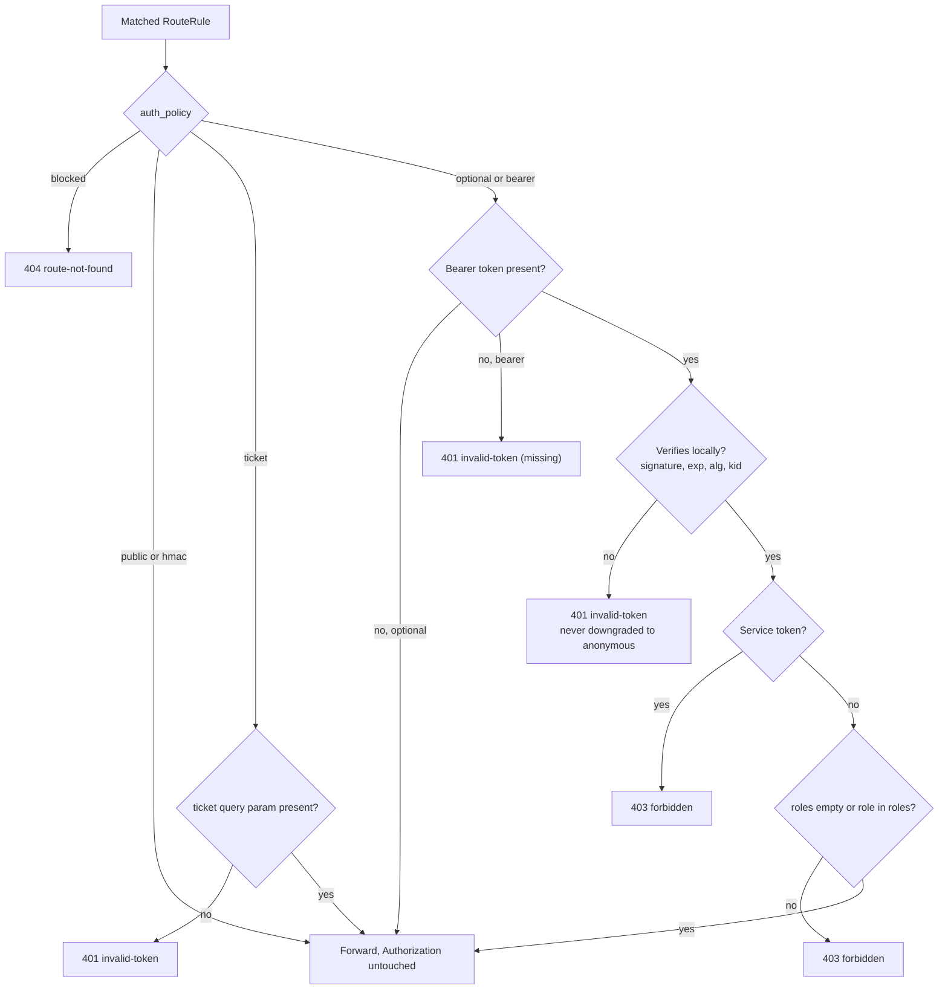

##### 3.1.1.3. State machines

**None persisted.** The gateway holds no entity with a lifecycle. For clarity on disconnect and failure semantics, the in-memory lifecycle of one proxied stream (a request whose response is `text/event-stream`) is:

| From | To | Trigger | Effect |
| --- | --- | --- | --- |
| — | `connecting` | Request passes stages 1–8 on a `stream` route | Upstream request opened with the route's timeout class; `gateway_sse_active_streams` incremented |
| `connecting` | `streaming` | Upstream returns response headers with `text/event-stream` | Headers relayed immediately with `Cache-Control: no-cache` and `X-Accel-Buffering: no` added |
| `connecting` | `closed` | Upstream returns a non-stream response (e.g. a `401` problem detail from ticket redemption, an assistant `429`) | Relayed as an ordinary response |
| `connecting` | `closed` | Connect failure or timeout | `503` / `504` problem detail (GW-11) |
| `streaming` | `streaming` | Upstream writes bytes | Written to the client as received; idle timer reset; first write recorded as time-to-first-byte |
| `streaming` | `closed` | Upstream ends the response cleanly | Client response ended; `initiator=upstream` |
| `streaming` | `closed` | Client disconnects | Upstream response `aclose()`d, connection discarded (GW-13); `initiator=client` |
| `streaming` | `closed` | Upstream connection error mid-stream | Terminal `event: error` frame with a `502` problem detail, then close (GW-12); `initiator=upstream_error` |
| `streaming` | `closed` | Idle read timeout, or the total bound for `stream_assistant` | Terminal `event: error` frame with a `504` problem detail, then close; upstream `aclose()`d; `initiator=timeout` |
| `streaming` | `closed` | Gateway shutdown after the drain grace period | Client response ended; clients reconnect with the `retry:` interval the upstream already set; `initiator=shutdown` |

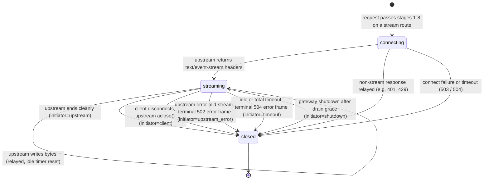

`closed` is terminal. There is no resume at the gateway: resumption is `notification`'s `Last-Event-ID` and cursor mechanism (C18, C22), which works through any gateway replica because the gateway holds nothing.

##### 3.1.1.4. Workflows and async jobs

**None in the Temporal or Celery sense.** The gateway starts no workflow, enqueues no task, and runs no scheduler or consumer. It has three pieces of in-process background behaviour:

| Behaviour | Trigger | Logic | Failure behaviour |
| --- | --- | --- | --- |
| Public key refresh | Startup; then when `kid` in a token is unknown, at most once per `JWT_JWKS_MIN_REFRESH_S`; otherwise every `JWT_JWKS_CACHE_TTL_S` | If `JWT_JWKS_URL` is set, fetch `GET /api/v1/auth/jwks` from `identity` and replace the cached key set atomically; if unset, the key is read from `JWT_PUBLIC_KEY_PATH` at startup only | A failed refresh keeps the previous key set and logs a warning. Startup with no loadable key fails the container (a gateway that cannot verify is not ready) |
| OpenAPI aggregation | On request to `/openapi.json` or `/docs` when the cache is older than `GATEWAY_OPENAPI_CACHE_TTL_S` | Fetch each upstream's `/openapi.json` concurrently (2s timeout each); merge (below); cache | An upstream that fails is omitted and listed under `x-upstreams-unavailable`; the last good copy of its section is used if one is cached |
| Rate-limit counting | Each request, per applicable class | Fixed-window counter (below) | Redis error or timeout (> `GATEWAY_RATELIMIT_REDIS_TIMEOUT_MS`) → fail open, count `failed_open` |

**Public key refresh** (JWKS mode):

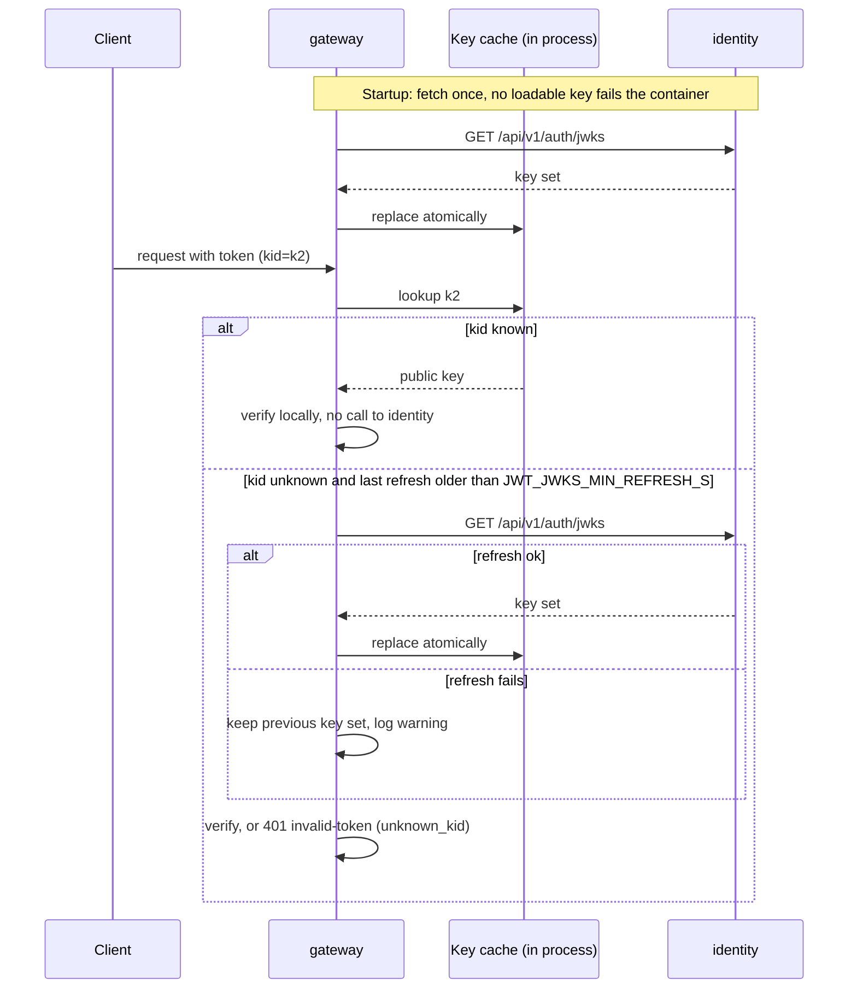

**Rate-limit algorithm — fixed window counter.** For each applicable class, with `w = window_seconds`:

```
key = rl:{scope}:{identifier}                 # keyspace defined in RFC 0001 (Redis)
MULTI
  SET   key 0 EX w NX                         # open a window if none exists
  INCR  key                                   # → n
  PTTL  key                                   # → ms until the window resets
EXEC
if n > limit:   429, Retry-After = ceil(PTTL / 1000)
else:           allow; RateLimit-Remaining = limit - n; RateLimit-Reset = ceil(PTTL / 1000)
```

The window starts at the first request in it and the key's TTL *is* the window, so the key pattern `rl:{scope}:{identifier}` needs no timestamp component and every key expires on its own. TTL is 60s for per-minute classes and 3600s for the one per-hour class (`generate`). Rejected requests still increment the counter, so hammering past the limit does not shorten the wait. The known weakness of a fixed window — up to 2× the limit across a window boundary — is accepted ([§3.3](#33-tradeoffs)).

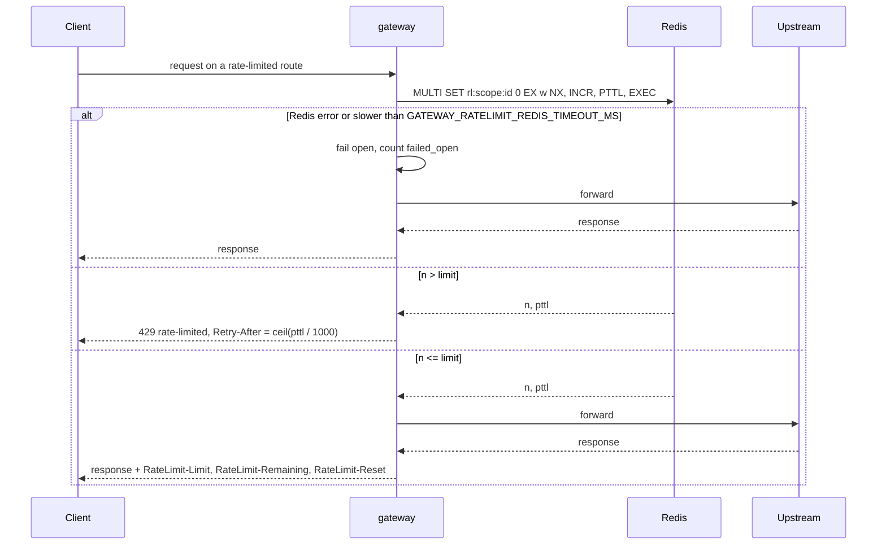

**OpenAPI merge.** Paths are disjoint by construction (one prefix, one owner), so merging paths is a union; a collision is a route-table bug and is logged as an error. Component schemas are namespaced by service (`catalog.ProductOut`) and `$ref`s rewritten, because two services independently defining `Page` or `ProblemDetail` is normal. Every operation is tagged with its service. Paths whose rule is `blocked` are removed. The gateway's own operational endpoints are added under a `gateway` tag. `servers` is set to the gateway's public URL, so "Try it out" goes through the edge.

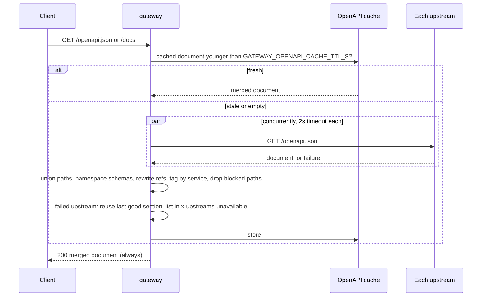

##### 3.1.1.5. Dependencies and degradation

**Synchronous calls out.** The gateway calls upstreams only to proxy a client request (one upstream per request), to aggregate OpenAPI, and to fetch the JWKS.

| Dependency | Used for | When it is down | Client-visible effect |
| --- | --- | --- | --- |
| `identity` (:8001) | Proxying `/auth`, `/users`, `/merchants`; JWKS fetch | Proxied routes → `503 upstream-unavailable`. Token verification is unaffected — local, against the cached key (R7) | Login and refresh fail; every other authenticated request keeps working until access tokens expire (≤ 15 min) |
| `catalog` (:8002) | `/products`, `/categories`, `/variants`, `/media` | `503` on those prefixes | Browse unavailable; orders already placed unaffected |
| `order` (:8003) | `/orders`, `/webhooks` | `503` on those prefixes | Checkout unavailable |
| `inventory` (:8004) | `/inventory` | `503` | Stock views and adjustments unavailable |
| `notification` (:8005) | `/notifications` | `503`; open streams end with `event: error` (GW-12) | Push stops; `EventSource` retries; the durable list is back when the service is |
| `analytics` (:8006) | `/analytics` | `503` | Dashboards unavailable; checkout unaffected |
| `assistant` (:8007) | `/assistant`, `/search` | `503`; open streams end with `event: error` | AI features unavailable, nothing else (the `ai` Compose profile may simply be off) |
| Redis | Rate-limit counters only | Fail open: requests admitted, `gateway_ratelimit_decisions_total{outcome="failed_open"}` rises | None, except that limits are not enforced for the duration |
| OTel Collector | Span and metric export | Exporter drops and retries in the background; request path unaffected | None |

**Synchronous calls in.** Every client request. No service calls the gateway: in-network callers go to services directly.

**Infrastructure needed to start:** none beyond its own container and a loadable public key. Upstreams, Redis and the collector are all optional at startup, which is what lets a developer run the `core` profile alone.

**Upstream connection management.** One pooled `httpx.AsyncClient` per upstream, HTTP/1.1, `max_connections = GATEWAY_UPSTREAM_MAX_CONNECTIONS`, `max_keepalive_connections = GATEWAY_UPSTREAM_MAX_KEEPALIVE`. Pool exhaustion waits at most the connect timeout and then fails `503`, so a slow upstream cannot hold requests for other upstreams hostage — each has its own pool.

##### 3.1.1.6. Configuration

Twelve-factor, environment only, validated at startup by `pydantic-settings`; a missing or malformed variable fails the container immediately ([RFC 0001](0001-platform-and-shared-infrastructure.md)).

| Variable | Default (local) | Meaning |
| --- | --- | --- |
| `GATEWAY_PORT` | `8000` | Listen port |
| `UPSTREAM_IDENTITY_URL` | `http://identity:8001` | Upstream base URLs. Empty → the upstream is "not deployed" and its routes return `503` |
| `UPSTREAM_CATALOG_URL` | `http://catalog:8002` | |
| `UPSTREAM_ORDER_URL` | `http://order:8003` | |
| `UPSTREAM_INVENTORY_URL` | `http://inventory:8004` | |
| `UPSTREAM_NOTIFICATION_URL` | `http://notification:8005` | |
| `UPSTREAM_ANALYTICS_URL` | `http://analytics:8006` | |
| `UPSTREAM_ASSISTANT_URL` | `http://assistant:8007` | |
| `JWT_PUBLIC_KEY_PATH` | `/run/keys/jwt_public.pem` | Mounted public key (from the gitignored key directory) |
| `JWT_JWKS_URL` | *(empty)* | If set (e.g. `http://identity:8001/api/v1/auth/jwks`), the key set is fetched and cached instead |
| `JWT_JWKS_CACHE_TTL_S` | `300` | JWKS refresh interval |
| `JWT_JWKS_MIN_REFRESH_S` | `30` | Floor between refreshes triggered by an unknown `kid` |
| `JWT_ALGORITHMS` | `RS256` | Accepted algorithms; anything else (including `none`, `HS256`) is rejected |
| `JWT_LEEWAY_S` | `10` | Clock-skew allowance on `exp` / `nbf` |
| `GATEWAY_CORS_ALLOW_ORIGINS` | `http://localhost:3000,http://localhost:5173` | Explicit allow-list; `*` is rejected by settings validation |
| `GATEWAY_CORS_MAX_AGE_S` | `600` | Preflight cache |
| `GATEWAY_UPSTREAM_CONNECT_TIMEOUT_S` | `2` | All timeout classes |
| `GATEWAY_UPSTREAM_READ_TIMEOUT_S` | `10` | `standard` class read/total |
| `GATEWAY_EXTENDED_READ_TIMEOUT_S` | `60` | `extended` class (assistant non-streaming) |
| `GATEWAY_UPLOAD_READ_TIMEOUT_S` | `30` | `upload` class |
| `GATEWAY_SSE_IDLE_TIMEOUT_S` | `60` | Idle read bound on stream classes — three missed 20s notification heartbeats |
| `GATEWAY_ASSISTANT_STREAM_MAX_S` | `180` | Total bound on `stream_assistant`; set above `assistant`'s own generation timeout so the service, not the gateway, normally ends the stream |
| `GATEWAY_MAX_BODY_BYTES` | `1048576` | Default request body limit (1 MiB) |
| `GATEWAY_MAX_UPLOAD_BYTES` | `10485760` | Media upload route limit (10 MiB) |
| `GATEWAY_LOGIN_BODY_MAX_BYTES` | `16384` | The one buffered body (GW-6, GW-8) |
| `GATEWAY_MAX_CONCURRENT_STREAMS` | `2000` | Per-replica SSE relay cap (GW-22) |
| `GATEWAY_UPSTREAM_MAX_CONNECTIONS` | `100` | Per-upstream pool size |
| `GATEWAY_UPSTREAM_MAX_KEEPALIVE` | `20` | Per-upstream idle keep-alive connections |
| `GATEWAY_TRUSTED_PROXIES` | *(empty)* | CIDRs whose `X-Forwarded-For` is honoured (GW-9) |
| `GATEWAY_TRUST_INBOUND_TRACEPARENT` | `false` | Adopt a client's `traceparent` as parent (GW-10) |
| `GATEWAY_OPENAPI_CACHE_TTL_S` | `60` | Aggregated document cache |
| `GATEWAY_PUBLIC_URL` | `http://localhost:8000` | `servers` entry in the aggregated OpenAPI |
| `GATEWAY_SHUTDOWN_GRACE_S` | `10` | Drain period on SIGTERM |
| `REDIS_URL` | `redis://redis:6379/0` | Rate-limit counters |
| `GATEWAY_RATELIMIT_ENABLED` | `true` | Master switch (tests and the `core`-only profile without Redis) |
| `GATEWAY_RATELIMIT_REDIS_TIMEOUT_MS` | `50` | Past this, fail open |
| `RL_DEFAULT_PER_IP_PER_MIN` | `100` | [Rate-limit classes](#rate-limit-classes) |
| `RL_LOGIN_PER_IP_PER_MIN` | `5` | |
| `RL_LOGIN_PER_EMAIL_PER_MIN` | `5` | |
| `RL_ORDER_CREATE_PER_USER_PER_MIN` | `30` | |
| `RL_SEARCH_ANON_PER_IP_PER_MIN` | `20` | |
| `RL_SEARCH_PER_USER_PER_MIN` | `60` | |
| `RL_CHAT_ANON_PER_IP_PER_MIN` | `3` | |
| `RL_CHAT_PER_USER_PER_MIN` | `10` | |
| `RL_GENERATE_PER_MERCHANT_PER_HOUR` | `20` | |
| `RL_NOTIF_ACK_PER_CLIENT_PER_MIN` | `12` | |
| `OTEL_SERVICE_NAME` | `gateway` | Standard OTel variables, consumed by the `common` tracing setup |
| `OTEL_EXPORTER_OTLP_ENDPOINT` | `http://otel-collector:4317` | |
| `OTEL_TRACES_SAMPLER` | `parentbased_always_on` | 100% locally; turning it down is a variable (archive 0003 Q5) |
| `LOG_LEVEL` | `INFO` | |

##### 3.1.1.7. Observability

**Metrics** — Prometheus exposition at `GET /metrics`. Every `route` label is the route-table *template* (`/api/v1/products/{id}`), never the raw path, so cardinality is bounded by the table.

| Metric | Type | Labels | What it answers |
| --- | --- | --- | --- |
| `gateway_requests_total` | counter | `route`, `method`, `upstream`, `status_class` (`2xx`…`5xx`), `origin` (`upstream` \| `gateway`) | RED rate and errors; `origin` separates "the service said 403" from "the edge said 403" |
| `gateway_request_duration_seconds` | histogram | `route`, `method`, `upstream` | RED duration at the edge (for streams, time to response headers) |
| `gateway_upstream_duration_seconds` | histogram | `upstream`, `outcome` (`ok` \| `error` \| `timeout`) | Upstream latency as the gateway saw it — the edge-vs-service gap is gateway overhead |
| `gateway_upstream_errors_total` | counter | `upstream`, `kind` (`connect` \| `timeout` \| `protocol` \| `reset` \| `not_configured` \| `pool_exhausted`) | Which failure mode produced a `502`/`503`/`504` |
| `gateway_auth_rejections_total` | counter | `reason` (`missing` \| `malformed` \| `expired` \| `bad_signature` \| `bad_algorithm` \| `unknown_kid` \| `role` \| `service_token` \| `missing_ticket`) | Edge rejections by cause |
| `gateway_ratelimit_decisions_total` | counter | `scope`, `outcome` (`allowed` \| `limited` \| `failed_open`) | Limits in effect; `failed_open` is the Redis-outage signal |
| `gateway_client_id_stripped_total` | counter | `route` | Malformed `X-Client-Id` values removed (C21) — a rising rate means a client bug |
| `gateway_request_body_rejected_total` | counter | `route` | `413`s |
| `gateway_inflight_requests` | gauge | `upstream` | Concurrency at the edge |
| `gateway_sse_active_streams` | gauge | `upstream` | Open SSE relays — sockets, the capacity unit for streaming |
| `gateway_sse_time_to_first_byte_seconds` | histogram | `upstream`, `route` | The buffering detector: time from upstream response headers to the first body byte relayed. For the assistant this is time-to-first-event through the edge |
| `gateway_sse_stream_duration_seconds` | histogram | `upstream`, `initiator` | How long streams live and who ended them |
| `gateway_sse_disconnects_total` | counter | `upstream`, `initiator` (`client` \| `upstream` \| `upstream_error` \| `timeout` \| `shutdown` \| `cap`) | Disconnect propagation; reconnect storms show as `client`/`shutdown` spikes |
| `gateway_openapi_upstream_fetch_failures_total` | counter | `upstream` | Documentation degradation |
| `gateway_jwks_refresh_total` | counter | `outcome` (`ok` \| `error`) | Key-refresh health, when JWKS mode is on |

**Spans.** FastAPI and httpx auto-instrumentation from `common`:

| Span | Kind | Key attributes | Notes |
| --- | --- | --- | --- |
| `{method} {route}` | server (root) | `http.request.method`, `http.route`, `http.response.status_code`, `url.path`, `smartretail.upstream`, `smartretail.auth_policy`, `smartretail.ratelimit.scope`, `smartretail.ratelimit.outcome`, `enduser.id` (`sub`), `enduser.role`, `smartretail.client_request_id`, `smartretail.client_id_present` | The root of every platform trace (G7). Linked to an inbound `traceparent` when present and untrusted (GW-10) |
| `{method}` → upstream | client | `server.address`, `http.response.status_code`, `error.type` | Child of the server span; propagates `traceparent` to the upstream |
| `ratelimit` | internal | `scope`, `outcome`, `redis.duration_ms` | One per request with any class applied |
| `jwt.verify` | internal | `outcome`, `reason` | Cheap; kept so edge auth cost is visible |

For streams, **both the server and client spans end when the stream ends, not at first byte**, with span event `first_byte` at the first relayed body byte and attributes `smartretail.stream.bytes` and `smartretail.stream.initiator`. Request and response bodies are never recorded; headers are allow-listed (`Content-Type`, `Content-Length`, `Accept`, `User-Agent`, `X-Request-ID`, `Idempotency-Key` presence only); `Authorization`, `Cookie` and the stream ticket are never recorded (GW-18).

**Log fields.** One JSON access-log line per request, via the `common` formatter: `timestamp`, `level`, `service=gateway`, `trace_id`, `request_id` (equal to `trace_id`), `client_request_id`, `method`, `route`, `path` (ticket redacted), `upstream`, `status`, `origin`, `duration_ms`, `bytes_in`, `bytes_out`, `stream`, `stream_initiator`, `user_id` (`sub` or null), `role`, `client_ip`, `client_id_present`, `ratelimit_scope`, `ratelimit_outcome`, `error_type` (problem `type` when the gateway originated the response). Never: `Authorization`, bodies, the login email (not even hashed), the ticket.

**Dashboards.** The gateway panel set in the provisioned Grafana "platform overview" and "per-service RED" dashboards ([RFC 0001](0001-platform-and-shared-infrastructure.md)): edge RPS and error rate by upstream and `origin`; edge vs upstream p50/p95/p99; auth rejections by reason; rate-limit decisions by scope with `failed_open` highlighted; active SSE streams by upstream; SSE time-to-first-byte p95; disconnects by initiator.

**Alerts.** None — there is no operational context to alert into ([RFC 0001](0001-platform-and-shared-infrastructure.md)). The panels above are the ones that would carry alerts first: `failed_open > 0`, SSE time-to-first-byte p95 > 1s, `5xx` with `origin=gateway` > 1%.

#### 3.1.2. API changes

##### 3.1.2.1. Endpoints

**Endpoints the gateway itself serves.** These are handled in-process, are not proxied, and are exempt from authentication. They are served on the gateway's own port; upstreams' `/health`, `/metrics` and `/docs` are reached on their own ports inside Compose, never through the edge.

| Method | Path | Request | Response | Status codes |
| --- | --- | --- | --- | --- |
| `GET` | `/health` | — | `{"status": "ok"}` — liveness; no dependency is touched | `200` |
| `GET` | `/health/ready` | — | `{"status": "ready" \| "not_ready", "checks": {"settings": "ok", "public_key": "ok", "route_table": "ok"}, "informational": {"redis": "ok" \| "unreachable", "upstreams": {"identity": "ok" \| "unreachable" \| "not_configured", …}}}` | `200` when every entry in `checks` is `ok`; `503` otherwise. `informational` never changes the status (GW-16) |
| `GET` | `/metrics` | — | Prometheus text exposition ([§3.1.1.7](#3117-observability)) | `200` |
| `GET` | `/openapi.json` | — | The aggregated OpenAPI 3.1 document (GW-15), with `x-upstreams-unavailable: [...]` when any upstream could not be fetched | `200` (always, even if every upstream is down — then it lists only the gateway's own endpoints) |
| `GET` | `/docs` | — | Swagger UI over `/openapi.json` | `200` |
| `OPTIONS` | any routed path | CORS preflight | `204` with CORS headers if the origin is allowed; `204` without them if not (the browser then blocks) | `204` |

Nothing the gateway serves is idempotency-keyed or asynchronous; `202` semantics belong to the upstreams (`POST /orders`, `POST /products/{id}/status`, bulk generation, reindex) and pass through unchanged.

**The route table** — every public prefix, its upstream, and the edge policy applied. Routing is longest-prefix, then method; the path is forwarded unchanged (no prefix stripping), so each service mounts its own `/api/v1/...` routes. Full endpoint contracts are in the owning RFC's §3.1.2.1.

| Prefix / pattern | Methods | Upstream | Auth policy | Timeout class | Stream | Rate classes (beyond `default`) | Owning RFC |
| --- | --- | --- | --- | --- | --- | --- | --- |
| `/api/v1/auth/login` | `POST` | `identity` | `public` | `standard` | — | `login_ip`, `login_email` | [0003](0003-identity-service.md#3121-endpoints) |
| `/api/v1/auth/register`, `/auth/refresh`, `/auth/jwks` | `POST`, `GET` | `identity` | `public` | `standard` | — | — | [0003](0003-identity-service.md#3121-endpoints) |
| `/api/v1/auth/logout` | `POST` | `identity` | `bearer` | `standard` | — | — | [0003](0003-identity-service.md#3121-endpoints) |
| `/api/v1/users/me`, `/users/me/*` | all | `identity` | `bearer` | `standard` | — | — | [0003](0003-identity-service.md#3121-endpoints) |
| `/api/v1/users`, `/users/{user_id}` | all | `identity` | `bearer` · `admin` | `standard` | — | — | [0003](0003-identity-service.md#3121-endpoints) |
| `/api/v1/merchants/*` | `GET` | `identity` | `optional` | `standard` | — | — | [0003](0003-identity-service.md#3121-endpoints) |
| `/api/v1/categories/*` | `GET` | `catalog` | `optional` | `standard` | — | — | [0004](0004-catalog-service.md#3121-endpoints) |
| `/api/v1/categories/*` | `POST`, `PATCH`, `DELETE` | `catalog` | `bearer` · `admin` | `standard` | — | — | [0004](0004-catalog-service.md#3121-endpoints) |
| `/api/v1/products`, `/products/{id}` | `GET` | `catalog` | `optional` | `standard` | — | — | [0004](0004-catalog-service.md#3121-endpoints) |
| `/api/v1/products/me` | `GET` | `catalog` | `bearer` · `merchant` | `standard` | — | — | [0004](0004-catalog-service.md#3121-endpoints) |
| `/api/v1/products/{id}/history`, `/products/{id}/publish-status` | `GET` | `catalog` | `bearer` · `merchant`, `admin` | `standard` | — | — | [0004](0004-catalog-service.md#3121-endpoints) |
| `/api/v1/products/{id}/media/upload` | `POST` | `catalog` | `bearer` · `merchant`, `admin` | `upload` | — | — (10 MiB body) | [0004](0004-catalog-service.md#3121-endpoints) |
| `/api/v1/products/*` (all writes: create, patch, delete, status, variants, media) | `POST`, `PATCH`, `DELETE` | `catalog` | `bearer` · `merchant`, `admin` | `standard` | — | — | [0004](0004-catalog-service.md#3121-endpoints) |
| `/api/v1/variants/*`, `/api/v1/media/*` | `PATCH`, `DELETE` | `catalog` | `bearer` · `merchant`, `admin` | `standard` | — | — | [0004](0004-catalog-service.md#3121-endpoints) |
| `/api/v1/orders` | `POST` | `order` | `bearer` · `customer` | `standard` | — | `order_create` | [0005](0005-order-service.md#3121-endpoints) |
| `/api/v1/orders` | `GET` | `order` | `bearer` · `customer` | `standard` | — | — | [0005](0005-order-service.md#3121-endpoints) |
| `/api/v1/orders/merchant` | `GET` | `order` | `bearer` · `merchant` | `standard` | — | — | [0005](0005-order-service.md#3121-endpoints) |
| `/api/v1/orders/{id}`, `/orders/{id}/cancel` | `GET`, `POST` | `order` | `bearer` · `customer`, `admin` | `standard` | — | — | [0005](0005-order-service.md#3121-endpoints) |
| `/api/v1/orders/{id}/shipment/status`, `/orders/{id}/workflow` | `POST`, `GET` | `order` | `bearer` · `admin` | `standard` | — | — | [0005](0005-order-service.md#3121-endpoints) |
| `/api/v1/webhooks/*` | `POST` | `order` | `hmac` | `standard` | — | — | [0005](0005-order-service.md#3121-endpoints) |
| `/internal/*` | all | — | `blocked` | — | — | — | Internal routes of [0004](0004-catalog-service.md#3121-endpoints) and [0006](0006-inventory-service.md#3121-endpoints) (GW-4) |
| `/api/v1/inventory/{variant_id}` | `GET` | `inventory` | `optional` | `standard` | — | — | [0006](0006-inventory-service.md#3121-endpoints) |
| `/api/v1/inventory`, `/inventory/{variant_id}` (writes), `/inventory/{variant_id}/adjust`, `/inventory/{variant_id}/movements` | `GET`, `PUT`, `POST` | `inventory` | `bearer` · `merchant`, `admin` | `standard` | — | — | [0006](0006-inventory-service.md#3121-endpoints) |
| `/api/v1/notifications/stream` | `GET` | `notification` | `ticket` | `stream_notification` | yes | **exempt from `default`** | [0007](0007-notification-service.md#3121-endpoints) |
| `/api/v1/notifications/ack` | `POST` | `notification` | `bearer` | `standard` | — | `notif_ack` | [0007](0007-notification-service.md#3121-endpoints) |
| `/api/v1/notifications/admin` | `GET` | `notification` | `bearer` · `admin` | `standard` | — | — | [0007](0007-notification-service.md#3121-endpoints) |
| `/api/v1/notifications/*` (list, read, read-all, stream-ticket, unread-count) | `GET`, `POST` | `notification` | `bearer` | `standard` | — | — | [0007](0007-notification-service.md#3121-endpoints) |
| `/api/v1/analytics/overview`, `/analytics/failures`, `/analytics/assistant*` | `GET` | `analytics` | `bearer` · `admin` | `standard` | — | — | [0008](0008-analytics-service.md#3121-endpoints) |
| `/api/v1/analytics/*` (orders, revenue, products/popular, inventory/stockouts) | `GET` | `analytics` | `bearer` · `merchant`, `admin` | `standard` | — | — | [0008](0008-analytics-service.md#3121-endpoints) |
| `/api/v1/search/semantic`, `/search/similar/*` | `POST`, `GET` | `assistant` | `optional` | `standard` | — | `search_anon` (no token) or `search_user` (token) | [0009](0009-assistant-service.md#3121-endpoints) |
| `/api/v1/search/index/status`, `/search/index/reindex` | `GET`, `POST` | `assistant` | `bearer` · `admin` | `standard` | — | — | [0009](0009-assistant-service.md#3121-endpoints) |
| `/api/v1/search/index/{product_id}` | `GET` | `assistant` | `bearer` · `merchant`, `admin` | `standard` | — | — | [0009](0009-assistant-service.md#3121-endpoints) |
| `/api/v1/assistant/chat` | `POST` | `assistant` | `optional` | `stream_assistant` | yes | `chat_anon` or `chat_user` | [0009](0009-assistant-service.md#3121-endpoints) |
| `/api/v1/assistant/chat/sync` | `POST` | `assistant` | `optional` | `extended` | — | `chat_anon` or `chat_user` | [0009](0009-assistant-service.md#3121-endpoints) |
| `/api/v1/assistant/conversations*`, `/assistant/messages/*` | `GET`, `DELETE`, `POST` | `assistant` | `bearer` · `customer` | `standard` | — | — | [0009](0009-assistant-service.md#3121-endpoints) |
| `/api/v1/assistant/generate` | `POST` | `assistant` | `bearer` · `merchant` | `stream_assistant` | yes | `generate` | [0009](0009-assistant-service.md#3121-endpoints) |
| `/api/v1/assistant/generate/sync`, `/assistant/generate/bulk` | `POST` | `assistant` | `bearer` · `merchant` | `extended` | — | `generate` | [0009](0009-assistant-service.md#3121-endpoints) |
| `/api/v1/assistant/generate/jobs/*`, `/assistant/generations` | `GET` | `assistant` | `bearer` · `merchant` | `standard` | — | — | [0009](0009-assistant-service.md#3121-endpoints) |
| `/api/v1/assistant/usage/admin` | `GET` | `assistant` | `bearer` · `admin` | `standard` | — | — | [0009](0009-assistant-service.md#3121-endpoints) |
| `/api/v1/assistant/usage` | `GET` | `assistant` | `bearer` | `standard` | — | — | [0009](0009-assistant-service.md#3121-endpoints) |
| anything else | any | — | — | — | — | `default` | `404 route-not-found` |

Two routing notes. `/api/v1/search/*` is owned by `assistant` in full — keyword filtering is a `catalog` query parameter on `/products`, semantic and similarity search are `assistant` endpoints. And `catalog` owns `/products`, `/categories`, `/variants` and `/media` directly; there is no `/api/v1/catalog` prefix.

**A proxied, authenticated request** (for example `PATCH /api/v1/products/{id}`, `bearer` · `merchant`, `admin`):

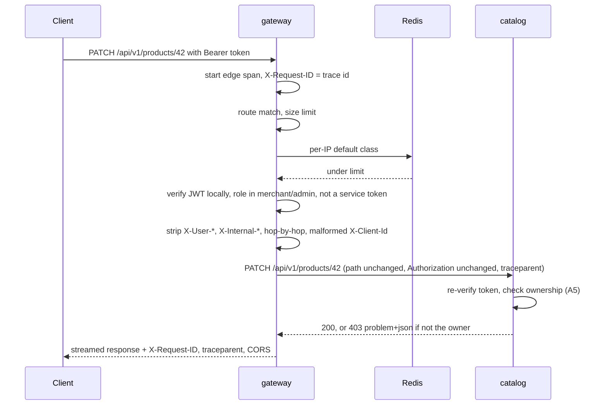

**Headers — what the gateway does with each.**

| Header | Direction | Handling |
| --- | --- | --- |
| `Authorization` | in → upstream | Verified per auth policy; forwarded unchanged (A5) |
| `X-Request-ID` | in, out, → upstream | GW-10. Always set on the response and on the upstream request to the trace ID |
| `traceparent`, `tracestate` | in, out, → upstream | Injected from the edge span on the upstream request; returned on every response. Inbound handled per GW-10 |
| `X-Client-Id` | in → upstream | Passed through if it matches `^[A-Za-z0-9_-]{8,64}$`; **stripped** (not rejected) if malformed — a cosmetic header must never fail a checkout (C21). Never generated by the gateway. Passed on every route, not only mutating ones and `/notifications/stream-ticket`, since stripping is the only thing the gateway does to it |
| `Idempotency-Key` | in → upstream | Untouched. Its semantics are `order`'s |
| `Last-Event-ID` | in → upstream | Untouched. Its semantics are `notification`'s (C18) |
| `X-User-*`, `X-Internal-*` | in | Stripped (GW-5) |
| `X-Forwarded-For`, `X-Forwarded-Proto`, `X-Forwarded-Host` | → upstream | Set by the gateway; inbound values replaced unless the peer is a trusted proxy (GW-9) |
| Hop-by-hop (`Connection`, `Keep-Alive`, `TE`, `Trailer`, `Transfer-Encoding`, `Upgrade`, `Proxy-*`) | both | Stripped per RFC 9110. `Upgrade` is therefore never honoured — no WebSockets |
| `Content-Encoding` | out | Passed through untouched; the gateway neither adds nor removes compression (GW-6) |
| `Cache-Control: no-cache`, `X-Accel-Buffering: no` | out | Added on `text/event-stream` responses so that any intermediary also refrains from buffering |
| `RateLimit-Limit`, `RateLimit-Remaining`, `RateLimit-Reset` | out | On routes with a rate class (GW-21) |
| `Retry-After` | out | On every gateway `429` and `503` |
| CORS headers | out | On every response to an allowed origin, including errors (GW-19) |

**CORS policy (GW-19).**

| Aspect | Value |
| --- | --- |
| Allowed origins | `GATEWAY_CORS_ALLOW_ORIGINS` — an explicit list; `*` rejected at startup |
| Allowed methods | `GET`, `POST`, `PUT`, `PATCH`, `DELETE`, `OPTIONS` |
| Allowed request headers | `Authorization`, `Content-Type`, `Idempotency-Key`, `X-Request-ID`, `X-Client-Id`, `Last-Event-ID`, `traceparent` |
| Exposed response headers | `X-Request-ID`, `traceparent`, `Location`, `Retry-After`, `RateLimit-Limit`, `RateLimit-Remaining`, `RateLimit-Reset` |
| Credentials | `false` — authentication is a bearer header or a stream ticket, never a cookie |
| Preflight | Answered at the edge, `Access-Control-Max-Age: 600`; counts toward `default`, never authenticated |

<a id="rate-limit-classes"></a>**Rate-limit classes.** `default` applies to every routed request except the notification stream; route-specific classes stack on top of it.

| Scope | Applies to | Limit | Window | Identifier | Runs | Source |
| --- | --- | --- | --- | --- | --- | --- |
| `default` | Every routed request, including preflight; **exempt: `GET /api/v1/notifications/stream`** | 100 | 60s | client IP | before auth | archive 0003 §6.2 |
| `login_ip` | `POST /api/v1/auth/login` | 5 | 60s | client IP | before auth | archive 0003 §3.1.2 |
| `login_email` | `POST /api/v1/auth/login` | 5 | 60s | `sha256(lower(trim(email)))[:32]` (GW-8) | after body read | archive 0003 §3.1.2 |
| `order_create` | `POST /api/v1/orders` | 30 | 60s | `sub` | after auth | archive 0003 §3.1.2 |
| `search_anon` | `/api/v1/search/semantic`, `/search/similar/*`, no token | 20 | 60s | client IP | before auth | archive 0004 §6.2 |
| `search_user` | same routes, with a verified token | 60 | 60s | `sub` | after auth | archive 0004 §6.2 |
| `chat_anon` | `POST /api/v1/assistant/chat`, `/chat/sync`, no token | 3 | 60s | client IP | before auth | archive 0005 §3.1.2, §6.2 |
| `chat_user` | same routes, with a verified token | 10 | 60s | `sub` | after auth | archive 0005 §3.1.2, §6.2 |
| `generate` | `POST /api/v1/assistant/generate`, `/generate/sync`, `/generate/bulk` (one bulk request counts once) | 20 | 3600s | `sub` (the merchant) | after auth | archive 0005 §3.1.2, §6.2 |
| `notif_ack` | `POST /api/v1/notifications/ack` | 12 | 60s | `sub` + `:` + `X-Client-Id` (or `sub` alone if the header is absent or stripped) | after auth | archive 0003 §3.1.2 (C23) |

Why the stream is exempt: a long-lived connection is one request, and counting reconnects against the per-IP default would throttle a post-deploy reconnect storm into a failure. Reconnect storms are handled by `notification`'s jittered `retry:` and 3-streams-per-user cap. `POST /notifications/stream-ticket`, which precedes every stream open, remains under `default`, so stream opening is still bounded per IP.

Why `chat_*` and `generate` are request limits in addition to `assistant`'s token budgets: budgets bound *spend* and are checked inside the service after the request has been parsed; the gateway limit bounds *request rate* before the request reaches the service at all. The two are complementary ("rate limiting ... on top of token budgets").

**The `429` problem detail.**

```http
HTTP/1.1 429 Too Many Requests
Content-Type: application/problem+json
Retry-After: 37
RateLimit-Limit: 5
RateLimit-Remaining: 0
RateLimit-Reset: 37
X-Request-ID: 4bf92f3577b34da6a3ce929d0e0e4736
traceparent: 00-4bf92f3577b34da6a3ce929d0e0e4736-00f067aa0ba902b7-01

{
  "type":           "…/errors/rate-limited",
  "title":          "Too many requests",
  "status":         429,
  "detail":         "Limit of 5 requests per 60 seconds exceeded for this route. Retry after 37 seconds.",
  "instance":       "/api/v1/auth/login",
  "request_id":     "4bf92f3577b34da6a3ce929d0e0e4736",
  "scope":          "login_email",
  "limit":          5,
  "window_seconds": 60,
  "retry_after":    37
}
```

`scope` names the class but never the identifier (no IP, no email hash). `Retry-After` is always present (archive 0003 §3.1.4). The `type` base URI is the platform error base defined in `common`.

<a id="error-normalisation"></a>**Error normalisation — responses the gateway originates.** All are RFC 9457 with the standard fields `{type, title, status, detail, instance, request_id}` from the shared handler (A7), and all carry `X-Request-ID`, `traceparent` and CORS headers.

| Status | `type` slug | When | Extra headers / fields |
| --- | --- | --- | --- |
| `401` | `invalid-token` | `bearer` route with no, malformed, expired, wrongly-signed, wrong-algorithm or unknown-`kid` token; `optional` route with a presented token that fails verification (GW-2); `ticket` route with no `ticket` parameter | `WWW-Authenticate: Bearer error="invalid_token"` (or `Bearer` alone when missing). `detail` says which of missing / expired / invalid, never why a signature failed |
| `403` | `forbidden` | Valid token, role not in the route's coarse set; any service token (GW-3) | — |
| `404` | `route-not-found` | No rule matches, or the rule is `blocked` (GW-4) | — |
| `405` | `method-not-allowed` | Prefix matches, method does not | `Allow` |
| `413` | `payload-too-large` | Body over the route's limit (GW-14) | `limit_bytes` |
| `429` | `rate-limited` | Above | `Retry-After`, `RateLimit-*`; `scope`, `limit`, `window_seconds`, `retry_after` |
| `502` | `upstream-bad-response` | Upstream closed or reset before complete response headers; malformed HTTP; a mid-stream failure after SSE headers (as a terminal `event: error` frame, GW-12) | `upstream` |
| `503` | `upstream-unavailable` | Connection refused, DNS failure, connect timeout, upstream not configured (its profile is off), pool exhausted; gateway stream cap reached (GW-22) | `Retry-After: 5`; `upstream` |
| `504` | `upstream-timeout` | Read timeout on a non-stream response; idle or total timeout on a stream (as a terminal `event: error` frame) | `upstream`, `timeout_seconds` |
| `5xx` (upstream's status) | `upstream-error` | Upstream returned `5xx` with a body that is not `application/problem+json`; the status is preserved and the body discarded (it may contain a stack trace) | `upstream` |

Every other status from an upstream — including upstream `401`, `403`, `404`, `409`, `422`, `429`, `501`, and any problem-detail `5xx` — is relayed unchanged. The gateway never retries a request to an upstream: it cannot know whether a non-idempotent request took effect, and `Idempotency-Key` retries are the client's to make.

**Upstream response handling** (GW-11):

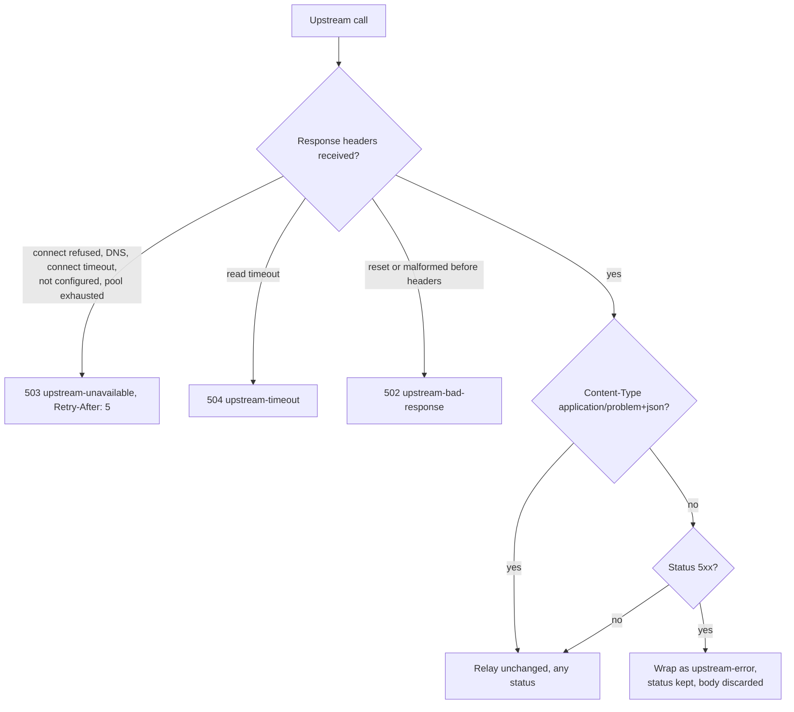

**SSE pass-through — the contract.** Two upstream surfaces stream: `notification` (`GET /notifications/stream`, long-lived, heartbeat every 20s, ticket-authenticated) and `assistant` (`POST /assistant/chat` and `POST /assistant/generate`, request-scoped, typically 5–15s). For both:

| Concern | Gateway behaviour |
| --- | --- |
| Buffering | None — bytes are written to the client as they arrive from the upstream (GW-6). No response compression anywhere. `X-Accel-Buffering: no` and `Cache-Control: no-cache` added so an intermediary does not buffer either |
| Framing | The gateway does not parse, rewrite, reorder or coalesce frames; `id:`, `event:`, `data:`, `retry:` and `: keepalive` comments pass through verbatim. The only frame the gateway ever writes is the terminal `event: error` of GW-12 and the timeout case |
| Timeouts | Idle read timeout (60s) rather than a total timeout; the notification stream has no total bound (it ends at JWT expiry by `notification`'s own rule), the assistant stream a 180s total bound set above `assistant`'s per-request generation timeout |
| Disconnect | Client disconnect → upstream closed immediately (GW-13). Upstream close → client response ended |
| Rate limits | Notification stream exempt from `default`; assistant streams under `chat_*` / `generate` |
| Auth | Notification stream: `ticket` policy, no bearer check — `EventSource` cannot set `Authorization` (C19). Assistant streams: normal `optional` / `bearer` policies (they are `fetch`-driven `POST`s, so a header is available) |
| Errors before headers | Normal problem-detail responses (ticket redemption `401`, assistant budget `429`, connection limit `503`) are relayed as ordinary responses |
| Tracing | Spans end at stream end, with a `first_byte` event (§3.1.1.7) |
| Capacity | Per-replica cap (GW-22); one asyncio task and two sockets per open stream |

**SSE pass-through with client disconnect** (assistant chat shown; the notification stream differs only in using the `ticket` policy and having no total bound):

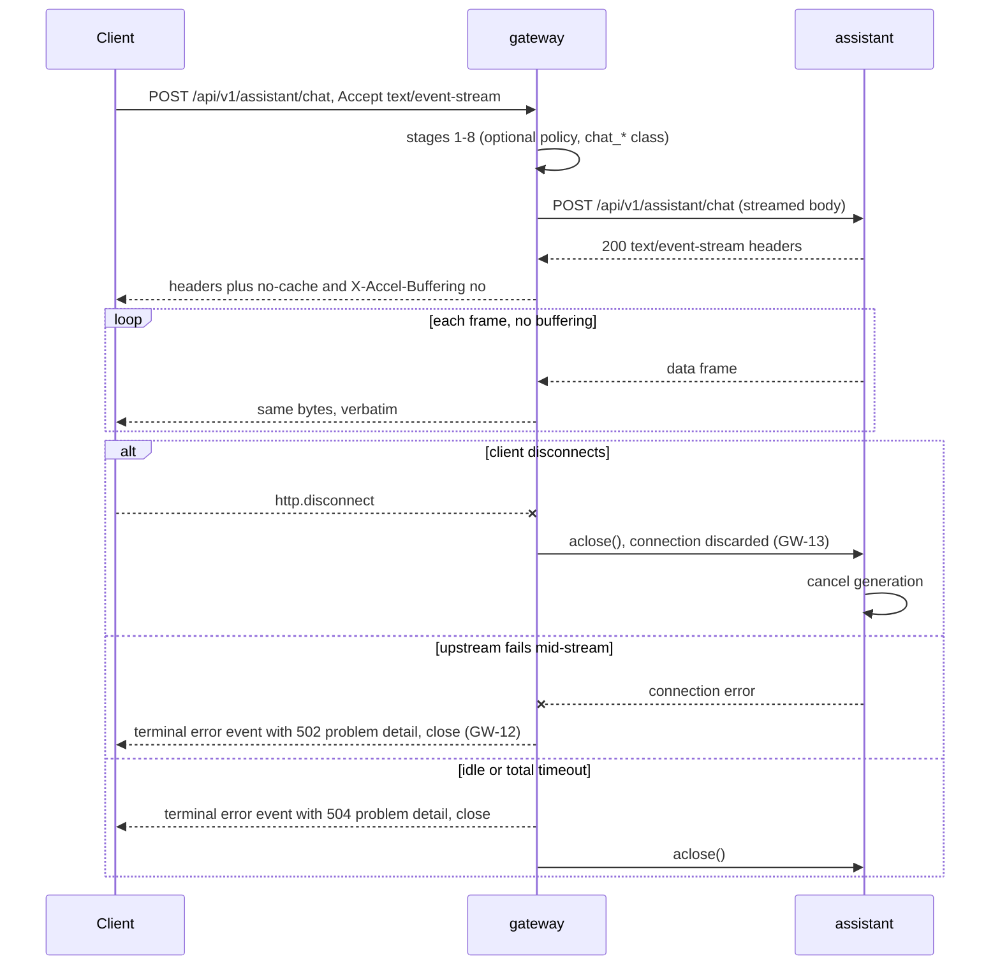

##### 3.1.2.2. Role matrix

The gateway's matrix is **coarse and route-level**. It is a necessary condition only (GW-1); the full matrix per endpoint, with ownership and merchant scoping, is in each owning RFC's §3.1.2.2. "✓" = passes the gateway; "✗" = rejected at the gateway with the code shown; "→" = passes the gateway, the upstream decides (ownership, visibility, or scope). `anonymous` = no token. `internal` = a service token (always refused at the edge, GW-3; internal callers use the Compose network).

| Route (prefix) | anonymous | customer | merchant | admin | internal | Upstream-side rule the gateway does not apply |
| --- | --- | --- | --- | --- | --- | --- |
| `/auth/register`, `/auth/login`, `/auth/refresh`, `/auth/jwks` | ✓ | ✓ | ✓ | ✓ | ✗ 403 | `admin` cannot self-register |
| `/auth/logout` | ✗ 401 | ✓ | ✓ | ✓ | ✗ 403 | Revokes only the presented refresh token |
| `/users/me*` | ✗ 401 | ✓ | ✓ | ✓ | ✗ 403 | `role` not writable via `/users/me` |
| `/users`, `/users/{id}` | ✗ 401 | ✗ 403 | ✗ 403 | ✓ | ✗ 403 | — |
| `GET /merchants/*` | ✓ | ✓ | ✓ | ✓ | ✗ 403 | — |
| `GET /categories*` | ✓ | ✓ | ✓ | ✓ | ✗ 403 | — |
| `POST/PATCH/DELETE /categories*` | ✗ 401 | ✗ 403 | ✗ 403 | ✓ | ✗ 403 | `409` if products reference it |
| `GET /products`, `/products/{id}` | ✓ | ✓ | ✓ → | ✓ → | ✗ 403 | Visibility: non-published only to owner merchant or admin |
| `GET /products/me` | ✗ 401 | ✗ 403 | ✓ | ✗ 403 | ✗ 403 | Own products only |
| `/products/*` writes, history, publish-status, media upload; `/variants/*`; `/media/*` | ✗ 401 | ✗ 403 | ✓ → | ✓ | ✗ 403 | Owner merchant only (`merchant_id` from the token) |
| `POST /orders`, `GET /orders` | ✗ 401 | ✓ | ✗ 403 | ✗ 403 | ✗ 403 | Own orders only; `Idempotency-Key` required |
| `GET /orders/merchant` | ✗ 401 | ✗ 403 | ✓ | ✗ 403 | ✗ 403 | Only that merchant's lines |
| `GET /orders/{id}`, `POST /orders/{id}/cancel` | ✗ 401 | ✓ → | ✗ 403 | ✓ | ✗ 403 | Owner customer or admin |
| `/orders/{id}/shipment/status`, `/orders/{id}/workflow` | ✗ 401 | ✗ 403 | ✗ 403 | ✓ | ✗ 403 | — |
| `POST /webhooks/*` | ✓ → | ✓ → | ✓ → | ✓ → | ✓ → | HMAC signature, timestamp and replay window verified by `order` |
| `/internal/*` | ✗ 404 | ✗ 404 | ✗ 404 | ✗ 404 | ✗ 404 | Internal only, service scope required, reached on the Compose network (GW-4) |
| `GET /inventory/{variant_id}` | ✓ | ✓ | ✓ | ✓ | ✗ 403 | — |
| `/inventory` list, writes, adjust, movements | ✗ 401 | ✗ 403 | ✓ → | ✓ | ✗ 403 | Owner merchant only |
| `GET /notifications/stream` | ✓ → (ticket) | ✓ → | ✓ → | ✓ → | ✓ → | Ticket redeemed by `notification`; identity comes from the ticket, not a token |
| `/notifications/*` (list, read, read-all, ack, stream-ticket, unread-count) | ✗ 401 | ✓ → | ✓ → | ✓ → | ✗ 403 | Own notifications only |
| `GET /notifications/admin` | ✗ 401 | ✗ 403 | ✗ 403 | ✓ | ✗ 403 | — |
| `/analytics/orders`, `/revenue`, `/products/popular`, `/inventory/stockouts` | ✗ 401 | ✗ 403 | ✓ → | ✓ | ✗ 403 | Merchant scope applied in the aggregation pipeline |
| `/analytics/overview`, `/failures`, `/assistant*` | ✗ 401 | ✗ 403 | ✗ 403 | ✓ | ✗ 403 | — |
| `/search/semantic`, `/search/similar/*` | ✓ | ✓ | ✓ | ✓ | ✗ 403 | Only published products from active merchants |
| `/search/index/status`, `/search/index/reindex` | ✗ 401 | ✗ 403 | ✗ 403 | ✓ | ✗ 403 | — |
| `/search/index/{product_id}` | ✗ 401 | ✗ 403 | ✓ → | ✓ | ✗ 403 | Owner merchant only |
| `POST /assistant/chat`, `/chat/sync` | ✓ | ✓ | ✓ → | ✓ → | ✗ 403 | `assistant` decides which roles may chat (customer or anonymous) — GW-1 keeps the gateway from duplicating it |
| `/assistant/conversations*`, `/assistant/messages/*` | ✗ 401 | ✓ → | ✗ 403 | ✗ 403 | ✗ 403 | Owner only |
| `/assistant/generate*`, `/assistant/generations` | ✗ 401 | ✗ 403 | ✓ → | ✗ 403 | ✗ 403 | Owner merchant of the product / job |
| `GET /assistant/usage` | ✗ 401 | ✓ | ✓ | ✓ | ✗ 403 | Own usage |
| `GET /assistant/usage/admin` | ✗ 401 | ✗ 403 | ✗ 403 | ✓ | ✗ 403 | — |
| Gateway's own `/health`, `/health/ready`, `/metrics`, `/docs`, `/openapi.json` | ✓ | ✓ | ✓ | ✓ | ✓ | — |

**Scoping rule.** The gateway never scopes by owner or merchant. It has the claims to do so but not the rows; scoping is correct only where the row is. The single most important recurring isolation invariant — a merchant cannot read or modify another merchant's data — is therefore asserted against the upstreams directly as well as through the edge (GW-G3).

##### 3.1.2.3. Events produced

**None.** The gateway has no database and therefore no outbox, and A10 forbids publishing to Kafka from a request handler. It does not appear as a producer in the [event catalogue](0000-architecture.md#3123-event-catalogue).

It does shape two envelope fields indirectly, by what it forwards: the `correlation_id` of every event is the trace ID the gateway generated (GW-10, C12), and the `client_id` of every event caused by a request is the `X-Client-Id` the gateway let through, or `null` if it stripped a malformed one (C21). The producing service writes both into its outbox row; see the [event envelope](0000-architecture.md#3124-event-envelope).

##### 3.1.2.4. Events consumed

**None.** The gateway reacts to no fact. Anything that might look like a reason to consume — a merchant suspension, a role change — is handled by token expiry (≤ 15 minutes) and by the owning services, because an edge that consumed events would need somewhere to store what it learned, and that is the database it must not have.

#### 3.1.3. Data/schema changes

**No store.** The gateway has no PostgreSQL database, no MongoDB database, no Alembic history, and no tables. It appears in the [table index](0000-architecture.md#3134-table-index) as `gateway — none` and in the [ownership map](0000-architecture.md#3136-ownership-map) as owning no fact.

**Why.** This is the deliberate exception to the ownership test ([RFC 0000 §3.1.1.2](0000-architecture.md#3112-the-ownership-test)): the gateway is justified by *where* edge concerns must live, not by state it owns. A database would give it the ability to hold business state, and the exception is safe only because it cannot. Every piece of information the gateway uses per request is either in the request (the token's claims, headers), in its own configuration (the route table), or ephemeral (rate-limit counters). If a future gateway feature seems to need a table, that is the signal that the feature belongs in a service.

**Shared tables carried:** none — no [`outbox`](0000-architecture.md#3132-shared-tables--outbox-and-processed_events) (it produces no events) and no `processed_events` (it consumes none).

**Ephemeral state it touches** (not a store of record; losing all of it is harmless):

| Location | Pattern | TTL | Content | Defined in |
| --- | --- | --- | --- | --- |
| Redis | `rl:{scope}:{identifier}` | the class window: 60s, or 3600s for `generate` | Integer request count for the current fixed window | Redis keyspaces, [RFC 0001](0001-platform-and-shared-infrastructure.md) |
| Process memory | JWKS / public key | `JWT_JWKS_CACHE_TTL_S` | Verification keys | — |
| Process memory | Aggregated OpenAPI | `GATEWAY_OPENAPI_CACHE_TTL_S` | Merged document and last good section per upstream | — |

The `rl:*` keyspace was first listed with a uniform 60s TTL; the per-hour `generate` class needs its window as its TTL, so the TTL is "the class window". Redis is flushed freely in development — the only effect is that windows restart.

**Data diagram.** The gateway owns no tables; this is the data it reads, caches and forwards ([GW-D29](#321-decision-register)). Process-memory state is per replica and rebuilt at start-up; the Redis counters are shared across replicas; headers live for one request.

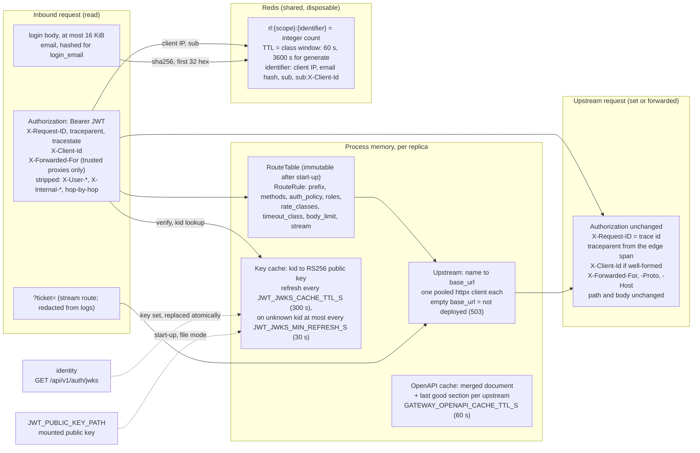

**Migrations:** none. **Constraints and indexes:** none. There is no `erDiagram` for this service: it has no tables.

#### 3.1.4. Breaking changes

**None externally** — the platform has no released API and no clients. The following behaviours are part of the gateway's contract and are recorded so that no client codes against an interim behaviour:

| Change | Impact | Handling |
| --- | --- | --- |
| `X-Request-ID`'s value became the OTel trace ID (C12) rather than a random UUID | Header name and presence are unchanged; only the value's provenance and format (32 hex, no dashes) differ | No client depends on the format. A client-supplied valid trace ID is still echoed (GW-10) |
| Responses carry `traceparent` | Additive | — |
| Rate limiting on `/auth/login`, `/orders` and every other class | Clients can receive `429` | Documented; generous limits; `Retry-After` always present; `RateLimit-*` advertised (GW-21) |
| `POST /orders/{id}/shipment/status` superseded by `POST /api/v1/webhooks/shipment` | The gateway gains the `/webhooks` prefix with `hmac` policy | The admin route remains routed, for manual testing |
| SSE routes are passed through unbuffered, with idle rather than total timeouts | A misconfigured buffering path would have degraded streaming into a single delayed response — silently | Asserted by measurement, not inspection (§7) |
| `/internal/*` is not routed at the edge (GW-4) | An external caller receives `404` rather than the owning service's own `403` | Internal callers never used the edge |
| Malformed `X-Client-Id` is stripped, not rejected | A client with a buggy id generator loses device targeting, never a request | Counted by `gateway_client_id_stripped_total` |

#### 3.1.5. Action Plan

Ordered so that the proxy core is proven end to end before edge policies are layered onto it, and so that each stage is testable against a single upstream first.

| # | Task | Output | Depends on |
| --- | --- | --- | --- |
| GW-T1 | Service skeleton, `GatewaySettings`, Dockerfile (multi-stage, non-root), Compose entry on `:8000` under the `core` profile | Container healthy; `/health` and `/health/ready` answer | `common` settings and logging ([RFC 0001](0001-platform-and-shared-infrastructure.md)) |
| GW-T2 | Route table and matcher; streamed forwarding with header hygiene; one pooled client per upstream; `404`/`405` | `identity` and `catalog` reachable through `:8000`; route-table test enumerates every rule | GW-T1 |
| GW-T3 | Correlation middleware: `X-Request-ID` generation and echo on every response, including gateway-originated errors | Every response carries `X-Request-ID`; the same id appears in gateway and upstream logs | GW-T2 |
| GW-T4 | Auth policies (`public`, `optional`, `bearer`, `ticket`, `hmac`, `blocked`) over `common` verification; coarse role sets; service-token refusal; `X-User-*` stripping | Rejection-reason tests; GW-G3 direct-call tests | GW-T2, `identity` token issuance ([RFC 0003](0003-identity-service.md)) |
| GW-T5 | Upstream timeouts and error normalisation: `502`/`503`/`504`, non-problem `5xx` wrapping, pass-through of problem details | Fault-injection tests (stopped, slow, garbage upstream) | GW-T2 |
| GW-T6 | CORS allow-list on all responses; preflight at the edge | Browser-origin tests, including CORS headers on `401` and `429` | GW-T3 |
| GW-T7 | Request size limits (default, upload route), `413` | Oversize tests, chunked and `Content-Length` | GW-T2 |
| GW-T8 | Aggregated OpenAPI with namespacing, `blocked` path removal, TTL cache, per-upstream degradation; `/docs` | `/openapi.json` complete; one upstream down still serves | GW-T2 |
| GW-T9 | End-to-end smoke through the gateway: register → login → create category → create product → list → status transitions | `make test` green cold | GW-T4..T8 |
| GW-T10 | Add `order` and `inventory` prefixes; `/internal/*` answers `404`; `order_create` class placeholder | Checkout reachable via the edge; reservations `404` at the edge | GW-T4, [RFC 0005](0005-order-service.md), [RFC 0006](0006-inventory-service.md) |
| GW-T11 | OTel: edge server span, httpx client span, `traceparent` injection, `X-Request-ID` = trace ID (GW-10); ticket redaction in spans (GW-18) | A gateway → catalog call is one trace with SQL spans; a checkout trace spans gateway → order → inventory → workflow → relay → consumer | GW-T3, OTel stack ([RFC 0001](0001-platform-and-shared-infrastructure.md)) |
| GW-T12 | `/metrics` with the §3.1.1.7 set; Grafana gateway panels | Prometheus scrapes the gateway; panels live | GW-T11 |
| GW-T13 | Rate limiting: fixed-window counters, every class in the table, per-IP before auth and per-subject after, login email hashing, `RateLimit-*`, fail-open | Threshold, recovery, isolation and Redis-down tests | GW-T4, Redis ([RFC 0001](0001-platform-and-shared-infrastructure.md)) |
| GW-T14 | `X-Client-Id` shape validation and strip; `notif_ack` identifier | Malformed id stripped, mutation still succeeds with `origin_client_id IS NULL` | GW-T2 |
| GW-T15 | Add `notification`, `analytics`, `webhooks` prefixes; `ticket` policy on the stream; `hmac` policy byte-for-byte | Stream opens through the edge; webhook signature verifies after proxying | GW-T4, [RFC 0007](0007-notification-service.md), [RFC 0008](0008-analytics-service.md) |
| GW-T16 | SSE pass-through: no buffering, no compression, idle timeouts, stream-route rate-limit exemption, disconnect propagation, terminal `error` frame, stream cap | **Measured** first-frame latency through the gateway (G5a); disconnect propagation asserted | GW-T15, GW-T13 |
| GW-T17 | Add `/search/*` prefix; `search_anon` / `search_user` classes | Semantic search reachable and limited | GW-T13, [RFC 0009](0009-assistant-service.md) |
| GW-T18 | Add `/assistant/*` prefix; `stream_assistant` and `extended` timeout classes; `chat_*` and `generate` classes | **Measured** time-to-first-token through the gateway, p95 < 1.5s over 20 requests; client disconnect cancels generation | GW-T16, GW-T17 |
| GW-T19 | Record the Q5 decision (GW-20) with its revisit triggers | §3.2 and §5 reviewed | GW-T13, GW-T16 |

**Delivery phasing.**

| Component | Milestone |
| --- | --- |
| Skeleton, route table, streamed forwarding, `identity` and `catalog` prefixes (GW-T1, GW-T2) | M1 |
| `X-Request-ID` generation and echo — random UUID value until tracing lands (GW-T3) | M1 |
| JWT early rejection, coarse role checks, `X-User-*` stripping (GW-T4) | M1 |
| Upstream timeouts (10s) and `504`/`502`/`503` normalisation (GW-T5) | M1 |
| CORS allow-list, request size limits, aggregated OpenAPI and `/docs`, `/health`, `/health/ready` (GW-T6..T8) | M1 |
| End-to-end smoke through the gateway (GW-T9) | M1 |
| `order` and `inventory` prefixes, reservations blocked at the edge, service-token refusal at the edge (GW-T10, GW-3) | M2 |
| OTel spans, `traceparent`, `X-Request-ID` becomes the trace ID (GW-T11) | M3 |
| `/metrics` and Grafana panels (GW-T12) | M3 |
| Rate limiting in Redis: `default`, `login_*`, `order_create`, `notif_ack` (GW-T13) | M3 |
| `X-Client-Id` pass-through and shape validation (GW-T14) | M3 |
| `notification`, `analytics`, `webhooks` prefixes; `ticket` and `hmac` policies (GW-T15) | M3 |
| SSE pass-through for the notification stream, including disconnect propagation and stream cap (GW-T16) | M3 |
| Q5 decided — gateway stays hand-written (GW-T19) | M3 (reviewed at M4) |
| `/search/*` prefix and search rate classes (GW-T17) | M5 |
| `/assistant/*` prefix, assistant stream and extended timeouts, `chat_*` / `generate` classes, time-to-first-token measurement (GW-T18) | M6 |

### 3.2. Rationale

The register lists every significant decision in this RFC with its reason; the prose in [§3.2.2](#322-reasoning) argues the larger ones in full.

#### 3.2.1. Decision register

The gateway decisions already ID'd GW-1 … GW-22 in [§3.1.1.1](#3111-responsibility-and-boundaries) keep those IDs: a register row that records one of them says "= GW-n" in its Decision cell rather than renumbering it, and the remaining rows record decisions stated only in prose.

| ID | Decision | Why | Alternatives rejected (and why) | Revisit if |
| --- | --- | --- | --- | --- |
| GW-D1 | One gateway is the single public entry point at `:8000`, routing by path prefix | Correlation, CORS, rate limiting and aggregated docs need exactly one place; per-service copies drift and cannot count across services ([§3.2.2](#322-reasoning)) | Expose services directly — eight ports, eight CORS configs, no cross-service limits; an nginx config — hides the decisions from review ([§5](#5-alternate-solutions) Alt. 1) | — (structural) |
| GW-D2 | The gateway has no store and no business logic — a bounded exception to the ownership test | The exception is safe only because it cannot hold business state ([§3.1.3](#313-dataschema-changes)) | Thick gateway / BFF — authorisation needs the rows, and composition makes the gateway where features accrete ([§5](#5-alternate-solutions) Alt. 3) | A gateway feature seems to need a table — then it belongs in a service |
| GW-D3 | = GW-20. Hand-written FastAPI, not an off-the-shelf proxy | Per-email and per-`sub` limits, strip-not-reject, RFC 9457 edge errors, the terminal SSE error frame and shared JWT code are code-shaped ([§3.2.2](#322-reasoning)) | Traefik / Kong / Envoy — need plugins or cannot express these; a second JWT implementation ([§5](#5-alternate-solutions) Alt. 2) | TLS becomes required; edge overhead exceeds upstream time on the hot path; routing rules become genuinely declarative (Q5) |
| GW-D4 | Tokens are verified locally against the cached public key; the gateway rejects early but is never the security boundary (A5) | Cheap load-shedding and one uniform `401`; `identity` being down does not stop authenticated traffic (R7) ([§3.2.2](#322-reasoning)) | Call `identity` per request — a sync hop on every request; trust the gateway alone — services unsafe to call directly | Sub-15-minute revocation becomes a requirement (today a revoked user passes until expiry, [§4](#4-dependenciesblockersknown-issues)) |
| GW-D5 | = GW-1. Coarse route-level role checks are necessary conditions only | Keeps the gateway table from becoming a second, divergent policy; drift fails safe ([§3.3](#33-tradeoffs)) | Full authorisation at the edge — needs ownership rows the gateway must not have | — |
| GW-D6 | = GW-2. On `optional` routes a presented token must verify | Silent downgrade would show a merchant the public view of their own catalogue and hide the need to refresh | Treat a bad token as anonymous — hides the error | — |
| GW-D7 | = GW-3. Service tokens are refused on every edge route | Service tokens are for in-network callers; one arriving publicly is a leak or misconfiguration | Let upstreams alone reject them — loses defence in depth | — |
| GW-D8 | = GW-4. Only `/api/v1/*` is routed; `/internal/*` answers `404` | Defence in depth on top of the owning service's scope check; keeps internal routes out of public OpenAPI; a prefix needs no per-route change | Route internal paths and rely on scope checks only | — |
| GW-D9 | = GW-5. Identity is never forwarded as a header; inbound `X-User-*` / `X-Internal-*` are stripped | A header trustworthy on one path and forgeable on another is worse than none; the token carries its own proof ([§3.2.2](#322-reasoning)) | Inject `X-User-*` and let services trust it — forgeable on direct calls; saves only microseconds ([§5](#5-alternate-solutions) Alt. 4) | — |
| GW-D10 | = GW-6. Stream every body, buffer nothing, compress nothing; login body (≤ 16 KiB) is the one exception | A per-route "no buffering" switch is a switch to forget; bytes are never re-serialised, which the HMAC webhook needs ([§3.2.2](#322-reasoning)) | Buffer and special-case SSE — the failure both streaming designs warn about ([§5](#5-alternate-solutions) Alt. 8); response compression — the component most likely to buffer SSE | — |
| GW-D11 | = GW-7. Rate limiting is a fixed-window counter in Redis, shared across replicas; per-IP classes before auth, per-subject after | Three commands, one self-expiring key; limits are abuse and spend controls, and the 2× boundary burst does not change their effect ([§3.2.2](#322-reasoning)) | Sliding log — a sorted set per identifier; GCRA — the upgrade path, not needed yet; per-service limits — cannot span services ([§5](#5-alternate-solutions) Alt. 5, 6) | A limit is observed being gamed at the window boundary (GW-Q1) |
| GW-D12 | = GW-7. On Redis error or timeout, rate limiting fails open | A limiter outage must not become a platform outage; `failed_open` makes the gap visible ([§3.2.2](#322-reasoning)) | Fail closed — every request fails; per-replica in-process fallback — multiplies limits by replica count (GW-Q3) | Login brute force during Redis outages becomes a concern (GW-Q3) |
| GW-D13 | = GW-17, GW-21. Gateway `429` uses type `rate-limited` with `Retry-After`; `RateLimit-*` advertised on rate-limited routes | A client should never discover a limit by hitting it, and must tell an edge limit from `assistant`'s budget | Bare `429` — clients cannot back off correctly | — |
| GW-D14 | = GW-8. The login rate-limit key is a truncated SHA-256 of the normalised email | Redis never holds an address | `identity` counts per-email attempts — splits the login limit across two components ([§3.3](#33-tradeoffs)) | — |
| GW-D15 | = GW-9. The client IP is the socket peer; `X-Forwarded-For` only from `GATEWAY_TRUSTED_PROXIES` | Otherwise any client could rotate its apparent IP to escape per-IP limits | Trust `X-Forwarded-For` always | A real proxy is placed in front of the gateway (then configure the trusted list) |
| GW-D16 | = GW-10. `X-Request-ID` is the trace ID; the edge starts a new root trace and only links an untrusted inbound `traceparent` | One ID for logs and traces (C12); adopting arbitrary client trace IDs would let a client merge its requests into another's trace ([§3.3](#33-tradeoffs)) | Random UUID request ID — two IDs to correlate; adopt inbound `traceparent` — trace merging | A trusted front proxy exists (`GATEWAY_TRUST_INBOUND_TRACEPARENT`) |
| GW-D17 | = GW-11. Gateway-originated failures are RFC 9457; upstream problem details pass through; non-problem `5xx` is wrapped | One error shape for failures no upstream can report; a crashed worker's body may contain a stack trace ([§3.1.2.1](#error-normalisation)) | Bare proxy error pages; rewriting every upstream error | — |
| GW-D18 | The gateway never retries an upstream request | It cannot know whether a non-idempotent request took effect; retries double load when an upstream struggles | Retry idempotent requests — little gain at seven upstreams on one network ([§5](#5-alternate-solutions) Alt. 10) | — |
| GW-D19 | No circuit breaker; per-upstream pools plus 2s connect / 10s read timeouts | A dead upstream fails fast and cannot starve others; a breaker adds per-replica state for little gain (GW-Q2) | Per-upstream circuit breaker | Slow (not dead) upstream failures are seen exhausting a pool (GW-Q2) |
| GW-D20 | = GW-12, GW-13. A broken stream ends with a terminal `event: error` frame; a client disconnect closes the upstream immediately | Keeps the "never stops without explanation" promise when the upstream dies; an abandoned stream otherwise keeps spending tokens ([§3.2.2](#322-reasoning)) | Just close the socket; keep reading or pool the half-read connection — hides the disconnect | — |
| GW-D21 | = GW-22. Per-replica cap on concurrent SSE relays; beyond it `503` with `Retry-After` | The gateway protects its own file descriptors; per-user and per-instance caps stay with the upstreams | Unbounded relays | — |
| GW-D22 | SSE, not WebSockets; no `Upgrade` support (E4, C15) | Traffic is server → client only; SSE is plain HTTP, so routing, auth, limits, tracing and errors apply unchanged | WebSockets — stateful gateway path, bespoke auth handshake ([§5](#5-alternate-solutions) Alt. 7) | A surface needs bidirectionality |
| GW-D23 | = GW-18. Stream route uses `ticket` policy; the ticket is redacted from logs and spans (C19) | `EventSource` cannot set `Authorization`; C19 exists to keep credentials out of logs, and the gateway logs URLs first | JWT in the SSE URL — leaks into logs and `Referer` ([§5](#5-alternate-solutions) Alt. 9) | — |
| GW-D24 | = GW-14. Request bodies bounded at the edge: 1 MiB default, 10 MiB on media upload | Oversize is rejected before a byte reaches the upstream; upstreams keep tighter validation | Rely on upstream limits only | — |
| GW-D25 | = GW-15. Aggregated OpenAPI is merged on demand, cached briefly, namespaced per service, and degrades per upstream | One docs page; a down upstream must not fail `/docs` ([§3.1.1.4](#3114-workflows-and-async-jobs)) | A separate docs tool; failing the whole document | — |
| GW-D26 | = GW-16. Readiness depends only on the gateway itself, not on upstreams or Redis | Partial Compose profiles are normal; one failed service must not take the whole surface down ([§3.2.2](#322-reasoning)) | Readiness requires every upstream | — |
| GW-D27 | = GW-19. CORS is an explicit allow-list (no `*`, no credentials), answered at the edge and applied to error responses | A `401` or `429` without CORS headers is an opaque network error to a browser | Per-service CORS; `*` | — |
| GW-D28 | Entity-first layout with no `v<N>/` folders: `core/`, `health/`, `docs/`, `proxy/`; route table in `proxy/routing.py` | The gateway owns no API contract — paths are table rows forwarded unchanged — and no store, so no `models.py`, `repo.py` or `alembic/` ([§3.1.1.1](#3111-responsibility-and-boundaries)). *Changed after [mentor review 2026-10-06 §3](../reviews/mentor-reviews.md#3-entity-first-service-layout-with-versions) — previously layer-first: `app/api/handlers/`, `configs/`, `infrastructure/`, `middleware/`, `clients/`.* | Versioned folders per concern — would version a contract the gateway does not own | The gateway ever serves an API of its own beyond operational routes |
| GW-D29 | The gateway's data is documented as a data diagram of its route table, key cache, rate-limit counters and forwarded headers, not an ER diagram ([§3.1.3](#313-dataschema-changes)) | It owns no tables, so an `erDiagram` would be empty, but a reviewer still needs to see what state it keeps and where it lives. *Added after [mentor review 2026-10-12 §4](../reviews/mentor-reviews.md#4-diagram-coverage-per-service).* | An empty ER section (hides the Redis and cache state); no data section (the gap the review found) | The gateway gains persistent state |
| GW-D30 | A third timeout class, `stream` (`GATEWAY_STREAM_READ_TIMEOUT_S=120`), for server-sent events (`/notifications/stream`, `/assistant/chat`, `/assistant/generate`); the timeout is now applied **per request** (`build_request(timeout=…)`), which also makes the `upload` class (GW-14) take effect — before, the client's default read timeout applied to every route (Milestone 3 implementation) | A 10 s read timeout cuts an SSE stream whose keepalive is every 20 s; the upload timeout was configured but never reached the request. *Added after [mentor review 2026-10-13](../reviews/mentor-reviews.md#review-of-2026-10-13) §6.* | One long timeout for every route (hides hung upstreams on ordinary calls) | Streams move to a dedicated edge (e.g. a WebSocket gateway) |
| GW-D31 | A malformed `X-Client-Id` (not `[A-Za-z0-9_-]{8,64}`) is dropped, never rejected; validation lives in `smartretail_common.client_id` and services re-check it (Milestone 3 implementation) | The header only narrows where a notification is shown first (C21); refusing a request over it would make an advisory header a failure mode | Rejecting with 400 (breaks clients over a hint) | — |
| GW-D32 | Routes for `notification` (8005), `analytics` (8006) and `assistant` (8007) are added; `/api/v1/notifications/stream` is PUBLIC at the edge because it authenticates with a single-use ticket in the service (an `EventSource` cannot send headers) (Milestone 3 implementation) | The role sets are coarse early rejection, looser than or equal to each service's own checks (GW-1) | Verifying the ticket at the gateway (the gateway would need Redis and the ticket format) | — |

#### 3.2.2. Reasoning

**Why a gateway at all.** Correlation IDs, CORS, rate limiting and aggregated documentation need one place to live. Without a gateway they are either duplicated into eight services — eight CORS configurations that drift, eight rate limiters that cannot count across each other — or pushed into an nginx configuration nobody reviews. A rate limit on `/auth/login` that lives in `identity` cannot also bound `/search/semantic`; a limit that lives in each service cannot bound a client that spreads its requests across services.

**Why the gateway is thin.** A gateway that accumulates business logic becomes a distributed monolith's centre of gravity: every feature grows a branch in it, and every deploy of it is a deploy of everything. This one does routing, early token rejection, correlation, and the other edge concerns that genuinely belong at the edge. Authorisation decisions stay in the service that owns the resource, because only `catalog` knows what "the merchant owns this product" means. GW-1 makes this operational: the gateway's role table may only ever be *looser* than the services', so it can never become the place a policy is actually decided.

**Why it verifies at all, if every service re-verifies (A5).** Two reasons, neither of them security. It is cheap load-shedding: a flood of garbage tokens is rejected with a local signature check before it costs an upstream connection. And it gives one uniform `401` shape and one metric for authentication failures across the whole surface. It is an optimisation that rejects early, never the security boundary — services must be safe to call directly, because internal callers exist and a misrouted request must not be an open door.

**Why the gateway does not forward identity headers (GW-5).** An `X-User-Id` header injected by the gateway is only trustworthy if nothing else can reach the service, and A5 says services must be safe to call directly. A header that is trustworthy on one path and forgeable on another is worse than no header, because a service that reads it once will read it everywhere. The token is the only assertion that carries its own proof.

**Why a fixed window rather than a sliding window or token bucket.** The limits exist to close a brute-force hole (login), bound spend (search, chat, generation) and shed abuse (the per-IP default), not to shape traffic precisely. A fixed-window counter is three Redis commands in one round trip, one key per identifier, self-expiring, and trivially explained in a `Retry-After`. Its known weakness — up to twice the limit across a window boundary — means an attacker gets ten login attempts in a two-second span once per minute instead of five, which does not change the brute-force arithmetic. A sliding log costs a sorted set per identifier; GCRA is more precise and still one key, and is the upgrade path if precision is ever needed ([§5](#5-alternate-solutions)).

**Why fail open.** A Redis outage would otherwise be a platform outage — every request would fail at the edge for want of a counter. The limits protect against abuse that is rare; an outage of the thing that enforces them is also rare; the product of the two is accepted. `failed_open` is counted so the gap is visible.

**Why stream everything rather than special-casing SSE (GW-6).** Both streaming RFCs identify the same trap: streaming that works against the service and buffers at the gateway, silently degrading push into delayed delivery and token streaming into a single late response. A design where SSE routes are "the ones with buffering switched off" leaves a switch to forget. A design where nothing is ever buffered has no switch. The one buffered body — login, for its email — is 16 KiB at most and is on a route that never streams.

**Why a terminal `error` frame from the gateway (GW-12).** Both SSE contracts guarantee that a stream never simply stops without explanation. That guarantee is the upstream's to keep while it is alive; when the upstream dies mid-stream, only the gateway is left to keep it. Writing a frame in the upstream's own `error` vocabulary is the only way the promise survives the failure it most needs to survive.

**Why disconnect must propagate (GW-13).** An abandoned browser tab on an assistant stream is money spent on tokens nobody reads, and an abandoned notification stream is a subscription nobody needs. The upstream can only notice a disconnect if its own socket closes; a gateway that keeps reading the upstream response after the client left — or returns the half-read connection to a pool — hides the disconnect entirely.

**Why readiness ignores upstreams (GW-16).** Compose profiles are the normal way to run the stack: a developer working on `catalog` does not start `assistant`. A gateway whose readiness required every upstream would be permanently not-ready in every partial profile, and in production would turn one failed service into a total outage. Per-route `503`s scope the failure to the routes it affects.

**Why the gateway stays hand-written (Q5, GW-20).** The question was to be reconsidered when rate limiting and SSE proxying arrived. Both have arrived, and both strengthen the case for code rather than configuration:

| Requirement | Hand-written FastAPI | Traefik / Kong / Envoy |
| --- | --- | --- |
| JWT verification sharing `common` (one implementation, one claim model, one set of tests) | Direct import | A second implementation in a plugin or filter, drifting from the services' |
| Per-email login limit (needs the body) and per-`sub` limits (needs verified claims) | A few lines after auth | Custom plugin (Lua / Go / Wasm) or not expressible |
| Strip-don't-reject for `X-Client-Id` | One middleware | Custom plugin |
| RFC 9457 bodies for every edge error, from the shared handler | Shared handler | Per-error templating in proxy configuration |
| Terminal `event: error` frame on mid-stream failure (GW-12) | Direct | Not available |
| Aggregated OpenAPI with namespacing | Direct | Not a proxy feature; a separate tool |
| SSE pass-through without buffering | `httpx` stream relay | Native, and better-optimised |
| Throughput per core | Lower (Python) | Much higher |
| TLS, HTTP/2, hot-reload routing | Not provided | Native |

Everything the platform needs is on the rows where the hand-written gateway wins; everything the off-the-shelf proxies win on is either out of scope (TLS) or unmeasured (throughput). The decision is therefore to stay hand-written, with explicit triggers to revisit: TLS termination becomes required; measured gateway overhead (edge vs upstream duration) exceeds the upstream time on the hot read path; or the route table grows rules that are genuinely declarative (weighted canaries, header-based routing) rather than policy. At that point the natural shape is an off-the-shelf proxy *in front of* this gateway for TLS and raw throughput, not a replacement for the policy it holds.

### 3.3. Tradeoffs

| Trade being made | The cost | Why it is acceptable |
| --- | --- | --- |
| The gateway as a stateless exception to the ownership test | Slight inconsistency in the ownership test | Bounded explicitly — no logic, no database. The alternative duplicates edge concerns eight times |
| An extra network hop on every request | Latency and one more process to run | Sub-millisecond on the Compose network; measured by the edge-vs-upstream duration pair. Every edge concern would otherwise cost more, eight times |
| Double token verification (gateway and service) | Two signature checks per request | RS256 verification is microseconds against a cached key. The second check is what makes services safe to call directly (A5) |
| Coarse role checks that duplicate a subset of each service's matrix | Two places to update when a route's roles change | GW-1 makes drift fail safe: the gateway may only be looser, so a stale gateway rule lets a request through to be rejected by the service, never blocks one the service would allow. The route-table test and GW-G3 catch the rest |
| Hand-written proxy rather than Traefik/Kong/Envoy | Lower throughput per core; no native TLS, HTTP/2, or hot reload; more code to own | The policy the platform needs is code-shaped (§3.2). Throughput is not a stated requirement; TLS is out of scope |
| Fixed-window rate limiting | Up to 2× the limit across a window boundary | The limits are abuse and spend controls, not traffic shaping; the burst does not change their effect materially. GCRA is the upgrade path |
| Rate limiting fails open | During a Redis outage, no limits | An outage of the limiter must not be an outage of the platform. Visible as `failed_open` |
| Per-IP limits | Clients behind one NAT share a budget; a botnet evades them | Per-subject classes cover authenticated traffic; 100/min per IP is generous for a shared NAT at this scale |
| Reading the login body at the edge | One buffered body; the gateway parses a field it does not own | 16 KiB bound; the email is hashed and never logged; the body is forwarded byte-for-byte. The alternative — `identity` counting per-email attempts — would split the login limit across two components |
| No response compression | Larger JSON responses | Irrelevant on a local network; removes the component most likely to buffer SSE |
| Streaming every body, including small JSON | Slightly more per-request overhead than a buffered proxy | Removes the buffering switch that both streaming designs warn about |
| Readiness independent of upstreams | A ready gateway may route to a dead upstream | That is what per-route `503` is for; the alternative takes the whole surface down for one service |
| Aggregated OpenAPI fetched from upstreams at runtime | `/docs` can be briefly incomplete | Degrades per upstream with an explicit marker; cached; per-service `/docs` remain on service ports |
| Internal routes blocked at the edge | One more rule to keep in sync with `inventory` | Defence in depth; the rule is a single prefix |
| Refusing untrusted inbound `traceparent` | A client cannot stitch its own trace to the platform's | A span link preserves the relation; adopting arbitrary client trace IDs would let a client merge its requests into another's trace |

#### 3.3.1. Challenges and Open Questions

| # | Question | Current position | Needs a decision by |
| --- | --- | --- | --- |
| Q5 *(archive 0000; the same question as archive 0001 Q1)* | Should the gateway stay hand-written, or move to Traefik/Kong (or Envoy)? | **Hand-written** (GW-20). Rate limiting needs the body and verified claims; SSE needs a terminal error frame; JWT verification must share `common`. Revisit on the triggers in §3.2: TLS required, measured edge overhead dominating the hot path, or genuinely declarative routing rules | Decided here |
| GW-Q1 | Should rate limiting upgrade from fixed window to GCRA? | Not now. Fixed window is adequate for abuse and spend controls. GCRA is a one-key, one-script change behind the same `rl:*` pattern if boundary bursts ever matter | Revisit if a limit is observed being gamed at the boundary |
| GW-Q2 | Is a circuit breaker needed per upstream? | Not built. With a 2s connect timeout, a 10s read timeout and per-upstream pools, a dead upstream fails fast and cannot starve others. A breaker adds per-replica state and a half-open probe policy for little gain at seven upstreams | Revisit if slow (not dead) upstream failures are seen exhausting a pool |
| GW-Q3 | On Redis failure, fail open entirely, or fall back to an in-process per-replica limiter? | Fail open. A per-replica fallback multiplies every limit by the replica count and behaves differently from the normal path; its value is narrow (the login class during a Redis outage) | Revisit if login brute-force during Redis outages becomes a concern |
| GW-Q4 | Should the `chat_*` class key anonymous callers by the assistant's anonymous session id rather than IP? | IP. A session id is client-controlled and minted freely, so keying by it would let an anonymous caller reset its own limit | Decided |
| GW-Q5 | Should `/metrics` and `/docs` be served on a separate internal port rather than the public one? | Same port locally; nothing is exposed beyond `localhost`. A deployment with a real public edge would move `/metrics` to an internal listener | Only if deployed beyond Compose |
| GW-Q6 | Should the `notif_ack` limit live in the gateway or in `notification`? | Gateway, keyed by `sub` + `X-Client-Id`, with every other rate limit. `notification` returns `204` unconditionally and does not need to know about limits | Decided |

---

## 4. Dependencies/blockers/known issues

**Dependencies.**

| Dependency | Version | Used for |
| --- | --- | --- |
| Python | 3.12 | Runtime |
| FastAPI | 0.115.x | HTTP layer, operational endpoints, Swagger UI |
| Uvicorn (`uvloop`, `httptools`) | 0.32.x | ASGI server; graceful shutdown |
| httpx | 0.28.x | Upstream proxying with streamed request and response bodies; test client |
| PyJWT (via `common`) | 2.10.x | RS256 verification |
| Pydantic / pydantic-settings | 2.x | Settings validation |
| `redis[hiredis]` | 5.x | Async Redis client for rate-limit counters |
| OpenTelemetry SDK + FastAPI and httpx instrumentations | 1.28.x | Spans, context propagation |
| `prometheus-client` | current | `/metrics` exposition |
| `common` | in-repo | JWT verification and claim model, problem-detail handler, JSON logging, tracing setup |
| Redis | 7.4 | Rate-limit counters ([RFC 0001](0001-platform-and-shared-infrastructure.md)) |
| OTel Collector | 0.112.x | Span and metric export target |

No `sse-starlette`: the gateway relays upstream bytes and never constructs an SSE response itself (the terminal error frame is two lines written directly).

**Blockers.** None. Every dependency is public. Upstream services are soft dependencies: the gateway starts and serves `503` for any that are absent.

**Known issues.**

- No TLS; plain HTTP inside Compose.
- Rate limits fail open during a Redis outage (GW-Q3).
- Per-IP limits are shared by clients behind one NAT and evaded by distributed clients; per-subject limits cover authenticated traffic only.
- Fixed-window limits permit up to twice the limit across a window boundary (GW-Q1).
- A revoked or demoted user passes the gateway's checks until their access token expires (≤ 15 minutes); the gateway performs no revocation lookup, by design (A4).
- `/metrics`, `/docs` and `/openapi.json` are unauthenticated on the public port — acceptable only because nothing is exposed beyond `localhost` (GW-Q5).
- Gateway shutdown ends open SSE streams; clients reconnect on the upstream-set `retry:` interval, but a gateway rolling restart still causes one reconnect per open stream.
- Python proxy throughput is lower than a native proxy; unmeasured, because no load target exists.

---

## 5. Alternate solutions

**Alternative 1 — Skip the gateway; expose services directly.** Each service on its own public port; clients know the map.

*Rejected.* Correlation IDs, CORS, rate limiting and aggregated documentation need one place to live, and the alternative is duplicating them into every service or into an nginx configuration nobody reviews. Cross-service rate limits become impossible, and every client hard-codes eight ports.

**Alternative 2 — Off-the-shelf gateway (Traefik / Kong / Envoy).** Mature routing, rate limiting and TLS without writing code.

*Deferred rather than rejected* — this is Q5 (archive 0001 Q1), now decided in favour of the hand-written gateway (GW-20). With few upstreams, a declarative gateway's configuration is roughly the size of the Python it replaces, and a hand-written one keeps the token-verification path readable and shared with the services. Rate limiting by email and by verified subject, strip-not-reject for `X-Client-Id`, RFC 9457 edge errors from the shared handler, the terminal SSE `error` frame and aggregated OpenAPI all need plugins or are not expressible. The revisit triggers are in §3.2; the likely future shape is a native proxy *in front of* this gateway for TLS and throughput.

**Alternative 3 — A thick gateway (backend-for-frontend) that also does authorisation and response composition.** Centralises policy; lets one client call fan out to several services.

*Rejected.* Authorisation requires the rows — "does merchant M own product P" is unanswerable without `catalog_db` — so a gateway that authorises must either call services to ask (a synchronous hop per check, and a policy split across two places) or hold data (the database this RFC forbids). Composition makes the gateway the place features accrete, which is the distributed-monolith failure. A5 and the ownership test both rule it out.

**Alternative 4 — Gateway injects identity headers (`X-User-Id`, `X-User-Role`); services trust them instead of re-verifying.** Saves a signature check per service.

*Rejected* (GW-5). Services must be safe to call directly (A5); a header trustworthy only on one network path is forgeable on every other. The saving is microseconds.

**Alternative 5 — Rate limiting in each service.** No shared Redis dependency at the edge; each service limits what it knows.

*Rejected.* Limits could not span services, would be implemented seven times, and would reject requests only after they had consumed an upstream connection. The per-service pieces that *are* service-specific — LLM token budgets, the 3-streams-per-user cap — stay in their services.

**Alternative 6 — Sliding-log or GCRA rate limiting instead of fixed window.** No boundary burst.

*Deferred* (GW-Q1). Sliding log costs a sorted set per identifier and grows with the limit; GCRA is the precise, cheap option and remains the upgrade path behind the same key pattern.

**Alternative 7 — WebSockets instead of SSE for notification push and assistant streaming.** Bidirectional; auth in the first frame instead of a ticket.

*Rejected* (E4, C15). The traffic is server → client only. SSE is plain HTTP, so the gateway's routing, JWT verification, rate limiting, tracing and RFC 9457 errors apply unchanged. WebSockets would mean a separate connection lifecycle, a **stateful gateway path**, a bespoke auth handshake, and a hand-written reconnect-and-resume client, to buy a bidirectionality nothing asks for.

**Alternative 8 — Buffer responses at the gateway and special-case SSE routes.** The conventional proxy default; simpler error handling (a buffered response can be replaced by a `502` at any point).

*Rejected* (GW-6). Buffering is exactly the failure both streaming designs warn about, and making "not buffering" a per-route switch leaves a switch to forget. Streamed relays lose the ability to replace a response after headers are sent; GW-12's terminal error frame covers the one case where that matters.

**Alternative 9 — Put the JWT in the SSE URL instead of a ticket, and let the gateway verify it.** No ticket round trip; the gateway's normal bearer policy applies.

*Rejected* (C19). A token in a query string leaks into access logs, proxy logs and `Referer` headers — starting with the gateway's own access log. The gateway's `ticket` policy and redaction (GW-18) exist to support the ticket design instead.

**Alternative 10 — Gateway retries idempotent upstream requests on failure.** Masks transient upstream blips.

*Rejected.* The gateway cannot tell whether a `POST` took effect, and retrying `GET`s alone buys little at seven upstreams on one network while doubling load precisely when an upstream is struggling. Client retries with `Idempotency-Key` are the platform's retry model.

---

## 6. Production readiness

"Production" here means the assignment's target: Docker Compose on a developer machine, demonstrated to a mentor. The properties below are structural.

### 6.1. Scalability and Fault tolerance

- **Stateless.** No database, no local session, no sticky routing; any replica serves any request, and `docker compose up --scale gateway=N` is the whole scaling story. Rate-limit counters are in Redis, so limits are global across replicas.
- **Local token verification.** No call to `identity` on the request path; `identity` being down degrades login and refresh only (R7).
- **Timeouts and failure containment.** Connect 2s; read 10s on standard routes, with extended classes only where a route's normal latency needs them. A slow upstream returns `504` as a problem detail rather than hanging. Per-upstream connection pools mean one slow upstream cannot exhaust connections to another.
- **Per-route degradation.** An absent or failing upstream affects only its prefixes (`503`); readiness stays green (GW-16).
- **Backpressure.** The gateway rate-limits. It does not queue: a request is admitted, limited, or rejected, never held.
- **Streaming capacity.** An open SSE relay is one asyncio task and two sockets; `uvloop` and a raised `ulimit -n` put a replica comfortably in the thousands. The per-replica cap (GW-22) turns exhaustion into `503` with `Retry-After`. No sticky sessions are needed, because resumption is `notification`'s and works through any replica.
- **Cache failure is not request failure.** Redis down → rate limits fail open; requests proceed.
- **Graceful shutdown.** On SIGTERM the gateway stops accepting, drains in-flight non-stream requests for up to `GATEWAY_SHUTDOWN_GRACE_S`, then closes streams; `EventSource` reconnects to another replica using the `retry:` hint the upstream already sent, spreading reconnects.
- **Known ceilings.** Python proxy throughput; single Redis node; unmeasured, because no traffic target exists.

### 6.2. Security considerations

- **The gateway is not the security boundary.** It rejects early; every service re-verifies the token and makes its own authorisation decision (A5). Its coarse checks may only be looser than the services' (GW-1), so a gateway bug can let a request through to be refused, never grant access.
- **Tokens.** RS256 only; `none`, `HS*` and unknown algorithms rejected; `exp`/`nbf` checked with 10s leeway; unknown `kid` triggers a rate-limited key refresh, never a fallback. The gateway holds the public key only — compromising it cannot mint a token.
- **Service tokens refused at the edge** (GW-3); internal-only routes not routed (GW-4). A stolen service token cannot be used from outside the Compose network through the gateway.
- **No identity headers** — inbound `X-User-*` and `X-Internal-*` stripped; claims travel only inside the token (GW-5).
- **Brute force.** 5 login attempts per minute per IP and per email, closing the gap that existed before Redis. The email is hashed in the key and never logged (GW-8).
- **Denial of wallet.** Search (20/min per IP, 60/min per user), chat (3/min anonymous, 10/min authenticated) and generation (20/hour per merchant) are limited at the edge because they reach a paid provider; token budgets in `assistant` bound the rest.
- **IP spoofing.** `X-Forwarded-For` is honoured only from trusted proxies (GW-9).
- **`X-Client-Id` is client-minted and forgeable**, and treated as such: shape-validated, never generated, never an identity, never an authorisation input (C21). A malformed value is stripped, never rejected.
- **Credentials out of logs and traces.** `Authorization` and cookies never logged or recorded; the stream ticket redacted from access logs and span URLs (GW-18); request and response bodies never recorded; span headers allow-listed.
- **CORS** — an explicit allow-list from configuration, never `*`; credentials disabled (GW-19).
- **Error hygiene.** Gateway problem details never include stack traces or upstream internals; a non-problem upstream `5xx` body is discarded rather than relayed (GW-11). `401` detail says missing / expired / invalid and never why a signature failed.
- **Request size limits** bound memory and upstream exposure (GW-14); the one buffered body is 16 KiB.
- **Webhook integrity.** `hmac`-policy routes are forwarded byte-for-byte so `order`'s signature check sees exactly what the sender signed (GW-6).
- **No protocol upgrade.** Hop-by-hop headers, including `Upgrade`, are stripped.
- **Transport.** Plain HTTP inside Compose; TLS is out of scope.
- **Accepted gaps.** `/metrics` and `/docs` unauthenticated on the local port (GW-Q5); rate limits fail open during a Redis outage (GW-Q3); no revocation check at the edge (bounded by the 15-minute access-token TTL).

### 6.3. Deployment strategy

- **Compose.** One service, `gateway`, on `:8000`, in the `core` profile, with `depends_on` on nothing hard — it starts without upstreams or Redis and reports them in `/health/ready`'s informational block.
- **Image.** Multi-stage Dockerfile, non-root user, sharing the `common` base layer.
- **Keys.** The public key is mounted read-only from the gitignored key directory, or fetched from `identity`'s JWKS when `JWT_JWKS_URL` is set.
- **Configuration.** Environment only, validated at startup; `*` in the CORS list, an overlapping route table, or an unloadable key fails the container loudly.
- **No migrations**, so the gateway deploys and rolls back independently of every other service. Rolling back the gateway never touches data.
- **Streaming-specific configuration is code, not deployment.** Buffering off, no compression, idle timeouts and the stream-route rate-limit exemption are properties of the route table, so a redeploy cannot lose them. They are nonetheless verified by measurement (§7), because their failure mode is "feels slow", not an error.
- **Draining.** Rolling restarts rely on graceful shutdown (§6.1); no sticky sessions or session affinity are configured.

---

## 7. Test Plan

**Unit — no I/O.**

- Route matcher: longest-prefix and method matching for every row in [§3.1.2.1](#3121-endpoints); overlapping rules with different upstreams fail table construction; `blocked` rules never yield an upstream.
- Auth policies: each of `public`, `optional`, `bearer`, `ticket`, `hmac`, `blocked` against no token, valid token, expired token, tampered signature, wrong key, `alg: none`, `HS256`, unknown `kid`, service token; coarse role allow/deny for all three roles.
- GW-1 invariant: for every route, the gateway's role set is a superset of the owning service's allowed roles (asserted against each service's declared matrix).
- `X-Client-Id` validator: valid shapes pass; 7 and 65 characters, illegal characters, and empty are stripped; the request is never rejected.
- Rate limiter: window boundaries, per-scope isolation, per-identifier isolation, `Retry-After` from `PTTL`, rejected requests still counting, fail-open on a Redis error and on a Redis timeout.
- Login email extraction: normalisation and hashing; unparseable and oversize bodies fall back to per-IP only; forwarded bytes identical to received bytes.
- Correlation: generated trace ID echoed; valid inbound 32-hex `X-Request-ID` adopted; any other inbound value kept as `client_request_id`; untrusted inbound `traceparent` becomes a span link.
- Error mapping: each transport failure kind → the documented status and `type`; problem-detail upstream bodies relayed unchanged; non-problem `5xx` wrapped with status preserved.
- Header hygiene: `X-User-*`, `X-Internal-*` and hop-by-hop headers stripped; `Authorization`, `Idempotency-Key`, `Last-Event-ID` forwarded unchanged.
- Ticket redaction in the access-log formatter and span attributes.
- Problem-detail serialisation for every gateway-originated status.

**Integration — gateway in-process against stub upstreams (`httpx` mock transports and a real stub ASGI app), real Redis.**

- Every response — `2xx`, upstream `4xx`, gateway `401`/`403`/`404`/`413`/`429`/`502`/`503`/`504` — carries `X-Request-ID`, `traceparent`, and CORS headers for an allowed origin.
- Rate limits: each class returns `429` with `Retry-After` and `RateLimit-*` at its threshold and recovers after the window; `default` stacks with route classes; the notification stream is not counted against `default`; two gateway instances share one counter.
- Redis stopped → requests still succeed, limits fail open, `failed_open` counted.
- Upstream stopped → `503` with `Retry-After`; upstream sleeping past the read timeout → `504`; upstream closing the socket before headers → `502`; upstream returning a plaintext `500` → wrapped `500` problem detail with no body leak.
- Size limits: `Content-Length` over the limit → `413` with no upstream call; chunked body crossing the limit → `413`; 9 MiB upload accepted on the upload route, 2 MiB JSON rejected elsewhere.
- **Gateway: a malformed `X-Client-Id` is stripped and the mutation still succeeds, with `origin_client_id IS NULL`** (against the real `order` service in the E2E tier).
- Service token presented at the edge → `403`; `/internal/v1/inventory/reservations` and `/internal/v1/products/{id}/publish/validate` → `404` with no upstream call.
- `optional` route with an expired token → `401`, not an anonymous response.
- Webhook through the gateway: an HMAC computed over the sent bytes verifies at the stub upstream.
- OpenAPI: all upstreams' paths present, schemas namespaced, `blocked` paths absent; with one upstream stopped, `/openapi.json` is `200` and lists it in `x-upstreams-unavailable`.
- `/health/ready` is `200` with every upstream and Redis stopped, and `503` with no loadable public key.
- **Direct-call safety (GW-G3):** for each role-gated route, the upstream is called directly (not via the gateway) with a disallowed role and returns its own `403`.

**SSE pass-through.**

- Stub upstream writes one frame, sleeps 5s, writes another: the client receives the first frame within 100ms, not after 5s — the buffering detector.
- `: keepalive` comments, `id:`, `retry:` and multi-line `data:` pass through byte-identical.
- Client disconnect mid-stream → the stub upstream observes its socket closing within one read; the connection is not reused.
- Upstream killed mid-stream → the client receives one terminal `event: error` frame with a `502` problem detail, then EOF.
- Upstream silent past the idle timeout → terminal `event: error` with `504`.
- Stream cap reached → the next stream is `503` with `Retry-After`.
- Spans for a stream end at stream end, with a `first_byte` event.

**End-to-end — through the gateway, cold start, full stack.**

- The standard scenario runs entirely through `:8000`: register → login → create category as admin → create product → add variant → list as anonymous (absent, draft) → status transitions → publish (`202`) → set stock → place order (`202`) → confirm; `X-Request-ID` present and consistent across gateway and service logs for one request.
- **A gateway → catalog call is one trace with SQL spans.** A checkout produces exactly one trace containing spans from gateway, order, inventory, the Temporal workflow, the relay, and the notification consumer — asserted via the Jaeger API.
- `POST /auth/login` six times in a minute from one IP → the sixth is `429` with `Retry-After`; the same email from a second IP is also limited.
- **Notification push through the gateway:** first frame not buffered; push latency from consume to client receipt measured, under one second (G5a).
- **Assistant through the gateway:** time-to-first-token p95 < 1.5s over 20 requests, measured by the test client, not the service's clock (G5, Q9); client disconnect mid-stream cancels generation, asserted against the fake provider's cancellation record; the trace spans gateway → assistant → retrieval → LLM call → outbox with the streaming span closing at stream end.
- Semantic search trace spans gateway → assistant → embedding call → Postgres.
- Stopping `assistant` leaves every Part A flow working through the gateway and `/assistant/*` returning `503`.

**Explicitly not tested here** — throughput and latency under load (no target exists); upstream business rules, which are each owning RFC's test plan.

---

## 8. Impact Analysis

**On upstream services.** None need to implement CORS, rate limiting, correlation-ID generation or aggregated docs. Each must: mount its routes under its `/api/v1/...` prefix unchanged; produce RFC 9457 errors via `common` (so the gateway relays rather than wraps them); re-verify the token and never read an identity header (A5, GW-5); propagate the inbound `traceparent` and `X-Request-ID`; and, for streaming services, rely on the gateway to relay bytes verbatim and to close their socket on client disconnect.

**On clients.** One base URL; one error shape; `X-Request-ID` on every response for support correlation; `Retry-After` and `RateLimit-*` to back off correctly; `X-Client-Id` optional and never able to fail a request.

**On each service RFC.** Adding a route under an existing prefix needs no gateway change unless its role set is narrower than the prefix rule and the service wants early rejection. Adding a new prefix or a streaming route is a one-row change to the route table and to [§3.1.2.1](#3121-endpoints).

**On operations.** The gateway is the first place to look for any client-reported problem: its access log carries the trace ID, the upstream, the status and whether the gateway or the upstream originated it. "Is it the edge or the service?" is answered by `origin` and by the edge-vs-upstream duration pair.

**Risks.**

| Risk | Likelihood | Impact | Mitigation |
| --- | --- | --- | --- |
| Streaming works against the service but buffers at the gateway | **High** | Medium | GW-6 removes the buffering path; first-frame latency and time-to-first-token are **measured** through the gateway, never inspected |
| Gateway role rules drift into being the de facto policy | Medium | High | GW-1; the superset unit test; direct-call tests (GW-G3) |
| Business logic creeps into the gateway | Medium | Medium | The no-store, no-domain rule; no `models.py`, `repo.py` or `core/db.py` exists to put it in; review check |
| Redis outage silently removes brute-force protection | Low | Medium | `failed_open` metric and dashboard panel; GW-Q3 records the fallback option |
| A missed hop-by-hop or identity header lets a client influence an upstream | Low | High | Header hygiene unit tests; services never read identity headers regardless |
| A stale route table routes a new endpoint to `404` | Medium | Low | Route-table test enumerates every owning RFC's endpoint list |

---

## 9. Useful Links/References

**Project documents**

- [Part A — platform requirements](../part-a.md) · [Part B — GenAI layer](../part-b.md)
- [Milestones](../milestones.md) · [Execution Guidelines](../execution-guidelines.md)

**RFC set**

- [RFC 0000 — Architecture](0000-architecture.md): [surface map](0000-architecture.md#3121-surface-map), [API conventions](0000-architecture.md#3122-api-conventions), [auth split](0000-architecture.md#3114-authentication-and-authorisation-split), [A1–A14](0000-architecture.md#3115-cross-cutting-decisions-a1a14), [event envelope](0000-architecture.md#3124-event-envelope)
- [RFC 0001 — Platform and Shared Infrastructure](0001-platform-and-shared-infrastructure.md) — `common`, Redis keyspaces, OTel stack, Compose
- [RFC 0003 — `identity`](0003-identity-service.md) — token format, JWKS, service tokens
- [RFC 0007 — `notification`](0007-notification-service.md) — the notification SSE stream, stream tickets, `X-Client-Id` consumption
- [RFC 0009 — `assistant`](0009-assistant-service.md) — the assistant SSE contract, token budgets
- Archived sources: [0000](archive/0000-system-architecture.md), [0001](archive/0001-foundation-and-core-services.md), [0003](archive/0003-events-and-observability.md), [0004](archive/0004-retrieval-layer.md), [0005](archive/0005-ai-assistant-and-streaming.md), [0006](archive/0006-service-decomposition-and-data-model.md)

**Technical references**

- RFC 9457, Problem Details for HTTP APIs — https://www.rfc-editor.org/rfc/rfc9457
- RFC 9110, HTTP Semantics (hop-by-hop headers, `Retry-After`) — https://www.rfc-editor.org/rfc/rfc9110
- IETF draft, RateLimit header fields for HTTP — https://datatracker.ietf.org/doc/draft-ietf-httpapi-ratelimit-headers/
- W3C Trace Context — https://www.w3.org/TR/trace-context/
- HTML Living Standard, Server-sent events — https://html.spec.whatwg.org/multipage/server-sent-events.html
- RFC 7519, JSON Web Token — https://www.rfc-editor.org/rfc/rfc7519
- httpx streaming — https://www.python-httpx.org/async/#streaming-responses
- FastAPI — https://fastapi.tiangolo.com/
- Generic Cell Rate Algorithm (the GW-Q1 upgrade path) — https://en.wikipedia.org/wiki/Generic_cell_rate_algorithm
- RED method — https://grafana.com/blog/2018/08/02/the-red-method-how-to-instrument-your-services/

---

## 10. Related tickets/issues

| ID | Title | Maps to |
| --- | --- | --- |
| *(to be created)* | GW-T1 … GW-T19 | The tasks in [§3.1.5](#315-action-plan), one ticket each |
| — | archive 0001 T14 — gateway routing, JWT pre-verification, request-ID injection, CORS, aggregated docs | GW-T2..T8 |
| — | archive 0001 §4 known issue — no rate limiting on `POST /auth/login` | Closed by GW-T13 |
| — | archive 0003 T16c — gateway SSE pass-through | GW-T16 |
| — | archive 0003 T16e — `X-Client-Id` gateway pass-through and shape validation | GW-T14 |
| — | archive 0003 T20 — Redis rate limiting at the gateway | GW-T13 |
| — | archive 0005 T14 — gateway SSE pass-through, measured time-to-first-token | GW-T18 |
| — | Q5 (archive 0000) / Q1 (archive 0001) — hand-written vs Traefik/Kong | Decided here (GW-20) |

---

## 11. Notes

- **On decision identifiers.** A-, C- and E- identifiers are kept exactly as in the archive so they remain traceable. Archive 0001 carried its own, differently numbered A1–A8; the gateway-relevant one, its A6 ("the gateway verifies; each service re-verifies"), is the same decision as A5 in [RFC 0000](0000-architecture.md#3115-cross-cutting-decisions-a1a14) and is cited as A5 here. New decisions in this RFC are `GW-1`…`GW-22`, goals `GW-G1`…`GW-G10`, tasks `GW-T1`…`GW-T19`, open questions `GW-Q1`…`GW-Q6`.
- **On superseded sketches.** An early topology sketch showed the gateway injecting `X-User-*` headers and routing a `/api/v1/catalog` prefix. Both are superseded — by GW-5 and by the surface map respectively — and recorded here so a reader of the archive does not reintroduce them.
- **On the analytics coarse check.** The architecture summary described `/api/v1/analytics/*` as `admin`-only at the gateway. The analytics endpoint table admits merchants to four merchant-scoped endpoints. Under GW-1 the gateway must not be stricter than the service, so the coarse rule is `admin` on the admin-only endpoints and `merchant`, `admin` on the rest.
- **On what the gateway must never become.** The test for any proposed gateway feature is whether it needs a row. If it does, it is a service feature.
- **Amendment log.**

  | Date | Section | Change | Reason |
  | --- | --- | --- | --- |
  | Oct 11, 2026 | All | References to the shared package changed from `libs/common` to `common` | [Mentor review 2026-10-06 §1](../reviews/mentor-reviews.md#1-shared-package-folder) |
  | Oct 11, 2026 | §3.2.1 | Added the decision register (GW-D1–GW-D28); GW-1…GW-22 keep their IDs and are cross-referenced | [Mentor review 2026-10-06 §2](../reviews/mentor-reviews.md#2-a-reason-for-every-decision) |
  | Oct 11, 2026 | §3.1.1.1, §3.2.1 | Layer-first module layout replaced by concern folders `core/`, `health/`, `docs/`, `proxy/` with no `v<N>/` folders (GW-D28) | [Mentor review 2026-10-06 §3](../reviews/mentor-reviews.md#3-entity-first-service-layout-with-versions) |
  | Oct 11, 2026 | §3.1.1.1–§3.1.1.4, §3.1.2.1 | ASCII topology converted to Mermaid; added the component, pipeline, auth-policy and upstream-response flowcharts, the stream state diagram and the key-refresh, rate-limit, OpenAPI, proxied-request and SSE sequences | [Mentor review 2026-10-06 §4](../reviews/mentor-reviews.md#4-diagrams) |
  | Oct 12, 2026 | §3.1, §3.1.3, §3.2.1 | Added the diagram index and the data diagram of the gateway's in-memory and Redis state and forwarded headers (GW-D29) | [Mentor review 2026-10-12 §4](../reviews/mentor-reviews.md#4-diagram-coverage-per-service) |
  | Oct 12, 2026 | §3.2.1, §11 | Rows changed by a review (GW-D28, GW-D29) name the review and the previous decision; this amendment log added | [Mentor review 2026-10-12 §3](../reviews/mentor-reviews.md#3-every-change-traced-to-its-review) |
  | Oct 15, 2026 | §3.1.2.1, §3.2.1 | GW-D30–GW-D32: `stream` timeout class and per-request timeouts (fixes the upload class), `X-Client-Id` shape check, routes for notification, analytics and assistant | [Mentor review 2026-10-13](../reviews/mentor-reviews.md#review-of-2026-10-13) |
- **Definition of done.** Goals GW-G1–GW-G10 verified by their stated checks; the measured SSE latency tests green through the gateway; the route table matching every owning RFC's endpoint list; this RFC moved to **DONE** with review outcomes folded in.

---

## 12. Comments

*Reviewer comments go here. Please raise objections against the numbered decisions (GW-1–GW-22, a register row GW-D1–GW-D29, and A5/A8/C12/C13/C19/C21 as they apply at the edge), the open questions (Q5, GW-Q1–GW-Q6), the route table in §3.1.2.1, or the rejected alternatives in §5, so the discussion attaches to something specific.*

| Reviewer | Section | Comment | Resolution |
| --- | --- | --- | --- |
| | | | |
