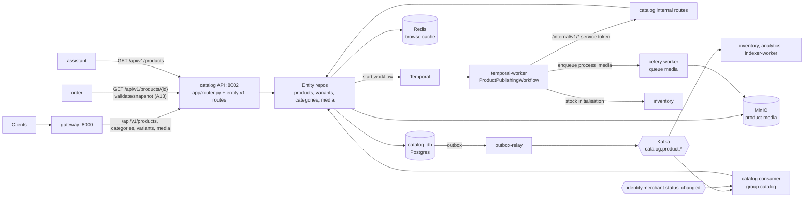
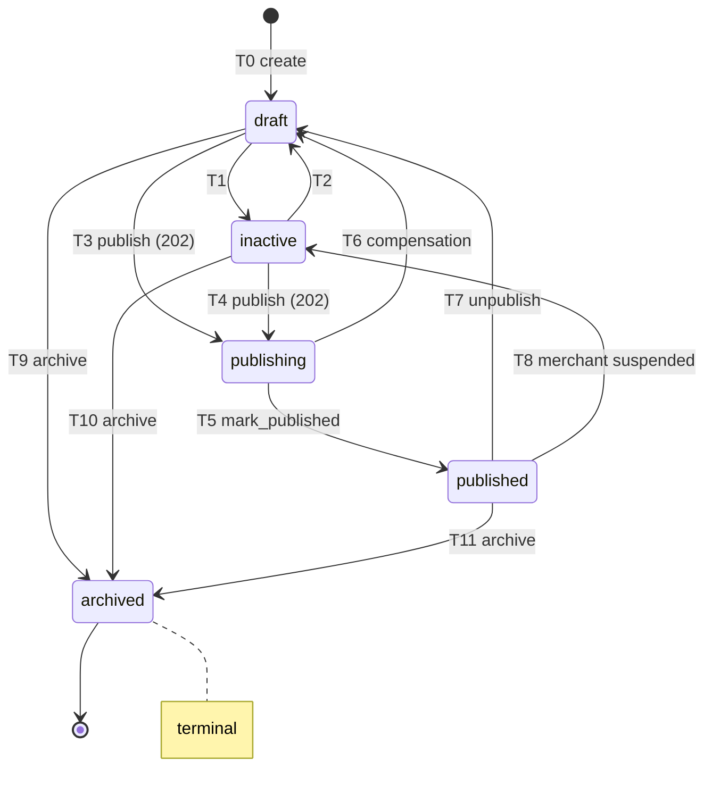
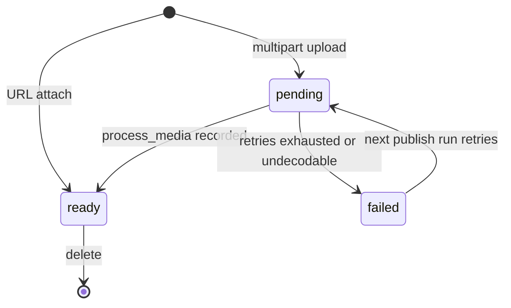
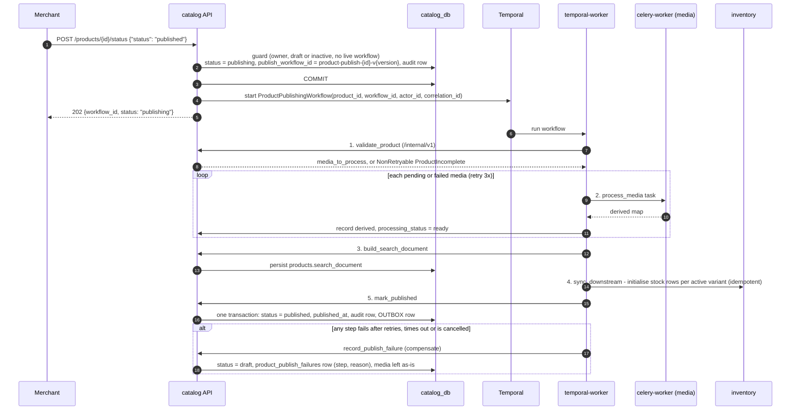
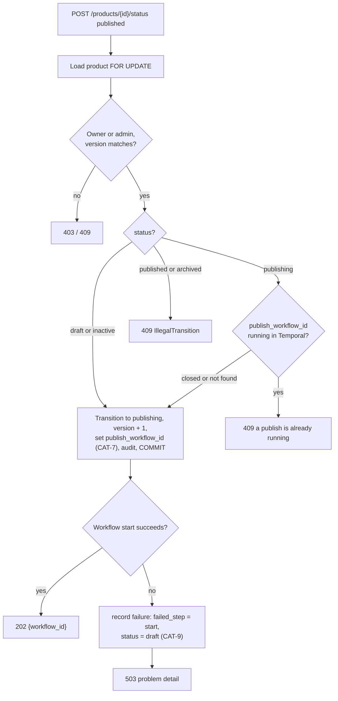
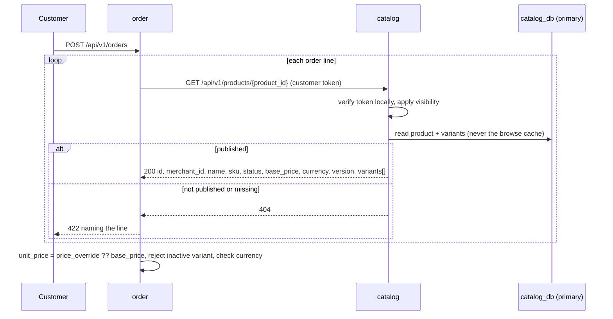
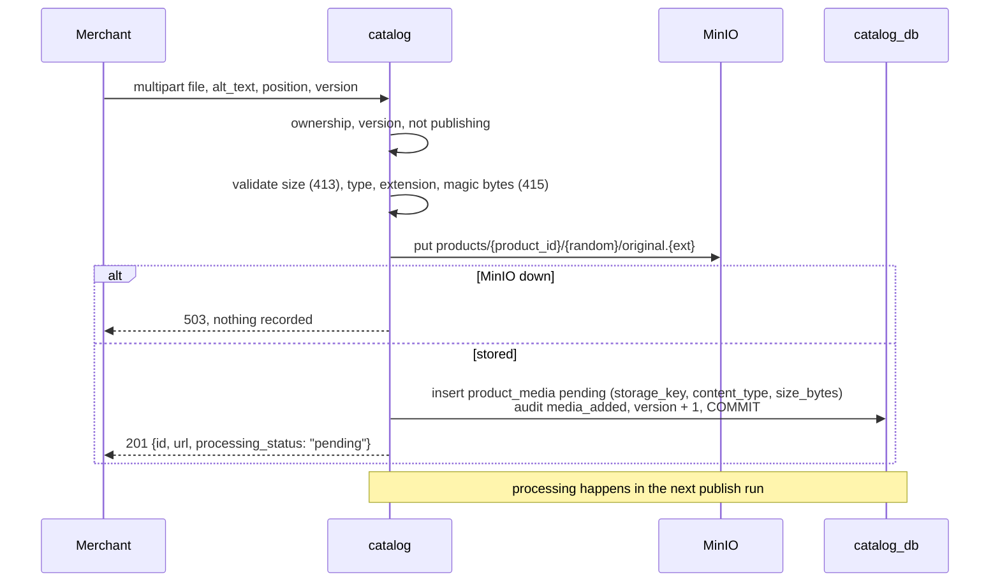
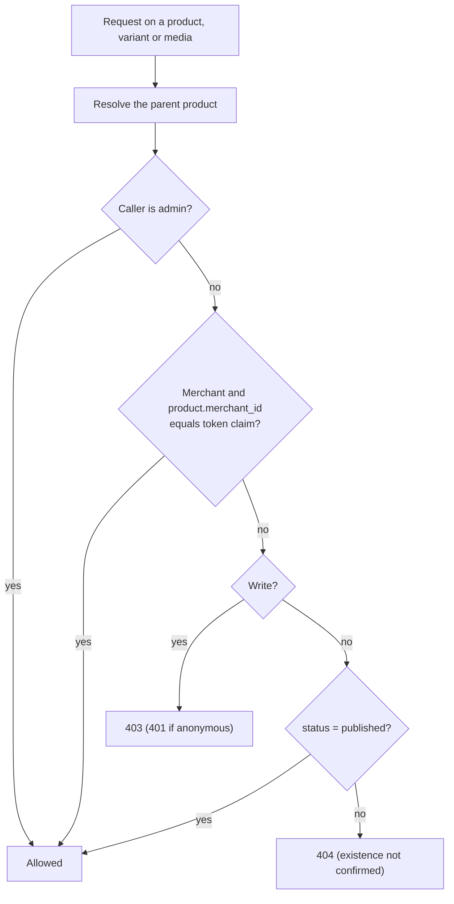
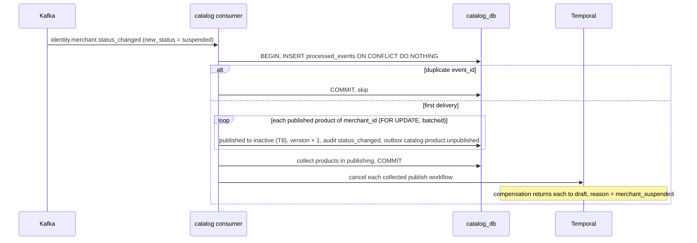
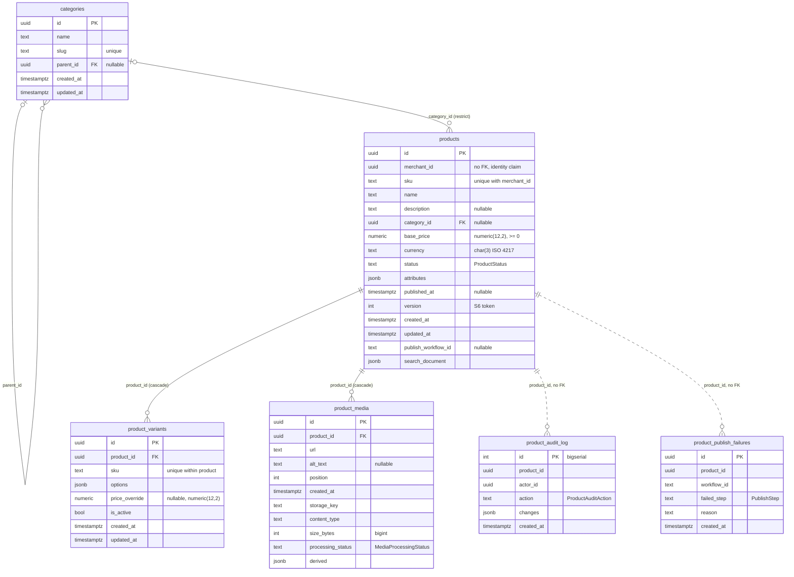

# RFC 0004 — `catalog` Service

| | |
| --- | --- |
| **Owner** | @muhammad.adnan |
| **Collaborators** | SarwanAhmed |
| **Status** | **DRAFT** · IN-REVIEW · DONE |
| **Created** | Sep 29, 2026 |
| **Supersedes** | The catalog parts of [archive/0001 — Foundation & Core Services](archive/0001-foundation-and-core-services.md), [archive/0002 — Core Business Logic & Workflows](archive/0002-core-business-logic-and-workflows.md), [archive/0003 — Events & Observability](archive/0003-events-and-observability.md), the catalog-facing parts of [archive/0004 — Retrieval Layer](archive/0004-retrieval-layer.md) and [archive/0005 — AI Assistant & Streaming](archive/0005-ai-assistant-and-streaming.md), and the `catalog_db` catalogue of [archive/0006 — Service Decomposition & Data Model](archive/0006-service-decomposition-and-data-model.md) |
| **Depends on** | [RFC 0000 — Architecture](0000-architecture.md) · [RFC 0001 — Platform & Shared Infrastructure](0001-platform-and-shared-infrastructure.md) · [RFC 0003 — `identity` Service](0003-identity-service.md) · [RFC 0006 — `inventory` Service](0006-inventory-service.md) |

> **Reading note.** This RFC is the complete specification of the `catalog` service: what it owns, its domain model and product state machine, the `ProductPublishingWorkflow`, the media pipeline, every endpoint under `/api/v1/products/*`, `/api/v1/categories/*`, `/api/v1/variants/*` and `/api/v1/media/*`, the events it produces and consumes, and every column of `catalog_db`. Cross-cutting rules — the ownership test, boundary rules R1–R8, decisions A1–A14, API conventions, the event envelope, schema conventions S1–S15 and the shared `outbox` / `processed_events` DDL — live in [RFC 0000](0000-architecture.md) and are linked rather than restated. Hosting of the Temporal worker, the Celery worker, the outbox relay, Kafka, Redis and MinIO is in [RFC 0001](0001-platform-and-shared-infrastructure.md); the business logic `catalog` runs inside those hosts is specified here. Decision IDs from the archived RFCs (A*, B*, C*, D*, E*, R*, S*) are kept exactly; decisions new to this RFC carry the prefix `CAT-`. Open-question numbers are per source RFC, so each is shown with its source (for example *Q2 (0001)*).

---

## Contents

1. [Title](#1-title)
2. [Overview](#2-overview)
   - 2.1. [Goals](#21-goals)
   - 2.2. [Non-goals](#22-non-goals)
3. [Solution Overview](#3-solution-overview)
   - 3.1. [Specification](#31-specification)
     - 3.1.1. [Architectural changes](#311-architectural-changes)
       - 3.1.1.1. [Responsibility and boundaries](#3111-responsibility-and-boundaries)
       - 3.1.1.2. [Domain model](#3112-domain-model)
       - 3.1.1.3. [State machines](#3113-state-machines)
       - 3.1.1.4. [Workflows and async jobs](#3114-workflows-and-async-jobs)
       - 3.1.1.5. [Dependencies and degradation](#3115-dependencies-and-degradation)
       - 3.1.1.6. [Configuration](#3116-configuration)
       - 3.1.1.7. [Observability](#3117-observability)
     - 3.1.2. [API changes](#312-api-changes)
       - 3.1.2.1. [Endpoints](#3121-endpoints)
       - 3.1.2.2. [Role matrix](#3122-role-matrix)
       - 3.1.2.3. [Events produced](#3123-events-produced)
       - 3.1.2.4. [Events consumed](#3124-events-consumed)
     - 3.1.3. [Data/schema changes](#313-dataschema-changes)
     - 3.1.4. [Breaking changes](#314-breaking-changes)
     - 3.1.5. [Action Plan](#315-action-plan)
   - 3.2. [Rationale](#32-rationale)
     - 3.2.1. [Decision register](#321-decision-register)
     - 3.2.2. [Reasoning](#322-reasoning)
   - 3.3. [Tradeoffs](#33-tradeoffs)
     - 3.3.1. [Challenges and Open Questions](#331-challenges-and-open-questions)
4. [Dependencies/blockers/known issues](#4-dependenciesblockersknown-issues)
5. [Alternate solutions](#5-alternate-solutions)
6. [Production readiness](#6-production-readiness)
   - 6.1. [Scalability and Fault tolerance](#61-scalability-and-fault-tolerance)
   - 6.2. [Security considerations](#62-security-considerations)
   - 6.3. [Deployment strategy](#63-deployment-strategy)
7. [Test Plan](#7-test-plan)
8. [Impact Analysis](#8-impact-analysis)
9. [Useful Links/References](#9-useful-linksreferences)
10. [Related tickets/issues](#10-related-ticketsissues)
11. [Notes](#11-notes)
12. [Comments](#12-comments)

---

## 1. Title

**The `catalog` service — products, variants, categories and media; the product state machine; the durable `ProductPublishingWorkflow`; and the product events every downstream consumer builds on.**

`catalog` (:8002, `catalog_db`) is the sole writer of what SmartRetail sells: the product definition, its price, its status, its variants, its category and its media metadata. It is read-heavy and the highest-cardinality store in the platform. Its one hard process is publishing — [Part A](../part-a.md) §2 — which it runs as a Temporal saga so that a partial failure can never leave a half-published product.

---

## 2. Overview

[Part A](../part-a.md) §1 asks that merchants create products, define variants such as size or colour, manage pricing, upload product media, configure categories and publish changes efficiently; that customers browse products; that product state (`draft`, `published`, `inactive`) is handled; and that every product change is traceable to who made it and when. §2 specifies the publishing process — validate for completeness, process media, create search-ready records, synchronise downstream, and mark ready only after processing completes — with the constraint that *partial failures must not corrupt product state or leave the workflow incomplete*.

`catalog` answers both. CRUD, ownership, visibility and the audit trail are ordinary transactional service code. Publishing is a `ProductPublishingWorkflow` hosted in `temporal-worker`, whose activities are thin adapters over `catalog`'s own service layer (B1), and whose only visibility write is one transaction that flips the status, writes the audit row and writes the outbox row that becomes `catalog.product.published` (B11, A10).

Downstream, three things depend on `catalog` and must not reach into it: `order` snapshots product data at creation through the platform's one synchronous cross-service call (A13, R5); `inventory` initialises stock rows on publish; `assistant`'s `indexer-worker`, `analytics` and `inventory` consume the three `catalog.product.*` topics. Stock is never stored here (R3): it is `inventory`'s fact, read by clients through the inventory API.

### 2.1. Goals

Goal IDs are kept from the RFC that introduced them.

| # | Source | Goal | How it is verified |
| --- | --- | --- | --- |
| G3 | 0001 | Product (catalog) management: CRUD for products, variants, categories | Endpoints in §3.1.2.1 return the documented responses; covered by tests |
| G4 | 0001 | RBAC enforced on every non-public endpoint, for `customer` / `merchant` / `admin` | The role-matrix test asserts allow/deny for each role against each endpoint in §3.1.2.2 |
| G5 | 0001 | Database schema created and version-controlled | Alembic migrations run from an empty `catalog_db` to head in CI and locally |
| G7 | 0001 | Ownership enforcement: a merchant can only modify the merchant's own catalog | Tests assert a merchant receives `403` on another merchant's product |
| G1 | 0002 | Product publishing runs as a durable workflow; partial failure never leaves a half-published product | Activity-failure injection tests: every failure point leaves the product in `draft` with a recorded reason, never `published` |
| G7 | 0002 | Media upload and processing work, driven by the publishing workflow | Upload returns a URL; the workflow's media step produces derived sizes |
| G8 | 0002 | Every state change writes an outbox row in the same transaction | A rolled-back state change leaves no outbox row, and vice versa |
| G9 | 0002 | The publish transition is asynchronous: `202` with a `workflow_id` | Contract test |
| G9 | 0003 | Background work is off the request path | No `catalog` handler performs media processing inline |
| CAT-G1 | new | Every product event carries enough state for its consumers without a call back into `catalog` | `inventory` creates stock rows and `indexer-worker` indexes from the payload alone (contract tests, §7) |
| CAT-G2 | new | A suspended merchant's products disappear from every public surface without a synchronous call | End-to-end: suspend → `identity.merchant.status_changed` consumed → products absent from browse and from semantic search |

### 2.2. Non-goals

| Excluded | Why / where it lives |
| --- | --- |
| Stock quantities | `inventory` owns stock ([RFC 0006](0006-inventory-service.md)). A `quantity` column here would make `catalog` a second writer on a fact `order` also changes — the multi-writer inconsistency Part A opens by describing (R3) |
| Semantic search, embeddings, vectors | `assistant` ([RFC 0009](0009-assistant-service.md)). `catalog` must not grow a vector column (D2); it offers keyword filtering only, and `assistant`'s hybrid search uses its own keyword index over chunks |
| A promotional and pricing rules engine | Not specified beyond "basic pricing". `catalog` stores a base price, a currency and a per-variant price override |
| Multi-currency arithmetic | A product has one `currency`; conversion is out of scope |
| Presigned direct-to-MinIO upload | Deferred (Q6 (0002)). Uploads pass through `catalog` so validation happens before anything is stored |
| Category-level variant dimension schemas | Variant `options` are free-form `jsonb` (Q5 (0001)); Pydantic validates shape |
| Automatic application of AI-generated copy | `assistant` returns a draft; the merchant applies it through `PATCH /products/{id}` explicitly (Q8 (0005)) |
| A shared reference-data service for categories | Decided against (archive/0006 §3.3.1): categories are `catalog`'s |
| Product reviews, recommendations | Not in scope (archive/0000 §3.1.1); cross-sell is a generation task in `assistant` |
| A frontend | The API and its OpenAPI document are the deliverable |

---

## 3. Solution Overview

### 3.1. Specification

#### 3.1.1. Architectural changes

##### 3.1.1.1. Responsibility and boundaries

**Owns** (the facts nothing else writes, per the ownership map in [RFC 0000 §3.1.3.6](0000-architecture.md#3136-ownership-map)):

| Fact | Read elsewhere as | Mechanism |
| --- | --- | --- |
| Product definition, price, status | Snapshot (`order`), Projection (`assistant`), Live lookup (search display) | API + events |
| Category tree | Projection | Event |
| Variants (option combinations, price override) | Snapshot (`order_items.variant_options`), snapshot in `stock_items` (`sku`, `product_id`, `merchant_id`) | API + `catalog.product.published` |
| Media metadata (url, ordering, storage key, processing state, derived sizes) | Projection (`product_chunks.metadata` media url) | Event payload |
| Product audit trail | — | — |
| Publish failure records | — | — |

**Does not own.**

| Fact | Owner | How `catalog` sees it |
| --- | --- | --- |
| Merchant identity and approval status | `identity` | `merchant_id` arrives as a **claim** in the verified token; approval status arrives as `identity.merchant.status_changed` ([RFC 0003](0003-identity-service.md#3123-events-produced)) |
| Merchant display name | `identity` | Not held. Clients call `GET /api/v1/merchants/{merchant_id}` (public) |
| Stock on hand, reservations, availability | `inventory` | Not held and not called. Clients read `GET /api/v1/inventory/{variant_id}` (§ *How stock is displayed* below) |
| Media binaries | MinIO (object storage) | Referenced by `product_media.storage_key` |
| Workflow execution state | Temporal | Referenced by `products.publish_workflow_id` |
| Chunks, embeddings, index state | `assistant` | None — `catalog` does not know the retrieval layer exists (archive/0004 §3.2) |

**Ownership-test row** ([RFC 0000 §3.1.1.2](0000-architecture.md#3112-the-ownership-test)):

| Candidate | State it owns | Invariant | Independent change | Distinct profile | Verdict |
| --- | --- | --- | --- | --- | --- |
| `catalog` | products, variants, categories, media | SKU unique per merchant; status machine | yes | read-heavy, high cardinality | **Service** |

Candidates rejected *into* `catalog` or away from it: `pricing` (price is a product attribute → `catalog`); `media` (no owned state — object storage plus a Celery task, `catalog` owns the metadata); `search` (index is derived — keyword query is a `catalog` endpoint, semantic query is `assistant`'s, indexing is a worker); `audit` (an audit row must be written in the same transaction as the change — each service owns its own trail, S7); `inventory` kept separate (putting it in `catalog` recreates the multi-writer bug).

**Rules that bind it.**

| Rule | How it applies to `catalog` |
| --- | --- |
| R1 / A1 / A2 | `catalog` connects to `catalog_db` only, with its own role; it cannot see any other database |
| R2 / A3 / S15 | `products.merchant_id` is a plain indexed `uuid`, not a foreign key to `identity.users.id` |
| R3 | Stock lives nowhere in `catalog_db` |
| R4 | Nobody joins against `catalog_db`; `order`, `inventory`, `assistant` read through the API or the events |
| R5 / A13 | `catalog` **serves** the platform's one synchronous cross-service call (`order → catalog` at creation) and makes none on a request path itself |
| R6 / A14 | Consumers snapshot or project `catalog` data; nothing references it live except the order-creation lookup |
| R7 | Browse and product reads work with `identity`, `inventory`, Kafka and Temporal all down (§3.1.1.5) |
| R8 | `ProductStatus`, `MediaProcessingStatus` and every other vocabulary live in the owning entity's `enums.py` (`services/catalog/app/products/enums.py`; `app/media/enums.py` when media processing lands), never in `common` |
| A4 / A5 | `catalog` re-verifies every token locally against the RS256 public key; the gateway's check is not trusted |
| A6 | Async FastAPI, SQLAlchemy 2.0 async, `asyncpg` |
| A7 | RFC 9457 problem details for every error |
| A8 | `X-Request-ID` / `traceparent` on every log line, audit row (`correlation_id` in the outbox) and workflow input |
| A10 / B11 / S12 | Every state change that is a fact for someone else writes an outbox row in the same transaction |
| A11 / C4 / S13 | The consumer dedupes on `processed_events (consumer_group, event_id)` in the same transaction as its effect |
| A12 / C7 | Publishing is a Temporal workflow; image processing is a Celery task; "a product was published" is a Kafka event |
| B1, B2, B3 | Activities are thin, workflows carry identifiers only, every activity is idempotent |
| B12 | Media upload goes through `catalog`, which stores the original in MinIO and records a `pending` row |
| S4 | Every enum-valued column is `text` with a `DomainEnum` and a transition table |
| S6 | `products.version` is the optimistic-concurrency token |
| S7 | `product_audit_log` is written by the service layer in the same transaction as the change |
| D2 | No vector column in `catalog_db`; `assistant` never reads `catalog_db` |
| E8 | Merchant-authored text is stored verbatim; `assistant` treats it as data, never instruction |

**Internal module layout** ([RFC 0000 §3.1.1.7](0000-architecture.md#3117-module-structure-inside-a-service), [file-structure §4–§5](../file-structure.md#4-service-layout-every-service)). Entity-first: everything about an entity sits in `app/<entity>/`; only the HTTP contract is versioned, in `app/<entity>/v1/`. Entries marked *(planned)* arrive with publishing, media processing and events (M2–M3).

```text
services/catalog/
├── main.py                       # create_application(): settings, logging, DB, JWT verifier, router, /health
├── alembic.ini
├── alembic/                      # per-service history (A8, S14); env.py carries the render_item hook (S4)
├── app/
│   ├── router.py                 # includes only: owns /api/v1 and the /categories, /products, /variants, /media prefixes
│   ├── models.py                 # imports every entity's ORM models onto one metadata (Alembic, seed)
│   ├── seed.py                   # idempotent seed (`python -m app.seed`)
│   ├── core/                     # cross-entity infrastructure, no business rules
│   │   ├── config.py             # Settings (pydantic-settings)
│   │   ├── db.py                 # Database factory, get_db session dependency
│   │   ├── logger.py             # JSON logging
│   │   ├── dependencies.py       # principal, role guards (require_admin, …); (planned) service-token scope check
│   │   ├── errors.py             # catalog problem types (ProductNotFound, VersionConflict, …)
│   │   ├── enums.py              # CallerRole — value sets shared by several entities
│   │   ├── schemas.py            # Pydantic bases for the versioned schemas
│   │   └── utils.py              # small pure helpers
│   ├── health/routes.py          # /health, /health/ready
│   ├── products/
│   │   ├── models.py             # Product, ProductAuditLog; (planned) ProductPublishFailure
│   │   ├── enums.py              # ProductStatus, ProductAuditAction; (planned) PublishStep, UnpublishReason
│   │   ├── state_machine.py      # PRODUCT_TRANSITIONS, transition(), IllegalTransition
│   │   ├── access.py             # ownership and visibility (I4)
│   │   ├── repo.py               # ProductRepo: create/update/archive, status, version check, audit (+ outbox, publish accept, suspension)
│   │   ├── listing_repo.py       # filters, sort, pagination, visibility; (planned) browse cache
│   │   ├── audit_repo.py         # product_audit_log writes (S7, CAT-5)
│   │   ├── dependencies.py
│   │   └── v1/{routes,schemas}.py  # /products, /products/me, /{id}, /status, /history, nested /variants and /media adds
│   ├── variants/                 # models.py, repo.py (VariantRepo), dependencies.py, v1/{routes,schemas}.py — PATCH/DELETE /variants/{id}
│   ├── categories/               # models.py, repo.py, dependencies.py, v1/{routes,schemas}.py — /categories
│   ├── media/                    # models.py, repo.py (MediaRepo), dependencies.py, v1/{routes,schemas}.py — DELETE /media/{id};
│   │                             #   (planned) enums.py (MediaProcessingStatus), MinIO storage, upload validation
│   ├── internal/                 # (planned) /internal/v1 routes for publishing activities (CAT-3), included by app/router.py
│   ├── workflows/                # (planned) ProductPublishingWorkflow + activity adapters — imported by temporal-worker
│   ├── tasks/                    # (planned) process_media Celery task — imported by celery-worker
│   └── consumers/                # (planned) identity.merchant.status_changed + cache invalidation — thin, like routes
└── tests/                        # unit/<entity>/…, integration/<entity>/…, test_schema_conventions.py
```

Routes do not touch the ORM and repos do not construct HTTP responses. That seam is why a publishing activity, the consumer and a route share one implementation of each rule (B1). Where the internal routes live (`app/internal/` versus an `internal/` folder per entity) is not fixed by [file-structure §5](../file-structure.md#5-per-service-differences); the folder above is a proposal.

**Components.**



##### 3.1.1.2. Domain model

**Aggregates.**

| Aggregate | Root | Children (same transaction, same `version`) | Notes |
| --- | --- | --- | --- |
| Product | `products` | `product_variants`, `product_media` | The unit of ownership (`merchant_id`), visibility (`status`) and concurrency (`version`). Audit rows and publish-failure rows reference it but are append-only records, not children |
| Category | `categories` | — (self-referencing tree via `parent_id`) | Admin-owned reference data inside `catalog` |

**Invariants.**

| # | Invariant | Enforced by |
| --- | --- | --- |
| I1 | A SKU is unique per merchant: `(merchant_id, sku)` on `products` | Unique constraint (S11) — duplicate → `409` |
| I2 | A variant SKU is unique within its product | Unique `(product_id, sku)` on `product_variants` (S11). Listed in archive/0006 only as a Notes cell ("unique within the product"); the constraint is named in §3.1.3 |
| I3 | `base_price >= 0`; `price_override`, when present, `>= 0`; money is `numeric(12,2)` beside a `char(3)` currency | `CHECK` (S2, S11) + Pydantic |
| I4 | A product's `merchant_id` is the verified token's claim, never a request field (for a merchant caller) | Service layer |
| I5 | Every change to a product, its variants or its media is written with an audit row in the same transaction | `ProductService` (S7) — no write path bypasses it |
| I6 | Every write to the product aggregate checks and increments `products.version`; a stale version → `409` | Service layer (S6). **CAT-1**: variant and media writes bump the root's `version`, because the root is the only row carrying one and `index_state.catalog_version` must move when a variant changes |
| I7 | `status` only moves along an edge in `PRODUCT_TRANSITIONS`; nothing outside `transition()` assigns it | §3.1.1.3; review check |
| I8 | A product becomes `published` only in `mark_published`, in one transaction with its audit and outbox rows | §3.1.1.4 — the Part A §2 constraint |
| I9 | At most one publish workflow runs per product | `publishing` has no edge to itself; the guard in §3.1.1.4 |
| I10 | A product is never hard-deleted; deletion is `archived` (S5). A variant is never hard-deleted either: `DELETE` sets `is_active = false` (**CAT-2**, S5 — `order_items` and `stock_items` reference variant ids across the boundary) | Service layer |
| I11 | A category referenced by any product cannot be deleted | FK `ON DELETE RESTRICT` → `409` |
| I12 | Stock is never stored in `catalog_db` | R3; the catalogue-completeness test (§7) |
| I13 | A product in `publishing` is not editable; its variants and media are not editable | Service layer → `409` (**CAT-4**), so validation at step 1 still holds at step 5 |

**`attributes` and `options`.** Both are `jsonb` because variant dimensions differ per category and are merchant-defined — a rigid schema would be wrong within a week (S8). They are validated at the Pydantic layer (object of string keys; scalar or array-of-scalar values; bounded key count and length) and are never used for joins or cross-row constraints. The GIN index on `attributes` exists in the schema; no public filter is exposed on it yet (§3.3.1).

**Vocabularies (S4)** — each a `DomainEnum` in its entity's `enums.py` (`ProductStatus`, `ProductAuditAction`, `PublishStep`, `UnpublishReason` in `services/catalog/app/products/enums.py`; `MediaProcessingStatus` in `services/catalog/app/media/enums.py`, created with the media pipeline in M2 — today only `ProductStatus` and `ProductAuditAction` exist), enforced on write by `DomainEnumText`, published into OpenAPI by Pydantic.

| Enum | Column | Values | Read policy |
| --- | --- | --- | --- |
| `ProductStatus` | `products.status` | `draft` \| `publishing` \| `published` \| `inactive` \| `archived` | `passthrough` (archive/0006 S4 table). See the note below |
| `MediaProcessingStatus` | `product_media.processing_status` | `pending` \| `ready` \| `failed` | `fallback` → `pending` |
| `ProductAuditAction` (**CAT-5**) | `product_audit_log.action` | `created` \| `updated` \| `status_changed` \| `deleted` \| `variant_added` \| `variant_updated` \| `variant_removed` \| `media_added` \| `media_removed` \| `media_processed` \| `publish_failed` | `passthrough` |
| `PublishStep` (**CAT-5**) | `product_publish_failures.failed_step` | `validate_product` \| `process_media` \| `build_search_document` \| `sync_downstream` \| `mark_published` \| `start` | `passthrough` |
| `UnpublishReason` (**CAT-5**) | event payload only | `merchant_unpublished` \| `archived` \| `merchant_suspended` | — |

archive/0006 lists `action` values ending in "…" and names `failed_step` values as activity names without a vocabulary; CAT-5 closes both lists. `mark_published` and `start` are added to `PublishStep` because a failure there is recordable too (§3.1.1.4).

**On `products.status` being `passthrough` while a state machine reads it.** archive/0006 S4 says a column a state machine reads should use `fallback`, and lists `products.status` as `passthrough` because it is mostly rendered and filtered. Both are kept: the column stays `passthrough`, so a list endpoint served by a rolled-back build never 500s on a value a newer build wrote, and `transition()` treats any value that is not a `ProductStatus` member as a state **with no outgoing edges** — every transition from it is rejected with `409`. The row freezes loudly, which is what `fallback` exists to guarantee, without changing what the list endpoint renders. Response schemas widen `status` to `ProductStatus | str` via a `BeforeValidator`; request schemas stay strict.

**How stock is displayed.** `catalog` holds no stock and **does not call `inventory`** — A13/R5 allow exactly one synchronous cross-service call and it is `order → catalog`. Product responses carry each variant's `id` and a `_links.availability` of `/api/v1/inventory/{variant_id}`; the client (or `assistant`'s hydration step, D9) reads `GET /api/v1/inventory/{variant_id}` → `{on_hand, reserved, available, in_stock}`, which is public, cached for 10 seconds, and owned by [RFC 0006](0006-inventory-service.md#3121-endpoints). archive/0000's ownership table reads "`catalog` reads via API for display"; this RFC reads that as "the catalog *surface* is completed by the inventory API", since a server-side call would add a second synchronous dependency to the hottest read path and contradict A13.

##### 3.1.1.3. State machines

**Product status.**



**Transition table** — `services/catalog/app/products/state_machine.py` (target shape; the implemented M1 table has no `publishing` row or edges yet):

```python
PRODUCT_TRANSITIONS: Mapping[ProductStatus, frozenset[ProductStatus]] = {
    S.DRAFT:      frozenset({S.INACTIVE, S.PUBLISHING, S.ARCHIVED}),
    S.INACTIVE:   frozenset({S.DRAFT, S.PUBLISHING, S.ARCHIVED}),
    S.PUBLISHING: frozenset({S.PUBLISHED, S.DRAFT}),
    S.PUBLISHED:  frozenset({S.DRAFT, S.INACTIVE, S.ARCHIVED}),
    S.ARCHIVED:   frozenset(),   # terminal
}
```

| # | From | To | Trigger | Who | Guards | Side effects (same transaction) |
| --- | --- | --- | --- | --- | --- | --- |
| T0 | — | `draft` | `POST /products` | owner `merchant`, `admin` | body valid; `(merchant_id, sku)` free; `category_id` exists if given | insert; audit `created` |
| T1 | `draft` | `inactive` | `POST /products/{id}/status {"status":"inactive"}` | owner `merchant`, `admin` | `version` matches | audit `status_changed` |
| T2 | `inactive` | `draft` | `POST /products/{id}/status {"status":"draft"}` | owner `merchant`, `admin` | `version` matches | audit `status_changed` |
| T3 | `draft` | `publishing` | `POST /products/{id}/status {"status":"published"}` | owner `merchant`, `admin` | `version` matches; no live workflow for the product (§3.1.1.4 *Accepting a publish*) | `publish_workflow_id` set; audit `status_changed`; workflow started after commit → `202` |
| T4 | `inactive` | `publishing` | same as T3 | owner `merchant`, `admin` | same as T3 | same as T3 |
| T5 | `publishing` | `published` | `mark_published` activity | internal (`temporal-worker` service token) | status is `publishing` **and** `publish_workflow_id` equals the calling workflow; completeness re-checked | `published_at`, `search_document` already persisted, `version + 1`; audit `status_changed`; outbox `catalog.product.published` |
| T6 | `publishing` | `draft` | `record_publish_failure` compensation | internal | status is `publishing` and `publish_workflow_id` matches | `product_publish_failures` row; audit `publish_failed`; media left as-is |
| T7 | `published` | `draft` | `POST /products/{id}/status {"status":"draft"}` (unpublish) | owner `merchant`, `admin` | `version` matches | audit `status_changed`; outbox `catalog.product.unpublished` (`reason: merchant_unpublished`) |
| T8 | `published` | `inactive` | `identity.merchant.status_changed` → `suspended` | internal (consumer) | merchant is the product's `merchant_id` | audit `status_changed` (actor = envelope `actor_id`); outbox `catalog.product.unpublished` (`reason: merchant_suspended`) — **CAT-6**, §3.1.2.4 |
| T9 | `draft` | `archived` | `DELETE /products/{id}` or `POST …/status {"status":"archived"}` | owner `merchant`, `admin` | `version` matches | audit `deleted` |
| T10 | `inactive` | `archived` | same as T9 | owner `merchant`, `admin` | same | audit `deleted` |
| T11 | `published` | `archived` | same as T9 | owner `merchant`, `admin` | same | audit `deleted`; outbox `catalog.product.unpublished` (`reason: archived`) |

The API accepts `draft`, `inactive`, `published` and `archived` as targets; `publishing` is never accepted from a client. Every other pair — 14 of the 25 ordered pairs over five states, including every self-edge, anything out of `archived`, anything out of `publishing` except T5/T6, and `draft → published` without the workflow — raises `IllegalTransition`, which the problem-detail handler maps to `409` with the from/to pair in `detail`. `version` alone would permit a perfectly serialised illegal move; `transition()` alone would permit two writers both legally leaving the same state. Both run in one transaction, and both surface as `409` (the same reasoning archive/0002 gives for orders).

**Why a failed publish returns to `draft` even when it started from `inactive`.** The sources fix the compensation target as `draft` (archive/0000 Flow 1, archive/0002). `draft` is the state from which a merchant is expected to fix and retry; returning a product to `inactive` would hide that it needs attention. Recorded as an open question (§3.3.1) because it loses the `inactive` marker.

**Media processing status.**

| From | To | Trigger | Who |
| --- | --- | --- | --- |
| — | `pending` | Multipart upload (`POST /products/{id}/media/upload`) | owner `merchant`, `admin` |
| — | `ready` | URL attach (`POST /products/{id}/media`) — nothing to process, `derived` null | owner `merchant`, `admin`, seed |
| `pending` | `ready` | `process_media` activity records the derived map | internal |
| `pending` | `failed` | `process_media` exhausts retries or the image is undecodable | internal |
| `failed` | `pending` | The next publish run retries failed media | internal |
| `ready` | — | Delete removes the row and its objects | owner `merchant`, `admin` |



Public responses list only `ready` media. The owner and admins see every row with its `processing_status`.

##### 3.1.1.4. Workflows and async jobs

###### `ProductPublishingWorkflow`

The direct implementation of [Part A](../part-a.md) §2, hosted by `temporal-worker` ([RFC 0001](0001-platform-and-shared-infrastructure.md)) on the task queue `catalog-publishing`. The workflow code and its activities are `catalog` code (`services/catalog/app/workflows/`); the platform RFC covers only the host.



Step 5 is the only step that makes the product publicly visible, and it is a single transaction. Steps 2 and 3 write to `catalog_db` (the `derived` map, `processing_status`, `search_document`) but none of those writes changes visibility: they are idempotent projections overwritten on every run. That is how "step 5 is the only state write" (archive/0000 Flow 1) and "the projection is built by the publishing workflow and persisted" (archive/0003) are both true, while B2 holds — the search document never travels through Temporal history. There is no interleaving in which a customer can see a product whose media or inventory is not ready.

**Inputs and identity.** The workflow carries identifiers only (B2): `product_id`, `workflow_id`, `actor_id`, `correlation_id`. **CAT-7**: `workflow_id = f"product-publish-{product_id}-v{version}"`, where `version` is `products.version` after the `→ publishing` write. It is deterministic (B3), unique per attempt (each accept increments `version`), and gives Temporal-level duplicate-start rejection as a second line of defence behind the status guard — the same shape as `order-{order_id}`. It is stored in `products.publish_workflow_id` and in every `product_publish_failures` row.

**Activities.** Each is a thin adapter (B1): marshal arguments, call one `catalog` service-layer function through the internal routes in §3.1.2.1 with the `temporal-worker` service token, return a small serialisable result. Each is idempotent, keyed by `(workflow_id, activity_name)` (B3).

| # | Activity | Calls | Does | Idempotency | Non-retryable errors |
| --- | --- | --- | --- | --- | --- |
| 1 | `validate_product` | `POST /internal/v1/products/{id}/publish/validate` | Asserts status is `publishing` with this `workflow_id`; name and description non-empty; `base_price` set; ≥1 `is_active` variant; ≥1 media row; `category_id` set. Returns the list of media ids needing processing | Read-only | `ProductIncompleteError` (with the list of missing fields), `PublishSupersededError` (status or `workflow_id` no longer match) |
| 2 | `process_media` | Celery `process_media` task (queue `media`), then `POST /internal/v1/media/{id}/processed` | For each `pending`/`failed` media id: enqueue the task, await its result with heartbeats, record `derived` and `processing_status = ready`. On final failure, records `processing_status = failed` before raising | Re-running re-derives to the same deterministic keys (`…/{size}.webp`) and overwrites; recording is last-writer-wins on identical values | `MediaUndecodableError`, `MediaRejectedError` |
| 3 | `build_search_document` | `POST /internal/v1/products/{id}/publish/search-document` | Builds and persists `products.search_document` (shape in §3.1.2.3) | Pure function of the current rows; overwrite | `PublishSupersededError` |
| 4 | `sync_downstream` | `inventory` internal stock-initialisation route ([RFC 0006](0006-inventory-service.md#3121-endpoints)) | Ensures a `stock_items` row (zero `on_hand`) exists for every active variant, with `product_id`, `merchant_id`, `sku` snapshots | `stock_items.variant_id` is unique; "already exists" is success | none — every inventory failure is transient here |
| 5 | `mark_published` | `POST /internal/v1/products/{id}/publish/complete` | One transaction: guards (status `publishing`, `workflow_id` matches, completeness re-checked), `status = published`, `published_at = now()`, `version + 1`, audit `status_changed`, outbox `catalog.product.published` | Already `published` with this `workflow_id` → no-op success; so a retried step 5 publishes exactly once | `PublishSupersededError`, `ProductIncompleteError` |
| C | `record_publish_failure` | `POST /internal/v1/products/{id}/publish/fail` | One transaction: guard (status `publishing`, `workflow_id` matches), `status = draft`, `version + 1`, `product_publish_failures` row (`failed_step`, `reason`), audit `publish_failed` | A second call for the same `workflow_id` finds `draft` and a failure row already present → no-op | none |

**Retry policies and timeouts** (**CAT-8** — archive/0002 fixes the shape: exponential backoff, capped attempts, an explicit non-retryable class for business failures, `start_to_close` per activity, `schedule_to_close` per attempt chain, a workflow execution timeout, and "retry 3×" for media; the numbers are proposed here and configurable, §3.1.1.6):

| Activity | `start_to_close` | `schedule_to_close` | Heartbeat | Retry policy |
| --- | --- | --- | --- | --- |
| `validate_product` | 10 s | 1 min | — | initial 1 s, coefficient 2.0, max interval 10 s, max 5 attempts; non-retryable as listed |
| `process_media` | 5 min | 20 min | 30 s | initial 2 s, coefficient 2.0, max interval 30 s, **max 3 attempts** (archive/0002) |
| `build_search_document` | 30 s | 2 min | — | initial 1 s, coefficient 2.0, max interval 10 s, max 5 attempts |
| `sync_downstream` | 30 s | 5 min | — | initial 1 s, coefficient 2.0, max interval 30 s, max 8 attempts — covers an `inventory` restart |
| `mark_published` | 10 s | 2 min | — | initial 1 s, coefficient 2.0, max interval 10 s, max 10 attempts |
| `record_publish_failure` | 10 s | 24 h | — | initial 1 s, coefficient 2.0, max interval 5 min, unlimited attempts within `schedule_to_close` — a compensation must eventually happen |
| Workflow | execution timeout 1 h | — | — | Workflow itself not retried; a timeout runs the compensation |

**Compensation.** Any activity failure that escapes its retry policy — non-retryable, attempts exhausted, or timed out — and a workflow cancellation (below) run `record_publish_failure` with the failing step's `PublishStep` and the error message as `reason`. What is undone and what is not:

| Step completed before the failure | Left in place | Why that is safe |
| --- | --- | --- |
| `process_media` | Derived objects in MinIO; media rows `ready` | Harmless, reused on the next publish; "media left as-is" (archive/0002) |
| `build_search_document` | `products.search_document` | Not visible; overwritten on the next run; the indexer only reads it from a `published` event |
| `sync_downstream` | Zero-quantity `stock_items` rows | Unsellable (`available = 0`), and exactly what the next publish would create |

Nothing needs reversing because nothing before step 5 is visible. That is the design, not an accident: the steps are ordered so that the only irreversible act is last and atomic.

**Failure recording and how a merchant sees it.** A failed publish is a record, not a log line: `product_publish_failures` keeps one row per failed workflow (`workflow_id`, `failed_step`, `reason`, `created_at`) and survives the product being archived. `GET /api/v1/products/{id}/publish-status` returns `{state, step, started_at, failure_reason?}` (Q8 (0002)) so a merchant sees why a publish failed without a Temporal login. The Part A §6 diagnosis path — "a product never published" → `publish-status` → workflow id → Temporal UI → failing activity → its trace → the exception — starts here.

**Accepting a publish** (T3/T4 guard, in `ProductRepo.change_status`, `services/catalog/app/products/repo.py`):

1. Load the product `FOR UPDATE`; check ownership and `version`.
2. If `status = publishing`: if `publish_workflow_id` is running in Temporal → `409` ("a publish is already running", with the `workflow_id`). If Temporal reports it closed or not found (a stuck row, below) → proceed as a fresh accept.
3. Transition to `publishing`, bump `version`, set `publish_workflow_id` (CAT-7), write the audit row, commit.
4. Start the workflow with that id. On success → `202`.
5. **CAT-9 — start failure.** If the start call fails after the commit (Temporal unreachable), a second transaction runs the same logic as `record_publish_failure` with `failed_step = start`, and the endpoint returns `503` with a problem detail. If that transaction also fails, the row remains `publishing` with a `publish_workflow_id` Temporal does not know; step 2 of the next publish request detects exactly that and recovers. Committing before starting (rather than starting first) means a workflow can never run against a product that is not `publishing`; `validate_product`'s guard covers the reverse race anyway.



**Cancellation.** The workflow accepts Temporal cancellation. `catalog`'s consumer cancels a running publish when the product's merchant is suspended (§3.1.2.4); cancellation runs the compensation with `failed_step` set to the step in flight and `reason = "merchant_suspended"`. There is no merchant-facing cancel endpoint.

**Query.** The workflow exposes a `current_step` query handler returning the step name and its start time; `publish-status` uses it while the product is `publishing`.

###### Celery task `process_media`

Queue `media` (separate from `notifications` so a media burst cannot starve notification delivery, archive/0003). Hosted by `celery-worker` ([RFC 0001](0001-platform-and-shared-infrastructure.md)); code in `services/catalog/app/tasks/`. Media processing ran first as an inline Temporal activity (Q7 (0002)); C7 moves it to Celery, and the activity becomes enqueue-and-await — the workflow contract is unchanged.

| Aspect | Specification |
| --- | --- |
| Input | `{media_id, storage_key, content_type}` — identifiers only |
| Work | Read the original from MinIO; decode with Pillow (refusing decompression bombs via a pixel ceiling); strip EXIF; write one WebP per configured size to `products/{product_id}/{media_id}/{size}.webp`; return `{size: storage_key}` |
| Writes to `catalog_db` | **None.** The task touches only object storage. The awaiting activity records the result through `catalog`'s internal route, so every `catalog_db` write stays in `catalog`'s service layer (R1). This is why archive/0006 describes `derived` as "written by the media activity" |
| Idempotency | Deterministic output keys; re-running overwrites identical objects |
| Retries | Celery `autoretry_for` transient I/O, 3 attempts with backoff; decode errors are not retried |
| Awaiting | The activity polls the task result with a heartbeat every 30 s; a lost task is detected by the heartbeat timeout and re-enqueued on the next attempt |

###### Consumer

One consumer process for the service (Q2 (0003)), consumer group `catalog`, on the platform consumer base class (dedupe, three in-process retries with backoff, then `<topic>.dlq`, C6). Handler logic is specified in §3.1.2.4.

###### Seed

`make seed` creates an admin, two merchants, two customers, categories and ~20 products with variants, and publishes products **through the real workflow** rather than writing `published` directly — the seed exercises the publishing path on every run. The seed is idempotent and re-runnable. Media in the seed uses the URL form.

##### 3.1.1.5. Dependencies and degradation

**Synchronous calls in.**

| Caller | Call | Token | Purpose |
| --- | --- | --- | --- |
| clients via `gateway` | every public route | user JWT or none | browse, manage |
| `order` | `GET /api/v1/products/{product_id}` per order line, at order creation | the end user's token (archive/0000 §3.1.1: `catalog` applies exactly the rule it applies at the edge) | **The validate/snapshot call** — the platform's one synchronous cross-service call (A13, R5). Details below |
| `temporal-worker` (publishing activities) | `/internal/v1/*` (§3.1.2.1) | service JWT, `sub: "service:temporal-worker"`, scope `catalog:internal` | activities 1, 2, 3, 5, C |
| `assistant` (merchant generation) | `GET /api/v1/products/{id}` and `GET /api/v1/products?merchant_id=&category_id=` for siblings | the merchant's token | loads product, variants, category and sibling products for generation; ownership checked by `assistant` and again by `catalog` for non-published products ([RFC 0009](0009-assistant-service.md)) |

**The order validate/snapshot call.** `order` calls `GET /api/v1/products/{product_id}` for each line before it writes anything ([RFC 0005](0005-order-service.md#3121-endpoints)). `catalog` serves it with the caller's customer token, so visibility rules apply unchanged: a product that is not `published` is `404` to a customer, which `order` maps to `422` naming the line. The response carries everything `order_items` snapshots (B8, A14): `id`, `merchant_id`, `name`, `sku`, `status`, `base_price`, `currency`, `version`, and per variant `id`, `sku`, `options`, `price_override`, `is_active`. `order` computes `unit_price = price_override ?? base_price`, rejects an inactive variant, and checks currency consistency across lines. The call is served from the primary database, never from the browse cache, because this is the one read whose staleness is a wrong charge. If `catalog` is down, order creation is blocked — the accepted cost of Q1 (0002) / Q2 (0006).



**Synchronous calls out.** None on any request path. The publishing activity `sync_downstream` calls `inventory` from `temporal-worker`, off the request path, with its own retry policy.

**Infrastructure.**

| Dependency | Used for | Behaviour when it is down |
| --- | --- | --- |
| PostgreSQL (`catalog_db`) | everything | `/health/ready` fails; requests fail `503` as problem details; nothing is served from memory |
| `identity` | nothing at runtime — tokens are verified locally against the cached public key (A4, R7) | No effect on `catalog`. Login and refresh fail elsewhere; existing tokens keep working until expiry |
| Temporal | starting publishes; `publish-status` step query | `POST …/status {"published"}` returns `503` via CAT-9, product stays or returns to `draft`. Every other endpoint is unaffected. `publish-status` omits `step` and reports `state` from the row. A worker crash mid-workflow resumes from the last completed activity on restart |
| `temporal-worker` | executing publishes | Workflows queue in Temporal's task queue (backpressure) and resume when a worker returns; products sit in `publishing` |
| RabbitMQ / `celery-worker` | media derivatives | `process_media` activity retries, then the publish compensates to `draft` with `failed_step = process_media` |
| MinIO | upload storage; media processing | Upload returns `503`; nothing is recorded (the object write precedes the row insert). Publishing fails at `process_media` if pending media exist. Reads are unaffected: urls are rendered from stored keys |
| `inventory` | `sync_downstream` | The activity retries (8 attempts); then compensation with `failed_step = sync_downstream`. Browse is unaffected — `catalog` never calls `inventory` to serve a read |
| Kafka / `outbox-relay` | event delivery | Outbox rows accumulate in `catalog_db` and publish on recovery. No `catalog` write fails |
| Kafka (consumer side) | merchant suspension | Suspension takes effect late; bounded meanwhile by `identity` refusing to issue tokens and the 15-minute access-token TTL (Q6 (0003)) |
| Redis | browse cache | Cache failure is not request failure: reads go to Postgres uncached; the client never sees an error |
| Schema Registry | serialisation in the relay | Relay-side concern; outbox rows wait |

##### 3.1.1.6. Configuration

Twelve-factor, environment-only, validated at startup by `pydantic-settings`; a missing or malformed variable fails the container immediately. Values marked *(source)* are fixed by an archived RFC; the rest are proposed defaults (**CAT-10**).

| Variable | Default | Meaning |
| --- | --- | --- |
| `CATALOG_DATABASE_URL` | `postgresql+asyncpg://catalog:…@postgres:5432/catalog_db` | `catalog`'s own role and database (R1) |
| `CATALOG_DB_POOL_SIZE` / `CATALOG_DB_MAX_OVERFLOW` | `10` / `20` *(source)* | SQLAlchemy async pool per replica |
| `CATALOG_PORT` | `8002` *(source)* | |
| `JWT_PUBLIC_KEY_PATH` | `/run/keys/jwt_public.pem` | RS256 verification key (mounted from a gitignored directory) |
| `JWT_ISSUER`, `JWT_AUDIENCE` | `smartretail-identity`, `smartretail` | Claims checked on verify |
| `INTERNAL_SERVICE_SCOPE` | `catalog:internal` | Scope required on `/internal/v1/*` |
| `PAGINATION_DEFAULT_LIMIT` / `PAGINATION_MAX_LIMIT` | `20` / `100` *(source: ceiling 100)* | Above the ceiling is clamped |
| `TEMPORAL_ADDRESS` | `temporal:7233` *(source)* | |
| `TEMPORAL_NAMESPACE` | `default` | |
| `PUBLISH_TASK_QUEUE` | `catalog-publishing` | |
| `PUBLISH_WORKFLOW_EXECUTION_TIMEOUT` | `1h` | CAT-8 |
| `PUBLISH_MEDIA_MAX_ATTEMPTS` | `3` *(source)* | `process_media` retry cap |
| `PUBLISH_SYNC_MAX_ATTEMPTS` | `8` | `sync_downstream` retry cap |
| `MINIO_ENDPOINT` | `http://minio:9000` *(source port)* | |
| `MINIO_ACCESS_KEY` / `MINIO_SECRET_KEY` | from `.env` | Default credentials locally — accepted gap |
| `MINIO_MEDIA_BUCKET` | `product-media` | Private, versioning off, created idempotently by an init script |
| `MEDIA_MAX_BYTES` | `10485760` (10 MiB) | Size ceiling → `413` |
| `MEDIA_ALLOWED_CONTENT_TYPES` | `image/jpeg,image/png,image/webp` | Allow-list, checked against the declared type, the extension and the magic bytes → `415` |
| `MEDIA_MAX_PIXELS` | `40000000` | Decompression-bomb ceiling in `process_media` |
| `MEDIA_DERIVED_SIZES` | `thumb:150,medium:600,large:1200` | Longest-edge sizes written by `process_media` |
| `MEDIA_URL_TTL_SECONDS` | `3600` | Presigned GET lifetime for uploaded media in responses (§3.1.3) |
| `CELERY_BROKER_URL` | `amqp://…@rabbitmq:5672//` | |
| `CELERY_MEDIA_QUEUE` | `media` *(source)* | |
| `REDIS_URL` | `redis://redis:6379/0` | |
| `BROWSE_CACHE_TTL_SECONDS` | `60` *(source)* | `cache:products:{hash}` |
| `BROWSE_CACHE_ENABLED` | `true` | Kill switch |
| `KAFKA_BOOTSTRAP_SERVERS` / `SCHEMA_REGISTRY_URL` | `kafka:9092` / `http://schema-registry:8081` | Consumer side |
| `CATALOG_CONSUMER_GROUP` | `catalog` | |
| `OTEL_EXPORTER_OTLP_ENDPOINT` | `http://otel-collector:4317` | C10 |
| `OTEL_SERVICE_NAME` | `catalog` | |
| `LOG_LEVEL` | `INFO` | JSON logs |

##### 3.1.1.7. Observability

**Logs.** JSON, one line per event, via `common` logging. Fields on every line: `timestamp`, `level`, `service=catalog`, `trace_id` (which is also `X-Request-ID`, C12), `span_id`. Contextual fields where present: `actor_id`, `merchant_id`, `product_id`, `variant_id`, `media_id`, `workflow_id`, `event_id`, `consumer_group`. Never logged: request bodies, tokens, presigned urls.

**Traces** (C10, C11). FastAPI, SQLAlchemy and httpx auto-instrumented, so a gateway → catalog call is one trace with SQL spans. Workflow and activity spans come from the Temporal interceptor in `temporal-worker`; the `correlation_id` the endpoint passes into the workflow links the `202` request's trace to the workflow's. The consumer restores `traceparent` from the envelope. Named spans added by `catalog`: `catalog.publish.accept`, `catalog.publish.start_workflow`, `catalog.media.upload`, `catalog.media.store_original`, `catalog.merchant_status.apply`, `catalog.browse.cache`.

**Metrics** (`/metrics`, Prometheus). RED per route comes from `common` (request count, error count, latency histogram, labelled by route template and status). Service-specific instruments (**CAT-11**; the sources require RED plus consumer lag, DLQ depth and outbox backlog, and name no catalog-specific instrument):

| Metric | Type | Labels | Meaning |
| --- | --- | --- | --- |
| `catalog_publish_requests_total` | counter | `outcome=accepted\|already_running\|illegal\|start_failed` | Publish attempts at the endpoint |
| `catalog_publish_completed_total` | counter | `outcome=published\|failed`, `failed_step` | Workflow outcomes, recorded by `mark_published` / `record_publish_failure` |
| `catalog_publish_duration_seconds` | histogram | `outcome` | Accept → published/failed |
| `catalog_products_publishing` | gauge | — | Rows currently in `publishing` — a rising value means stuck workflows |
| `catalog_media_uploads_total` | counter | `outcome=accepted\|rejected_type\|rejected_size\|storage_error` | |
| `catalog_media_processing_seconds` | histogram | `outcome=ready\|failed` | Per media item, enqueue → recorded |
| `catalog_version_conflicts_total` | counter | `entity=product` | S6 `409`s |
| `catalog_illegal_transitions_total` | counter | `from`, `to` | `IllegalTransition` `409`s |
| `catalog_browse_cache_requests_total` | counter | `result=hit\|miss\|error` | |
| `catalog_merchant_status_applied_total` | counter | `new_status`, `products_changed` bucketed | Consumer effect |
| `catalog_outbox_backlog` | gauge | — | Unpublished outbox rows (exported via the platform relay metrics as well) |
| `catalog_consumer_lag` | gauge | `topic`, `partition` | From the consumer base class |
| `catalog_dlq_events_total` | counter | `topic` | Events the consumer sent to DLQ |

**Dashboards.** `catalog` panels on the per-service RED dashboard, plus a *Publishing pipeline* panel set on the event-pipeline dashboard: accepts vs completions, failures by `failed_step`, `catalog_products_publishing`, publish duration p50/p95, media processing duration. Provisioned as code under `ops/grafana/`.

**Alerts.** None. Metrics and dashboard panels only — there is nothing to alert into (Q7 (0003)).

**Health.** `GET /health` (liveness), `GET /health/ready` (database round trip; the consumer reports broker connectivity and lag).

#### 3.1.2. API changes

##### 3.1.2.1. Endpoints

All public routes are under `/api/v1`, reached through the gateway at `:8000` per the [surface map](0000-architecture.md#3121-surface-map), JSON in and out, RFC 9457 problem details on error, `X-Request-ID` on every response, pagination envelope `{"items": [...], "total", "limit", "offset"}` with a hard `limit` ceiling of 100 ([API conventions](0000-architecture.md#3122-api-conventions)). Limit/offset is chosen over cursors because catalog listings are filtered and sorted by arbitrary columns; a cursor variant is additive if a path needs it. No catalog endpoint takes `Idempotency-Key`: writes are either naturally idempotent (`PATCH`, status targets) or protected by a unique constraint (`(merchant_id, sku)`, `(product_id, sku)`) — the publish transition is protected by the status guard and CAT-7.

**Concurrency contract (CAT-12).** Every mutating request on a product, its variants or its media carries the product's current `version` in the body (`"version": 7`). A mismatch → `409` with `type …/errors/version-conflict` and the current version in `detail`. Successful writes return the new `version`.

**Common status codes.** `400` malformed body · `401` missing/invalid/expired token · `403` authenticated but not permitted (role, or another merchant's product on a write) · `404` not found **or not visible to this caller** (a non-published product is `404` to anyone but its owner and admins, so its existence is not confirmed) · `409` conflict (duplicate SKU, stale `version`, illegal transition, publish already running, product in `publishing`, category in use) · `413` upload too large · `415` unsupported media type · `422` validation failure with `violations[]` · `503` a dependency required by this specific call is down.

**Categories**

| Method | Path | Request | Success | Other codes | Notes |
| --- | --- | --- | --- | --- | --- |
| `GET` | `/categories` | `?view=tree\|flat` (default `tree`), `?parent_id=` | `200` tree `[{id, name, slug, children:[…]}]` or flat page | `422` | Category tree or flat list. Public |
| `GET` | `/categories/{id}` | — | `200 {id, name, slug, parent_id, path:[{id,name,slug}]}` | `404` | One category, with its ancestor path |
| `POST` | `/categories` | `{name, slug, parent_id?}` | `201` + `Location` | `409` duplicate slug; `422` unknown `parent_id` | Admin only |
| `PATCH` | `/categories/{id}` | `{name?, slug?, parent_id?}` | `200` | `404`, `409` slug; `422` a `parent_id` that would create a cycle | Admin only |
| `DELETE` | `/categories/{id}` | — | `204` | `404`; `409` if products or child categories reference it | Admin only. Hard delete — categories are not referenced across a boundary except as snapshots |

**Products**

| Method | Path | Request | Success | Other codes | Notes |
| --- | --- | --- | --- | --- | --- |
| `GET` | `/products` | Filters `category_id`, `merchant_id`, `q`, `min_price`, `max_price`, `status` (privileged); sort `created_at`, `price`, `name` with `-` prefix for descending (default `-created_at`); `limit`, `offset` | `200` page of product summaries `{id, merchant_id, sku, name, base_price, currency, status, category_id, primary_media_url, published_at}` | `422` bad filter | Browse. Only `published` for anonymous and `customer` callers. `status` is honoured for `admin` (any product) and for a `merchant` filtering with their own `merchant_id`; otherwise ignored. `q` is a case-insensitive keyword match over `name`, `sku` and `description`. Anonymous/customer results cached (below) |
| `GET` | `/products/me` | same filters, `status` honoured | `200` page | `403` non-merchant | The caller's own products, any status. Declared before `/{product_id}` in `app/products/v1/routes.py` so `me` is not parsed as an id |
| `GET` | `/products/{id}` | — | `200` full product: fields + `variants[]` + `media[]` + `category` + `_links.availability` per variant | `404` | Non-published visible only to the owning merchant or an admin. Public media only `ready`. **Also the order validate/snapshot call** (§3.1.1.5) — served uncached |
| `POST` | `/products` | `{sku, name, description?, category_id?, base_price, currency?, attributes?}`; admins additionally `merchant_id` | `201` + `Location`, body = full product, `status: draft`, `version: 1` | `403` customer; `409` duplicate `(merchant_id, sku)`; `422` | Create in `draft`. `merchant_id` from the token for merchants (a body value is ignored, not obeyed); required in the body for admins acting on a merchant's behalf |
| `PATCH` | `/products/{id}` | any of `{name, description, category_id, base_price, currency, attributes, sku}` + `version` | `200` full product | `403` other merchant; `404`; `409` version / `publishing` / duplicate SKU; `422` | Partial update. On a `published` product the change is applied directly, `search_document` is rebuilt in the same transaction and `catalog.product.updated` is written (CAT-13); a change that would break publish completeness (e.g. clearing `category_id`) → `409` |
| `DELETE` | `/products/{id}` | `?version=` | `200` `{id, status: "archived", version}` | `403`, `404`, `409` version / `publishing` | Soft delete → `archived` (S5). From `published` also writes `catalog.product.unpublished` |
| `POST` | `/products/{id}/status` | `{status, version}`, `status ∈ {draft, inactive, published, archived}` | `200` for `draft`/`inactive`/`archived`; **`202 {workflow_id, status: "publishing", _links: {publish_status}}`** for `published` | `403`, `404`; `409` illegal transition or publish already running; `503` Temporal unavailable (CAT-9) | The `→ published` request starts `ProductPublishingWorkflow` and returns immediately (A-convention *async acceptance*); poll `publish-status` or `GET /products/{id}` |
| `GET` | `/products/{id}/publish-status` | — | `200 {state: "idle"\|"running"\|"published"\|"failed", step?, workflow_id?, started_at?, failure_reason?, failed_step?, failed_at?}` | `403`, `404` | So a merchant can see why a publish failed without a Temporal login. `running` reads `step` from the workflow query; `failed` reads the latest `product_publish_failures` row for the current `publish_workflow_id` |
| `GET` | `/products/{id}/history` | `limit`, `offset` | `200` page of `{id, actor_id, action, changes, created_at}` newest first | `403`, `404` | Audit trail — who changed what, when |

**Variants**

| Method | Path | Request | Success | Other codes | Notes |
| --- | --- | --- | --- | --- | --- |
| `POST` | `/products/{id}/variants` | `{sku, options: {size: "M", color: "red"}, price_override?, version}` | `201` + `Location`, body = variant + new product `version` | `403`, `404`; `409` duplicate `(product_id, sku)` / version / `publishing`; `422` | Add a variant. On a `published` product also writes `catalog.product.updated` (CAT-13) |
| `PATCH` | `/variants/{variant_id}` | `{sku?, options?, price_override?, is_active?, version}` | `200` | `403`, `404`, `409`, `422` | Update. Deactivating the last active variant of a `published` product → `409` |
| `DELETE` | `/variants/{variant_id}` | `?version=` | `200` `{id, is_active: false, version}` | `403`, `404`, `409` | Remove = `is_active = false` (CAT-2, S5). Last active variant of a `published` product → `409` |

**Media**

| Method | Path | Request | Success | Other codes | Notes |
| --- | --- | --- | --- | --- | --- |
| `POST` | `/products/{id}/media` | `{url, alt_text?, position?, version}` | `201`, `processing_status: ready`, `derived: null` | `403`, `404`, `409`, `422` non-https or malformed url | Attach an external media **URL** with `position` and `alt_text`. Kept for seeding and external images |
| `POST` | `/products/{id}/media/upload` | `multipart/form-data`: `file`, `alt_text?`, `position?`, `version` | `201 {id, url, processing_status: "pending", …}` | `403`, `404`, `409`; `413` over `MEDIA_MAX_BYTES`; `415` type not allowed or magic bytes disagree; `503` MinIO down | Binary upload to MinIO (B12). Sequence: validate size, type, extension, magic bytes → write original to `products/{product_id}/{random}/original.{ext}` → insert row `pending` with `storage_key`, `content_type`, `size_bytes` + audit `media_added`, commit. Processing happens in the next publish run (§3.3.1) |
| `DELETE` | `/media/{media_id}` | `?version=` | `204` | `403`, `404`, `409` last media of a `published` product / version | Remove the row (media is not referenced across a boundary) and, after commit, delete the original and derived objects best-effort |

**Upload sequence** (`POST /products/{id}/media/upload`):



**Internal (service token, scope `catalog:internal`, CAT-3).** Not routed by the gateway; reachable only on the Compose network. Each route is a thin router over the service function named in §3.1.1.4; user tokens are rejected (`403`) and service tokens are rejected on every public write route.

| Method | Path | Body | Success | Called by |
| --- | --- | --- | --- | --- |
| `POST` | `/internal/v1/products/{id}/publish/validate` | `{workflow_id}` | `200 {media_to_process: [media_id]}`; `422 ProductIncomplete {missing: [...]}`; `409 PublishSuperseded` | `validate_product` |
| `POST` | `/internal/v1/media/{media_id}/processed` | `{workflow_id, outcome: "ready"\|"failed", derived?, error?}` | `200` | `process_media` |
| `POST` | `/internal/v1/products/{id}/publish/search-document` | `{workflow_id}` | `200 {built_at}` | `build_search_document` |
| `POST` | `/internal/v1/products/{id}/publish/complete` | `{workflow_id}` | `200 {status: "published", version}` (also when already done) | `mark_published` |
| `POST` | `/internal/v1/products/{id}/publish/fail` | `{workflow_id, failed_step, reason}` | `200 {status: "draft"}` (also when already done) | `record_publish_failure` |

archive/0002 states that activities call `catalog` as a service with a scoped token but names no `catalog` route for them; CAT-3 names them. Internal routes live under `/internal/v1` rather than `/api/v1` so that the gateway's prefix routing cannot expose them by accident.

**Operational.** `GET /health`, `GET /health/ready`, `GET /metrics`, `GET /docs`, `GET /openapi.json`.

**Browse cache.** `GET /api/v1/products` for anonymous and `customer` callers (results that contain only `published` products) is cached in Redis under `cache:products:{hash}`, where `hash` is over the normalised full filter set, TTL 60 s (C13). Privileged views and `GET /products/{id}` are never cached. Invalidation is event-driven: `catalog`'s consumer deletes `cache:products:*` (`SCAN` + `UNLINK`) on `catalog.product.published`, `.updated` and `.unpublished` (archive/0003 names `product.updated`; the other two change browse results just as much). Invalidation runs after commit and after delivery, so a crash between the two costs at most one TTL of staleness. Cache errors fail open.

##### 3.1.2.2. Role matrix

Legend: ✓ allowed · **own** allowed only on products whose `merchant_id` equals the token's merchant claim (another merchant's → `403` on writes, `404` on non-published reads) · ✗ denied (`401` anonymous, `403` otherwise) · pub. published products only. `internal` means the `temporal-worker` service token with scope `catalog:internal`; it is refused on every route not in its column.

| Endpoint | anonymous | customer | merchant | admin | internal |
| --- | --- | --- | --- | --- | --- |
| `GET /categories`, `GET /categories/{id}` | ✓ | ✓ | ✓ | ✓ | ✗ |
| `POST/PATCH/DELETE /categories…` | ✗ | ✗ | ✗ | ✓ | ✗ |
| `GET /products` | pub. | pub. | pub. + own any status via `status` + own `merchant_id` | ✓ all | ✗ |
| `GET /products/me` | ✗ | ✗ | ✓ (own) | ✗ (`403` — admins use `GET /products?merchant_id=`) | ✗ |
| `GET /products/{id}` | pub. | pub. | pub. + own any status | ✓ | ✗ |
| `POST /products` | ✗ | ✗ | ✓ (own, from token) | ✓ (body `merchant_id`) | ✗ |
| `PATCH /products/{id}` | ✗ | ✗ | own | ✓ | ✗ |
| `DELETE /products/{id}` | ✗ | ✗ | own | ✓ | ✗ |
| `POST /products/{id}/status` | ✗ | ✗ | own | ✓ | ✗ |
| `GET /products/{id}/publish-status` | ✗ | ✗ | own | ✓ | ✗ |
| `GET /products/{id}/history` | ✗ | ✗ | own | ✓ | ✗ |
| `POST /products/{id}/variants` | ✗ | ✗ | own | ✓ | ✗ |
| `PATCH/DELETE /variants/{variant_id}` | ✗ | ✗ | own (via parent product) | ✓ | ✗ |
| `POST /products/{id}/media`, `…/media/upload` | ✗ | ✗ | own | ✓ | ✗ |
| `DELETE /media/{media_id}` | ✗ | ✗ | own (via parent product) | ✓ | ✗ |
| `/internal/v1/*` | ✗ | ✗ | ✗ | ✗ | ✓ |
| `/health*`, `/metrics`, `/docs` | ✓ (not exposed through the gateway except `/docs`) | ✓ | ✓ | ✓ | ✓ |

**Scoping rule.** Ownership is decided in `catalog`'s service layer against the `merchant_id` derived from the verified token (for a `merchant` the claim is the user id, which is also `merchant_profiles.user_id`), never from a request body, query parameter or header. A merchant supplying another merchant's `merchant_id` in a body is ignored, not obeyed; in a query filter it only narrows results to that merchant's *published* products. The gateway's coarse route check is an optimisation, not the boundary ([RFC 0000 §3.1.1.4](0000-architecture.md#3114-authentication-and-authorisation-split)). Variant and media routes resolve the parent product first and apply the same rule to it.



##### 3.1.2.3. Events produced

All three topics are in the [event catalogue](0000-architecture.md#3123-event-catalogue), carried in the standard [envelope](0000-architecture.md#3124-event-envelope) (`event_id`, `event_type`, `event_version`, `occurred_at`, `producer: "catalog"`, `correlation_id`, `causation_id`, `actor_id`, `client_id`, `payload`), Avro-encoded with `BACKWARD` compatibility in the Schema Registry (C5), written to `catalog_db.outbox` in the same transaction as the change (A10, B11) and published by `outbox-relay`. Kafka key and `aggregate_id` = `product_id`, `aggregate_type = "product"`, so all events for one product are ordered on one partition (C3). Topic configuration: 3 partitions, replication factor 1, 7-day retention; `catalog.product.published` is **compacted** (latest state per key is what a new consumer needs). `client_id` is the request's `X-Client-Id`, or null for events written by the workflow or the consumer.

**Payloads are state-carrying (CAT-14).** Each payload carries the product's full current public state rather than a diff, because every consumer — `inventory` creating stock rows, `indexer-worker` embedding from `search_document` (archive/0004 pipeline step 1 reads it "from the event payload"), `analytics` counting — must act without calling back into `catalog`, and a compacted topic is only useful if its latest record is complete.

| Topic | Trigger | Consumers |
| --- | --- | --- |
| `catalog.product.published` | T5 `mark_published` | `inventory` (stock rows), `analytics` (`total_products_published` +1), `indexer-worker` (chunk + embed) |
| `catalog.product.updated` | CAT-13: any committed change to a `published` product, its variants or its media (`PATCH`, variant add/update/remove, media add/remove, media processed) | `indexer-worker` (re-chunk; content-hash cache means one changed field re-embeds one chunk), `analytics`, `catalog` itself (cache invalidation) |
| `catalog.product.unpublished` | T7 unpublish, T8 merchant suspension, T11 archive from `published` | `indexer-worker` (delete chunks), `analytics` (`total_products_published` −1), `catalog` itself (cache invalidation) |

Changes to products that are not `published` emit nothing: a draft is not a fact anyone downstream acts on.

**`catalog.product.published` / `catalog.product.updated` payload** (`event_version: 1`):

| Field | Type | Notes |
| --- | --- | --- |
| `product_id` | uuid | |
| `merchant_id` | uuid | |
| `version` | int | `products.version` after the change — `index_state.catalog_version` compares against it |
| `sku` | string | |
| `name` | string | |
| `status` | string | `published` |
| `category_id` | uuid \| null | |
| `base_price` | decimal string | `numeric(12,2)` as a string, never a float (S2) |
| `currency` | string | ISO 4217 |
| `published_at` | timestamp | |
| `variants` | array of `{variant_id, sku, options (map), price_override (decimal string \| null), is_active}` | every variant, active and inactive — `inventory` needs `variant_id`, `sku`, `product_id`, `merchant_id` to create `stock_items` rows |
| `search_document` | record (below) | the persisted `products.search_document` |
| `changed_fields` | array of string | `updated` only; empty on `published`. Advisory — consumers must not rely on it for correctness |

**`search_document`** — the flattened projection built by `build_search_document`, persisted in `products.search_document` so the indexer can backfill (`make reindex`) without re-running workflows:

```json
{
  "product_id": "uuid", "merchant_id": "uuid", "version": 7,
  "name": "Acme Runner X1", "sku": "ACME-RUN-X1",
  "description": "…merchant text, verbatim…",
  "category": {"id": "uuid", "name": "Running", "path": ["Footwear", "Running"]},
  "attributes": {"brand": "Acme", "weight_g": 280},
  "variants": [{"variant_id": "uuid", "sku": "…", "options": {"size": "M", "color": "red"},
                "price": "89.00", "is_active": true}],
  "base_price": "89.00", "currency": "USD",
  "media": [{"media_id": "uuid", "url": "…", "alt_text": "…", "position": 0}],
  "built_at": "RFC3339"
}
```

It carries descriptive fields only. Live facts — stock, and the displayed price — are hydrated at read time by `assistant` (D9); prices appear here only for range pre-filtering. Merchant display name is not included (`catalog` does not hold it; §3.3.1). Merchant text is copied verbatim; `assistant` wraps it as data (E8).

**`catalog.product.unpublished` payload:**

| Field | Type | Notes |
| --- | --- | --- |
| `product_id` | uuid | |
| `merchant_id` | uuid | |
| `version` | int | after the change |
| `previous_status` | string | `published` |
| `new_status` | string | `draft` \| `inactive` \| `archived` |
| `reason` | string | `UnpublishReason`: `merchant_unpublished` \| `merchant_suspended` \| `archived` |
| `variant_ids` | array of uuid | lets a consumer act per variant without a lookup |
| `unpublished_at` | timestamp | |

##### 3.1.2.4. Events consumed

| Topic | Producer | Consumer group | Dedupe | Effect |
| --- | --- | --- | --- | --- |
| `identity.merchant.status_changed` | `identity` ([RFC 0003](0003-identity-service.md#3123-events-produced)) | `catalog` | `processed_events (consumer_group='catalog', event_id)` inserted in the same transaction as the effect (S13, C4) | Below |
| `catalog.product.published`, `.updated`, `.unpublished` | `catalog` | `catalog` | none needed — the effect (cache delete) is idempotent and writes nothing to `catalog_db` | Browse-cache invalidation (§3.1.2.1). This is why `catalog_db`'s `processed_events` guards only the merchant topic, as archive/0006 §3.1.3.2 records |

Consumer mechanics are the platform base class: dedupe check, three in-process retries with exponential backoff, then `<topic>.dlq` with the error and an offset commit so a poison message never stops a partition (C6); trace context restored from the envelope (C11). `identity.merchant.status_changed` is keyed by `user_id` and compacted, so a new `catalog` consumer converges on the latest status per merchant.

**`identity.merchant.status_changed` handler** (a `ProductRepo` method in `services/catalog/app/products/repo.py`, called by the thin consumer in `app/consumers/`). Payload fields used: `user_id` (= `merchant_id`), `previous_status`, `new_status` (`MerchantStatus`: `pending` \| `approved` \| `suspended`); envelope `actor_id` and `event_id`.

```text
  BEGIN
    INSERT processed_events('catalog', event_id, event_type) ON CONFLICT DO NOTHING
      → conflict: COMMIT, skip (duplicate delivery)
    if new_status == 'suspended':
        for each product of merchant_id with status 'published'  (FOR UPDATE, batched)
            transition published → inactive (T8), version+1,
            audit status_changed {cause_event_id, reason: merchant_suspended}, actor = envelope actor_id,
            outbox catalog.product.unpublished (reason: merchant_suspended)
        collect products of merchant_id with status 'publishing'
    else: no product change (see below)
  COMMIT
  after commit: request cancellation of each collected publish workflow
                (its compensation returns the product to draft, failed_step = the step in flight,
                 reason = merchant_suspended)
```



This closes Q2 (0001) — *how does `catalog` learn that a merchant was suspended?* — as Q6 (0003) decided: both. `identity` refuses to issue tokens, and `catalog` hides the merchant's products. The downstream effect follows by construction: each `catalog.product.unpublished` removes the product's chunks from the assistant's index, so a suspended merchant's products never surface in semantic search either (archive/0004 G7).

**CAT-6 — suspension moves `published → inactive`, and reinstatement does not republish.** archive/0006 says the consumer "projects merchant approval state", but no `catalog_db` table has a column to project it into (the catalogue in §3.1.3 is copied as specified). Hiding is therefore expressed with the state machine the service already has: `inactive` is the existing "withdrawn, not for sale" state and already has an edge to `publishing`. When the merchant returns to `approved`, nothing is republished automatically — `published` is reachable only through the workflow (I8), the same principle that made the original `501` preferable to a column write — and the merchant republishes each product. The audit rows carry `cause_event_id`, so "which products did the suspension hide?" is one query. The cost — a separate projection could block a suspended merchant's writes within seconds rather than at token expiry — is recorded in §3.3.1.

`pending → approved` changes nothing: `catalog` does not gate product creation on approval (Q3 (0001), still open).

#### 3.1.3. Data/schema changes

**Store overview — `catalog_db`.** Owned by `catalog` · PostgreSQL 16 · one logical database and one role on the shared instance (A2), with grants on `catalog_db` only (R1). Read-heavy and the highest-cardinality store in the platform. Per-service Alembic history (A8, S14), run as an explicit step, never on startup; every revision has a working `downgrade`.

| Table | Purpose |
| --- | --- |
| [`categories`](#categories) | Self-referencing category tree |
| [`products`](#products) | The product aggregate root |
| [`product_variants`](#product_variants) | Option combinations |
| [`product_media`](#product_media) | Images and their processing state |
| [`product_audit_log`](#product_audit_log) | Append-only change trail (S7) |
| [`product_publish_failures`](#product_publish_failures) | Failed publish workflows |
| `outbox` · `processed_events` `‡` | S12 / S13 — shared DDL, defined once in [RFC 0000 §3.1.3.2](0000-architecture.md#3132-shared-tables--outbox-and-processed_events) |

**Entity relationships.** `outbox` and `processed_events` are omitted (shared DDL, no relationships). Dashed lines are references by `product_id` with no foreign key, so the rows survive the product being archived.



**Non-database state.** MinIO bucket `product-media` holds originals and derivatives keyed by `product_media.storage_key` and the values of `product_media.derived`; Temporal holds workflow execution state, referenced by `products.publish_workflow_id`; Redis holds `cache:products:{hash}` (60 s).

**Markers** (from archive/0006, kept so the provenance of each cell stays auditable):

| Mark | Meaning |
| --- | --- |
| *(none)* | Stated explicitly in the archived RFC that introduced the column |
| `†` | The column **is named** in an archived RFC, but its **type was not stated** there. The type shown is inferred from S1–S15 ([RFC 0000 §3.1.3.1](0000-architecture.md#3131-schema-conventions-s1s15)) |
| `‡` | The column or table is **not named in any archived RFC**. It exists because a convention requires it — S1 a primary key, S3 timestamps, S12 an outbox for a producer, S13 a dedupe table for a consumer |

Both markers are proposals for review, ratified as a block at the Part A review (Q6 (0006)). In `catalog_db`: `product_media` has 3 `†` rows, `product_publish_failures` has 5 `†` rows and 1 `‡` row, and `processed_events` is a `‡` table.

###### `categories`

| Column | Type | Notes |
| --- | --- | --- |
| `id` | `uuid` PK | |
| `name` | `text` | not null |
| `slug` | `text` | unique, not null |
| `parent_id` | `uuid` FK → `categories.id` | nullable, self-referencing tree |
| `created_at`, `updated_at` | `timestamptz` | |

###### `products`

| Column | Type | Notes |
| --- | --- | --- |
| `id` | `uuid` PK | |
| `merchant_id` | `uuid` | **no FK** — owned by `identity`; indexed. Reference kind: claim ([RFC 0000 §3.1.3.5](0000-architecture.md#3135-cross-boundary-reference-kinds)) |
| `sku` | `text` | not null; unique together with `merchant_id` |
| `name` | `text` | not null |
| `description` | `text` | nullable |
| `category_id` | `uuid` FK → `categories.id` | nullable, restrict on delete |
| `base_price` | `numeric(12,2)` | not null, `>= 0` check (S2) |
| `currency` | `char(3)` | ISO 4217, default `USD` (S2) |
| `status` | `text` | `draft` \| `publishing` \| `published` \| `inactive` \| `archived`, default `draft`. `ProductStatus` (S4). **`publishing` is reachable only on the publish path** — written when a publish is accepted and left by the publish workflow ([archive/0002](archive/0002-core-business-logic-and-workflows.md) B2). Adding it was a vocabulary change, not a migration (S4) |
| `attributes` | `jsonb` | free-form merchant attributes, default `{}` (S8) |
| `published_at` | `timestamptz` | nullable; written by the publishing workflow |
| `version` | `integer` | default 1, incremented per update — the S6 optimistic-concurrency token |
| `created_at`, `updated_at` | `timestamptz` | |
| `publish_workflow_id` | `text` | nullable — the running or last publish workflow |
| `search_document` | `jsonb` | the projection built by the publishing workflow, persisted so the assistant's indexer can backfill without re-running workflows |

Indexes: unique `(merchant_id, sku)`; btree `merchant_id`, `category_id`, `status`; composite `(status, created_at desc)` for the default browse query; GIN on `attributes`.

###### `product_variants`

| Column | Type | Notes |
| --- | --- | --- |
| `id` | `uuid` PK | |
| `product_id` | `uuid` FK → `products.id` | cascade delete, indexed |
| `sku` | `text` | unique within the product |
| `options` | `jsonb` | e.g. `{"size": "M", "color": "red"}`, not null (S8) |
| `price_override` | `numeric(12,2)` | nullable (S2) |
| `is_active` | `boolean` | default `true` |
| `created_at`, `updated_at` | `timestamptz` | |

**Stock deliberately lives nowhere in this table.** A `quantity` column here would make `catalog` a second writer on a fact `inventory` owns, which is the multi-writer inconsistency [Part A](../part-a.md) exists to solve. See [`stock_items`](0006-inventory-service.md#stock_items) and R3.

###### `product_media`

| Column | Type | Notes |
| --- | --- | --- |
| `id` | `uuid` PK | |
| `product_id` | `uuid` FK → `products.id` | cascade delete, indexed |
| `url` | `text` | not null |
| `alt_text` | `text` | nullable |
| `position` | `integer` | default 0, ordering |
| `created_at` | `timestamptz` | |
| `storage_key` | `text` † | the MinIO object key for the original |
| `content_type` | `text` † | MIME type as uploaded |
| `size_bytes` | `bigint` † | of the original |
| `processing_status` | `text` | `pending` \| `ready` \| `failed`. `MediaProcessingStatus` (S4), read policy `fallback` → `pending` |
| `derived` | `jsonb` | map of size → storage key, written by the media activity |

How the columns are used (no change to the cells above): for URL-attached media `storage_key`, `content_type`, `size_bytes` and `derived` are null — meaning "not stored by us" (S10) — and `processing_status` is `ready`. For uploaded media, `url` holds the canonical object location of the original; because the bucket is private, responses render presigned GET urls for the original and each derived size (`MEDIA_URL_TTL_SECONDS`) rather than returning `url` verbatim (§3.3.1).

###### `product_audit_log`

Satisfies the auditability requirement in [Part A](../part-a.md) §1. Written in the same transaction as the change it records, by the service layer — not by a trigger, so the actor and request id are available (S7).

| Column | Type | Notes |
| --- | --- | --- |
| `id` | `bigserial` PK | S1 exception — append-only, never crosses a boundary |
| `product_id` | `uuid` | indexed |
| `actor_id` | `uuid` | the user from the token |
| `action` | `text` | `created` \| `updated` \| `status_changed` \| `deleted` \| `variant_added` … |
| `changes` | `jsonb` | before/after of changed fields only |
| `created_at` | `timestamptz` | indexed |

The full `action` vocabulary is `ProductAuditAction` (CAT-5, §3.1.1.2). For writes with no user in context, `actor_id` is the `actor_id` that started the process — the merchant who requested the publish for workflow writes, the envelope `actor_id` for consumer writes — and `changes` records the cause (`workflow_id` or `cause_event_id`). The correlation id is carried in `changes._correlation_id`, since the table has no dedicated column for it (§3.3.1).

###### `product_publish_failures`

So a failed publish is a record, not a log line. Named in [archive/0002](archive/0002-core-business-logic-and-workflows.md) §3.1.3 as a bare column list; types below are inferred.

| Column | Type | Notes |
| --- | --- | --- |
| `id` | `uuid` PK `‡` | Not named in the source; S1 requires a key |
| `product_id` | `uuid` † | indexed; no FK needed — same database, but the row must survive the product being archived |
| `workflow_id` | `text` † | the Temporal workflow that failed; matches `products.publish_workflow_id` |
| `failed_step` | `text` † | the activity name — `validate_product`, `process_media`, `build_search_document`, `sync_downstream` |
| `reason` | `text` † | the non-retryable failure message |
| `created_at` | `timestamptz` † | indexed (S3) |

`failed_step` values are the `PublishStep` vocabulary (CAT-5), which adds `mark_published` and `start` to the four named above.

###### Shared tables carried

| Table | Why `catalog_db` carries it | Definition |
| --- | --- | --- |
| `outbox` | S12 — produces the three `catalog.product.*` topics | [RFC 0000 §3.1.3.2](0000-architecture.md#3132-shared-tables--outbox-and-processed_events) |
| `processed_events` `‡` | S13 — consumes `identity.merchant.status_changed` | [RFC 0000 §3.1.3.2](0000-architecture.md#3132-shared-tables--outbox-and-processed_events) |

`processed_events` in `catalog_db` is one of the four `‡` tables archive/0006 added because "all consumers" was never enumerated per database (Q3 (0006)).

###### Constraints and indexes, collected

| Table | Constraint / index | Source |
| --- | --- | --- |
| `categories` | PK `id`; unique `slug`; FK `parent_id → categories.id` | archive/0006 |
| `products` | PK `id`; unique `(merchant_id, sku)`; FK `category_id → categories.id ON DELETE RESTRICT`; `CHECK (base_price >= 0)`; btree `merchant_id`, `category_id`, `status`; `(status, created_at desc)`; GIN `attributes` | archive/0006 |
| `product_variants` | PK `id`; FK `product_id → products.id ON DELETE CASCADE`; btree `product_id`; unique `(product_id, sku)` (named here from the "unique within the product" note); `CHECK (price_override >= 0)` (S2/S11, named here) | archive/0006 + this RFC |
| `product_media` | PK `id`; FK `product_id → products.id ON DELETE CASCADE`; btree `product_id` | archive/0006 |
| `product_audit_log` | PK `id`; btree `product_id`; btree `created_at` | archive/0006 |
| `product_publish_failures` | PK `id`; btree `product_id`; btree `created_at` | archive/0006 |

Column comments point at the source of truth rather than duplicating it: `COMMENT ON COLUMN products.status IS 'DomainEnum ProductStatus — see services/catalog/app/products/enums.py; transitions in app/products/state_machine.py'` (set by revision `0003_enum_comments_products`), and likewise for `product_audit_log.action` and, when it lands, `product_media.processing_status` (pointing at `app/media/enums.py`).

###### Migrations

| # | Revision | Content |
| --- | --- | --- |
| 1 | `0001_initial` | `categories`, `products` (without `publish_workflow_id`, `search_document`), `product_variants`, `product_media` (`id`, `product_id`, `url`, `alt_text`, `position`, `created_at`), `product_audit_log`, with all constraints and indexes above; column comments |
| 2 | `0002_publishing` | `products.publish_workflow_id`; `product_media.storage_key`, `content_type`, `size_bytes`, `processing_status` (server default `ready` for existing URL rows), `derived`; `product_publish_failures`; `outbox` |
| 3 | `0003_events` | `processed_events`; `products.search_document`; `outbox.client_id` and the relay's partial index on `published_at IS NULL` |

`ProductStatus` gaining `publishing` needs **no revision** — one line in `enums.py` and one edge in the transition table; `alembic check` must report no pending diff (S4). Every revision is additive with a working `downgrade`; no data migration is required.

#### 3.1.4. Breaking changes

`catalog` has no released clients, so none of these breaks an external consumer. They are recorded because the contract changed deliberately while the service was built, and a reader of the archived RFCs will see the earlier shape.

| Change | Impact | Handling |
| --- | --- | --- |
| `POST /products/{id}/status` with `published`: formerly `501 Not Implemented` with a problem detail pointing at the publishing design; now `202` with `{workflow_id, status: "publishing"}` | A client that coded against `501` would break | Pre-announced when the `501` was introduced; nothing was allowed to code against it. The `501` existed because publishing is an orchestrated workflow, not a column write |
| `products.status` gains `publishing` | A client switching exhaustively on status sees a new value. An API concern, not a schema one (S4) | The OpenAPI enum is generated from `ProductStatus`, so it cannot drift from what the service accepts |
| Media attachment gains binary upload beside the URL form | Additive | The URL form stays, for seeding and external images |
| The seed script publishes through the workflow instead of writing `published` directly | Seed runs are slower and require Temporal | The earlier shortcut is retired; the seed exercises the publishing path on every run |
| Media processing runs as a Celery task awaited by the activity rather than inline in the activity | Publishing timing changes | Internal; the workflow contract is unchanged |
| Browse reads cached for up to 60 s | Anonymous/customer browse may lag a change by up to one TTL | Documented; event-driven invalidation keeps the common case fresh |
| `DELETE /variants/{id}` deactivates instead of removing (CAT-2) | A deleted variant still appears to the owner with `is_active: false` | S5 — variant ids are referenced by `order_items` and `stock_items` |
| Every write carries `version` (CAT-12) | Clients must send the version they read | Stale version → `409`, the S6 contract |

#### 3.1.5. Action Plan

Ordered so each step is reviewable alone; the workflow is built on a service layer that already works over HTTP.

| # | Task | Output | Depends on |
| --- | --- | --- | --- |
| 1 | `catalog` skeleton on `common` (settings, async session, JSON logging, problem details, pagination, `DomainEnum`/`DomainEnumText`); Alembic with the `render_item` hook | Service boots; `/health`, `/health/ready` | Platform `common`, Postgres init script creating `catalog_db` and its role |
| 2 | Migration `0001_initial` — five tables, constraints, indexes, comments | `make migrate` to head from empty | 1 |
| 3 | `app/products/enums.py` and `app/products/state_machine.py`; `transition()`; unit tests for totality and every illegal pair | Unit suite green | 1 |
| 4 | Category CRUD (admin-gated), tree and flat views, cycle and in-use guards | Tests green | 2, identity's `require_roles` |
| 5 | Product CRUD with ownership enforcement, `version` checks and audit-log writes in the same transaction | Tests green, including cross-merchant `403` and stale-version `409` | 4 |
| 6 | Variants and URL-form media endpoints | Tests green | 5 |
| 7 | Listing: filters, `q`, sort, pagination, visibility rules; `/products/me`; `/history` | Tests green | 5 |
| 8 | Status endpoint with the non-workflow transitions | Tests green | 3, 5 |
| 9 | Migration `0002_publishing`; `outbox` writes wired into every state change | Rollback leaves no outbox row (G8) | 8 |
| 10 | MinIO client, bucket init, multipart upload with validation | Upload test: accepted types stored, rejected types refused, oversize refused | 9 |
| 11 | Internal routes and service-token scope check (CAT-3) | Service token accepted there, refused on public writes; user token refused there | 9 |
| 12 | `ProductPublishingWorkflow` + five activities + compensation, registered in `temporal-worker` | Workflow tests including per-step failure injection (G1) | 11, inventory stock-initialisation route |
| 13 | Publish accept (`202`), CAT-9 start-failure path, `publish-status` | Contract tests (G9) | 12 |
| 14 | `process_media` as a Celery task on the `media` queue; activity becomes enqueue-and-await | Publishing still green; no image work in the activity (G9 (0003)) | 12, Celery host |
| 15 | Migration `0003_events`; `search_document` persisted by `build_search_document`; Avro schemas for the three topics registered | Contract tests per topic | 9, Schema Registry |
| 16 | Consumer: `identity.merchant.status_changed` handler with dedupe; cache-invalidation handlers | Replay test; suspension end to end (CAT-G2) | 15, Kafka |
| 17 | Redis browse cache with invalidation, fail-open | Hit, miss, invalidation and Redis-down tests | 7, Redis |
| 18 | Metrics, named spans, dashboard panels | `/metrics` exposes §3.1.1.7; a publish is one linked trace | 13, observability stack |
| 19 | Seed: admin, two merchants, two customers, categories, ~20 products with variants, published through the workflow | `make seed` idempotent and green | 13 |
| 20 | End-to-end smoke through the gateway (§7) | `make test` green from a cold start | 19 |

**Delivery phasing**

| Component | Milestone |
| --- | --- |
| Service skeleton, `catalog_db`, `categories`, `products`, `product_variants`, `product_media` (URL form), `product_audit_log` | M1 |
| Category CRUD, product CRUD with ownership and `version`, variants, URL media, listing and visibility, `/me`, `/history` | M1 |
| Status transitions `draft ↔ inactive`, `→ archived`; publish returned `501` | M1 |
| `ProductStatus.publishing`, `publish_workflow_id`, `product_publish_failures`, `outbox` | M2 |
| `ProductPublishingWorkflow` with five activities and compensation; publish `202`; `publish-status` | M2 |
| Multipart upload to MinIO; `product_media` storage and processing columns; media processing as an inline activity | M2 |
| Seed publishing through the workflow | M2 |
| Events on Kafka via `outbox-relay`; Avro schemas for the three topics | M3 |
| `processed_events`; `identity.merchant.status_changed` consumer (suspension) | M3 |
| `products.search_document` persisted | M3 |
| Media processing moved to Celery (`media` queue) | M3 |
| Redis browse cache and invalidation | M3 |
| OTel traces, Prometheus metrics, dashboards | M3 |
| Part A review of boundaries, schema markers (`†`/`‡`), open questions | M4 |
| No `catalog` change: `indexer-worker` consumes the three topics and backfills from `search_document` | M5 |
| No `catalog` change: merchant content generation reads products and applies drafts through `PATCH /products/{id}` | M6 |
| Part B review | M7 |

### 3.2. Rationale

#### 3.2.1. Decision register

One row per significant decision in this RFC. Decisions that already carry an ID — this RFC's `CAT-1`…`CAT-14`, and the platform's A\*, B\*, C\*, R\*, S\* — are not renumbered: the row names them (“= CAT-7”) and `CAT-Dn` numbers only the register row. The full reasoning is in [§3.2.2](#322-reasoning); rejected alternatives are listed in [§5](#5-alternate-solutions).

| ID | Decision | Why | Alternatives rejected (and why) | Revisit if |
| --- | --- | --- | --- | --- |
| CAT-D1 | `catalog` is its own service owning products, variants, categories and media metadata | Passes all four ownership tests; read-heavy, high-cardinality profile ([§3.1.1.1](#3111-responsibility-and-boundaries), [§3.2.2](#322-reasoning)) | Separate `pricing`, `media`, `search`, category-reference services — own no independent state ([§5](#5-alternate-solutions) #6–8, #16); merging `inventory` in — recreates the multi-writer bug | An entity gains an independent writer or a distinct load profile |
| CAT-D2 | No stock in `catalog_db` (= R3) | Stock has several writers; a column here makes `catalog` a second writer ([§3.2.2](#322-reasoning)) | `quantity` on `product_variants` — the multi-writer inconsistency Part A describes ([§5](#5-alternate-solutions) #1) | Never, while `inventory` exists |
| CAT-D3 | `catalog` does not call `inventory` to show stock; responses carry `_links.availability` | A13 allows one synchronous call; a product page can render without stock ([§3.1.1.2](#3112-domain-model)) | Server-side call — couples the hottest read path to a second service ([§5](#5-alternate-solutions) #13) | Clients cannot afford the second request |
| CAT-D4 | `merchant_id` is a token claim: plain indexed `uuid`, no FK, no merchant join (= R2, A3, S15) | A synchronous call to `identity` on a public read is worse than a second client call for names ([§3.2.2](#322-reasoning)) | Cross-database FK — impossible under R1; call `identity` per read — latency and coupling | Listings need merchant names server-side (CAT-Q6) |
| CAT-D5 | Publishing is a durable Temporal workflow, `ProductPublishingWorkflow` (= A12) | Part A §2: partial failure must never leave a half-published product; Temporal gives state, timeouts and adjacent compensation ([§3.2.2](#322-reasoning)) | Direct `status = published` — violates §2 ([§5](#5-alternate-solutions) #2); Kafka choreography — scattered compensation (#3); Celery chain — no workflow state (#4) | Publishing collapses to a single local transaction |
| CAT-D6 | `publishing` is a persisted status with no self-edge | Makes "a publish is running" a transactional fact a second request can see ([§3.2.2](#322-reasoning)) | In-memory flag — a race; DB enum — would accept a second `publishing` write | — |
| CAT-D7 | Step 5 `mark_published` is last and one transaction (status, audit, outbox); compensation returns to `draft` | Nothing before step 5 is visible, so the compensation is one status write plus a record ([§3.1.1.4](#3114-workflows-and-async-jobs)) | Reverse saga undoing each step — nothing to undo; returning to `inactive` — hides that the product needs attention (CAT-Q3) | CAT-Q3 is decided for `inactive` |
| CAT-D8 | Activities are thin adapters over internal routes under `/internal/v1` with a scoped service token (= B1, CAT-3) | One implementation per rule, testable without Temporal; a separate prefix the gateway cannot expose by accident ([§3.1.2.1](#3121-endpoints)) | Business logic in activities — only testable inside Temporal; internal routes under `/api/v1` — one gateway rule from exposure | — |
| CAT-D9 | `workflow_id = product-publish-{id}-v{version}` (= CAT-7) | Deterministic, unique per attempt; Temporal rejects a duplicate start behind the status guard ([§3.1.1.4](#3114-workflows-and-async-jobs)) | Random id — loses the second line of duplicate defence | — |
| CAT-D10 | Commit `→ publishing` before starting the workflow; a start failure records `failed_step = start` and returns `503` (= CAT-9) | A workflow can never run against a product that is not `publishing`; a stuck row is recovered by the next request ([§3.1.1.4](#3114-workflows-and-async-jobs)) | Start first, then commit — a workflow could run against a product whose write rolled back | Temporal start becomes transactional with Postgres |
| CAT-D11 | Retry policies and timeouts per activity; compensation retries for 24 h (= CAT-8) | Shape fixed by archive/0002; numbers proposed and configurable ([§3.1.1.4](#3114-workflows-and-async-jobs)) | Unbounded retries — a publish could hang; no `schedule_to_close` — nothing guarantees termination | Measured step durations disagree with the numbers |
| CAT-D12 | Media derivatives in a Celery task on queue `media`, awaited by the `process_media` activity (= C7) | One-shot CPU job with per-task retry is Celery's shape; a separate queue cannot starve notifications ([§3.2.2](#322-reasoning)) | Inline in the activity — CPU work on the workflow worker ([§5](#5-alternate-solutions) #5); separate `media` service — owns no state (#6) | — |
| CAT-D13 | Uploads pass through `catalog`; MinIO bucket private, presigned GETs in responses | Validation (type, size, magic bytes) happens before anything is stored ([§3.3](#33-tradeoffs), CAT-Q8) | Presigned direct-to-MinIO — *deferred*, validation would follow storage (Q6 (0002), [§5](#5-alternate-solutions) #15) | Upload size or volume loads the API process |
| CAT-D14 | No edits to a product, its variants or media while `publishing` (= CAT-4) | Keeps step-1 validation true at step 5 ([§3.1.1.2](#3112-domain-model) I13) | Allow edits — the workflow could publish a product it never validated | — |
| CAT-D15 | Edits to a `published` product apply directly, rebuild `search_document` and emit `catalog.product.updated`; completeness-breaking edits → `409` (= CAT-13) | Price and text changes need no media or inventory step ([§3.3](#33-tradeoffs)) | Re-run the workflow on every edit — unpublish window for a typo | CAT-Q2 (new media or variants on a published product) is decided |
| CAT-D16 | Events are state-carrying; `catalog.product.published` compacted (= CAT-14) | Consumers act without calling back; a compacted topic needs a complete latest record ([§3.1.2.3](#3123-events-produced)) | Thin "changed" events with call-back — recreates synchronous coupling ([§5](#5-alternate-solutions) #14); `catalog` calling the indexer — couples publish to indexing (#11) | Payload size becomes a problem |
| CAT-D17 | Every state change that is a fact for others writes an outbox row in the same transaction (= A10, B11, S12) | No lost or phantom events; relay failure mode is duplication, absorbed by dedupe ([§6.1](#61-scalability-and-fault-tolerance)) | Publishing to Kafka after commit — loses events on crash; indexer polling `catalog_db` — violates R1 ([§5](#5-alternate-solutions) #12) | — |
| CAT-D18 | Merchant suspension moves `published → inactive`; reinstatement does not republish (= CAT-6) | No column exists to project approval into; `published` stays reachable only through the workflow ([§3.1.2.4](#3124-events-consumed)) | Merchant-status projection table — not specified yet (CAT-Q1, [§5](#5-alternate-solutions) #19); synchronous call to `identity` on writes | CAT-Q1 adds a projection |
| CAT-D19 | Audit trail is a table written by the service layer in the same transaction as the change (= S7) | Part A §1 traceability; a trigger cannot see the actor or request id ([§3.2.2](#322-reasoning)) | Trigger (#10), central audit service (#9) ([§5](#5-alternate-solutions)); NoSQL store — not transactional (Q7 (0001)) | Audit volume outgrows Postgres |
| CAT-D20 | Optimistic concurrency on `products.version`; variant and media writes bump the root (= S6, CAT-1, CAT-12) | Concurrent edits never silently overwrite; the root is the only row with a version and `index_state.catalog_version` must move ([§3.1.1.2](#3112-domain-model)) | Last-writer-wins — silent overwrites; version per child row — the indexer could not detect a variant change | — |
| CAT-D21 | Products are archived, variants deactivated — never hard-deleted (= S5, CAT-2) | `order_items` and `stock_items` reference these ids across the boundary ([§3.1.1.2](#3112-domain-model) I10) | Hard delete — breaks snapshots no FK protects ([§5](#5-alternate-solutions) #18) | — |
| CAT-D22 | Status columns are `text` + `DomainEnum` + transition table; `products.status` read `passthrough`, `transition()` freezes unknown values (= S4) | Vocabulary changes need no migration; a rolled-back build still lists rows and refuses to move them ([§3.1.1.2](#3112-domain-model)) | Native enum — no `downgrade`; `CHECK` — a migration per value and no edge constraint ([§5](#5-alternate-solutions) #17) | — |
| CAT-D23 | `attributes` and `options` are `jsonb`, validated by Pydantic, never filtered or joined (= S8) | Dimensions differ per category and are merchant-defined ([§3.2.2](#322-reasoning)) | Rigid columns — wrong within a week; category-level dimension schemas (Q5 (0001)) | Variant sync needs structure; CAT-Q5 |
| CAT-D24 | Anonymous/customer browse cached in Redis 60 s, event-invalidated, fail-open; the order snapshot read is never cached (= C13) | Bounded staleness on the hot path; the snapshot read is the one where staleness is a wrong charge ([§3.1.2.1](#3121-endpoints)) | No cache — every browse hits Postgres; caching product detail — stale order snapshots | Staleness complaints or cache cost |
| CAT-D25 | Tokens re-verified locally; ownership and visibility decided in the service layer from the token claim (= A4, A5) | Only `catalog` knows what owning a product means; the gateway check is an optimisation ([§3.1.2.2](#3122-role-matrix)) | Trusting the gateway — makes it the centre of a distributed monolith | — |
| CAT-D26 | Entity-first module layout: `app/<entity>/` with `v1/{routes,schemas}.py`, `app/router.py` includes only | A table has one shape, so only the HTTP contract is versioned ([§3.1.1.1](#3111-responsibility-and-boundaries), [review §3](../reviews/2026-10-06-mentor-review.md#3-entity-first-service-layout-with-versions)) | Version-first `app/v1/<entity>/` — duplicates models; hybrid `app/api/v1/` — splits each entity | — |

#### 3.2.2. Reasoning

**Why `catalog` is its own service.** It passes all four ownership tests: it alone writes products, variants, categories and media metadata; it protects SKU uniqueness per merchant and the status machine; its requirements (merchandising, publishing) move independently of orders or stock; and its profile — read-heavy, high cardinality — differs from `order`'s write bursts and `inventory`'s hot-row contention.

**Why the gateway is thin and authorisation lives here.** Only `catalog` knows what "the merchant owns this product" means. A gateway that took that decision would become a distributed monolith's centre of gravity.

**Why the audit log is a table written by the service layer.** Part A §1 requires every change to be traceable to who made it and when. A database trigger cannot see the authenticated actor or the request id. Writing the audit row in the same transaction as the change makes the pair atomic: there is no state in which a product changed and the trail did not record it. It stays in Postgres rather than the NoSQL store because it must be transactional with the change (Q7 (0001)).

**Why publishing once returned `501` rather than setting the column.** Setting `status = 'published'` directly would have been a one-line change and wrong in a way that is expensive to undo. Publishing is a multi-step workflow with an explicit constraint that partial failure must not leave a half-published product. A fake version would have trained clients on a contract that then had to break and hidden the process's real difficulty. An honest `501` naming the reason was better than a lie that worked; the `202` replaced it once the workflow existed.

**Why Temporal for publishing, not a chain of Kafka consumers or Celery.** Part A requires that a partial failure never corrupt product state. With choreography, "where is this publish stuck?" is answered by reading several consumers' logs; compensation is scattered; step timeouts are hand-rolled. Celery chains have no workflow state and lose failing error callbacks. Temporal answers the question with a query, keeps compensation adjacent to the step it undoes, and persists progress so a worker crash resumes rather than loses (A12).

**Why `publishing` is a real status rather than an in-memory flag.** A workflow can take seconds. During that window the product is neither draft nor published, and a second publish must be rejected rather than starting a competing workflow. A status value makes that a persisted, transactional fact a second request can see; a flag makes it a race. Under S4 the rejection comes from the transition table — `publishing` has no edge to itself — which is stricter than a database enum, which would have accepted a second write of `publishing` without complaint.

**Why activities are thin.** If business logic lived in activity code it could only be tested inside a Temporal environment and could not be reached by the route that needs the same rule. One implementation, two callers, fast unit tests (B1).

**Why step 5 is one transaction and last.** Nothing before it is visible, so nothing before it needs undoing; the one irreversible act — becoming visible and telling the world — happens atomically with its audit row and its outbox row. The compensation is therefore a single status write plus a record, not a reverse saga.

**Why media is processed in Celery, awaited by an activity.** "Resize this image" is a one-shot job with per-task retry — Celery's shape. The publishing *sequence* is Temporal's. Awaiting the task from the activity keeps the workflow's contract and failure semantics while moving CPU-bound work to a queue that cannot starve notifications (C7).

**Why no stock in `catalog`.** Inventory has multiple writers — orders, returns, warehouse sync — and is the consistency problem the platform exists to solve. A `quantity` on `product_variants` would make `catalog` a second writer on the same fact.

**Why `catalog` does not call `inventory` to display stock.** A13 permits one synchronous cross-service call, and it is the one where the caller cannot proceed without the answer. A product page can proceed without stock — it renders and asks `inventory` directly, whose public read is cached for 10 seconds. Adding a server-side call would couple the hottest read path to a second service's availability for no correctness gain.

**Why events are state-carrying.** Three consumers act on them; a thin "product X changed" event would force each to call back into `catalog`, recreating the synchronous coupling the event backbone exists to remove and turning `catalog` into a dependency of indexing and stock initialisation.

**Why `jsonb` for attributes and options.** Variant dimensions differ per category and are merchant-defined. A rigid schema would be wrong within a week; Pydantic validates what the database cannot.

**Why `merchant_id` is a claim and there is no merchant join.** A synchronous call to `identity` on a public read path would be worse for latency and coupling than a second client call for display names.

### 3.3. Tradeoffs

| Trade being made | The cost | Why it is acceptable |
| --- | --- | --- |
| No cross-service foreign key on `merchant_id` | The database cannot stop a product referencing a deleted merchant | Users are soft-deleted; suspension is propagated by event. A real distributed-system property, stated |
| `merchant_id` with no join available | Listing products with merchant names needs a second call | The alternative is a synchronous cross-service call on a public read path |
| `jsonb` for `attributes` and `options` | No database-level validation; typo'd keys accepted | Validated at the Pydantic layer; never used for filtered or joined fields (S8) |
| Limit/offset pagination | Deep offsets scan; concurrent inserts can shift a page | Catalog pages are shallow and heavily filtered; cursors are additive |
| Publishing as a Temporal workflow | A server, a worker and a new mental model for one process | Required by Part A §2's partial-failure constraint; hand-rolling durability is worse |
| Asynchronous publish (`202`) | Clients poll `publish-status` | Publishing includes media processing and a cross-service call; holding the request would make the client's timeout the workflow's timeout |
| Compensation always returns to `draft` | A product published from `inactive` that fails loses its `inactive` marker | Fixed by the sources; `draft` is the "needs attention" state (§3.3.1) |
| No edits while `publishing` (CAT-4) | A merchant waits seconds to edit | It is what keeps step-1 validation true at step 5 |
| Edits to a published product apply without re-running the workflow (CAT-13) | A price or text change goes live without the media and inventory steps | Those steps concern media and variants; completeness-breaking edits are refused. New media and variants on a published product are the gap (§3.3.1) |
| Suspension moves `published → inactive` and reinstatement does not republish (CAT-6) | A reinstated merchant republishes by hand | `published` stays reachable only through the workflow; no projection table exists to restore from |
| Suspension effect is eventual | A suspended merchant's products stay visible for seconds; the merchant can write until the access token expires (≤ 15 min) | Bounded, and it fails safe. The alternative is a synchronous call on the write path |
| Cached browse reads | Up to 60 s of staleness | Bounded, documented, invalidated on change; the order snapshot call is never cached |
| Upload through `catalog` rather than presigned | Upload bytes pass through the API process | Validation happens before anything is stored; presigned is the scalable answer (Q6 (0002)) |
| Variant `DELETE` deactivates (CAT-2) | Inactive variants accumulate | S5: order lines and stock rows reference them |
| `products.status` read `passthrough` with a freezing `transition()` | Two mechanisms instead of one policy | List endpoints survive a rollback; the state machine never branches on a bare string |
| Enum validity in the application, not the database (S4) | A hand-run `UPDATE products SET status = 'publshed'` succeeds | Bounded by R1 (one role per database); manual edits go through an admin utility that calls the service layer |

#### 3.3.1. Challenges and Open Questions

| # | Source | Question | Current position | Decide by |
| --- | --- | --- | --- | --- |
| Q2 | 0001 | How does `catalog` learn that a merchant was suspended or deleted? | **Closed** by Q6 (0003): `identity` refuses tokens and `catalog` consumes `identity.merchant.status_changed` (§3.1.2.4). Deletion is soft in `identity` and not separately propagated | Decided |
| Q3 | 0001 | Does merchant onboarding need an approval step before the merchant can create products? | `merchant_profiles.status` exists and defaults to `pending`, but `catalog` does not gate on it. Gating needs `catalog` to know approval state, which today exists only as events it consumes for suspension — gating would need a projection (see CAT-Q1) | Part A review |
| Q5 | 0001 | Are variant option dimensions free-form or drawn from a category-level definition? | Free-form `jsonb` | If variant synchronisation needs the structure |
| Q7 | 0001 | Should the audit log stay in Postgres or move to the NoSQL store? | Postgres — it must be transactional with the change | Revisit if volume becomes a problem |
| Q8 | 0001 | Should product listing responses be cached in Redis? | **Closed** by C13: yes, browse only, 60 s, event-invalidated | Decided |
| Q6 | 0002 | Direct-to-MinIO presigned upload, or upload through `catalog`? | Through `catalog` — simpler, and validation precedes storage. Presigned is the scalable answer | If upload size becomes a problem |
| Q7 | 0002 | Where does media processing run — Temporal activity or Celery task? | **Closed** by C7: Celery, with the activity as enqueue-and-await | Decided |
| Q8 | 0002 | How does a merchant learn a publish failed? | `GET /products/{id}/publish-status` and `product_publish_failures`. No notification exists for it: no `catalog` topic carries publish failures, and `notification` consumes none ([RFC 0007](0007-notification-service.md)) | Part A review |
| Q4 | 0000 | Where does inventory come from initially? | `catalog.product.published` creates a zero-quantity stock row; the merchant sets quantity through `inventory`. `sync_downstream` also initialises rows before visibility — the two are idempotent on unique `variant_id`; the activity guarantees rows exist before step 5, the consumer is the convergent path | Decided |
| Q3 | 0006 | Is `catalog_db.processed_events` genuinely required, or is the blanket rule enough? | Carried — the table guards the merchant-status consumer | Part A review |
| Q6 | 0006 | Should the `†` inferred types (`product_media` ×3, `product_publish_failures` ×5) and the `‡` key be ratified? | Ratified as a block unless a reviewer disputes a row | Part A review |
| Q8 | 0005 | Should merchants apply generated content in one call? | No — `assistant` returns a draft; `catalog` applies it via `PATCH` | Decided |
| CAT-Q1 | new | Should `catalog` hold a merchant-status projection (a small `merchant_states` table) so it can gate writes and publishes by a suspended or unapproved merchant within seconds, and restore hidden products on reinstatement? | Not added — no such table is specified, and CAT-6 achieves hiding with existing columns. Adding it would be one additive table and would close Q3 (0001) | Part A review |
| CAT-Q2 | new | Media uploaded to, or a variant added to, a `published` product: media stays `pending` (hidden from public responses) until the next publish run, and the new variant has no stock row until `inventory` learns of it. How should a published product absorb these without unpublishing? | Open. Options: `catalog` enqueues `process_media` on upload to a published product and records via the internal route; `inventory` consumes `catalog.product.updated` to initialise new variants ([RFC 0006](0006-inventory-service.md)) | Part A review |
| CAT-Q3 | new | Should a failed publish from `inactive` return to `inactive` rather than `draft`? | `draft`, as the sources fix it | Part A review |
| CAT-Q4 | new | `q` keyword search and `price`/`name` sorts have no supporting index (archive/0001 claimed every filter and sort is index-backed; archive/0006's index list does not include them) | Acceptable at a few thousand products (sequential scan on a filtered set). The fix is an additive migration: a `pg_trgm` GIN on `name` or a generated `tsvector`, plus `(status, base_price)` | When a measured query needs it |
| CAT-Q5 | new | Should `attributes` be filterable through the public API, given the GIN index exists but S8 forbids filtering `jsonb` fields? | No public attribute filter. The index is retained for operator queries and a later decision | Part A review |
| CAT-Q6 | new | Should the search document include the merchant's display name (the chunk identity line has a BRAND field)? | `catalog` does not hold it. The `indexer-worker` may resolve it from `identity`'s public profile, or `identity` could add it to `merchant.status_changed` for projection ([RFC 0009](0009-assistant-service.md)) | Before indexing ships |
| CAT-Q7 | new | `product_audit_log` has no `correlation_id` column although S7 says audit rows carry one | Carried inside `changes._correlation_id` without a schema change; a dedicated column is an additive migration | Part A review |
| CAT-Q8 | new | Uploaded media `url` versus a private bucket | Responses render presigned GETs from `storage_key`; the stored `url` is the canonical object location. A public-read derived bucket or a `catalog` media proxy are the alternatives | Before a client depends on the url shape |

---

## 4. Dependencies/blockers/known issues

**Dependencies.**

| Dependency | Version | Used for |
| --- | --- | --- |
| Python | 3.12 | Runtime |
| FastAPI / Uvicorn | 0.115.x / 0.32.x | HTTP, OpenAPI |
| SQLAlchemy (async) / asyncpg / Alembic | 2.0.x / 0.30.x / 1.14.x | ORM, driver, migrations |
| Pydantic / pydantic-settings | 2.x | Validation, configuration |
| PyJWT | 2.10.x | RS256 verification |
| `temporalio` | 1.8.x | Workflow client, workflow and activity definitions |
| `boto3` (MinIO) | 1.35.x | Object storage |
| Pillow | 11.x | Derivative generation |
| `python-multipart` | 0.0.x | Multipart upload |
| Celery | per platform | `process_media` task |
| Kafka client + Avro serialiser | per platform | Consumer |
| `redis` | per platform | Browse cache |
| OpenTelemetry SDK | per platform | Traces, metrics |
| PostgreSQL | 16 | `catalog_db` |

**Service dependencies.** `identity` for the public key and the merchant-status topic ([RFC 0003](0003-identity-service.md)); `inventory`'s internal stock-initialisation route for `sync_downstream` ([RFC 0006](0006-inventory-service.md)); the platform hosts and infrastructure ([RFC 0001](0001-platform-and-shared-infrastructure.md)).

**Blockers.** None. Every dependency is a public image or package.

**Known issues.**

- No notification tells a merchant a publish failed; `publish-status` is the channel (Q8 (0002)).
- Media added to a published product stays hidden until the next publish; a variant added to a published product has no stock row until inventory learns of it (CAT-Q2).
- A suspended merchant can still write through `catalog` until the access token expires (CAT-Q1).
- Merchant approval is not gated (Q3 (0001)).
- `q` and price/name sorts are unindexed (CAT-Q4).
- MinIO runs with default credentials from `.env` locally.
- Enum validity is not enforced against a hand-run `psql` write (S4).

---

## 5. Alternate solutions

| # | Alternative | Why rejected |
| --- | --- | --- |
| 1 | **Stock as a column on `product_variants`** | Makes `catalog` a second writer on a fact `order` must also change — the multi-writer inconsistency Part A opens with (R3) |
| 2 | **Set `status = 'published'` directly** (no workflow) | Violates Part A §2's partial-failure constraint and trains clients on a contract that must later break; the reason `501` preceded `202` |
| 3 | **Choreographed publishing over Kafka** | Compensation scattered across consumers, no single place that knows where a publish is, timeouts reimplemented per consumer |
| 4 | **Celery chain with `on_error` callbacks for publishing** | No workflow state, no visibility into where a chain stopped, failing error callbacks are lost |
| 5 | **Media processing inside the Temporal activity** | Was the first implementation; CPU-bound work on the workflow worker, no queue isolation from other jobs. Replaced by Celery (C7) |
| 6 | **A separate `media` service** | Owns no state — object storage plus a task; `catalog` owns the metadata. Fails ownership tests 1 and 2 |
| 7 | **A separate `pricing` service** | Price is a product attribute; splitting it produces two writers of one product fact |
| 8 | **A `search` service** | The index is derived. Keyword query is a `catalog` endpoint, semantic query is `assistant`'s, indexing is a worker |
| 9 | **A central `audit` service** | An audit row must share the transaction of the change it records; cross-service transactions do not exist |
| 10 | **Audit via database trigger** | A trigger cannot see the authenticated actor or the request id |
| 11 | **`catalog` calls the indexer (or `assistant`) on publish** | Couples publishing latency and availability to a service `catalog` should not know exists; a failed index would fail a publish. The event makes a failed index a degradation (keyword search still works), not an outage |
| 12 | **The indexer polls `catalog_db`** | Violates R1, adds minutes of staleness, and wastes the event backbone |
| 13 | **`catalog` calls `inventory` to embed stock in product responses** | Adds a second synchronous cross-service call on the hottest read path, against A13; the inventory read is public and cached |
| 14 | **Thin "product changed" events with call-back** | Every consumer calls back into `catalog`, recreating synchronous coupling (CAT-14) |
| 15 | **Presigned direct-to-MinIO upload** | *Deferred, not rejected* (Q6 (0002)): scalable, but validation would happen after storage |
| 16 | **A shared reference-data service for categories** | Categories have one writer and no independent reason to change |
| 17 | **Native Postgres enum or `CHECK` for `status`** | `ALTER TYPE … ADD VALUE` has no inverse, so S14's `downgrade` is impossible; a `CHECK` still needs a migration per value. Neither constrains the *edge*, which the transition table does (S4) |
| 18 | **Hard delete of products and variants** | Breaks snapshots and projections no foreign key protects (S5) |
| 19 | **A merchant-status projection table in `catalog_db`** | *Not adopted yet* (CAT-Q1): would gate writes faster and allow automatic restore, at the cost of a table no archived RFC specified |

---

## 6. Production readiness

### 6.1. Scalability and Fault tolerance

- **Stateless replicas.** `catalog` holds no in-process state; replicas scale with `docker compose up --scale catalog=N`. Pool `pool_size=10`, `max_overflow=20` per replica so scale-out does not exhaust Postgres connections.
- **Read path.** The default browse is served by `(status, created_at desc)`; pagination is mandatory with a ceiling of 100; anonymous browse is cached for 60 s and fails open. `catalog` scales on read volume independently of every other service.
- **Optimistic concurrency.** `products.version` is checked on every aggregate write, so concurrent edits never silently overwrite each other; the loser receives `409`.
- **Workflow durability.** Temporal persists every workflow event; a `temporal-worker` killed mid-publish resumes from the last completed activity. Retries use exponential backoff with capped attempts and an explicit non-retryable class; every activity has `start_to_close`, every chain `schedule_to_close`, and the workflow an execution timeout, so nothing hangs.
- **No half-published product.** Only step 5 changes visibility, in one transaction with its audit and outbox rows; any failure compensates to `draft` with a recorded reason.
- **Duplicate prevention at two layers.** The `publishing` status guard, and the deterministic `workflow_id` (CAT-7) that Temporal rejects on duplicate start.
- **Stuck-publish recovery.** A row left in `publishing` with an unknown workflow is detected and recovered by the next publish request (CAT-9); `catalog_products_publishing` makes the condition visible.
- **Backpressure.** Temporal's task queue buffers publishes when workers are saturated; the `media` queue buffers image work separately from notifications; the outbox buffers events while Kafka is down.
- **No event loss.** State change and outbox row are one transaction; the relay's failure mode is duplication, absorbed by consumers' dedupe.
- **Consumer safety.** Dedupe in the same transaction as the effect; poison messages go to DLQ after three retries; replaying the merchant topic from earliest produces no duplicate effect.
- **Blast radius.** `catalog` down blocks order creation (the accepted cost of A13) and publishing, and nothing else; `analytics`, `notification` and indexing lag and recover. Nothing `catalog` depends on synchronously on a read path can take browse down except its own database.
- **Known ceilings.** Single Postgres instance, no replica; unindexed keyword search (CAT-Q4). No schema decision here prevents replicas or partitioning.

### 6.2. Security considerations

- **Tenant isolation.** Ownership is enforced in the service layer against the token's merchant claim, never a body or query value; a merchant cannot read another merchant's non-published products (`404`) or modify any of theirs (`403`). The single most important recurring test.
- **Token handling.** RS256 verification locally in `catalog` (A4, A5); the gateway's pre-check is not relied on. Internal routes require a service token with scope `catalog:internal` and reject user tokens; public write routes reject service tokens, so a stolen customer token cannot drive a publish and a service token cannot impersonate a merchant.
- **Internal surface.** `/internal/v1/*` is not routed by the gateway and is reachable only on the Compose network.
- **Media upload.** Content-type allow-list, size ceiling, extension and magic-byte agreement, a pixel ceiling against decompression bombs, EXIF stripped, randomised storage keys, a private bucket served through short-lived presigned urls, and no execution path over uploaded content.
- **Input validation.** Pydantic on every body; length ceilings on free text; `numeric(12,2)` with non-negative checks on prices; bounded `jsonb` shape for `attributes` and `options`.
- **Injection.** ORM with bound parameters only; `q` is parameterised, never interpolated.
- **Merchant text reaches a model.** Descriptions and attributes are stored verbatim and flow into `search_document`; `assistant` treats them as data inside delimiters (E8). `catalog` does not sanitise prose, because altering merchant text would be its own defect.
- **Visibility downstream.** `catalog.product.unpublished` on unpublish, archive and suspension is what keeps non-published products out of semantic search (archive/0004 G7); a missing event there is a leak, and it is tested.
- **Workflow inputs carry identifiers, not secrets** — Temporal history is readable in its UI.
- **Event payloads** carry product data and ids only — no credentials, no stock, no customer data.
- **Error hygiene.** Problem details never include stack traces, SQL or presigned urls.
- **Audit.** Every change is attributable to an actor and a correlation id, in the same transaction as the change.
- **Accepted gaps.** MinIO default credentials locally; no rate limit specific to uploads beyond the gateway default (100 requests per minute per IP).

### 6.3. Deployment strategy

- **Container.** Multi-stage Dockerfile, non-root user, in the `core` Compose profile; `celery-worker`, `temporal-worker`, Temporal, MinIO and Kafka arrive through the `workflow` and `events` profiles ([RFC 0001](0001-platform-and-shared-infrastructure.md)).
- **Database provisioning.** The Postgres init script creates `catalog_db` and the `catalog` role, granted only on its own database.
- **Migrations.** `make migrate` runs Alembic to head as an explicit step, never on startup (N replicas must not race). Every revision is additive with a working `downgrade`.
- **Bucket.** Created idempotently at startup by an init script, private by default, versioning off.
- **Schemas.** The three Avro schemas are registered by the platform's `make topics`; compatibility `BACKWARD`.
- **Worker code.** `catalog`'s workflow and task modules are deployed with `temporal-worker` and `celery-worker`, separately from the API, so workflow code can be redeployed without restarting `catalog`. With no production traffic, in-flight workflows are drained before a worker redeploy; Temporal versioning would be used otherwise.
- **Consumers deploy independently** of the API process; a consumer restart never interrupts a request.
- **Rollback.** Alembic `downgrade`; a rolled-back build reads newer `status` values safely (`passthrough`) and refuses to transition them (§3.1.1.2).

---

## 7. Test Plan

Aim: ~80 % on the service layer, 100 % on the role matrix and the state machine.

**Unit** — no I/O.

- State machine totality: `PRODUCT_TRANSITIONS`' keys are exactly `ProductStatus`'s members; every target is a known state; every state is reachable from `draft`; the terminal set is exactly `{archived}`.
- Every legal transition (11) allowed; **each of the 14 illegal ordered pairs parametrised individually**, asserting `IllegalTransition` and the entity unmutated. An unrecognised raw status has no outgoing edge.
- `→ published` from the API maps to the `publishing` edge; `publishing` is never accepted as a client target.
- Publish completeness rules: each missing field reported by name.
- `search_document` builder: deterministic for identical input; includes category path, all variants, `ready` media only; prices as decimal strings.
- Event payload builders for the three topics against their Avro schemas.
- Pagination and filter parsing, including the `limit` ceiling clamp; visibility filter per role.
- Upload validators: allowed types, magic-byte mismatch, oversize, extension spoofing.
- Problem-detail serialisation for each error type.
- R8: a grep of `common` for any `catalog` status literal returns nothing.

**Integration** — real Postgres (throwaway database per session), `httpx.ASGITransport`, transaction rolled back per test.

- Categories: admin creates; merchant and customer `403`; anonymous `401`; delete with dependent products or children → `409`; cycle via `parent_id` → `422`.
- Product create: merchant succeeds and lands in `draft`; customer `403`; anonymous `401`; duplicate `(merchant_id, sku)` → `409`; a merchant's body `merchant_id` is ignored; admin without body `merchant_id` → `422`.
- Product update: owner succeeds; **a different merchant receives `403`**; admin succeeds; stale `version` → `409`; edit while `publishing` → `409`.
- Visibility: anonymous listing returns only `published`; a merchant sees own drafts via `/products/me`; a merchant does not see another merchant's drafts (`404` on detail, absent from lists); admin sees everything.
- Status endpoint: `draft → inactive` succeeds; `inactive → draft` succeeds; `archived → draft` → `409`; `→ archived` from each non-terminal state except `publishing`; unpublish writes an outbox row.
- Publish: `202` and `publishing` set, `workflow_id` returned; a second publish while running → `409`; Temporal unavailable → `503` and the product back in `draft` with a `start` failure row.
- Publish-status reflects each stage and a failure reason.
- Variants: created, updated, deactivated by the owner only; duplicate SKU in one product → `409`; deactivating the last active variant of a published product → `409`.
- Media: URL attach; upload — accepted types stored, rejected types `415`, oversize `413`, MinIO down `503` with no row written; delete removes objects; cascade with the product's FK.
- Audit log: a create and an update produce rows with the correct actor and a `changes` diff; a failed update leaves no audit row (same transaction).
- Outbox: a rolled-back state change leaves no outbox row, and a committed one always has one (G8).
- Listing: filter by category, merchant, price range and `q`; sort by each allowed column; pagination boundaries; `limit` above the ceiling clamped.
- Internal routes: service token accepted; user token `403`; service token on a public write `403`.
- Browse cache: hit, miss, and invalidation on `product.updated`, `.published` and `.unpublished`; Redis down → reads still succeed.
- Schema conventions (the platform convention suite, run against `catalog_db`): `uuid` keys except `product_audit_log`; `numeric(12,2)` beside `char(3)`; `timestamptz` only; no `sa.Enum`, no status `CHECK`, no `pg_type` enum; enum round trip for every `DomainEnumText` member; write strictness (unknown value rejected, surfaced as `StatementError` with `UnknownEnumValueError` on `.orig`); read tolerance (a raw-SQL unknown status is readable by the ORM and rendered by the list endpoint); every table in Alembic head appears in §3.1.3 and vice versa.

**Workflow tests** — Temporal test environment with time-skipping; fakes for the inventory route and the Celery task.

- Happy path reaches `published` with `published_at` set, one audit row and one outbox row.
- **Each of the five steps forced to fail in turn → product ends `draft`, a `product_publish_failures` row names the step, and no `published` state is ever observed** (G1).
- A transient failure retried then succeeding still reaches `published` exactly once; `mark_published` and `record_publish_failure` are idempotent under replay.
- `process_media` exhausting three attempts marks the media `failed` and compensates.
- Product edited or archived mid-workflow (bypassing the guard via direct SQL) → `PublishSupersededError` → compensation, no publish.
- Cancellation (merchant suspension) compensates with `reason = merchant_suspended`.
- Worker killed mid-workflow and restarted → the publish reaches a terminal state.

**Contract tests.**

- The three produced events validate against their registered schemas; `catalog.product.published` contains everything `inventory` needs to create stock rows and everything `indexer-worker` needs to chunk without a call back (CAT-G1).
- The consumer reads `identity.merchant.status_changed` at the registered schema.

**Consumer tests** — real Kafka.

- Suspension: every `published` product of the merchant moves to `inactive`, each with an audit row and a `catalog.product.unpublished` (`reason: merchant_suspended`); running publishes are cancelled; other merchants' products untouched.
- Reinstatement: no product changes.
- The same event delivered twice → one effect (dedupe).
- Replay from earliest → no product changes beyond the first application.
- A malformed event → DLQ, the next event processed.

**End-to-end** — through the gateway, cold start, no fixtures.

1. Register a merchant → log in → create a category as admin → create a product → add a variant → upload media → list as anonymous (absent: draft) → move to `inactive` and back.
2. Publish → `202` → poll `publish-status` until `published`; media has derived sizes; `GET /products/{id}` as anonymous succeeds; the product's variant has a stock row (`GET /api/v1/inventory/{variant_id}`).
3. `catalog.product.published` consumed: stock row created by the inventory consumer, `total_products_published` incremented, search document persisted.
4. Customer places an order for the product → `order`'s snapshot matches `catalog`'s values at that moment.
5. Publish a product with no media → `publish-status` shows `failed` at `validate_product`; the product is `draft`.
6. Suspend the merchant → `identity.merchant.status_changed` consumed; the merchant's products disappear from browse without any synchronous call, and from semantic search once indexing exists.
7. Assert `X-Request-ID` is present and consistent across gateway and `catalog` logs, and that the publish request and its workflow share a linked trace.

**Diagnosis walkthrough** (Part A §6): "A product never published" → `publish-status` → `workflow_id` → Temporal UI → failing activity → the activity's trace → the exception.

**Explicitly not tested.** Load and throughput beyond functional concurrency; MinIO failover.

---

## 8. Impact Analysis

**On other services.**

| Service | Impact |
| --- | --- |
| `order` ([RFC 0005](0005-order-service.md)) | Depends on `GET /products/{id}` at creation (A13); its snapshot fields are fixed by §3.1.1.5. `catalog` down blocks order creation |
| `inventory` ([RFC 0006](0006-inventory-service.md)) | Provides the stock-initialisation route `sync_downstream` calls; consumes `catalog.product.published` |
| `identity` ([RFC 0003](0003-identity-service.md)) | Produces `identity.merchant.status_changed`; `catalog` reacts |
| `analytics` ([RFC 0008](0008-analytics-service.md)) | Counts `total_products_published` from `published` (+1) and `unpublished` (−1) |
| `assistant` ([RFC 0009](0009-assistant-service.md)) | `indexer-worker` consumes all three topics and backfills from `search_document`; merchant generation reads through the public API and applies drafts via `PATCH` |
| `notification` ([RFC 0007](0007-notification-service.md)) | None — no `catalog` topic is consumed (Q8 (0002)) |
| `gateway` ([RFC 0002](0002-gateway-service.md)) | Routes the four `catalog` prefixes; does not route `/internal/v1` |

**Risks.**

| Risk | Likelihood | Impact | Mitigation |
| --- | --- | --- | --- |
| Temporal's learning curve | High | High | `ProductPublishingWorkflow` is the simpler of the two workflows and is built first as the learning vehicle |
| Compensation subtly wrong under a race | Medium | High | Failure injection at every step is a required test; the status + `workflow_id` guard on every write activity |
| Activity code accreting business logic | Medium | Medium | B1 is a review check; activities call routes over service functions |
| Unpublished products leaking into semantic search | Low | **High** | `catalog.product.unpublished` on every exit from `published`, contract-tested; the indexer's own filter |
| Cache invalidation bugs producing stale reads | Medium | Medium | 60 s TTL self-heals; invalidation is tested; the order snapshot is never cached |
| Media processing swallowing time | Medium | Medium | One task with a simple implementation |
| Tenant-isolation regression | Medium | High | Role-matrix and cross-merchant tests on every route, every run |

---

## 9. Useful Links/References

**Project documents**

- [RFC 0000 — Architecture](0000-architecture.md) · [RFC 0001 — Platform & Shared Infrastructure](0001-platform-and-shared-infrastructure.md)
- [RFC 0003 — `identity`](0003-identity-service.md) · [RFC 0005 — `order`](0005-order-service.md) · [RFC 0006 — `inventory`](0006-inventory-service.md) · [RFC 0008 — `analytics`](0008-analytics-service.md) · [RFC 0009 — `assistant`](0009-assistant-service.md)
- [Part A](../part-a.md) · [Part B](../part-b.md) · [Milestones](../milestones.md) · [Execution Guidelines](../execution-guidelines.md)
- Archived sources: [0000](archive/0000-system-architecture.md) · [0001](archive/0001-foundation-and-core-services.md) · [0002](archive/0002-core-business-logic-and-workflows.md) · [0003](archive/0003-events-and-observability.md) · [0004](archive/0004-retrieval-layer.md) · [0005](archive/0005-ai-assistant-and-streaming.md) · [0006](archive/0006-service-decomposition-and-data-model.md)

**Technical references**

- FastAPI — https://fastapi.tiangolo.com/
- SQLAlchemy 2.0 async ORM — https://docs.sqlalchemy.org/en/20/orm/extensions/asyncio.html
- Alembic — https://alembic.sqlalchemy.org/
- RFC 9457, Problem Details for HTTP APIs — https://www.rfc-editor.org/rfc/rfc9457
- Temporal Python SDK — https://docs.temporal.io/develop/python
- Temporal testing and time-skipping — https://docs.temporal.io/develop/python/testing-suite
- Saga pattern — https://microservices.io/patterns/data/saga.html
- Transactional outbox — https://microservices.io/patterns/data/transactional-outbox.html
- MinIO Python SDK — https://min.io/docs/minio/linux/developers/python/minio-py.html
- Pillow — https://pillow.readthedocs.io/
- PostgreSQL `jsonb` indexing — https://www.postgresql.org/docs/16/datatype-json.html#JSON-INDEXING

---

## 10. Related tickets/issues

| ID | Title | Maps to |
| --- | --- | --- |
| *(to be created)* | CAT-T1 … CAT-T20 | The Action Plan rows in §3.1.5, one ticket each |
| — | archive/0001 T8–T13, T15 | Catalog skeleton, CRUD, listing, status machine, seed |
| — | archive/0002 T7–T9, T19 | Publishing status, workflow, `202`, seed through the workflow |
| — | archive/0003 T13, T20, T21 | Media to Celery, browse cache, merchant-suspension consumer |
| — | archive/0004 T7, T8 | Indexer consumption and backfill from `search_document` (consumer side, [RFC 0009](0009-assistant-service.md)) |

---

## 11. Notes

- **On provenance.** Everything in this RFC traces to an archived RFC or carries a `CAT-` id. The `CAT-` decisions fill gaps the archived set left between documents — internal routes for activities (CAT-3), the publish `workflow_id` shape (CAT-7), retry numbers (CAT-8), the start-failure path (CAT-9), state-carrying payloads (CAT-14), and how suspension hides products with the existing schema (CAT-6). Each is a proposal for review, in the same spirit as archive/0006's `†`/`‡` markers.
- **On the schema.** The six `catalog_db` tables are copied from archive/0006 §3.1.3.5 with every column, type, marker and note; only the `Since` column was removed and milestone wording in Notes cells rephrased. Constraints the Notes imply but the source did not list as indexes — unique `(product_id, sku)`, `price_override >= 0` — are named in §3.1.3 rather than added as columns.
- **On `inactive`.** Part A names `draft`, `published` and `inactive`. Here `inactive` means "withdrawn, not for sale", reachable by the merchant from `draft` and by the system from `published` on suspension, and publishable again.
- **Definition of done.** Goals in §2.1 verified by their checks; `make up && make migrate && make seed && make test` green from a clean clone; failure-injection and role-matrix suites green; `CAT-` decisions reviewed.

---

## 12. Comments

*Reviewer comments go here. Please raise objections against a numbered item — a transition T0–T11, an invariant I1–I13, a `CAT-` decision, an open question, or a rejected alternative in §5 — so the discussion attaches to something specific.*

| Reviewer | Section | Comment | Resolution |
| --- | --- | --- | --- |
| | | | |
