# RFC 0005 — `order` Service

| | |
| --- | --- |
| **Owner** | @muhammad.adnan |
| **Collaborators** | SarwanAhmed |
| **Status** | **DRAFT** · IN-REVIEW · DONE |
| **Created** | Sep 29, 2026 |
| **Supersedes** | [archive/0002 — Core Business Logic & Workflows](archive/0002-core-business-logic-and-workflows.md) (order half: order service, `OrderWorkflow`, idempotency, payment and shipment) · [archive/0000 — System Architecture](archive/0000-system-architecture.md) (order rows of the inventory, flow 2, order events, Q3) · [archive/0003 — Events & Observability](archive/0003-events-and-observability.md) (order events, `origin_client_id`, carrier webhook, rate limit, idempotency fast path, order metrics) · [archive/0006 — Service Decomposition & Data Model](archive/0006-service-decomposition-and-data-model.md) (`order_db` catalogue, payment/shipment rejections) |
| **Depends on** | [RFC 0000 — Architecture](0000-architecture.md) · [RFC 0001 — Platform and Shared Infrastructure](0001-platform-and-shared-infrastructure.md) · [RFC 0003 — `identity`](0003-identity-service.md) · [RFC 0004 — `catalog`](0004-catalog-service.md) · [RFC 0006 — `inventory`](0006-inventory-service.md) |

> **Reading note.** This RFC is the complete specification of the `order` service: the order aggregate with its folded payment and shipment sub-domains, idempotent checkout, the three state machines, `OrderWorkflow` and every activity and compensation it runs, the simulated payment and carrier providers, every endpoint under `/api/v1/orders/*` plus the carrier webhook, the seven events `order` produces, and every column of `order_db`. Cross-cutting rules — the ownership test, R1–R8, A1–A14, S1–S15, the API conventions, the event envelope and catalogue, and the shared `outbox` DDL — live in [RFC 0000](0000-architecture.md) and are referenced here, not restated. How the `temporal-worker`, `celery-worker` and `outbox-relay` processes are hosted is [RFC 0001](0001-platform-and-shared-infrastructure.md); what `order`'s code does inside them is here. Original decision IDs (A*, B*, C*, R*, S*, Q*) are kept as they were in the archive; decisions new to this RFC are prefixed `ORD-`.

---

## Contents

1. [Title](#1-title)
2. [Overview](#2-overview)
   - 2.1. [Goals](#21-goals)
   - 2.2. [Non-goals](#22-non-goals)
3. [Solution Overview](#3-solution-overview)
   - 3.1. [Specification](#31-specification)
     - 3.1.1. [Architectural changes](#311-architectural-changes)
       - 3.1.1.1. [Responsibility and boundaries](#3111-responsibility-and-boundaries)
       - 3.1.1.2. [Domain model](#3112-domain-model)
       - 3.1.1.3. [State machines](#3113-state-machines)
       - 3.1.1.4. [Workflows and async jobs](#3114-workflows-and-async-jobs)
       - 3.1.1.5. [Dependencies and degradation](#3115-dependencies-and-degradation)
       - 3.1.1.6. [Configuration](#3116-configuration)
       - 3.1.1.7. [Observability](#3117-observability)
     - 3.1.2. [API changes](#312-api-changes)
       - 3.1.2.1. [Endpoints](#3121-endpoints)
       - 3.1.2.2. [Role matrix](#3122-role-matrix)
       - 3.1.2.3. [Events produced](#3123-events-produced)
       - 3.1.2.4. [Events consumed](#3124-events-consumed)
     - 3.1.3. [Data/schema changes](#313-dataschema-changes)
     - 3.1.4. [Breaking changes](#314-breaking-changes)
     - 3.1.5. [Action Plan](#315-action-plan)
   - 3.2. [Rationale](#32-rationale)
     - 3.2.1. [Decision register](#321-decision-register)
   - 3.3. [Tradeoffs](#33-tradeoffs)
     - 3.3.1. [Challenges and Open Questions](#331-challenges-and-open-questions)
4. [Dependencies/blockers/known issues](#4-dependenciesblockersknown-issues)
5. [Alternate solutions](#5-alternate-solutions)
6. [Production readiness](#6-production-readiness)
   - 6.1. [Scalability and Fault tolerance](#61-scalability-and-fault-tolerance)
   - 6.2. [Security considerations](#62-security-considerations)
   - 6.3. [Deployment strategy](#63-deployment-strategy)
7. [Test Plan](#7-test-plan)
8. [Impact Analysis](#8-impact-analysis)
9. [Useful Links/References](#9-useful-linksreferences)
10. [Related tickets/issues](#10-related-ticketsissues)
11. [Notes](#11-notes)
12. [Comments](#12-comments)

---

## 1. Title

**The `order` service (:8003) — the order aggregate with payment and shipment sub-state, idempotent asynchronous checkout, and `OrderWorkflow`, the Temporal saga that reserves, charges, commits, ships and confirms, or compensates in reverse.**

`order` is the direct implementation of [Part A](../part-a.md) §3 (Order Workflow). It owns the four properties that make an order system trustworthy: **idempotency** (a retried request produces one order), **reservation** (stock is held before money moves), **compensation** (a failure undoes what was done, in reverse), and **resumability** (an interrupted order finishes or is cleanly reversed). It is also the only producer of `order.*`, `payment.*` and `shipment.status_changed`, which feed `notification` and `analytics`.

---

## 2. Overview

[Part A](../part-a.md) §3 specifies the order flow in enough detail to implement directly: record the order reliably; reserve or reduce inventory; trigger payment; create a shipment; notify; update analytics. It adds five requirements: *high traffic order bursts, idempotent retries, backpressure handling, recovery from partial failures* ("an order interrupted mid-flow must be resumable or cleanly reversible"), and *prevention of duplicate orders*. [Part A](../part-a.md) §1 names the symptoms these fix — checkout delays under load, fragmented order and shipment data, and "order confirmation, dispatch updates, and refund notices are unreliable during traffic spikes".

The process is multi-step, crosses service boundaries (`catalog`, `inventory`, the simulated payment provider and carrier) and must either complete or undo cleanly. That is the definition of a saga, and it is why Temporal is in the stack ([RFC 0000](0000-architecture.md#3115-cross-cutting-decisions-a1a14) A12). The design principle throughout is the one archive/0002 set: **the workflow owns the sequence, the services own the state.** A Temporal activity is a thin call into the same service-layer function an HTTP route would call.

`payment` and `shipment` are **not** services. They failed the ownership test ([RFC 0000](0000-architecture.md#3112-the-ownership-test)): with a simulated provider and no cardholder data, what would remain is a table keyed one-to-one to orders and written only by the order's own workflow. They are sub-state on the order aggregate, with their provider *interfaces* kept separate so extraction is mechanical if the premise changes (A9).

### 2.1. Goals

| # | Goal | How it is verified |
| --- | --- | --- |
| G1 | Orders are created, persisted, and progressed through a defined state machine | State-machine tests cover every legal and illegal transition (archive/0002 G2) |
| G2 | Inventory is reserved before payment and committed only on success; failure releases it | A failed payment leaves `available_quantity` exactly as it began (archive/0002 G3) |
| G3 | Duplicate orders are impossible — a retried request produces one order | 10 parallel requests with one `Idempotency-Key` yield one order and ten identical replies (archive/0002 G4; see ORD-7 on the status code) |
| G4 | An order interrupted mid-flight resumes; one that cannot complete is cleanly reversed | Worker killed mid-workflow; on restart the order reaches a terminal state with no orphaned reservation (archive/0002 G5) |
| G5 | Oversell is impossible under concurrency, as seen from checkout | 50 concurrent orders against 10 units yield exactly 10 confirmations and 40 explicit stockouts (archive/0002 G6; the lock itself is [RFC 0006](0006-inventory-service.md)) |
| G6 | Every order state change writes an outbox row in the same transaction | A rolled-back state change leaves no outbox row, and vice versa (archive/0002 G8) |
| G7 | Every order, payment and shipment event reaches Kafka via the relay with its origin client preserved | A checkout from client A produces an `order.confirmed` carrying A's id; a carrier webhook produces one carrying null (archive/0003 T16e) |
| G8 | Checkout is traceable end to end and its latency and failure reasons are measurable | One trace spans gateway → order → inventory → workflow → relay → consumer; `order_failures_total{reason}` moves on each failure path (archive/0003 G7) |

### 2.2. Non-goals

| Excluded | Why / where it lives instead |
| --- | --- |
| A real payment provider | Never — simulated behind `PaymentProvider` per A9 |
| A real carrier integration | Same — `ShippingProvider` plus a signed simulated webhook |
| Returns and refunds as a customer-facing flow | Out of scope. The `refund_payment` activity exists because the saga needs it; a customer-initiated return API does not (§3.3.1 ORD-Q1) |
| A shopping cart | Not specified anywhere in Part A or B. Orders carry line items directly (archive/0000 Q7, decided) |
| Promotions, discounts, tax, multi-currency arithmetic | Orders compute from the catalog price and a per-order `currency` that must match across lines |
| Partial shipment, split fulfilment, backorder | One order, one shipment |
| Splitting a multi-merchant order into per-merchant sub-orders | A real marketplace concern; out of scope. Multi-merchant orders are allowed and the merchant view filters lines (archive/0002 Q9) |
| Stock levels, reservation locking, ledger, expiry sweeper | Owned by `inventory` — [RFC 0006](0006-inventory-service.md) |
| Notification rendering and delivery, SSE, delivery scope | Owned by `notification` — [RFC 0007](0007-notification-service.md). `order` supplies the events and `origin_client_id` |
| Order analytics (orders over time, revenue, AOV, popularity, failures) | Computed by `analytics` from `order` events — [RFC 0008](0008-analytics-service.md) |
| Rate limiting mechanics | The gateway ([RFC 0002](0002-gateway-service.md)); `order` states only its limit |
| Fraud checks | Accepted gap (§6.2) |
| The assistant placing orders | Read-only by design ([RFC 0009](0009-assistant-service.md)); an assistant with write access to orders is a risk with no requirement behind it |

---

## 3. Solution Overview

### 3.1. Specification

#### 3.1.1. Architectural changes

##### 3.1.1.1. Responsibility and boundaries

**Topology around `order`** (component diagram).

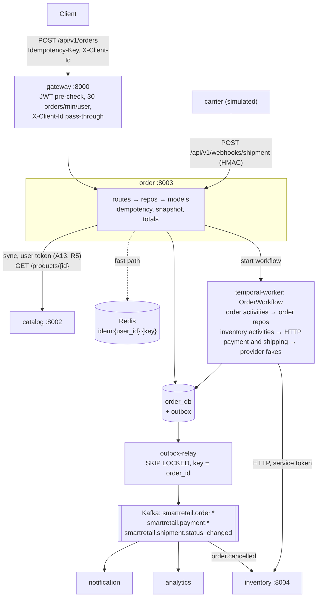

**Owns** — facts nothing else writes ([RFC 0000 ownership map](0000-architecture.md#3136-ownership-map)):

| Fact | Notes |
| --- | --- |
| Order, order lines (as snapshots), order status | The aggregate root and its children |
| Payment state (`payment_status`, `payment_reference`) | Sub-state on the order — the folded `payment` candidate |
| Shipment state (`shipment_status`, `shipment_reference`, `tracking_number`) | Sub-state on the order — the folded `shipment` candidate |
| Order status timeline | `order_status_history`, the S7 audit trail |
| Idempotency claims | `idempotency_keys` — one order per key |
| The link from an order to its Temporal execution | `workflow_id`, `workflow_run_id`; Temporal owns the execution state itself |

**Does not own.**

| Fact | Owner | How `order` sees it |
| --- | --- | --- |
| Product definition, price, publication status | `catalog` | Live lookup at creation (A13), then **snapshot** into `order_items` (A14, B8) |
| Stock on hand, reservations, ledger | `inventory` | Reservation API, called by workflow activities with a service token |
| User identity and role | `identity` | Claim — `customer_id` from the verified JWT |
| Notifications, delivery records | `notification` | None — `order` emits events and never calls it |
| Metric rollups | `analytics` | None — `order` never calls it, and it never calls `order` (C8) |
| Workflow execution state | Temporal | Referenced by `workflow_id`; read through query/describe for the diagnostic endpoint |

**Ownership-test row** (from [RFC 0000 §3.1.1.2](0000-architecture.md#3112-the-ownership-test)):

| # | Candidate | State it would own | Invariant | Independent change | Distinct profile | Verdict |
| --- | --- | --- | --- | --- | --- | --- |
| 4 | `order` | orders, lines, payment and shipment state, idempotency keys | one order per key; valid state transitions | yes | write-heavy bursts; strongest consistency need | **Service** |
| 9 | `payment` | payment intents | — (would be order state) | no | no | **Rejected → `order`** |
| 10 | `shipment` | shipment records | — (would be order state) | no | no | **Rejected → `order`** |

**Why `payment` and `shipment` are folded in** (archive/0000 §3.2, archive/0006 §3.1.1). In a real system, a payment service exists for a *compliance* boundary — PCI scope isolation — and to own a provider's reconciliation, refund, and dispute lifecycle. Neither exists here: the provider is simulated (A9) and no cardholder data enters the system at any point. What would remain is a table of payment intents keyed one-to-one to orders, updated only by the order's own workflow. Splitting it would create a distributed transaction across two databases to record one fact, which is strictly worse than a column — more failure modes, no isolation gained. Shipment status is likewise a sub-state of the order's lifecycle, driven by workflow activities and the carrier webhook. The *interface* is kept separate so a real provider, or a real service, is a later extraction rather than a rewrite. If a real payment provider is ever introduced, `payment` becomes a service, and the interface boundary makes it an extraction, not a rewrite.

**Rules and decisions that bind `order`.**

| ID | Rule | How it applies here |
| --- | --- | --- |
| R1 | A service reads and writes only its own database | `order` holds the only role with grants on `order_db`. Order-side activities in `temporal-worker` and order's Celery tasks run `order`'s code with `order`'s role; nothing else connects |
| R2 / S15 | No FK crosses a boundary | `order_items.product_id`, `variant_id`, `merchant_id` and `orders.customer_id` are plain indexed UUIDs (A3) |
| R3 | One writer per fact | Order, payment and shipment state are written only by `OrderRepo` |
| R4 | Cross-service reads by API or event | Product data by API; stock by API; nothing joins |
| R5 / A13 | Sync calls only where the caller cannot proceed | `order → catalog` at creation is **the one such call in the system** |
| R6 / A14 | Data crossing a boundary is snapshotted | Line items store name, SKU, options and price as they were at purchase |
| R7 | Serve reads you hold without others being up | Order reads need only `order_db`; JWTs verify locally (A4, A5) |
| R8 | `common` holds no business rule | The idempotency *mechanism* may be shared; the order rules and vocabularies live in `services/order` |
| A9 | Payments and carriers simulated behind an interface | `PaymentProvider`, `ShippingProvider`, deterministic fakes (§3.1.1.4) |
| A10 / B11 | Transactional outbox for every state-change event | Every status or sub-state change and its outbox row commit together |
| A12 | Temporal owns processes, Kafka owns facts, Celery owns one-shot jobs | `OrderWorkflow` is the process; `order.*` are the facts; key sweeping is a Celery Beat task |
| B1 | Activities are thin adapters over the service layer | No business rule in workflow or activity code; a review check |
| B2 | Workflows hold identifiers and step results only | The workflow carries `order_id`, never the order |
| B3 | Every activity is idempotent, keyed by a deterministic token | Token = `(workflow_id, activity_name, attempt-invariant input)` |
| B4 | Reservation before payment, commit after | The workflow order in §3.1.1.4 |
| B7 | Idempotency keys claimed by unique insert | §3.1.1.4, *Idempotent creation* |
| B8 | Orders snapshot product data at creation | `order_items` |
| B9 | Order creation returns `202`, not `201` | §3.1.2.1 |
| B10 | Payment and shipping are protocols with a deterministic fake | §3.1.1.4 |
| C3 | Ordering is per aggregate | Every event `order` produces uses `aggregate_id = order_id`, so `order.*`, `payment.*` and `shipment.*` for one order share a partition and arrive in order |
| C12 / A8 | The trace ID is the correlation ID | Carried into the workflow and into every outbox row |
| C13 | Redis's three jobs include the idempotency fast path | §3.1.1.4 |
| C21 | Delivery is scoped by originating client | `orders.origin_client_id`, persisted at creation, read by every activity that writes an outbox row |
| S2, S4, S6, S7, S8, S10, S11, S12 | Schema conventions | Applied in §3.1.3; S4 transition tables in §3.1.1.3 |

**Internal module layout** (the entity-first layout of [RFC 0000 §3.1.1.7](0000-architecture.md#3117-module-structure-inside-a-service) and [file-structure.md §4](../file-structure.md#4-service-layout-every-service); routes do not touch the ORM, and repos do not construct HTTP responses). `order` is planned; its one entity is `orders/` (orders, items, status history). `idempotency_keys` is request-level machinery rather than an order rule (R8), so it sits in `core/`:

```
services/order/
├── main.py                       create_application(): settings, logging, DB, router, /health
├── alembic.ini
├── alembic/                      per-service history (S14), render_item hook (S4)
├── app/
│   ├── router.py                 includes only: owns /api/v1 and the /orders and /webhooks prefixes
│   ├── models.py                 imports every ORM model onto one metadata (Alembic, seed)
│   ├── seed.py                   sample orders through the real workflow (O16)
│   ├── core/
│   │   ├── config.py             OrderSettings (§3.1.1.6)
│   │   ├── db.py                 Database factory, get_db
│   │   ├── logger.py             JSON logging
│   │   ├── dependencies.py       principal, role guards; user routes reject service tokens
│   │   ├── security.py           carrier HMAC signer and verifier (ORD-13)
│   │   ├── errors.py             IllegalTransition, idempotency and catalog problem types
│   │   ├── enums.py              IdempotencyState
│   │   ├── idempotency.py        IdempotencyKey ORM model + IdempotencyRepo:
│   │   │                         claim / replay / complete / release (B7, ORD-8)
│   │   ├── schemas.py            Pydantic bases
│   │   └── utils.py              key canonicalisation, request hash (ORD-7)
│   ├── health/
│   │   └── routes.py             /health, /health/ready
│   ├── orders/
│   │   ├── models.py             Order, OrderItem, OrderStatusHistory — persistence only
│   │   ├── repo.py               OrderRepo: create, advance(), cancel, reads — the only writer of status
│   │   ├── shipment_repo.py      ShipmentRepo.apply_carrier_update() — shared by webhook and admin route
│   │   ├── snapshot.py           catalog lookup → OrderLineSnapshot
│   │   ├── events.py             order-event payload builders (envelope from common)
│   │   ├── dependencies.py       builds the repos for a request
│   │   ├── enums.py              OrderStatus, PaymentStatus, ShipmentStatus,
│   │   │                         OrderFailureReason (ORD-5)
│   │   ├── state_machine.py      ORDER_/PAYMENT_/SHIPMENT_TRANSITIONS, transition()
│   │   ├── utils.py              money: line and order totals (S2, ORD-4)
│   │   └── v1/
│   │       ├── routes.py         POST/GET /orders, /merchant, /{id}, /{id}/cancel, /{id}/workflow,
│   │       │                     /{id}/shipment/status (test-only)
│   │       └── schemas.py        the v1 request/response contract
│   ├── webhooks/
│   │   └── v1/
│   │       ├── routes.py         POST /webhooks/shipment (HMAC)
│   │       └── schemas.py        carrier callback body
│   ├── providers/
│   │   ├── payment.py            PaymentProvider protocol + FakePaymentProvider
│   │   └── shipping.py           ShippingProvider protocol + FakeShippingProvider
│   ├── clients/
│   │   ├── catalog.py            httpx client, user token forwarded
│   │   └── inventory.py          httpx client, service token (ORD-11)
│   ├── workflows/
│   │   ├── order_workflow.py     OrderWorkflow — sequence, compensation, signal, query
│   │   └── activities.py         thin adapters over the repos (B1)
│   └── tasks/
│       └── maintenance.py        sweep_idempotency_keys, resume_unstarted_orders (Celery)
└── tests/
    ├── unit/orders/              state machines, money, events, fakes
    └── integration/orders/       real Postgres; test_migrations.py
```

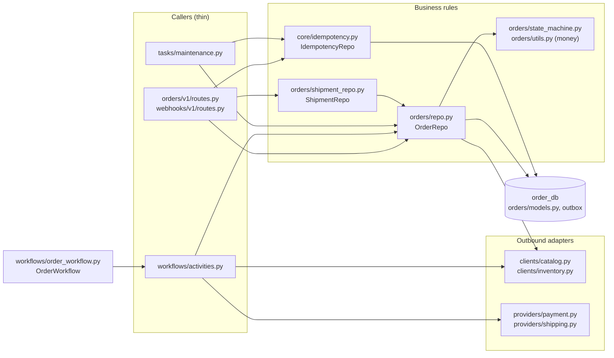

`temporal-worker` registers `OrderWorkflow` and `order`'s activities by importing `app.workflows`; `celery-worker` registers `app.tasks`. Both are hosts ([RFC 0001](0001-platform-and-shared-infrastructure.md)); the logic and its tests belong here.

##### 3.1.1.2. Domain model

**Aggregate.** `Order` is the aggregate root. Its children are `OrderItem` (line snapshots, immutable after creation) and `OrderStatusHistory` (append-only). Payment and shipment are **value-level sub-state on the root**, not entities of their own — there is exactly one payment and at most one shipment per order. `IdempotencyKey` is a separate aggregate: it exists before the order does, and it references the order by id once created.

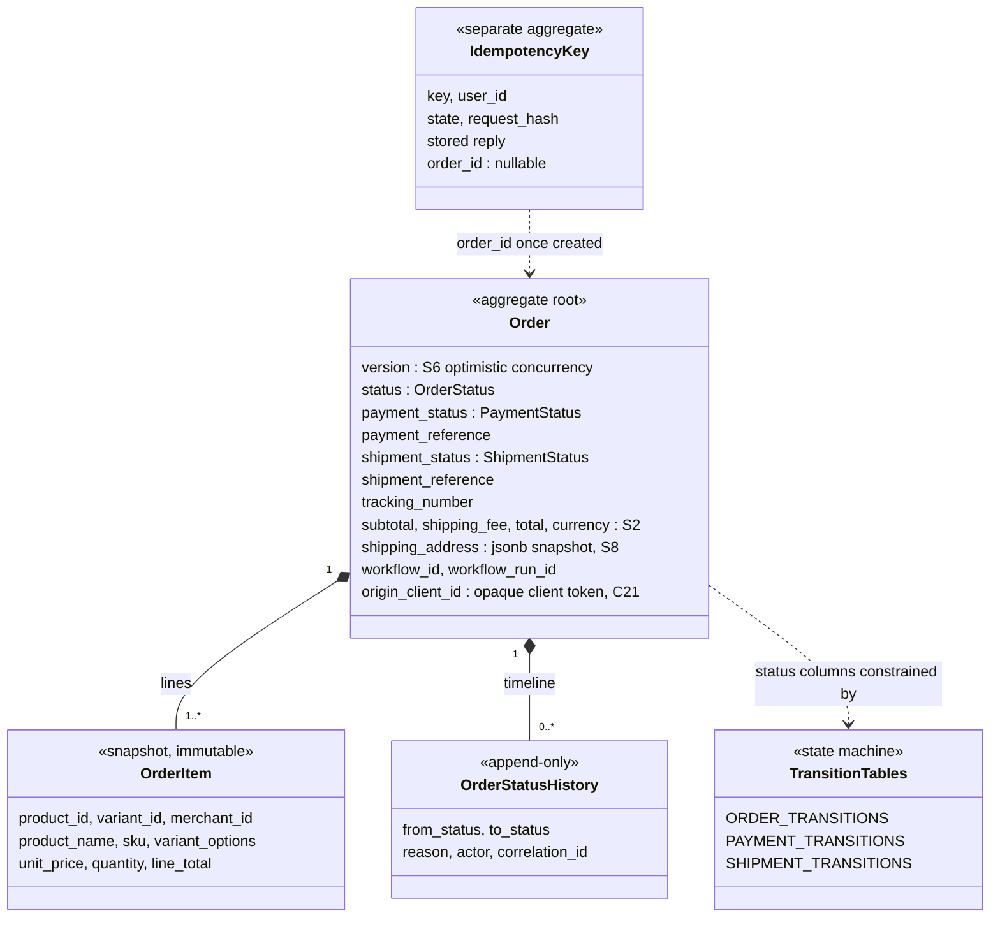

**Invariants.**

| # | Invariant | Where enforced |
| --- | --- | --- |
| I1 | One order per `(user_id, Idempotency-Key)` | Primary key / unique `(user_id, key)` on `idempotency_keys` (S11, B7) |
| I2 | Every status, payment-status and shipment-status change is an edge in its transition table | `transition()` in `app/orders/state_machine.py`; nothing else assigns those columns (review check) |
| I3 | No lost update on an order | `version` checked and incremented in `OrderRepo.advance()` (S6); the loser gets `409` |
| I4 | `line_total = unit_price × quantity`; `subtotal = Σ line_total`; `total = subtotal + shipping_fee` | `app/orders/utils.py`, computed server-side; stored values never recomputed from live catalog data |
| I5 | All lines share the order's `currency` | Creation rejects mixed currencies with `422` (S2) |
| I6 | `quantity > 0`; money columns non-negative | Database `CHECK`s (S2, S11) and Pydantic |
| I7 | A snapshot never changes after creation | No update path exists for `order_items`; tested (§7) |
| I8 | Every state change writes its history row (S7) and its outbox row (B11) in the same transaction | `OrderRepo.advance()` |
| I9 | Amounts come from the catalog snapshot, never from the client | The request schema has no price field; an extra field is rejected |
| I10 | At most one line per `variant_id` per order | Creation rejects duplicates with `422` — required because `inventory.reservations` is unique on `(order_id, variant_id)` (ORD-6) |

**Money rules (S2).** Every money value is `numeric(12,2)` in the database and `Decimal` in Python — never `float`. The unit price is the catalog variant's `price_override` if set, otherwise the product's `base_price` (ORD-4). `line_total` is `unit_price × quantity`, which is exact at two decimal places because `quantity` is an integer; `subtotal`, `shipping_fee` and `total` are summed as `Decimal` and quantised to `0.01` with `ROUND_HALF_EVEN`, so a stored total can never disagree with the sum of its lines by a cent. The order's `currency` is the currency of its lines; mixed currencies are rejected rather than converted. `shipping_fee` is a flat configured amount (`ORDER_SHIPPING_FEE`, default `0.00`) in the order's currency (ORD-4).

**Vocabularies** (`DomainEnum`, S4 — `text` columns, enforced on write by `DomainEnumText` and at the edge by Pydantic, published into OpenAPI):

| Enum | Column | Values | Read policy (S4) |
| --- | --- | --- | --- |
| `OrderStatus` | `orders.status` | `pending`, `awaiting_payment`, `confirmed`, `shipped`, `delivered`, `cancelled`, `failed`, `refunding`, `refunded` | `fallback` → `pending` |
| `PaymentStatus` | `orders.payment_status` | `none`, `pending`, `succeeded`, `failed`, `refunded` | `fallback` → `none` |
| `ShipmentStatus` | `orders.shipment_status` | `none`, `created`, `shipped`, `in_transit`, `delivered` | `fallback` → `none` |
| `IdempotencyState` | `idempotency_keys.state` | `in_progress`, `completed` | `passthrough` |

`fallback` is chosen for the three state-machine columns because a state machine must never branch on a bare string: an unrecognised value (written by a newer build, read by a rolled-back one) degrades to the initial state, every transition out of it that does not apply is rejected, and the row **freezes loudly instead of corrupting quietly**. Response schemas for these columns stay strict, because the ORM already guarantees a member.

**Non-`DomainEnum` codes.**

| Code set | Where | Values | Why not a `DomainEnum` column |
| --- | --- | --- | --- |
| `OrderFailureReason` (ORD-5) | `orders.failure_reason`, `order_status_history.reason`, event payloads, metric label | `INSUFFICIENT_STOCK`, `INVENTORY_UNAVAILABLE`, `PAYMENT_DECLINED`, `PAYMENT_TIMEOUT`, `RESERVATION_EXPIRED`, `COMMIT_FAILED`, `FULFILMENT_FAILED`, `REFUND_FAILED`, `OPERATOR_TERMINATED` | The first three are the archive's codes; the rest name failure paths the archive describes without naming. The column is specified as plain nullable `text` in the catalogue; the set is a `StrEnum` in `app/orders/enums.py` validated by the service layer so metric labels stay bounded |
| Actor | `order_status_history.actor` | `customer:<id>` \| `workflow` \| `admin:<id>` \| `system` | A `<kind>:<id>` composite is not a closed set (S4) |

**Order number.** `order_number` is human-readable, `SR-<year>-<7-digit sequence>`, e.g. `SR-2026-0001042`, unique. The sequence is a Postgres sequence `order_number_seq` in `order_db`, created by the initial migration (ORD-3). It is never used as a key across a boundary — ids are UUIDs (S1).

##### 3.1.1.3. State machines

Three columns are state machines. Under S4 they are `text`, so the database no longer rejects a bad status; what replaces it is stricter, and it lives in `services/order/app/orders/state_machine.py` — one file, next to the enums it constrains (`app/orders/enums.py`).

**Order status diagram.**

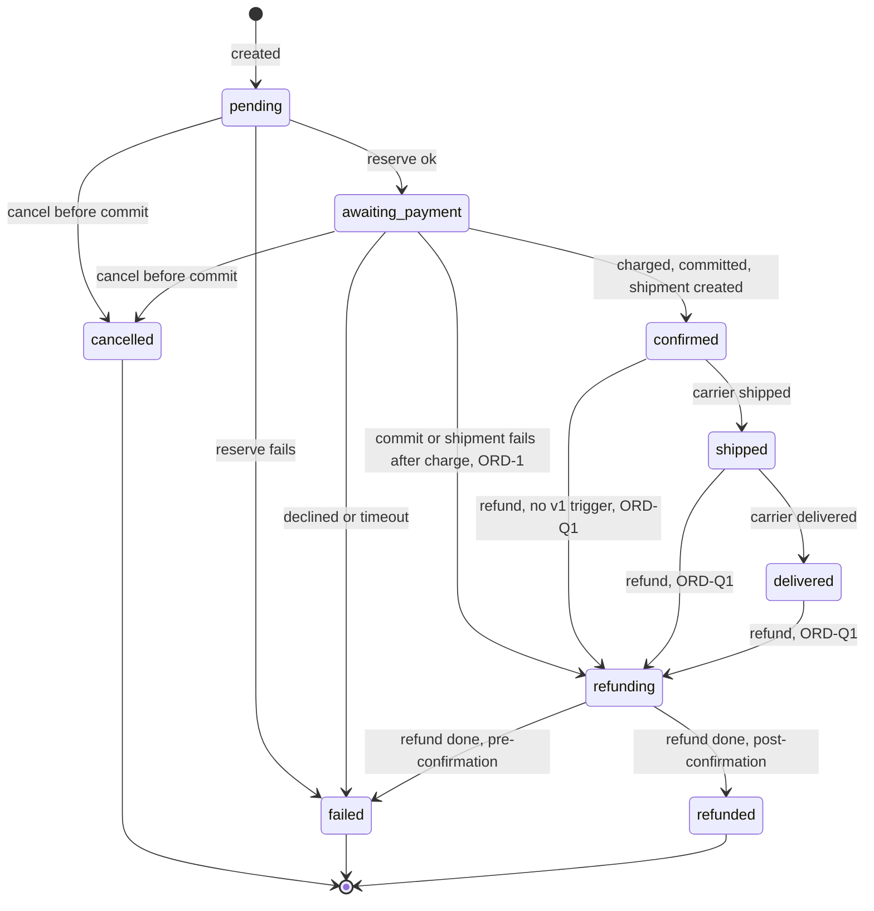

**`ORDER_TRANSITIONS`** — the full table. Terminal states have no outgoing edge.

```python
ORDER_TRANSITIONS: Mapping[OrderStatus, frozenset[OrderStatus]] = {
    S.PENDING:          frozenset({S.AWAITING_PAYMENT, S.FAILED, S.CANCELLED}),
    S.AWAITING_PAYMENT: frozenset({S.CONFIRMED, S.FAILED, S.CANCELLED, S.REFUNDING}),  # REFUNDING: ORD-1
    S.CONFIRMED:        frozenset({S.SHIPPED, S.REFUNDING}),
    S.SHIPPED:          frozenset({S.DELIVERED, S.REFUNDING}),
    S.DELIVERED:        frozenset({S.REFUNDING}),
    S.REFUNDING:        frozenset({S.REFUNDED, S.FAILED}),
    S.CANCELLED:        frozenset(),   # terminal
    S.FAILED:           frozenset(),   # terminal
    S.REFUNDED:         frozenset(),   # terminal
}
```

| From | To | Triggered by | Guard | Side effects in the same transaction |
| --- | --- | --- | --- | --- |
| `pending` | `awaiting_payment` | Workflow, after `reserve_inventory` succeeds | Reservation ids recorded in the workflow | `payment_status none → pending`; history row |
| `pending` | `failed` | Workflow — reserve failed (`INSUFFICIENT_STOCK`, `INVENTORY_UNAVAILABLE`) | — | `failure_reason`; outbox `order.failed` |
| `pending` | `cancelled` | Workflow on a cancel signal received before or during reserve | Stage is before `committing` | Reservation released first if held; outbox `order.cancelled` |
| `awaiting_payment` | `confirmed` | Workflow step 6, after commit and shipment creation | `payment_status = succeeded`, `shipment_status = created` | `confirmed_at`; outbox `order.confirmed` |
| `awaiting_payment` | `failed` | Workflow — `PAYMENT_DECLINED`, `PAYMENT_TIMEOUT` | Reservation released first | `failure_reason`; `payment_status → failed`; outbox `payment.failed`, `order.failed` |
| `awaiting_payment` | `cancelled` | Workflow on a cancel signal received before `commit_inventory` starts | Stage is before `committing` | Refund first if charged (archive/0002 Q4), then release; outbox `order.cancelled` |
| `awaiting_payment` | `refunding` | Workflow — commit or shipment failed after a successful charge (ORD-1) | `payment_status = succeeded` | `failure_reason` recorded; compensation begins |
| `confirmed` | `shipped` | Carrier webhook / admin simulation `shipped` | `shipment_status created → shipped` legal | outbox `shipment.status_changed` |
| `confirmed` | `refunding` | Post-confirmation refund (no v1 trigger — ORD-Q1) | `payment_status = succeeded` | — |
| `shipped` | `delivered` | Carrier `delivered` | `shipment_status → delivered` legal | outbox `shipment.status_changed` |
| `shipped` | `refunding` | Post-confirmation refund (ORD-Q1) | as above | — |
| `delivered` | `refunding` | Post-confirmation refund (ORD-Q1) | as above | — |
| `refunding` | `refunded` | `refund_payment` completes on a post-confirmation refund | `payment_status → refunded` | — |
| `refunding` | `failed` | Workflow — refund completed as a compensation for a pre-confirmation failure (`COMMIT_FAILED`, `RESERVATION_EXPIRED`, `FULFILMENT_FAILED`) | `payment_status → refunded` | outbox `order.failed` carrying `payment_status: refunded` |

That is **14 legal edges of the 81 ordered pairs** over the nine states; the other **67 are rejected**. `in_transit` changes shipment sub-state only; the order stays `shipped`.

**ORD-1 — the `awaiting_payment → refunding` edge.** The archived transition table (archive/0002 §3.1.1) lists 13 edges while archive/0002 and archive/0006 both state 14 legal and 67 illegal pairs, and the archived diagram draws "shipment fails ──▶ refunding ──▶ failed". Commit and shipment creation both happen *before* `confirmed` (steps 4–5), so the only way to reach the diagram's `refunding → failed` is from `awaiting_payment`. Adding that one edge makes the table, the diagram, the count and the compensation path agree. Without it a post-charge failure would go `awaiting_payment → failed` directly and `refunding → failed` would be unreachable.

**The guarded method.** Every status change goes through one method, which raises rather than assigning:

```python
def transition(self, target: OrderStatus, *, actor: str, reason: str | None = None):
    if target not in ORDER_TRANSITIONS[self.status]:
        raise IllegalTransition("order", self.id, "status", self.status, target)
    self.status = target
```

`IllegalTransition` maps to `409` through the problem-detail handler. Nothing outside `transition()` assigns to `status`, `payment_status` or `shipment_status` — that is a review check, and it is what makes the guard total.

**Payment sub-state — `PAYMENT_TRANSITIONS`** (declared the same way; the archive says so without listing the edges, so the table below is ORD-2).

| From | To | Triggered by | Event |
| --- | --- | --- | --- |
| `none` | `pending` | Order enters `awaiting_payment` | — |
| `pending` | `succeeded` | `charge_payment` returns a reference | `payment.succeeded` |
| `pending` | `failed` | Decline, or retries exhausted on timeout with nothing captured | `payment.failed` |
| `pending` | `refunded` | Compensation after an ambiguous timeout found a capture and refunded it | — (carried on `order.failed` / `order.cancelled`) |
| `succeeded` | `refunded` | `refund_payment` completes | — (carried on `order.failed` / `order.cancelled`; no refund topic exists — ORD-Q2) |

`failed` and `refunded` are terminal. An order cancelled before payment keeps `none`.

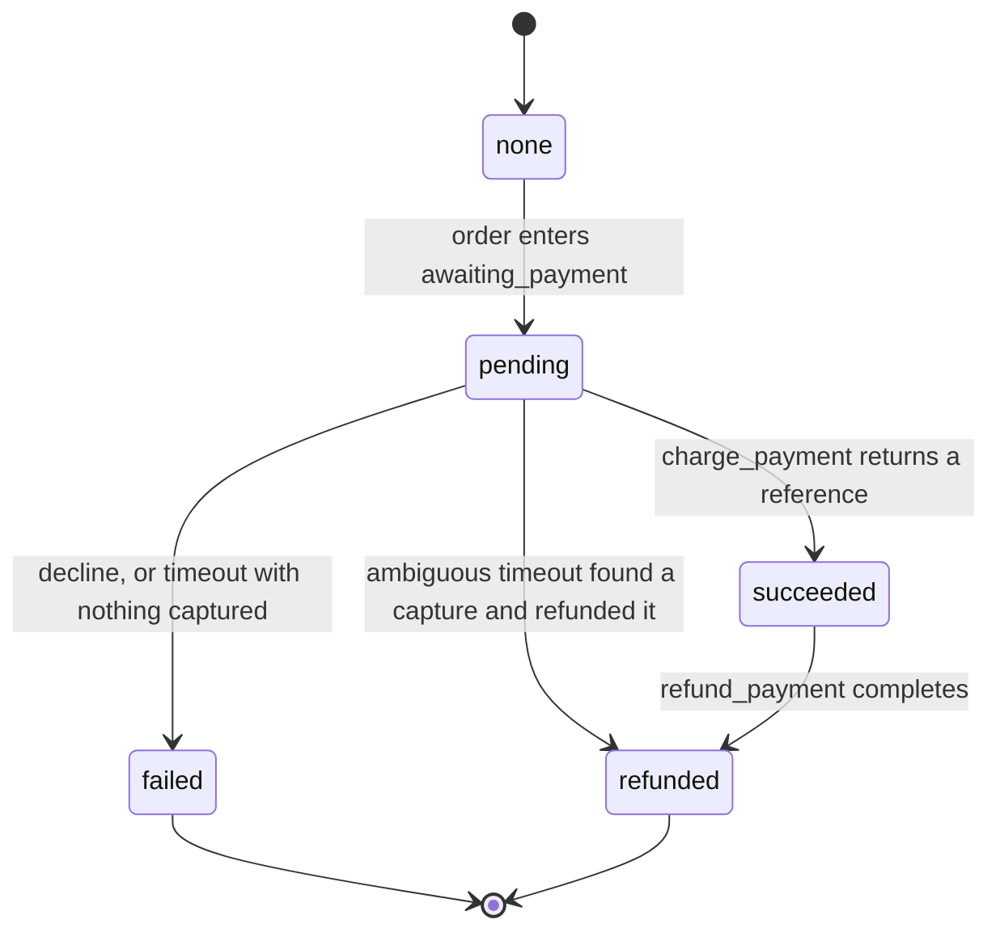

**Shipment sub-state — `SHIPMENT_TRANSITIONS`** (ORD-2).

| From | To | Triggered by | Order status effect | Event |
| --- | --- | --- | --- | --- |
| `none` | `created` | `create_shipment` returns a reference and tracking number | none (order is still `awaiting_payment`) | — |
| `created` | `shipped` | Carrier `shipped` | `confirmed → shipped` | `shipment.status_changed` |
| `shipped` | `in_transit` | Carrier `in_transit` | none | `shipment.status_changed` |
| `shipped` | `delivered` | Carrier `delivered` | `shipped → delivered` | `shipment.status_changed` |
| `in_transit` | `delivered` | Carrier `delivered` | `shipped → delivered` | `shipment.status_changed` |

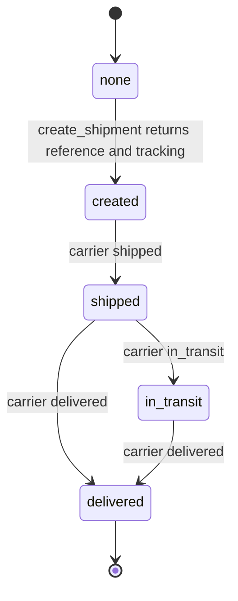

`delivered` is terminal. A carrier update that repeats the current status is an idempotent no-op (`200`, no row, no event); any other update not in the table is `409`. A carrier update on an order that is not `confirmed`/`shipped` (for example `refunding`) is `409`.

**Why this is strictly stronger than the type it replaces.** Let *V* be the value set and *T ⊆ V × V* the legal transition relation. A Postgres `ENUM` on `orders.status` constrained an `UPDATE` to *new ∈ V* — it checked the label and never the edge. It therefore accepted all 81 ordered pairs over the nine order states. `ORDER_TRANSITIONS` accepts 14. The 67 it rejects are the writes that actually corrupt an order: un-delivering (`delivered → pending`), reviving a terminal state (`cancelled → confirmed`), and skipping payment entirely (`pending → confirmed`). Every one of those was always valid against a native `order_status` type. The honest boundary of the claim: the enum's guarantee applied to *every* writer including a hand-run `psql` statement, while the transition table applies only to writers that go through `OrderRepo`. It is strictly stronger **within the application**, not within the database; the trade is bounded by R1 giving `order_db` exactly one service and one role, and manual status edits go through an admin utility that calls the service layer.

**Both guards run in the same transaction, and neither subsumes the other.** The S6 `version` check answers *"has anyone else changed this row since I read it?"* — a question about concurrency. `transition()` answers *"is this move legal from where the row actually is?"* — a question about the state machine. `version` alone permits a perfectly serialised `delivered → pending`; `transition()` alone permits two workers both reading `confirmed` and both legally moving to `shipped`, writing two shipments. `OrderRepo.advance()` performs the version check, the transition, the S7 history row and the B11 outbox row in one transaction, and both failures surface as `409`. Optimistic concurrency is enough on orders (archive/0002 Q10, decided): the workflow is effectively a single writer per order, and `version` protects against a concurrent admin action or carrier update.

##### 3.1.1.4. Workflows and async jobs

###### Idempotent creation (B7)

The synchronous part of checkout, in the `order` HTTP handler, before any workflow starts:

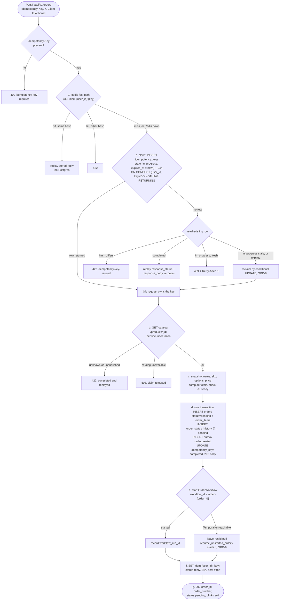

**Checkout request, happy path** (the critical endpoint as a sequence):

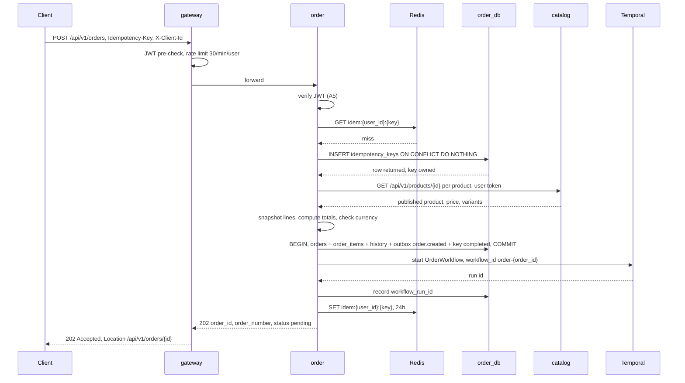

**Why the claim is a unique insert.** Read-then-write has a window: two concurrent requests both find no key, both proceed, both create an order. That window is narrow under light load and wide under exactly the burst traffic Part A describes, which is the worst possible property — it works in testing and fails in the demo. A unique constraint has no window; the database arbitrates.

**Key rules.**

| Rule | Behaviour |
| --- | --- |
| Header required | `POST /orders` without `Idempotency-Key` → `400`, problem type `idempotency-key-required` |
| Key format | 1–255 printable ASCII characters; a UUID is recommended. Canonicalised by trimming whitespace, and lower-casing when the key parses as a UUID (ORD-7) |
| Scope | Per user: the primary key is `(key, user_id)`, `user_id` from the verified token. One caller cannot probe or collide with another's keys |
| Request hash | SHA-256 over the canonicalised body — JSON with sorted keys, no insignificant whitespace, `items` in submitted order, numbers normalised (ORD-7) |
| Same key, same body, completed | The stored `response_status` and `response_body` are **replayed verbatim** — the original `202` and body. The replay adds one header, `Idempotency-Replayed: true`, and changes nothing else (ORD-7) |
| Same key, different body | `422` — a client bug. The existing order is untouched |
| Same key while the first request is in flight | `409` with `Retry-After: 1` — "Retry-Later", never a second order |
| Stored replies | Business rejections after the claim (`422` unpublished product, mixed currency) are completed and replayed like a success. Dependency failures (`503` catalog down, database error) **release** the claim, deleting the row, so a retry can proceed (ORD-8) |
| Stale in-flight claim | An `in_progress` row older than `IDEMPOTENCY_IN_PROGRESS_LEASE_SECONDS` (30 s) belongs to a request that died; it is reclaimed by a conditional `UPDATE … WHERE state = 'in_progress' AND created_at < now() - lease`, which only one contender can win (ORD-8) |
| TTL | 24 hours (`expires_at`). An expired row is treated as absent and reclaimed by the same conditional update; the daily `sweep_idempotency_keys` deletes the rest |
| Redis fast path | `idem:{user_id}:{key}`, 24 h TTL, written after the Postgres completion commits, holding `{request_hash, response_status, response_body}`. Only completed replies are cached; `in_progress` is decided by Postgres alone. Redis is an accelerator ahead of the Postgres claim, never the arbiter: a Redis error is logged and skipped (C13) |
| Second line of defence | `workflow_id = order-{order_id}` with Temporal's reject-duplicate policy: even a duplicate start for the same order is refused (archive/0002 Q3) |

###### `OrderWorkflow` — the saga

`OrderWorkflow(order_id, correlation_id, payment_method)` runs on the `orders` task queue with `workflow_id = order-{order_id}`. One workflow per order, not one long-running workflow per customer (archive/0002 Q3, decided): the per-order id gives free deduplication at the Temporal level behind the idempotency key.

Its input holds identifiers only (B2). `payment_method` is an opaque provider token (for the fake, a string such as `tok_ok`), never card data — there is no field anywhere that could hold a card number. It travels only in the workflow input because no column persists it (ORD-Q5). Temporal history is readable in its UI, and nothing sensitive is put in it.

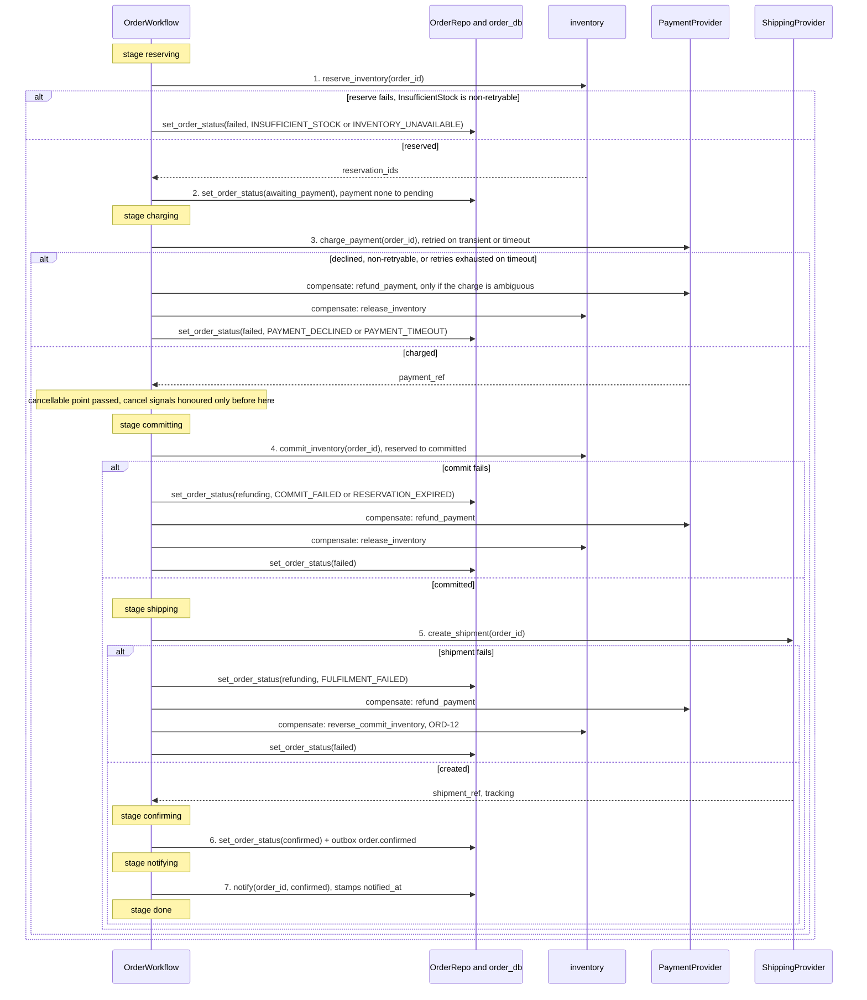

Any step failing runs the compensations of the steps already completed, **in reverse order**. This is why the order lifecycle is a workflow and not a chain of event handlers: compensation stays adjacent to the step it undoes, and "where is order X?" is a query, not an inference from six consumers' logs.

**Workflow code shape** (B1: sequence and compensation only; every rule is in the service layer):

```python
@workflow.defn(name="OrderWorkflow")
class OrderWorkflow:
    def __init__(self):
        self._stage = "starting"
        self._cancel: CancelRequest | None = None
        self._failure: str | None = None

    @workflow.signal
    def request_cancellation(self, req: CancelRequest) -> None:
        if self._stage in CANCELLABLE_STAGES and self._cancel is None:
            self._cancel = req            # after the cancellable point the signal is recorded and ignored

    @workflow.query
    def get_state(self) -> WorkflowState:
        return WorkflowState(stage=self._stage, failure_reason=self._failure,
                             cancel_requested=self._cancel is not None)

    @workflow.run
    async def run(self, inp: OrderWorkflowInput) -> OrderOutcome:
        undo: list[Callable[[], Awaitable[None]]] = []
        try:
            self._stage = "reserving"
            res = await act(reserve_inventory, inp.order_id, **RESERVE)
            undo.append(lambda: act(release_inventory, inp.order_id, res, **COMPENSATE))
            if self._cancel: return await self._cancelled(inp, undo)

            await act(set_order_status, inp.order_id, "awaiting_payment", **LOCAL)
            self._stage = "charging"
            pay = await act(charge_payment, inp.order_id, inp.payment_method, **CHARGE)
            undo.append(lambda: act(refund_payment, inp.order_id, **COMPENSATE))
            if self._cancel: return await self._cancelled(inp, undo)

            self._stage = "committing"              # past the cancellable point
            await act(commit_inventory, inp.order_id, res, **COMMIT)
            undo[0] = lambda: act(reverse_commit_inventory, inp.order_id, res, **COMPENSATE)

            self._stage = "shipping"
            await act(create_shipment, inp.order_id, **SHIP)

            self._stage = "confirming"
            await act(set_order_status, inp.order_id, "confirmed", **LOCAL)
            self._stage = "notifying"
            await act(notify, inp.order_id, "confirmed", **LOCAL)
            self._stage = "done"
            return OrderOutcome.CONFIRMED
        except ActivityError as err:
            return await self._fail(inp, undo, reason_from(err))
```

`_fail` records the reason, moves to `refunding` first when a charge had succeeded (ORD-1), runs `undo` in reverse, then sets `failed`. `_cancelled` runs `undo` in reverse and sets `cancelled`. Compensation activities use the unbounded-retry `COMPENSATE` policy below, because a compensation that gives up is worse than one that is late.

**Activities.** Each is a thin adapter (B1) and idempotent under a deterministic token (B3): `f"{workflow_id}:{activity_name}:{attempt-invariant input}"`. Timeouts and retry policies are ORD-10.

| # | Activity | Calls | Idempotency | `start_to_close` | `schedule_to_close` | Retry policy | Non-retryable |
| --- | --- | --- | --- | --- | --- | --- | --- |
| 1 | `reserve_inventory` | `POST /internal/v1/inventory/reservations` with all lines, service token | Unique `(order_id, variant_id)` in `inventory.reservations` (B3); a retry returns the existing reservations | 10 s | 60 s | initial 1 s, ×2, max 10 s, 5 attempts | `InsufficientStock`, `UnknownVariant` |
| 2 | `set_order_status` | `OrderRepo.advance()` | A no-op when the order is already in the target state | 5 s | 5 min | initial 1 s, ×2, max 30 s, unlimited within the window | `IllegalTransition` |
| 3 | `charge_payment` | `PaymentProvider.charge()` then `OrderRepo.record_payment()` | Provider idempotency key `order-{id}:charge`: a retry after a timeout returns the first result, so there is **exactly one charge** | 15 s | 60 s | initial 1 s, ×2, max 10 s, **3 attempts** (a network blip is retried up to three times) | `PaymentDeclined` — a declined card is retried **zero** times |
| 4 | `commit_inventory` | `POST /internal/v1/inventory/reservations/{id}/commit` per reservation | Committing a committed reservation is a no-op | 10 s | 5 min | initial 1 s, ×2, max 30 s, unlimited within the window | `ReservationExpired`, `ReservationNotHeld` |
| 5 | `create_shipment` | `ShippingProvider.create_shipment()` then `OrderRepo.record_shipment()` | Provider key `order-{id}:shipment` | 15 s | 2 min | initial 1 s, ×2, max 15 s, 5 attempts | `AddressRejected` |
| 6 | `set_order_status(confirmed)` | as 2, writes `order.confirmed` | as 2 | 5 s | 5 min | as 2 | as 2 |
| 7 | `notify` | `OrderRepo.mark_notified()` — `notified_at = coalesce(notified_at, now())` and a log line | Idempotent by `coalesce` | 5 s | 5 min | as 2 | — |
| C1 | `release_inventory` | `DELETE /internal/v1/inventory/reservations/{id}` | Releasing a released or expired reservation is success | 10 s | 1 h | initial 2 s, ×2, max 60 s, unlimited within the window | — |
| C2 | `refund_payment` | `PaymentProvider.refund()` keyed to the charge key, then `OrderRepo.record_refund()` | Refund key `order-{id}:refund`; "nothing captured" is success and records `payment_status failed` | 15 s | 1 h | as C1 | — |
| C3 | `reverse_commit_inventory` | `POST /internal/v1/inventory/reservations/{id}/reverse`: inventory's reversal of a *committed* reservation (returns quantity to `on_hand` with a `compensation` ledger row) — ORD-12, answered by [RFC 0006](0006-inventory-service.md#3121-endpoints) INV-16 | Keyed by reservation id | 10 s | 1 h | as C1 | — |

**Why these numbers.** Inventory holds a reservation for 15 minutes (B5, owned by [RFC 0006](0006-inventory-service.md); archive/0002 Q2 keeps it at 15 minutes — long enough to cover a slow payment retry, short enough that stranded stock returns within a demo). The forward path's worst case — 60 s reserve + 60 s charge + 5 min commit + 2 min shipment + status writes — is under ten minutes, so a workflow that is merely slow never has its reservation swept out from under it. If the sweeper does release it (a workflow lost in a way Temporal could not recover), `commit_inventory` fails with `ReservationExpired`, which is non-retryable and triggers the refund. The workflow-level execution timeout is **24 hours** (`ORDER_WORKFLOW_EXECUTION_TIMEOUT`): large enough that it can never cut a compensation short, finite so nothing hangs indefinitely. Timeouts exist at every level — `start_to_close` per attempt, `schedule_to_close` per attempt chain, and the execution timeout.

**The ambiguous charge.** A charge that times out on every attempt may or may not have captured money. The compensation therefore always calls `refund_payment` keyed to the charge key; the fake (and any real provider) answers "nothing captured" when there was no capture, which is recorded as `payment_status pending → failed`, and refunds otherwise (`pending → refunded`). The order ends `failed` with `PAYMENT_TIMEOUT` either way, and the customer is never charged for an order that did not complete.

**Why reserve before charging (B4).** If payment runs first and the reservation then fails, money has been taken for stock that does not exist, and the fix is a refund the customer did not ask for. Reserving first means the worst case is a released reservation, which costs nothing and is invisible. The cheap failure comes first.

**Cancellation.**

| Stage when the signal arrives | Outcome | Order path | Payment |
| --- | --- | --- | --- |
| `starting`, `reserving` | Honoured after the in-flight activity finishes; the reservation (if made) is released | `pending → cancelled` | `none` |
| `charging` (charge in flight or succeeded) | Honoured after the charge finishes: refund if charged (auto-refund, archive/0002 Q4 — the fake makes it trivial and the saga needs the activity anyway; a real provider would need an approval step), then release | `awaiting_payment → cancelled` | `refunded`, or `failed` if declined — a decline takes precedence and the order ends `failed` |
| `committing` or later | **Not a cancellation.** The signal is recorded in workflow history and ignored. After commit a cancel would be a refund request, which has no customer-facing flow (ORD-Q1) | unchanged | unchanged |

The API decides synchronously where it can: `POST /orders/{id}/cancel` reads the order and queries `get_state`; if the order is terminal or the stage is `committing` or later it returns `409` with a problem detail explaining that the order is past the cancellable point. Otherwise it sends `request_cancellation` and returns `202` with the order's URL, because the cancellation completes asynchronously. The residual race — the signal arrives in the instant the workflow enters `committing` — resolves in the workflow's favour, deterministically, and the client sees the true outcome on its next read. Temporal *Update* would close that race and is recorded as ORD-Q4. An operator-issued Temporal cancellation or termination is handled as follows: a cancellation before the cancellable point behaves exactly like the signal; after it, the workflow compensates in reverse and ends `failed` with `OPERATOR_TERMINATED`.

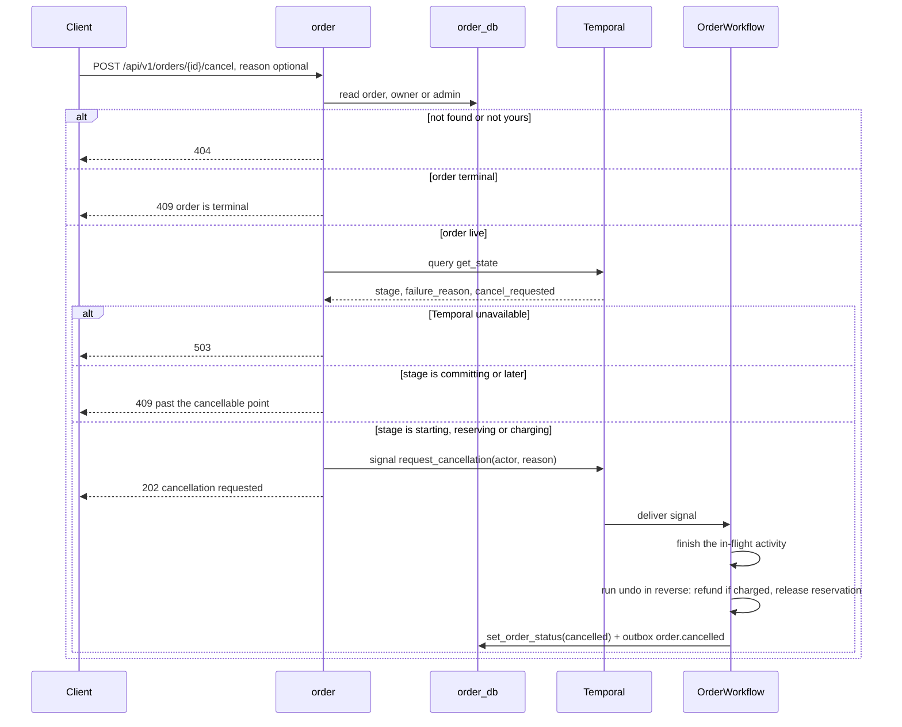

**Signals and queries.**

| Kind | Name | Payload | Used by |
| --- | --- | --- | --- |
| Signal | `request_cancellation` | `{actor, reason}` | `POST /orders/{id}/cancel` |
| Query | `get_state` | → `{stage, failure_reason, cancel_requested}` | `GET /orders/{id}/workflow`, the cancel pre-check |

**Resumability.** Temporal persists every workflow event. A worker killed mid-order resumes from the last completed activity on restart; no order is lost and none is silently abandoned (G4). Because every activity is idempotent (B3), replaying the in-flight one is safe.

**Correlation and origin.** The workflow input carries `correlation_id`, and trace context crosses into the workflow through the Temporal tracing interceptor ([RFC 0001](0001-platform-and-shared-infrastructure.md)). Every activity that writes an outbox row reads `orders.origin_client_id` and writes it into `outbox.client_id` (C21): `order.confirmed` and `order.failed` are emitted by the workflow on a worker after the request has ended, so without the persisted column the two notification types that most need origin targeting would be the two that cannot have it. Events from the carrier webhook carry `client_id = null`.

###### Payment and shipping providers (A9, B10)

```python
class PaymentProvider(Protocol):
    async def charge(self, *, idempotency_key: str, order_id: UUID, amount: Decimal,
                     currency: str, payment_method: str) -> ChargeResult: ...     # reference
    async def refund(self, *, idempotency_key: str, charge_idempotency_key: str,
                     amount: Decimal, currency: str) -> RefundResult: ...         # refunded | nothing_captured

class ShippingProvider(Protocol):
    async def create_shipment(self, *, idempotency_key: str, order_number: str,
                              address: ShippingAddress, lines: list[ShipLine]) -> ShipmentResult: ...
                                                                                  # reference, tracking_number
```

Errors are typed: `PaymentDeclined` and `AddressRejected` are non-retryable; `ProviderTransientError` is retryable; a timeout is the activity's `start_to_close` expiring. The **deterministic fakes** make every saga branch reachable by configuration, which a real sandbox would not:

| Fake | Trigger | Behaviour | Branch it reaches |
| --- | --- | --- | --- |
| Payment | `payment_method = tok_ok` (or any unlisted token) | Succeeds, reference `pay_<hash(key)>` | Happy path |
| Payment | `FAKE_PAYMENT_DECLINE_TOKEN` (`tok_decline`) | `PaymentDeclined` | Step 3 decline → release → `failed PAYMENT_DECLINED` |
| Payment | `FAKE_PAYMENT_TIMEOUT_TOKEN` (`tok_timeout`) | Sleeps `FAKE_PROVIDER_TIMEOUT_SECONDS`, longer than `start_to_close`, on every attempt | Step 3 timeout → ambiguous-refund → `failed PAYMENT_TIMEOUT` |
| Payment | `tok_flaky_2` | Transient error on the first two attempts for a key, success on the third | Retry-then-succeed, **exactly one charge** in the call log (B3) |
| Payment | `tok_refund_fail` | Charge succeeds; refund raises transient errors until `schedule_to_close` | A stuck `refunding` order, visible in metrics |
| Shipping | `shipping_address.postal_code = FAKE_SHIPPING_REJECT_POSTCODE` (`00000`) | `AddressRejected` | Step 5 failure → refund, reverse commit → `failed FULFILMENT_FAILED` |
| Shipping | `postal_code = FAKE_SHIPPING_TIMEOUT_POSTCODE` (`99999`) | Times out on every attempt | Step 5 retries exhausted → same compensation |
| Shipping | any other address | Succeeds, `shp_<hash(key)>`, tracking `TRK<digits>` | Happy path |

Each fake's behaviour is a pure function of `(trigger, attempt number for that idempotency key)`; each keeps an in-memory call log and dedupes by idempotency key, returning the first result for a repeated key. The call log is what the "exactly one charge" test reads. The fakes are not placeholders to be replaced later; within this project they are the design.

###### Carrier webhook simulation

Shipment progression after confirmation is driven by carrier callbacks. `POST /api/v1/webhooks/shipment` is an HMAC-signed simulated carrier callback (archive/0003 T22); `POST /api/v1/orders/{id}/shipment/status` remains for manual testing. Both call `ShipmentRepo.apply_carrier_update()`, so there is one implementation.

| Aspect | Specification |
| --- | --- |
| Body | `{event_id, merchant_reference, shipment_reference, tracking_number, status, occurred_at}`. `merchant_reference` is the `order_number` the order passed to the carrier at `create_shipment`, so lookup uses the existing unique index; `status ∈ {shipped, in_transit, delivered}` |
| Signature | Header `X-Carrier-Signature: t=<unix>,v1=<hex>` where `v1 = HMAC-SHA256(CARRIER_WEBHOOK_SECRET, "<t>.<raw body>")`, compared in constant time (ORD-13) |
| Replay window | `|now − t| ≤ CARRIER_WEBHOOK_TOLERANCE_SECONDS` (300 s); outside it → `401`. Unsigned → `401` |
| Replay inside the window | Harmless by construction: applying the same status twice is an idempotent no-op in `SHIPMENT_TRANSITIONS`, so no new storage is needed to reject it |
| Cross-check | `shipment_reference` must match the order's; mismatch → `404` (the order is not revealed) |
| Effects | Shipment transition, order transition where the table says so, history row, outbox `shipment.status_changed` with `client_id = null`, all in one `advance()` transaction |
| Responses | `200 {applied: true|false}` · `401` bad or stale signature · `404` unknown order or reference · `409` illegal transition · `422` malformed body |
| The simulator | `make carrier-sim ORDER=<order_number> STATUS=<status>` runs `scripts/carrier_sim.py`, which signs and posts exactly what a carrier would. The same signer is a test fixture, so the tests exercise the real verification path |

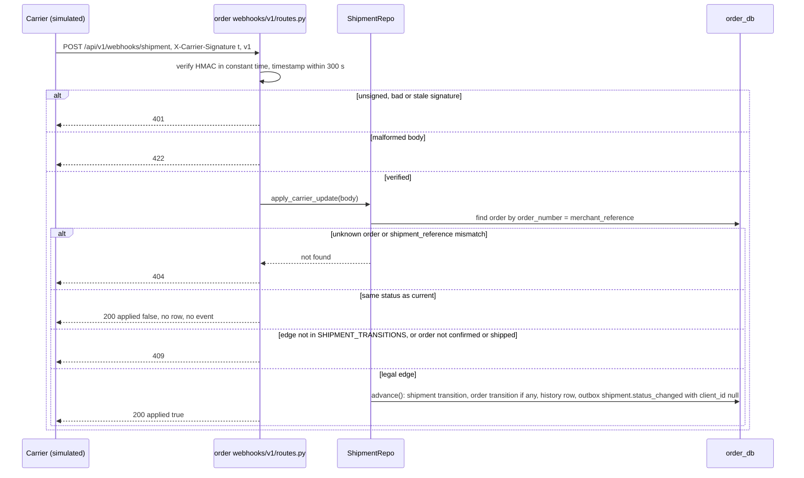

###### Async jobs owned by `order`

| Job | Host | Schedule | Effect |
| --- | --- | --- | --- |
| `sweep_idempotency_keys` | `celery-worker`, queue `maintenance` | Celery Beat, daily | `DELETE FROM idempotency_keys WHERE expires_at < now()` in batches; safe to run twice |
| `resume_unstarted_orders` (ORD-9) | `celery-worker`, queue `maintenance` | Celery Beat, every minute | Finds `pending` orders with `workflow_run_id IS NULL` older than 30 s (the `(status, created_at)` index "for operational sweeps") and starts their workflow; `WorkflowAlreadyStarted` is success |
| `OrderWorkflow` and its activities | `temporal-worker`, task queue `orders` | Per order | The saga above |

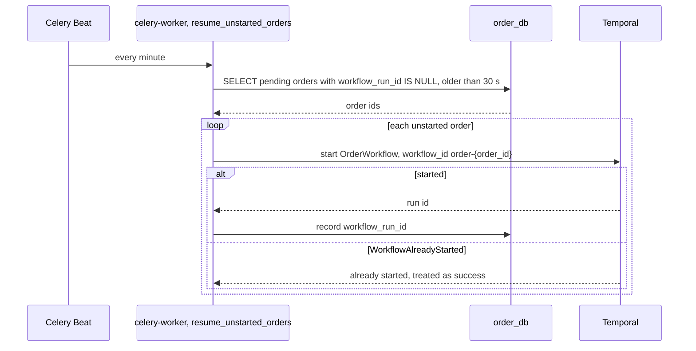

The `sweep_published_outbox` Beat task that trims `order_db.outbox` is the relay's, specified in [RFC 0001](0001-platform-and-shared-infrastructure.md).

##### 3.1.1.5. Dependencies and degradation

**Synchronous calls out.**

| Callee | Call | When | Credential | Timeout |
| --- | --- | --- | --- | --- |
| `catalog` | `GET /api/v1/products/{id}` per distinct product, concurrently (bounded at 8) | Order creation, step b | **The end user's token**, forwarded, so `catalog` applies exactly the rule it applies at the edge ([RFC 0000](0000-architecture.md#3114-authentication-and-authorisation-split)) | `CATALOG_TIMEOUT_SECONDS` 2 s, one retry on connect error |
| `inventory` | `POST /reservations`, `DELETE /reservations/{id}`, `POST /reservations/{id}/commit`, `POST /reservations/{id}/reverse` (ORD-12, INV-16), all under `/internal/v1/inventory` | Workflow activities | **Service token** — `sub: "service:temporal-worker"`, scope `inventory:internal`, minted by `identity` from a client-credentials grant, cached and refreshed at 80 % of its lifetime (ORD-11). Internal routes require the scope and reject user tokens; user-facing routes reject service tokens. Sharing a role for both would mean a stolen customer token could call `/internal/v1/inventory/reservations` | Activity `start_to_close` |
| Temporal | start workflow, signal, query, describe | Creation, cancel, diagnostics | mTLS-free local gRPC | 5 s |
| Redis | `GET`/`SET idem:*` | Creation | — | 100 ms |

**What the catalog check rejects** (`422`, with a problem detail naming the offending line index in `violations[]`): unknown product; product not `published` (draft, publishing, inactive, archived); unknown or inactive variant, or a variant of a different product; mixed currencies across lines; `quantity ≤ 0`; duplicate `variant_id` (ORD-6); more than `ORDER_MAX_LINES` lines. Stock is **not** checked here — the reservation is the check, and checking twice would race.

**Calls in.** Clients through the gateway; the simulated carrier; no other service calls `order` (analytics and notification are consumers, never callers — C8).

**Infrastructure.** `order_db` (PostgreSQL 16), Temporal, Redis (optional), `outbox-relay` → Kafka (optional for the request path), `identity`'s public key.

**Behaviour when each dependency is down.**

| Down | Effect on `order` | Why it is acceptable |
| --- | --- | --- |
| `catalog` | Order creation returns `503` (`catalog-unavailable`, `Retry-After`); the idempotency claim is released so a retry proceeds. Reads, cancel and webhooks are unaffected | The accepted cost of the synchronous call (Q3). A projection would put a staleness window on price and availability — exactly the wrong fact |
| `inventory` | `reserve_inventory` retries for 60 s, then the order fails cleanly with `INVENTORY_UNAVAILABLE` — it does not hang the API or corrupt state. Compensation calls to inventory retry for up to an hour; the reservation expiry sweeper (B5) is the net beneath them | The blast radius is one failed order per attempt, with a recorded reason |
| Temporal | Creation still returns `202`: the order is persisted `pending` with no run id and `resume_unstarted_orders` starts it when Temporal returns (ORD-9). Cancel and `/workflow` return `503`. In-flight workflows pause and resume | Checkout acceptance does not depend on the orchestrator being up; order *progress* does |
| `temporal-worker` | Workflows queue on the task queue and resume on restart (backpressure: the queue buffers when workers are saturated) | G4 |
| Redis | Fast path skipped; every retry goes to the Postgres claim. Gateway rate limiting fails open | Redis is an accelerator here, never the arbiter |
| Kafka / `outbox-relay` | Outbox rows accumulate in `order_db` and publish on recovery. **Checkout is unaffected** | Nothing synchronous is downstream of the order path |
| `notification`, `analytics` | None. Events wait in Kafka | They are consumers, not callees, precisely so their failure cannot affect checkout |
| `identity` | None on the request path (local JWT verification). The worker's cached service token keeps working until expiry; after that inventory activities fail and retry until `identity` returns | A4, A5 |
| `order_db` | `503` on every route; `/health/ready` fails | The one hard dependency |

##### 3.1.1.6. Configuration

Twelve-factor, validated at startup by `pydantic-settings`; a missing required variable fails the container. Names and defaults below are ORD-14 unless a source value is cited.

| Variable | Default | Meaning |
| --- | --- | --- |
| `ORDER_DATABASE_URL` | — (required) | `order_db` with the `order` role only (R1) |
| `JWT_PUBLIC_KEY_PATH` | — (required) | `identity`'s RS256 public key (A4) |
| `CATALOG_BASE_URL` | `http://catalog:8002` | Snapshot lookup |
| `CATALOG_TIMEOUT_SECONDS` | `2` | Per call |
| `INVENTORY_BASE_URL` | `http://inventory:8004` | Reservation API |
| `IDENTITY_TOKEN_URL`, `SERVICE_CLIENT_ID`, `SERVICE_CLIENT_SECRET` | — (required in the worker) | Client-credentials grant for the service token |
| `TEMPORAL_ADDRESS` | `temporal:7233` | |
| `TEMPORAL_NAMESPACE` | `default` | |
| `ORDER_TASK_QUEUE` | `orders` | |
| `ORDER_WORKFLOW_EXECUTION_TIMEOUT` | `24h` | |
| `REDIS_URL` | `redis://redis:6379/0` | Optional; unset disables the fast path |
| `IDEMPOTENCY_TTL_HOURS` | `24` | archive/0006, archive/0003 |
| `IDEMPOTENCY_IN_PROGRESS_LEASE_SECONDS` | `30` | ORD-8 |
| `ORDER_SHIPPING_FEE` | `0.00` | Flat fee in the order's currency (ORD-4) |
| `ORDER_MAX_LINES` | `50` | |
| `ORDER_MAX_QUANTITY_PER_LINE` | `999` | |
| `PAYMENT_PROVIDER` / `SHIPPING_PROVIDER` | `fake` / `fake` | The only implementations |
| `FAKE_PAYMENT_DECLINE_TOKEN` | `tok_decline` | |
| `FAKE_PAYMENT_TIMEOUT_TOKEN` | `tok_timeout` | |
| `FAKE_PROVIDER_TIMEOUT_SECONDS` | `30` | Longer than every provider activity's `start_to_close` |
| `FAKE_SHIPPING_REJECT_POSTCODE` | `00000` | |
| `FAKE_SHIPPING_TIMEOUT_POSTCODE` | `99999` | |
| `CARRIER_WEBHOOK_SECRET` | — (required when the webhook is enabled) | HMAC key |
| `CARRIER_WEBHOOK_TOLERANCE_SECONDS` | `300` | Replay window |
| `OTEL_EXPORTER_OTLP_ENDPOINT` | `http://otel-collector:4317` | |

Owned elsewhere but load-bearing for `order`: the gateway's order rate limit of **30 per minute per user** ([RFC 0002](0002-gateway-service.md)); the reservation TTL of **15 minutes** ([RFC 0006](0006-inventory-service.md)).

##### 3.1.1.7. Observability

**Metrics** (Prometheus via the OTel Collector, `/metrics`; names ORD-15). RED metrics for every route come from `common`.

| Metric | Type | Labels | Answers |
| --- | --- | --- | --- |
| `order_checkout_request_duration_seconds` | histogram | `outcome = accepted\|replayed\|rejected\|conflict\|unavailable` | Checkout latency — the time to `202`, the symptom Part A opens with |
| `order_checkout_catalog_duration_seconds` | histogram | `outcome` | How much of checkout latency is the synchronous catalog call |
| `order_workflow_duration_seconds` | histogram | `outcome = confirmed\|failed\|cancelled` | Time from `pending` to a terminal or confirmed state |
| `order_activity_duration_seconds` | histogram | `activity`, `outcome` | Which step is slow (reserve lock wait, charge, shipment) |
| `order_activity_attempts_total` | counter | `activity`, `outcome = success\|retryable\|non_retryable` | Retry pressure per step |
| `orders_created_total` / `orders_confirmed_total` | counter | `currency` | Throughput and conversion |
| `order_failures_total` | counter | `reason` (`OrderFailureReason`), `step` | **Failure reasons** — the Part A §5 "Failed Events / Workflow Issues" view from the source |
| `order_cancellations_total` | counter | `stage`, `outcome = honoured\|rejected` | Where cancels land |
| `order_compensations_total` | counter | `activity`, `outcome` | Whether compensation works |
| `order_idempotency_total` | counter | `result = claimed\|replayed_redis\|replayed_db\|in_progress\|mismatch\|reclaimed` | Duplicate-prevention traffic |
| `order_nonterminal_age_seconds` | gauge (p99 and max) | `status` | Stuck orders — a `refunding` order with a failing refund shows here |
| `order_unstarted_orders` | gauge | — | Orders waiting for `resume_unstarted_orders` |
| `order_carrier_webhook_total` | counter | `outcome = applied\|noop\|bad_signature\|stale\|illegal\|unknown` | Carrier integration health |

Business metrics (orders over time, revenue, AOV, popularity, failures by reason) are computed by `analytics` from events, not from these instruments ([RFC 0008](0008-analytics-service.md)).

**Spans.** FastAPI and SQLAlchemy auto-instrumented; `httpx` spans for the catalog and inventory calls; `OrderWorkflow` and every activity as spans through the Temporal interceptor; outbox writes carry `traceparent` into the envelope (C11), so one checkout is **one trace** across gateway, `order`, `catalog`, the workflow, `inventory`, the relay and the notification consumer. Span attributes: `order.id`, `order.number`, `order.status`, `workflow.id`, `idempotency.result`. Request and response bodies are never span attributes; headers are allow-listed.

**Log fields** (structured JSON, every line): `trace_id` (which is `X-Request-ID`, C12), `order_id`, `order_number`, `workflow_id`, `activity`, `attempt`, `customer_id`, `failure_reason`, `idempotency_result`. Never the payment token, never the full shipping address.

**Dashboard.** A *Checkout* Grafana dashboard provisioned as code: checkout p50/p95/p99 with exemplar traces, catalog-call share, activity latency by step, failures by reason, compensations, idempotency results, stuck orders, unstarted orders, outbox backlog for `order_db`. No alerting — there is nothing to alert into ([RFC 0001](0001-platform-and-shared-infrastructure.md)).

**Diagnosis walkthroughs** (Part A §6, "checkout / order processing"):

| Symptom | Path to the cause |
| --- | --- |
| "Checkout is slow" | Grafana latency panel → the slow endpoint → an exemplar trace → the slow span (catalog call, or reservation lock wait) |
| "An order is stuck" | `GET /orders/{id}/workflow` → stage and failure reason → Temporal UI → the failing activity → its trace |
| "Stock looks wrong" | Inventory's ledger reconciliation → the movement rows → `reference_id` → the order → its trace |
| "A customer got no notification" | `orders.notified_at` → the `order.confirmed` event id → consumer dedupe table → DLQ → delivery attempts |

#### 3.1.2. API changes

All routes are under `/api/v1`, reached through the gateway at `:8000`, and follow the [RFC 0000 API conventions](0000-architecture.md#3122-api-conventions): RFC 9457 problem details (`{type, title, status, detail, instance, request_id}` plus `violations[]`), `{items, total, limit, offset}` pagination with a `limit` ceiling of 100, `X-Request-ID` echoed, optional `X-Client-Id` on mutations, and `202` for anything that starts a workflow. Every service, including `order`, re-verifies the JWT (A5).

##### 3.1.2.1. Endpoints

**Customer surface**

| Method | Path | Request | Success | Errors | Notes |
| --- | --- | --- | --- | --- | --- |
| `POST` | `/api/v1/orders` | Headers: **`Idempotency-Key` (required)**, `X-Client-Id` (optional). Body: `{items: [{product_id, variant_id, quantity}], shipping_address: {name, line1, line2?, city, region?, postal_code, country}, payment_method}` | **`202 Accepted`** `{order_id, order_number, status: "pending", _links: {self}}`, `Location: /api/v1/orders/{id}`. A replay returns the stored status and body verbatim plus `Idempotency-Replayed: true` | `400` missing key · `401` · `403` not a customer · `409` same key in flight (`Retry-After: 1`) · `422` validation / unpublished / mixed currency / duplicate variant / same key different body · `429` rate limit (gateway, `Retry-After`) · `503` catalog unavailable | Creates the order and starts the workflow (B9). No price field is accepted — amounts are computed server-side from the catalog snapshot |
| `GET` | `/api/v1/orders` | Query: `status`, `from`, `to`, `limit`, `offset` | `200` page of `{order_id, order_number, status, total, currency, placed_at, payment_status, shipment_status}` | `401` | The caller's own orders. An `admin` sees all and may add `customer_id` (ORD-16) |
| `GET` | `/api/v1/orders/{id}` | — | `200` full order: header, `items[]` (snapshots), `payment {status, reference}`, `shipment {status, reference, tracking_number}`, totals, `failure_reason`, `notified_at`, and a `timeline[]` of transitions `{from, to, reason, actor, at}` from `order_status_history` | `401` · `404` not found **or not yours** | Owner or `admin`. Another customer's order is `404`, not `403`, which would confirm it exists |
| `POST` | `/api/v1/orders/{id}/cancel` | Body: `{reason?}` | `202` `{order_id, status, cancellation: "requested"}` | `401` · `404` · `409` past the cancellable point or terminal, with a problem detail explaining why · `503` Temporal unavailable | Owner or `admin`. Signals the workflow (§3.1.1.4). Naturally idempotent: a second cancel while one is pending returns the same `202` |

**Merchant and admin surface**

| Method | Path | Request | Success | Errors | Notes |
| --- | --- | --- | --- | --- | --- |
| `GET` | `/api/v1/orders/merchant` | Query: `status`, `from`, `to`, `limit`, `offset` | `200` page of `{order_id, order_number, status, placed_at, shipment_status, lines: [...only this merchant's lines...], merchant_subtotal, currency}` | `401` · `403` not a merchant | Orders containing the caller's products, **with only that merchant's lines**. Never another merchant's lines, the order total, the customer's full basket, the payment reference or the shipping address (ORD-16). Scope is `order_items.merchant_id = token.merchant_id`, using the `merchant_id` index |
| `POST` | `/api/v1/orders/{id}/shipment/status` | `{status: shipped \| in_transit \| delivered, tracking_number?}` | `200` updated shipment block | `401` · `403` · `404` · `409` illegal transition · `422` | `admin`. Simulates a carrier callback through the same `apply_carrier_update()` as the webhook. Superseded by the webhook; retained, documented as test-only |
| `GET` | `/api/v1/orders/{id}/workflow` | — | `200` `{workflow_id, run_id, execution_status, stage, failure_reason, cancel_requested, started_at, closed_at, _links.temporal_ui}` | `401` · `403` · `404` · `503` Temporal unavailable | `admin`. Diagnosis without opening the Temporal UI; combines `describe` with the `get_state` query |

**Carrier surface**

| Method | Path | Request | Success | Errors | Notes |
| --- | --- | --- | --- | --- | --- |
| `POST` | `/api/v1/webhooks/shipment` | `X-Carrier-Signature: t=…,v1=…`; body per §3.1.1.4 | `200 {applied}` | `401` bad or stale signature · `404` · `409` · `422` | No bearer token — authenticated by HMAC. Not under `/orders/*`; `order` owns this prefix route (flagged for the [RFC 0000 surface map](0000-architecture.md#3121-surface-map)) |

**Operational** — `GET /health`, `GET /health/ready` (checks `order_db`; reports Temporal reachability without failing on it), `GET /metrics`, `GET /docs`.

**Route precedence.** `/orders/merchant` is declared before `/{id}` in `orders/v1/routes.py`, and `{id}` is typed as a UUID, so `merchant` can never be parsed as an id.

**`202` semantics.** An accepted order exists and is addressable, but its lifecycle is asynchronous. The client learns the outcome by `GET /orders/{id}` or, preferably, by the `order_confirmed` / `order_failed` notification pushed by `notification` over SSE ([RFC 0007](0007-notification-service.md)). A client retry is a poll, never a second order.

##### 3.1.2.2. Role matrix

| Endpoint | anonymous | customer | merchant | admin | internal / other |
| --- | --- | --- | --- | --- | --- |
| `POST /orders` | ✗ `401` | ✓ own orders | ✗ `403` | ✗ `403` | service token ✗ `403` |
| `GET /orders` | ✗ | ✓ own only | ✗ `403` (use `/orders/merchant`) | ✓ all, `customer_id` filter | ✗ |
| `GET /orders/{id}` | ✗ | ✓ own; others `404` | ✗ `404` | ✓ any | ✗ |
| `POST /orders/{id}/cancel` | ✗ | ✓ own; others `404` | ✗ `404` | ✓ any | ✗ |
| `GET /orders/merchant` | ✗ | ✗ `403` | ✓ orders containing own products, own lines only | ✗ `403` (admin uses `GET /orders`) | ✗ |
| `POST /orders/{id}/shipment/status` | ✗ | ✗ `403` | ✗ `403` | ✓ | ✗ |
| `GET /orders/{id}/workflow` | ✗ | ✗ `403` | ✗ `403` | ✓ | ✗ |
| `POST /webhooks/shipment` | HMAC only | — | — | — | carrier (HMAC) |
| `/health*`, `/metrics` | ✓ | ✓ | ✓ | ✓ | ✓ |

**Scoping rules.** Ownership is decided by `order` against claims from the verified token, never against a request field ([RFC 0000](0000-architecture.md#3114-authentication-and-authorisation-split)): a customer's scope is `orders.customer_id = token.sub`; a merchant's is `order_items.merchant_id = token.merchant_id`, where `merchant_id` on the line is the catalog snapshot, not a request value; `admin` is unscoped. The gateway's coarse route check is an early rejection, not the boundary. User-facing routes reject service tokens. Order isolation — customer sees own, merchant sees own lines, admin sees all — is the highest-value test here.

##### 3.1.2.3. Events produced

Seven event types, all via the transactional outbox (A10, B11) in `order_db` and published by `outbox-relay` (C1, C2). Topic names are `smartretail.<event_type>`, one Avro schema per topic in the Schema Registry with `BACKWARD` compatibility (C5). The envelope is [RFC 0000 §3.1.2.4](0000-architecture.md#3124-event-envelope); the catalogue row for each is [RFC 0000 §3.1.2.3](0000-architecture.md#3123-event-catalogue). For every event: `producer = "order"`, `aggregate_type = "order"`, `aggregate_id` and the Kafka key = `order_id` (C3), `correlation_id` from the originating request (carried through the workflow), `client_id` from `orders.origin_client_id` (or null for carrier-driven events), `actor_id` the customer or admin id where there is one.

Payload fields are ORD-17: the archive fixes topics, keys and consumers but never enumerates payload fields. They carry identifiers and the minimum needed to render and to aggregate — no card data, no password hashes, no full address beyond what a shipment notification needs.

| Event type | Written when (same transaction) | `causation_id` | Payload | Consumers |
| --- | --- | --- | --- | --- |
| `order.created` | Creation, step d | null | `{order_id, order_number, customer_id, status: "pending", currency, subtotal, shipping_fee, total, item_count, items: [{product_id, variant_id, merchant_id, sku, quantity, unit_price, line_total}], placed_at}` | `analytics` (orders over time; order attempts — the stockout-rate denominator) |
| `order.confirmed` | Step 6 | the `order.created` event id | `{order_id, order_number, customer_id, currency, subtotal, shipping_fee, total, items: [{product_id, variant_id, merchant_id, product_name, sku, quantity, unit_price, line_total}], payment_reference, shipment_reference, tracking_number, placed_at, confirmed_at}` | `notification` (`order_confirmed`, origin-first), `analytics` (revenue, AOV, popularity from line items, per merchant) |
| `order.failed` | Terminal failure | the `order.created` event id | `{order_id, order_number, customer_id, failure_reason, failed_step, payment_status, currency, total, merchant_ids: [...], failed_at}` | `notification` (`order_failed`, origin-first, promoted if unseen), `analytics` (failures by `failure_reason`) |
| `order.cancelled` | `cancelled` | the `order.created` event id | `{order_id, order_number, customer_id, cancelled_by: actor, reason, stage, payment_status, reservations_released: true, items: [{variant_id, quantity}], cancelled_at}` | `notification` (`order_cancelled`, all devices), `analytics`, `inventory` (releases any still-held reservation for the order — a second path behind the workflow's own release, idempotent in `inventory`) |
| `payment.succeeded` | Charge recorded | the `order.created` event id | `{order_id, customer_id, payment_reference, amount, currency, succeeded_at}` | `notification`, `analytics` |
| `payment.failed` | Decline or timeout recorded | the `order.created` event id | `{order_id, customer_id, reason: PAYMENT_DECLINED \| PAYMENT_TIMEOUT, amount, currency, failed_at}` | `notification`, `analytics` |
| `shipment.status_changed` | Every shipment sub-state change driven by the carrier (`shipped`, `in_transit`, `delivered`) | null (carrier-driven) | `{order_id, order_number, customer_id, from_status, to_status, shipment_reference, tracking_number, carrier_event_id, occurred_at}` | `notification` (`shipment_update`, all devices — there is no origin client), `analytics` |

`shipment_status none → created` inside the workflow does not emit `shipment.status_changed`: the customer learns of it through `order.confirmed`, and emitting both would produce two notifications for one moment. Refunds have no topic of their own; the fact is carried as `payment_status: "refunded"` on `order.failed` and `order.cancelled` (ORD-Q2). New topic names are not invented here without amending the [RFC 0000 catalogue](0000-architecture.md#3123-event-catalogue).

**Order of events for one order** (one partition, C3): `order.created` → `payment.succeeded | payment.failed` → `order.confirmed | order.failed | order.cancelled` → `shipment.status_changed`*.

**`notified_at`.** The `notify` activity runs after `order.confirmed` on the success path, and after the terminal status write on the failure and cancel paths. It stamps `orders.notified_at` (first write wins) and logs; it writes **no additional outbox row**, because there is no notification topic in the catalogue and `notification` consumes the order events directly. A confirmed or failed order with `notified_at IS NULL` is an order whose notify step never ran — which is what makes a notification failure visible on the order.

**The analytics feed.** `analytics` derives Orders Over Time from `order.created` and `order.confirmed` (daily buckets of both, so conversion is derivable), Revenue Trends from `order.confirmed` (`total` per currency), Most Popular Products from `order.confirmed` line items, Average Order Value from `order.confirmed` revenue ÷ confirmed count, Inventory Stockout Rate from `inventory.stockout` ÷ `order.created`, and Failed Events / Workflow Issues from `order.failed` by `failure_reason`. The payloads above carry exactly those fields, including `merchant_id` per line so merchant scoping is applied in the aggregation pipeline, not the response. `assistant`'s conversion metric correlates `order.confirmed` with `assistant.interaction` within 24 hours in `analytics`; `order` is unaware of it.

##### 3.1.2.4. Events consumed

**None.** `order` is a producer only: it carries `outbox` and no `processed_events` ([RFC 0000 §3.1.3.2](0000-architecture.md#3132-shared-tables--outbox-and-processed_events)). Carrier updates arrive as a signed HTTP webhook, not as an event, and are made idempotent by the shipment state machine rather than by a dedupe table.

#### 3.1.3. Data/schema changes

###### `order_db`

Owned by `order` · PostgreSQL 16 · one logical database with one role (A2, R1). Write-heavy in bursts, and the strongest consistency requirement in the platform.

| Table | Purpose |
| --- | --- |
| [`orders`](#orders) | The order aggregate root, incl. payment and shipment sub-state |
| [`order_items`](#order_items) | Line items, fully snapshotted |
| [`order_status_history`](#order_status_history) | Append-only timeline (S7) |
| [`idempotency_keys`](#idempotency_keys) | One order per key |
| [`outbox`](0000-architecture.md#3132-shared-tables--outbox-and-processed_events) | S12 — shared DDL defined once in RFC 0000; produces `order.*`, `payment.*`, `shipment.status_changed` |

**Markers**, as in the archived catalogue: *(none)* = stated explicitly in a source RFC; `†` = column named in a source RFC but its type was not stated there, inferred from S1–S15; `‡` = not named in any source RFC, present because a convention requires it. The four `order_db` tables carry **no** `†` or `‡` cells — every column below was stated with its type in a source RFC.

**Non-database state.** Redis holds `idem:{user_id}:{key}` (24 h, the idempotency fast path). Temporal owns workflow execution state, referenced by `workflow_id` only.

**Entity-relationship diagram** of the four `order_db` tables. The shared `outbox` table is omitted; its DDL is in [RFC 0000](0000-architecture.md#3132-shared-tables--outbox-and-processed_events). `order_items.order_id` is the only foreign key; the dotted lines are plain indexed UUIDs.

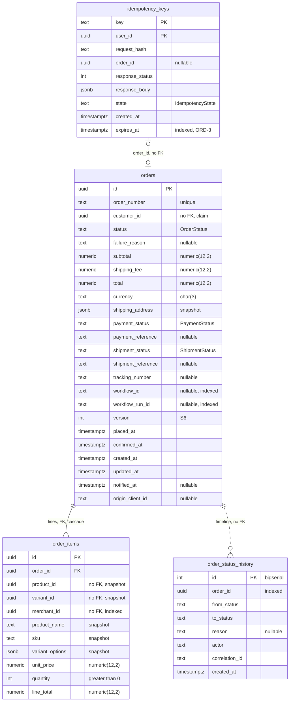

###### `orders`

Payment and shipment are **sub-state on this aggregate**, not separate services — see the rejections in [RFC 0000 §3.1.1.2](0000-architecture.md#3112-the-ownership-test).

| Column | Type | Notes |
| --- | --- | --- |
| `id` | `uuid` PK | |
| `order_number` | `text` | unique, human-readable, e.g. `SR-2026-0001042` |
| `customer_id` | `uuid` | no FK — owned by `identity`; indexed. Reference kind: claim |
| `status` | `text` | `pending` \| `awaiting_payment` \| `confirmed` \| `shipped` \| `delivered` \| `cancelled` \| `failed` \| `refunding` \| `refunded`. `OrderStatus` (S4), read policy `fallback` → `pending`. Transitions are constrained by `ORDER_TRANSITIONS` in the service layer, specified in [§3.1.1.3](#3113-state-machines) (originally [archive/0002](archive/0002-core-business-logic-and-workflows.md) §3.1.1) — 14 of the 81 ordered pairs are legal |
| `failure_reason` | `text` | nullable; set with any terminal failure |
| `subtotal`, `shipping_fee`, `total` | `numeric(12,2)` | non-negative checks (S2) |
| `currency` | `char(3)` | all lines must agree (S2) |
| `shipping_address` | `jsonb` | snapshot, not a reference (S8) |
| `payment_status` | `text` | `none` \| `pending` \| `succeeded` \| `failed` \| `refunded`. `PaymentStatus` (S4), read policy `fallback` → `none` |
| `payment_reference` | `text` | nullable; the simulated provider's id |
| `shipment_status` | `text` | `none` \| `created` \| `shipped` \| `in_transit` \| `delivered`. `ShipmentStatus` (S4), read policy `fallback` → `none` |
| `shipment_reference`, `tracking_number` | `text` | nullable |
| `workflow_id`, `workflow_run_id` | `text` | nullable, indexed — the link to Temporal |
| `version` | `integer` | S6 optimistic concurrency |
| `placed_at`, `confirmed_at`, `created_at`, `updated_at` | `timestamptz` | |
| `notified_at` | `timestamptz` | nullable — so a notification failure is visible on the order |
| `origin_client_id` | `text` | nullable — the `X-Client-Id` of the checkout request, persisted because `order.confirmed` and `order.failed` are emitted by the Temporal workflow after the request has ended and would otherwise have no origin ([archive/0003](archive/0003-events-and-observability.md) C21) |

Indexes: unique `order_number`; `(customer_id, created_at desc)`; `status`; `(status, created_at)` for operational sweeps.

###### `order_items`

Every product fact here is a **snapshot** taken at purchase ([archive/0002](archive/0002-core-business-logic-and-workflows.md) B8). A later price or name change must not reach a historical order — that is the domain behaviour, not a limitation.

| Column | Type | Notes |
| --- | --- | --- |
| `id` | `uuid` PK | |
| `order_id` | `uuid` FK → `orders.id` | cascade, indexed |
| `product_id`, `variant_id`, `merchant_id` | `uuid` | **no FK** — all snapshots; `merchant_id` indexed for the merchant view |
| `product_name`, `sku` | `text` | snapshot at purchase |
| `variant_options` | `jsonb` | snapshot |
| `unit_price` | `numeric(12,2)` | snapshot (S2) |
| `quantity` | `integer` | `> 0` check |
| `line_total` | `numeric(12,2)` | `unit_price * quantity`, stored |

###### `order_status_history`

The `timeline[]` the API returns, and the audit trail for orders (S7).

| Column | Type | Notes |
| --- | --- | --- |
| `id` | `bigserial` PK | S1 exception |
| `order_id` | `uuid` | indexed |
| `from_status`, `to_status` | `text` | `OrderStatus` values. **Plain `text` with no type decorator** — an append-only historical record must stay readable after a value is retired from the enum |
| `reason` | `text` | nullable |
| `actor` | `text` | `customer:<id>` \| `workflow` \| `admin:<id>` \| `system`. Free `text`, deliberately **not** a `DomainEnum` — a `<kind>:<id>` composite is not a closed set (S4) |
| `correlation_id` | `text` | |
| `created_at` | `timestamptz` | |

###### `idempotency_keys`

Claimed by a unique insert, never a read-then-write ([archive/0002](archive/0002-core-business-logic-and-workflows.md) B7).

| Column | Type | Notes |
| --- | --- | --- |
| `key` | `text` | part of PK |
| `user_id` | `uuid` | part of PK — a key is scoped to its caller, so one user cannot collide with or probe another's |
| `request_hash` | `text` | SHA-256 of the canonicalised body; same key + different body is a client bug → `422` |
| `order_id` | `uuid` | nullable until the order is created |
| `response_status`, `response_body` | `integer`, `jsonb` | the stored reply, replayed verbatim on retry |
| `state` | `text` | `in_progress` \| `completed` — an in-flight duplicate receives `409 Retry-Later`, not a second order. `IdempotencyState` (S4) |
| `created_at`, `expires_at` | `timestamptz` | 24-hour retention, swept |

Constraint: unique `(user_id, key)` — S11, and the mechanism behind "one order per key".

###### Constraints, indexes and database objects

| Object | Table | Definition | Source |
| --- | --- | --- | --- |
| PK | all four | as above | archive/0006 |
| Unique | `orders` | `order_number` | archive/0006 |
| Index | `orders` | `(customer_id, created_at desc)` — the customer list | archive/0006 |
| Index | `orders` | `status`; `(status, created_at)` — operational sweeps, incl. `resume_unstarted_orders` | archive/0006 |
| Index | `orders` | `workflow_id`, `workflow_run_id` | archive/0006 ("nullable, indexed") |
| Check | `orders` | `subtotal >= 0`, `shipping_fee >= 0`, `total >= 0` | archive/0006 (S2) |
| FK | `order_items` | `order_id → orders.id ON DELETE CASCADE`, indexed — the only FK, inside one database | archive/0006 |
| Index | `order_items` | `merchant_id` — the merchant view | archive/0006 |
| Check | `order_items` | `quantity > 0` | archive/0006 |
| Index | `order_status_history` | `order_id` | archive/0006 |
| Unique | `idempotency_keys` | `(user_id, key)` — the S11 arbiter | archive/0006 |
| Index | `idempotency_keys` | `expires_at` — the sweep's predicate | **ORD-3, proposed** |
| Sequence | — | `order_number_seq` — the numeric part of `order_number` | **ORD-3, proposed** |
| Comment | `orders` | `COMMENT ON COLUMN orders.status IS 'DomainEnum OrderStatus — see services/order/app/orders/enums.py; transitions in app/orders/state_machine.py'`, and the same for `payment_status`, `shipment_status` | archive/0006 S4 |

No `CHECK` names a status value and no Postgres `ENUM` type exists (S4). The status columns carry no index beyond those listed; the enums-as-text trade (alphabetical `ORDER BY status`) is irrelevant because no order query sorts by status.

**Migrations** (per-service Alembic history, explicit step, never on startup, every revision with a working `downgrade`, additive — S14; `alembic/env.py` carries the S4 `render_item` hook):

| Revision | Content | Downgrade |
| --- | --- | --- |
| `0001_initial` | `orders` (all columns except `notified_at`, `origin_client_id`), `order_items`, `order_status_history`, `idempotency_keys`, the shared `outbox` DDL, `order_number_seq`, indexes and checks above, S4 column comments | Drop in reverse |
| `0002_orders_notification_origin` | `orders` + `notified_at`, + `origin_client_id` (both nullable, no backfill) | Drop both columns |
| `0003_outbox_client_id_relay_index` | `outbox` + `client_id` (nullable) and the relay's partial index on `published_at IS NULL` ordered by `id` — as defined in RFC 0000 | Drop both |
| `0004_idempotency_expiry_index` | `idempotency_keys(expires_at)` index (ORD-3) | Drop index |

Vocabulary changes are not migrations: adding a value to any `order` enum is one line in `app/orders/enums.py` plus an edge in its transition table, and `alembic check` must report no pending diff.

**Shared tables carried.** [`outbox`](0000-architecture.md#3132-shared-tables--outbox-and-processed_events) (S12) — yes. `processed_events` (S13) — no; `order` consumes nothing.

**Known deviations, recorded rather than changed.** `order_items.unit_price` and `line_total` have no adjacent currency column; the currency is `orders.currency`, which every line must share (I5). This departs from the letter of S2 ("always adjacent") within one aggregate; §3.3.1 ORD-Q6. `order_items` has no `created_at`/`updated_at`: it is written once with its order and never updated, so it falls under S3's append-only exception.

#### 3.1.4. Breaking changes

`order` has no released clients and no production data; every change below is to a contract fixed in advance so nothing codes against interim behaviour.

| Change | Impact | Handling |
| --- | --- | --- |
| `POST /orders` exists and returns **`202 Accepted`**, not `201` | Clients must poll or listen for the notification | Pre-announced in the RFC 0000 contract list; the contract is honest about what the system does |
| `POST /orders/{id}/shipment/status` superseded by `POST /api/v1/webhooks/shipment` | The admin endpoint remains | Additive; the old route is documented as test-only |
| Rate limiting on `POST /orders` (30 per minute per user) | Clients can receive `429` | Documented; generous limit; `Retry-After` always present |
| `X-Request-ID` value becomes the trace ID (C12) | Header name and behaviour unchanged | No client depends on the format |
| `orders` gains `notified_at` and `origin_client_id` | None — nullable, no backfill | Additive migration |
| `ORDER_TRANSITIONS` gains `awaiting_payment → refunding` (ORD-1) | A client switching exhaustively on transitions sees one more; no status value is added | No client; the OpenAPI enum is generated from `OrderStatus` and is unchanged |

#### 3.1.5. Action Plan

Ordered so that the order workflow has something real to reserve against — `inventory`'s reservation API ([RFC 0006](0006-inventory-service.md)) lands first — and so the event path is proven after the saga is.

| # | Task | Output | Depends on |
| --- | --- | --- | --- |
| O1 | `order` service skeleton, settings, Alembic with the S4 `render_item` hook; `0001_initial` | Migration to head; `alembic check` clean | `common` outbox, idempotency and Temporal client helpers; service-token mint and verify ([RFC 0001](0001-platform-and-shared-infrastructure.md), [RFC 0003](0003-identity-service.md)) |
| O2 | Domain: enums, `ORDER_/PAYMENT_/SHIPMENT_TRANSITIONS`, `transition()`, money | 67 illegal-pair tests and the structural tests green | O1 |
| O3 | `OrderRepo.advance()` — version check, transition, history row, outbox row in one transaction | Rollback leaves no outbox row (G6) | O2 |
| O4 | Idempotency: claim, replay, conflict, in-progress, mismatch, lease reclaim, release on dependency failure | Concurrent-duplicate test (G3) | O1 |
| O5 | Order creation: catalog snapshot with the user's token, validation, totals, persistence, workflow start | Tests green | O4, O3, catalog's `published` status ([RFC 0004](0004-catalog-service.md)) |
| O6 | `PaymentProvider` and `ShippingProvider` protocols and deterministic fakes | Every branch reachable by configuration | O1 |
| O7 | `OrderWorkflow`, the activities, compensations, service-token inventory client | Failure-injection tests at every step (G2, G4) | O5, O6, inventory reservations |
| O8 | Read APIs: customer list, detail with timeline, merchant view, admin list | Isolation tests green | O5 |
| O9 | Cancellation signal, `get_state` query, cancel pre-check and the post-commit `409` | Tests at each stage | O7 |
| O10 | Admin shipment simulation and the resulting transitions; `/workflow` diagnostic endpoint | Tests green | O8 |
| O11 | Outbox payloads for all seven events; `origin_client_id` captured at creation and copied by every workflow-side outbox write | A checkout from client A carries A's id; a carrier update carries null (G7) | O7 |
| O12 | Avro schemas for the seven topics registered; relay publishing `order_db` | Contract tests; one topic end to end, then all seven | O11, relay and registry ([RFC 0001](0001-platform-and-shared-infrastructure.md)) |
| O13 | Redis idempotency fast path; `sweep_idempotency_keys`; `resume_unstarted_orders` | Redis-down test; sweep test; Temporal-down creation test | O4 |
| O14 | Signed carrier webhook and `make carrier-sim` | HMAC verified; stale rejected; replay a no-op | O10 |
| O15 | Tracing through workflow and activities; metrics; the Checkout dashboard | One trace per checkout (G8); every metric non-null | O7, observability stack |
| O16 | Seed: sample orders in several states through the real workflow | `make seed` idempotent and green | O7 |
| O17 | End-to-end: order → confirm, the failure paths, the worker-kill resumability test | `make test` green cold | all |

**Delivery phasing.**

| Component | Milestone |
| --- | --- |
| `order` service, `order_db` (`orders`, `order_items`, `order_status_history`, `idempotency_keys`, `outbox`) | M2 |
| Vocabularies `OrderStatus`, `PaymentStatus`, `ShipmentStatus`, `IdempotencyState`; transition tables | M2 |
| Idempotency — Postgres unique-insert claim, replay, conflict, in-progress | M2 |
| Order creation with the synchronous catalog snapshot; `202` | M2 |
| `OrderWorkflow`, activities, compensations, cancellation signal, `get_state` query | M2 |
| `PaymentProvider` / `ShippingProvider` and deterministic fakes | M2 |
| Customer, merchant and admin read APIs; cancel; admin shipment simulation; `/workflow` | M2 |
| Outbox rows written for every state change (accumulating unread) | M2 |
| Outbox published to Kafka; Avro schemas for the seven topics | M3 |
| `orders.notified_at`, `orders.origin_client_id`; `outbox.client_id` | M3 |
| Redis idempotency fast path; `sweep_idempotency_keys` on Celery Beat | M3 |
| Gateway rate limit on `POST /orders` | M3 |
| HMAC-signed carrier webhook replacing the admin simulation | M3 |
| Tracing across workflow and Kafka; order metrics; Checkout dashboard | M3 |
| `resume_unstarted_orders` (ORD-9), `awaiting_payment → refunding` (ORD-1), other ORD proposals | M4 review |
| Review of folding `payment` (Q1, archive/0006) and the synchronous catalog call (Q3) | M4 |
| `order.confirmed` feeding the assistant conversion metric (consumer side only; no `order` change) | M6 |

### 3.2. Rationale

The register below lists every significant decision in this RFC with its reason. The prose after it gives the longer argument for the most contested ones.

#### 3.2.1. Decision register

This RFC already carries ID'd decisions (A*, B*, C*, R*, S* from RFC 0000 and the archive, ORD-1–ORD-17 in [§11](#11-notes), Q*/ORD-Q* in [§3.3.1](#331-challenges-and-open-questions)). They are not renumbered: each register row gets a new `ORD-D` ID and names the existing IDs it covers in the Decision cell (“= B7”).

| ID | Decision | Why | Alternatives rejected (and why) | Revisit if |
| --- | --- | --- | --- | --- |
| ORD-D1 | `OrderWorkflow`, a Temporal saga, orchestrates checkout (= A12) | Part A requires an interrupted order to be resumable or cleanly reversed; Temporal persists state, keeps compensation next to its step and answers "where is order X?" with a query ([§3.2](#32-rationale)) | Kafka choreography: compensation scattered, no single view; 2PC/XA: blocking, unsupported across the stores; in-process `try/except`: nothing resumes after process death; Celery chains: no workflow state ([§5](#5-alternate-solutions) 1–4) | The Temporal spike fails and the schedule risk in [§8](#8-impact-analysis) materialises |
| ORD-D2 | One workflow per order, `workflow_id = order-{order_id}`, reject-duplicate policy (= archive/0002 Q3) | Gives free deduplication at Temporal as a second line of defence behind the idempotency key ([§3.1.1.4](#orderworkflow--the-saga)) | One long-running workflow per customer: loses the per-order dedupe and mixes unrelated orders' histories | Decided; not expected |
| ORD-D3 | `payment` and `shipment` are sub-state on the order, not services (= A9, archive/0006 Q1) | They fail the ownership test: simulated provider, no cardholder data, a table keyed 1:1 to orders written only by the order's workflow ([§3.1.1.1](#3111-responsibility-and-boundaries)) | Separate services: a distributed transaction to record one fact, more failure modes, no isolation gained ([§5](#5-alternate-solutions) 6) | A real payment provider or a PCI boundary appears ([§8](#8-impact-analysis)) |
| ORD-D4 | Payment and shipping behind `PaymentProvider` / `ShippingProvider` with deterministic fakes (= A9, B10) | Every saga branch, including timeouts and refund failures, is reachable by configuration; the interface keeps extraction mechanical ([§3.1.1.4](#payment-and-shipping-providers-a9-b10)) | A real sandbox: cannot be told to fail on demand; not asked for by Part A or B | A real provider is introduced |
| ORD-D5 | Reserve stock before charging; commit only after a successful charge (= B4) | The cheap failure comes first: a released reservation costs nothing, a charge for missing stock needs an unrequested refund ([§3.2](#32-rationale)) | Charge first; sell first and reconcile later, which turns a technical constraint into a cancelled paid order ([§5](#5-alternate-solutions) 5) | Not expected |
| ORD-D6 | Idempotency keys claimed by a unique insert on `(user_id, key)` in Postgres; Redis is only a fast path (= B7, C13, ORD-7) | A read-then-write races under exactly the burst load Part A describes; a unique constraint has no window. Per-user scope stops probing ([§3.1.1.4](#idempotent-creation-b7)) | Read-then-write: races; Redis alone: not durable, not transactional with the order insert ([§5](#5-alternate-solutions) 8) | Not expected |
| ORD-D7 | Replay the stored reply verbatim plus `Idempotency-Replayed: true`; in-flight duplicate → `409 Retry-After: 1`; 30 s lease reclaim; business rejections stored, dependency failures release the claim (= ORD-7, ORD-8) | A retry must see the original answer; a dead request must not hold a key forever; a transient `503` must not be replayed forever ([§3.1.1.4](#idempotent-creation-b7)) | Replaying with a different status code; storing every failure (a catalog outage would poison the key) | Creation latency approaches the 30 s lease |
| ORD-D8 | `POST /orders` returns `202 Accepted`, not `201` (= B9) | Holding the connection through payment and shipment is the checkout latency Part A opens with, and makes the client's timeout the order's timeout ([§3.2](#32-rationale)) | Blocking `201` until the workflow ends ([§5](#5-alternate-solutions) 9) | Not expected |
| ORD-D9 | Synchronous `order → catalog` lookup at creation with the user's token — the one sync call in the system (= A13, R5, Q3) | Creation cannot proceed without knowing the product is published and its real price; forwarding the user token makes `catalog` apply its edge rules ([§3.2](#32-rationale)) | A local product projection: puts a staleness window on price and publication status at purchase ([§5](#5-alternate-solutions) 7) | Q3 is re-decided at the Part A architecture review |
| ORD-D10 | Product data snapshotted into `order_items` (= A14, B8, R6) | A merchant repricing a product must not change what a customer paid; the line records what was bought ([§3.2](#32-rationale)) | Referencing the live product: history changes retroactively and needs a cross-service join | Not expected |
| ORD-D11 | Money is `numeric(12,2)` / `Decimal`, `ROUND_HALF_EVEN`, price = `price_override` ?? `base_price`, flat shipping fee, one currency per order (= S2, ORD-4, ORD-6, ORD-Q6) | A stored total can never disagree with its lines by a cent; mixed currencies are rejected rather than converted ([§3.1.1.2](#3112-domain-model)) | `float`; currency conversion; a currency column per line (restates one fact per line) | Multi-currency or promotions come into scope |
| ORD-D12 | Three state machines as `text` columns with `ORDER_/PAYMENT_/SHIPMENT_TRANSITIONS` and one `transition()` in `orders/state_machine.py` (= S4, ORD-1, ORD-2) | A native enum checks the label, never the edge (81 pairs vs 14), and `ALTER TYPE … ADD VALUE` cannot be downgraded (S14) ([§3.1.1.3](#3113-state-machines)) | Native Postgres enum; `CHECK (status IN (…))`, kept as the escape hatch ([§5](#5-alternate-solutions) 11) | A non-Python writer to `order_db` appears |
| ORD-D13 | `awaiting_payment → refunding` edge (= ORD-1) | Commit and shipment both happen before `confirmed`, so this edge is the only way to reach `refunding → failed`; it restores the stated 14/67 count ([§3.1.1.3](#3113-state-machines)) | Going `awaiting_payment → failed` directly: leaves `refunding → failed` unreachable and hides the refund | Not expected |
| ORD-D14 | `fallback` read policy on the three status columns | An unknown value from a newer build degrades to the initial state, so the row freezes loudly instead of corrupting quietly ([§3.1.1.2](#3112-domain-model)) | `passthrough`: lets a state machine branch on a bare string | Not expected |
| ORD-D15 | `version` check plus `transition()` plus history row plus outbox row in one `OrderRepo.advance()` transaction; optimistic concurrency only (= S6, S7, B11, archive/0002 Q10) | The two guards answer different questions (concurrency vs legality) and neither subsumes the other; the workflow is effectively the single writer ([§3.1.1.3](#3113-state-machines)) | Either guard alone; pessimistic row locks (not needed with one writer per order) | Several concurrent writers per order become normal |
| ORD-D16 | Every state change writes its outbox row in the same transaction; `aggregate_id` and Kafka key = `order_id` (= A10, B11, C3) | Removes the dual-write loss; the relay's failure mode becomes a duplicate. One partition per order keeps its events in order ([§3.2](#32-rationale)) | Publish after commit: loses events on a crash; Kafka transactions: do not extend to Postgres; event sourcing: high cost ([§5](#5-alternate-solutions) 10, 12) | Not expected |
| ORD-D17 | Activities are thin adapters over the repos and idempotent under `workflow_id:activity:input` (= B1, B2, B3) | One implementation, two callers (route and activity), fast unit tests; replaying an in-flight activity after a crash is safe ([§3.2](#32-rationale)) | Business logic in activities: testable only inside Temporal and unreachable from HTTP | Not expected |
| ORD-D18 | Per-activity timeouts and retry policies sized inside the 15-minute reservation TTL; compensations retry for an hour; 24 h execution timeout (= ORD-10) | A slow workflow never has its reservation swept from under it; a compensation that gives up is worse than one that is late ([§3.1.1.4](#orderworkflow--the-saga)) | Unbounded workflow time; equal retries for business and transient errors (a declined card is retried zero times) | The reservation TTL changes (archive/0002 Q2) |
| ORD-D19 | Compensations run in reverse; a post-commit failure reverses the committed reservation; an ambiguous charge is always refunded by key (= ORD-12) | A committed reservation can never return to `held`, so "release" cannot undo it; the customer is never charged for an order that did not complete ([§3.1.1.4](#orderworkflow--the-saga)) | Release after commit (impossible in `inventory`); assuming a timed-out charge failed | Not expected; resolved by INV-16 |
| ORD-D20 | Cancellation by signal + `get_state` query, honoured only before `committing`; auto-refund if charged (= archive/0002 Q4, ORD-Q4) | After commit a cancel is a refund request, which has no customer flow; the archive specifies a signal ([§3.1.1.4](#orderworkflow--the-saga)) | Temporal Update: closes the race but departs from the archive; admin-approved refund on cancel | ORD-Q4 is decided for Update, or returns come into scope |
| ORD-D21 | Order creation succeeds while Temporal is down; `resume_unstarted_orders` starts the workflow later (= ORD-9) | Checkout acceptance should not depend on the orchestrator being up; only order progress does ([§3.1.1.5](#3115-dependencies-and-degradation)) | Failing creation with `503` when Temporal is unreachable | Not expected |
| ORD-D22 | Worker calls `inventory` with a client-credentials service token, scope `inventory:internal`; user routes reject service tokens (= ORD-11) | There is no user in a workflow; sharing one role would let a stolen customer token call the internal reservation routes ([§3.1.1.5](#3115-dependencies-and-degradation)) | Forwarding the customer's token into the workflow; one role for both | `identity`'s client-credentials grant changes ([RFC 0003](0003-identity-service.md)) |
| ORD-D23 | Carrier updates arrive as an HMAC-signed webhook with a 300 s window; replays are absorbed by the shipment state machine (= ORD-13) | The correct shape even for a simulated carrier; a repeated status is a no-op, so no dedupe table is needed ([§3.1.1.4](#carrier-webhook-simulation)) | Unsigned callbacks; a dedupe table; an admin-only simulation route (kept, test-only) | A real carrier integration is added |
| ORD-D24 | Isolation by token claims: another customer's order is `404`; merchants see only their own lines, never total, address or payment reference (= ORD-16) | `403` would confirm the order exists; the merchant scope comes from the catalog snapshot, not the request ([§3.1.2.2](#3122-role-matrix)) | Scoping by request fields; `403` for foreign orders | Multi-merchant sub-orders come into scope (archive/0002 Q9) |
| ORD-D25 | `origin_client_id` persisted on the order and copied into every outbox row (= C21, archive/0006 Q7) | `order.confirmed` and `order.failed` are emitted by the worker after the request has ended and would otherwise have no origin ([§3.2](#32-rationale)) | Reading the client id from request context (not available on the worker) | Not expected |
| ORD-D26 | `order` is a producer only: seven events, no refund topic, no `processed_events` (= ORD-17, ORD-Q2) | Carrier updates are a signed HTTP call made idempotent by the state machine; refunds ride on `payment_status` so the RFC 0000 catalogue is not amended silently ([§3.1.2.4](#3124-events-consumed)) | A `payment.refunded` topic; consuming carrier events from Kafka | The RFC 0000 catalogue adds a refund topic (ORD-Q2) |
| ORD-D27 | Entity-first layout: one `orders/` entity with `models`, `repo`, `enums`, `state_machine`, `utils` (money) and `v1/{routes,schemas}`; `idempotency_keys` in `core/` | The binding layout ([RFC 0000 §3.1.1.7](0000-architecture.md#3117-module-structure-inside-a-service)); the idempotency mechanism is request plumbing, not an order rule (R8) ([§3.1.1.1](#3111-responsibility-and-boundaries)) | Version-first `app/v1/<entity>/`; hybrid `app/api/v1/` split (mentor review §3) | A second entity needs idempotency, or the mechanism moves to `common` |

**Why Temporal rather than a chain of Kafka consumers.** Part A requires that an interrupted order be "resumable or cleanly reversible". With choreography, the answer to "where is order X stuck?" is "read six consumers' logs and infer", compensation is scattered across the consumers that happen to run after a failure, and step timeouts have to be hand-rolled everywhere. Temporal answers that question with a query, keeps compensation adjacent to the step it undoes, and persists workflow state so a worker crash resumes rather than loses. Kafka is the wrong tool for a saga — no built-in state, no compensation, no visibility into where a process is stuck — and Temporal is the wrong tool for broadcasting a fact, which is why the workflow's outcome leaves as events (A12).

**Why reserve before charging.** The cheap failure comes first: a released reservation costs nothing and is invisible, whereas a charge followed by a failed reservation takes money for stock that does not exist.

**Why idempotency keys are claimed by unique insert.** A read-check-write has a race that only appears under exactly the load Part A describes. A unique constraint has no window; the database arbitrates (S11).

**Why `202` and not `201`.** Payment authorisation against a real provider takes hundreds of milliseconds to seconds, and shipment creation is another network call. Holding the HTTP connection through both is the checkout latency Part A opens with, and it makes the client's timeout the order's timeout. Returning the order id immediately means a client retry is a poll, not a second order.

**Why product data is snapshotted rather than referenced.** A merchant repricing a product must not retroactively change what a customer paid. The snapshot is what the order *means*; that it also removes a cross-service join is a bonus rather than the motivation. An order line should survive its product being deleted, because it records what was bought, not what is for sale.

**Why the catalog call is synchronous.** Order creation cannot proceed without knowing the product is published and its real price. Applied to the reference-kind procedure: the historical value matters for the line (→ snapshot), but taking the snapshot needs a value that must be current and cannot be stale, and the caller cannot proceed without it (→ live lookup, and accept the availability coupling, R5). It is the one such call in the system.

**Why the outbox is written in the state-change transaction.** The dual-write problem — commit to Postgres, then publish to Kafka, and crash in between — is the standard way event-driven systems lose events, and it is invisible until it happens. The outbox makes the event part of the same transaction as the state change; the relay's failure mode is then a duplicate, which consumers absorb, rather than a loss. It is non-negotiable for order and payment events. Writing outbox rows from the first state change meant the Kafka integration was a relay process and a topic configuration rather than a revisit of every handler.

**Why activities are thin.** If business logic lives in activity code, it can only be tested inside a Temporal test environment, and it cannot be reached by the HTTP route that needs the same rule. Keeping activities as adapters over the service layer means one implementation, two callers, and fast unit tests.

**Why `origin_client_id` is persisted.** The workflow emits `order.confirmed` and `order.failed` after the request has ended, on a worker with no request context. The only way for those events to know which device started the checkout is for the order to remember it.

**Why the enums are `text` with a transition table (S4).** `ALTER TYPE … ADD VALUE` is irreversible, so a native enum cannot satisfy S14's mandatory `downgrade`; and a native enum checked the label, never the edge — it accepted all 81 order pairs. The transition table accepts 14. The enum checked the label and never the edge, and the edge is where the money is.

### 3.3. Tradeoffs

| Trade being made | The cost | Why it is acceptable |
| --- | --- | --- |
| Temporal in the stack | A server, a UI, a worker, and a new mental model | Required by Part A, and it is the correct tool. The alternative is hand-rolling durability badly |
| Asynchronous order creation (`202`) | Clients must poll or listen; the demo is less immediate than a blocking `201` | The workflow completes in well under a second with fakes, and the contract is honest about what the system does |
| Synchronous `order → catalog` call at creation | `catalog` being down blocks order creation; adds latency to the create path | A local product projection introduces a staleness window on price and availability, which is worse (Q3) |
| `payment` and `shipment` folded into `order` | Looks less "microservice" in a review; a real payment integration later needs extraction | The interface boundary (A9) makes extraction mechanical. Building an empty service to look right is the worse failure |
| Payment and shipping simulated | No real integration experience | Not asked for by either part. The fake makes every failure branch testable, which a real sandbox would not |
| `order_items` duplicating product data | Storage, and a corrected product name never reaches historical orders | That is the intended semantics of an order record |
| Transactional outbox | Extra table, relay component, up to one poll interval of publish latency | The alternative loses events on any crash between commit and publish |
| Enum validity in the model, not the database (S4) | A direct `psql` write is no longer constrained — `UPDATE orders SET status = 'shippd'` now succeeds; `\d orders` no longer lists permitted values | S14 becomes satisfiable, and the state machine gains a transition table strictly stricter than the type it replaces. Bounded by R1 and reduced by `COMMENT ON COLUMN`, a round-trip test, and a runbook routing manual edits through an admin utility. Residual risk is a human with the service role at 2am, accepted knowingly |
| Optimistic concurrency only on orders | A concurrent admin action and workflow step can collide | The loser gets `409` and the activity retries against fresh state; the workflow is effectively the single writer (archive/0002 Q10) |
| Cancellation by signal rather than Update | A narrow race at the cancellable point, resolved in the workflow's favour | The client is told `202 requested`, not `cancelled`, and sees the true outcome on read (ORD-Q4) |
| Ownership-based boundary | The merchant order view spans `order` (lines) and `catalog` (product details) | Features change; data ownership does not. The snapshot carries enough for the view |
| Refunds carried on `order.failed` / `order.cancelled` instead of their own topic | A consumer wanting refunds must inspect `payment_status` | The catalogue is not amended silently (ORD-Q2) |

#### 3.3.1. Challenges and Open Questions

Original question IDs are kept, with the archived RFC that raised them — several archived RFCs numbered their questions independently.

| # | Source | Question | Current position | Needs a decision by |
| --- | --- | --- | --- | --- |
| Q3 | archive/0000 (also archive/0002 Q1, archive/0003 Q3, archive/0006 Q2) | Does `order` call `catalog` synchronously, or keep a local product projection fed by events, now that `catalog.product.*` events exist? | **Synchronous (A13, R5).** A projection is the scalable answer, but price and publication status at purchase must be authoritative, and a projection puts a staleness window on exactly the wrong fact | Part A architecture review |
| Q1 | archive/0006 | Is folding `payment` into `order` defensible at review? | Yes — no compliance boundary, no owned state, no independent change. The interface is separate, so extraction is mechanical if the premise changes | Part A architecture review |
| Q2 | archive/0002 | Reservation TTL — 15 minutes, or shorter? | 15 minutes, owned by `inventory`. `order`'s forward-path timeouts are sized to finish well inside it (§3.1.1.4) | If flash-sale testing shows contention ([RFC 0006](0006-inventory-service.md)) |
| Q3 | archive/0002 | One workflow per order, or one long-running workflow per customer? | One per order; `workflow_id = order-{order_id}` is a second line of defence behind the idempotency key | Decided |
| Q4 | archive/0002 | Does cancellation after payment auto-refund, or require an admin? | Auto-refund, before the cancellable point. A real provider would need an approval step | Revisit if returns are ever in scope |
| Q9 | archive/0002 | Must every line belong to one merchant? | No — multi-merchant orders are allowed; the merchant view filters lines. Per-merchant sub-orders are out of scope | Recorded |
| Q10 | archive/0002 | Is optimistic concurrency (`version`) enough on orders? | Yes; the workflow is effectively a single writer per order | Decided |
| Q7 | archive/0000 | Do we need a cart? | No. Orders are placed with a line-item body | Decided |
| Q12 | archive/0003 | Should the SSE stream carry order-status events directly? | No — one stream per concern; order outcomes reach clients as notifications ([RFC 0007](0007-notification-service.md)) | Part A architecture review |
| Q7 | archive/0006 | Is `origin_client_id` a legitimate fifth reference kind (opaque client token), or a snapshot of an untrusted hint? | A fifth kind: a token the client invented, compared only for equality, always scoped under a verified `user_id`, never an authorisation input ([RFC 0000](0000-architecture.md#3135-cross-boundary-reference-kinds)) | Part A architecture review |
| ORD-Q1 | new | What triggers `confirmed/shipped/delivered → refunding`? | The edges and `refund_payment` exist; no v1 endpoint triggers them because returns are a non-goal. An admin refund endpoint running a small refund workflow is the natural addition | When returns are in scope |
| ORD-Q2 | new | Should refunds have their own topic (`payment.refunded`)? | Not added without amending the RFC 0000 catalogue; refunds ride on `order.failed` / `order.cancelled` as `payment_status` | Part A architecture review |
| ORD-Q3 | new | Should payment and shipment sub-state changes write `order_status_history` rows? | No: the table's columns are `OrderStatus` values. Sub-state changes are audited by their outbox rows (actor, correlation and time in the envelope). A reviewer may prefer sub-state rows in the timeline | Part A architecture review |
| ORD-Q4 | new | Cancellation by Temporal *Update* instead of signal + query? | Update gives a synchronous accept/reject and closes the race at the cancellable point; signal + query is kept because the archive specifies a signal | Part A architecture review |
| ORD-Q5 | new | The payment-method token lives only in the workflow input — is that right? | Yes for a simulated provider (it is an opaque identifier, not a secret); a real provider would store a provider-side payment-intent id on the order instead | If a real provider appears |
| ORD-Q6 | new | `order_items` money columns have no adjacent currency column (S2's letter) | Currency is per order and enforced identical across lines (I5); adding `order_items.currency` would restate one fact per line | Part A architecture review |

---

## 4. Dependencies/blockers/known issues

**Dependencies.**

| Dependency | Version | Used for |
| --- | --- | --- |
| Temporal server + UI | 1.25.x | `OrderWorkflow` orchestration |
| `temporalio` (Python SDK) | 1.8.x | Workflow, activities, signal, query, test environment |
| PostgreSQL | 16 | `order_db` |
| `httpx` | — | Catalog and inventory clients |
| `redis[hiredis]` | 5.x | Idempotency fast path |
| `confluent-kafka[avro]` (via the relay) | 2.6.x | Publication of `order` events |
| OpenTelemetry SDK + instrumentations | 1.28.x | Traces and metrics |

Service dependencies: `catalog`'s product read and `published` status ([RFC 0004](0004-catalog-service.md#3121-endpoints)); `inventory`'s internal reservation endpoints ([RFC 0006](0006-inventory-service.md#3121-endpoints)); `identity`'s client-credentials grant for the service token ([RFC 0003](0003-identity-service.md)); the relay, worker hosts and Schema Registry ([RFC 0001](0001-platform-and-shared-infrastructure.md)).

**Blockers.** None. Every dependency is a public image or package, and the simulated providers remove the only external-account requirement.

**Cross-RFC requirements this RFC places on others.**

| On | Requirement |
| --- | --- |
| [RFC 0006 — inventory](0006-inventory-service.md) | **ORD-12**: a way to reverse a *committed* reservation (return its quantity to `on_hand` with a ledger row, reason e.g. `order_compensation`), because the archived saga compensates a post-commit shipment failure with "release", and a committed reservation can never return to `held`. **Resolved** by INV-16: a dedicated `POST /internal/v1/inventory/reservations/{id}/reverse`. Also: `POST /reservations` accepts all lines of one order atomically and is idempotent on `(order_id, variant_id)`; `order.cancelled` releases any held reservation idempotently |
| [RFC 0003 — identity](0003-identity-service.md) | The client-credentials grant issuing `sub: "service:temporal-worker"` with scope `inventory:internal` (ORD-11). This is the amendment the archived architecture said a no-user-in-context call would require |
| [RFC 0000 — architecture](0000-architecture.md#3121-surface-map) | The surface map lists `/api/v1/orders/*` for `order`; `/api/v1/webhooks/shipment` is also `order`'s |
| [RFC 0002 — gateway](0002-gateway-service.md) | 30 orders per minute per user; `X-Client-Id` passed through, shape-validated (`^[A-Za-z0-9_-]{8,64}$`) and stripped if malformed rather than rejected — a cosmetic header must never fail a checkout |

**Known issues.**

- No customer-facing refund or return flow; the refund edges exist without a trigger (ORD-Q1).
- A narrow cancel race at the cancellable point, resolved in the workflow's favour (ORD-Q4).
- The idempotency key prevents duplicates, not volume; volume is the gateway's rate limit.
- Single-node Temporal and one Postgres instance; a hot variant row in `inventory` serialises checkouts for that variant during a flash sale. None is a schema decision that blocks scaling.
- Workflow code rollback requires care with in-flight executions; locally the answer is drain and restart, or `make reset`.

---

## 5. Alternate solutions

| # | Alternative | Why rejected |
| --- | --- | --- |
| 1 | **Choreographed saga over Kafka; no Temporal.** `order` publishes `order.created`; `inventory` reacts and publishes `inventory.reserved`; a payment consumer reacts, and so on | Compensation logic ends up distributed across consumers that must each know what to undo; there is no single place that knows where an order is; timeouts and retries are reimplemented per consumer; debugging a stuck order means reading several consumer logs. It also inverts the dependency — the services would need to know the process, which is what the orchestrator is for. Part A's resumability requirement is precisely Temporal's strength, and choreography's weakest point |
| 2 | **Two-phase commit / XA across services** | Blocking, poor failure behaviour, and unsupported across the mix of stores involved. Sagas with compensation are the accepted answer for exactly this problem |
| 3 | **Synchronous orchestration inside the order service** — a Python function calling inventory, payment and shipment in sequence, with `try/except` compensation | Genuinely the fastest thing to write. It fails on process death: killed between charging and committing inventory, nothing resumes and nothing compensates, and the only evidence is a log line that may not have flushed. It also holds the HTTP connection for the full sequence, and every retry policy and timeout is hand-written. This is the alternative Temporal exists to replace |
| 4 | **Celery chains with `on_error` callbacks** | No workflow state, no visibility into where a chain stopped, and error callbacks that themselves fail are lost. Celery is right for one-shot jobs and is used for exactly that (the idempotency sweep) |
| 5 | **Optimistic inventory: sell first, reconcile later** — no reservation; decrement on confirmation and cancel on oversell | Converts a technical constraint into a customer-facing failure — the customer who receives a cancellation after paying. Part A names inventory consistency as the problem to solve |
| 6 | **Separate `payment` and `shipment` services** | They fail ownership tests 2–4: no invariant of their own, no independent reason to change, no distinct profile. Splitting creates a distributed transaction to record one fact. Kept as interfaces so extraction is mechanical (A9) |
| 7 | **A local product projection instead of the synchronous catalog call** | Puts a staleness window on price and publication status at the moment of purchase. Revisited under Q3 and kept rejected |
| 8 | **Idempotency by read-then-write, or by Redis alone** | Read-then-write races under burst load. Redis alone is not durable and not transactional with the order insert; it is kept only as a fast path ahead of the Postgres claim |
| 9 | **Blocking `201` until the workflow finishes** | Makes the client's timeout the order's timeout and holds connections through provider latency — the checkout delay Part A opens with |
| 10 | **Event sourcing as the order store** | A genuinely good fit for orders and the natural home for the audit requirement, but a large conceptual cost, and it makes every simple read harder. The outbox gives most of the integration benefit at a fraction of the cost; `order_status_history` gives the audit |
| 11 | **Native Postgres enums or `CHECK (status IN (…))` on the status columns** | Native enums cannot satisfy S14 and never checked the edge. `CHECK` is reversible and is the escape hatch **if a non-Python writer to `order_db` is ever introduced** |
| 12 | **Kafka transactions for exactly-once** | Exactly-once within Kafka does not extend to Postgres; consumer idempotency is needed regardless |

---

## 6. Production readiness

### 6.1. Scalability and Fault tolerance

- **Workflow durability.** Temporal persists every workflow event. A worker killed mid-order resumes from the last completed activity; no order is lost and none is silently abandoned. Tested by actually killing the worker (G4).
- **Activity retries.** Exponential backoff, capped attempts, and explicit non-retryable errors for business failures — a declined card is retried zero times, a network blip up to three.
- **Timeouts at every level.** `start_to_close` per activity, `schedule_to_close` per attempt chain, and a workflow-level execution timeout, so nothing hangs indefinitely; the forward path is sized inside the reservation TTL.
- **Duplicate prevention at two layers.** The idempotency key at the API, and `workflow_id = order-{order_id}` at Temporal, which rejects a duplicate start.
- **Oversell prevention under concurrency** is `inventory`'s row lock plus `CHECK (on_hand >= reserved >= 0)`; `order`'s contribution is that stock is only ever touched through a reservation, and it is tested from checkout at 50 concurrent orders against 10 units (G5).
- **Backpressure.** Order creation stays fast because it only claims, snapshots, persists and starts a workflow. The Temporal task queue buffers when workers are saturated; workers scale horizontally with `--scale`; the gateway rate-limits; Kafka and the outbox absorb downstream slowness. Part A's "degrades gracefully rather than collapsing", per layer.
- **Stateless service.** `order` holds no in-process state; replicas scale with `--scale`.
- **Blast radius.** `inventory` down fails orders cleanly with a recorded reason. `catalog` down blocks creation only (Q3). Kafka, `notification` and `analytics` down leave checkout unaffected. Temporal down still accepts orders (ORD-9).
- **Stranded-stock recovery** is `inventory`'s expiry sweeper, independent of Temporal, so a failure mode Temporal cannot see still self-heals — and `order` handles its consequence (`RESERVATION_EXPIRED` → refund).
- **Compensation cannot give up quietly.** Compensation activities retry for an hour; a refund that still fails leaves the order in `refunding`, visible on `order_nonterminal_age_seconds`, never silently `failed`.
- **Known ceilings.** Single-node Temporal; one Postgres; a hot variant row serialises writers. None blocks scaling.

### 6.2. Security considerations

- **Order isolation** — a customer reads only their own orders (others are `404`); a merchant sees only their own lines within an order, never another merchant's lines or the customer's full basket; `admin` sees all.
- **Claims are the only trusted input.** `customer_id` and `merchant_id` scope come from the verified JWT, never from the body or a query parameter.
- **Amounts are computed server-side** from the catalog snapshot. A client-supplied price is ignored, not trusted — the obvious attack on any checkout.
- **No card data anywhere.** The request carries a `payment_method` token; the fake returns a reference. No field in any schema could hold a card number.
- **Idempotency keys are scoped per user,** so one caller cannot probe or collide with another's keys.
- **Internal calls use a scoped service token.** Inventory's internal routes require the `inventory:internal` scope and reject user tokens; `order`'s user routes reject service tokens. The catalog call forwards the user's own token so `catalog` applies its edge rules.
- **Workflow inputs carry identifiers, not secrets.** Temporal history is readable in its UI.
- **The carrier webhook is HMAC-signed** with a timestamp and a 300 s replay window, compared in constant time, and rejects unsigned or stale requests — the correct shape even for a simulated carrier.
- **Event payloads carry identifiers and the minimum needed to render** — no password hashes, no card data, no full address beyond what a shipment notification needs. Kafka is unauthenticated locally, so payload minimalism is the actual control.
- **`origin_client_id` is client-minted and forgeable, and treated as such**: stored only on the order it came with, never an authorisation input, never an identity.
- **R1 grants.** Only `order`'s role can reach `order_db`; `assistant` cannot read orders.
- **Accepted gaps** — no fraud checks; the idempotency key limits duplicates, not volume (volume is the gateway's 30/min/user); no TLS inside Compose.

### 6.3. Deployment strategy

- **Compose profile `workflow`** carries `order`, `inventory`, `temporal`, `temporal-ui` and `temporal-worker`; the `events` profile adds the relay, Kafka, Redis and Celery ([RFC 0001](0001-platform-and-shared-infrastructure.md)).
- **Migrations** are per service and explicit (`make migrate`), never on startup; every revision has a working `downgrade`.
- **Worker deployment is separate from the service,** so workflow code can be redeployed without restarting the API. Temporal's versioning handles in-flight workflows; with no production traffic, drain and restart is used.
- **Rollback.** Alembic downgrade for `order`; the `fallback` read policy means a rolled-back build reading a newer status value freezes that order rather than crashing a list endpoint. Workflow code rollback requires care with in-flight executions; locally, `make reset`.
- **Schema registry** versions for the seven topics are additive and never deleted.
- **Readiness.** `/health/ready` fails without `order_db`; Compose dependency ordering keeps `order` from accepting traffic before its store is reachable.

---

## 7. Test Plan

**Unit** — no I/O.

- Order state machine: every legal transition, and every illegal one rejected — **all 67 illegal pairs parametrised individually**, asserting `IllegalTransition` and that the entity is left unmutated. Structural tests: `ORDER_TRANSITIONS`'s keys are exactly `OrderStatus`'s members, every target is a known state, every state is reachable from `pending`, and the terminal set is exactly `{cancelled, failed, refunded}`. These catch a typo'd edit to the table, which under S4 is the only thing standing between the service and a bad transition.
- The same totality, reachability and illegal-pair tests for `PAYMENT_TRANSITIONS` (initial `none`, terminal `{failed, refunded}`) and `SHIPMENT_TRANSITIONS` (initial `none`, terminal `{delivered}`).
- Total calculation: multi-line, multi-quantity, rounding at two decimal places, `price_override` over `base_price`, mixed-currency rejection, shipping fee.
- Idempotency: key canonicalisation, request hashing, same-key-different-body detection, lease expiry arithmetic.
- Payment and shipping fakes: each configured branch returns what it claims; a repeated idempotency key returns the first result.
- Outbox payload builders: every field of the seven payloads; envelope construction; correlation and `client_id` propagation.
- HMAC signer and verifier: valid, tampered body, wrong secret, stale timestamp, future timestamp.
- Failure-reason mapping from activity errors to `OrderFailureReason`.

**Integration** — real Postgres; catalog and inventory stubbed at the HTTP boundary unless stated.

- Creation: valid order → `202`, `pending`, items snapshotted with the catalog's values at that moment; `order.created` outbox row in the same transaction.
- **Ten parallel requests with one `Idempotency-Key` → one order, ten identical responses** (G3) — identical status and body.
- Same key, different body → `422`. In-progress duplicate → `409` with `Retry-After`. Stale in-progress claim → reclaimed by exactly one of several contenders.
- Missing `Idempotency-Key` → `400`. The same key from two different users → two orders.
- A key replayed after 24 hours (expired) → a new order; the sweep deletes expired rows and is safe to run twice.
- Redis fast path: replay served without a Postgres read; Redis down → Postgres claim still correct.
- Catalog `503` → `503`, claim released, retry succeeds once catalog returns. Business `422` → stored and replayed.
- Unpublished, archived, or unknown product → `422` with a problem detail naming the line. Mixed currencies → `422`. Zero or negative quantity → `422`. Duplicate variant → `422`. A price in the body → `422`.
- Snapshot immutability: changing a product's name and price leaves every existing `order_item` unchanged. Archiving a product leaves order history intact and readable.
- Isolation: another customer's order → `404` (not `403`); merchant view shows only own lines and no total or address; admin sees all; a service token on a user route → `403`.
- Cancellation before payment succeeds; after commit → `409` with an explanatory detail.
- Rollback: a failed `advance()` leaves no history row and no outbox row, and vice versa (G6).
- Version conflict: two concurrent `advance()` calls from the same `version` → one succeeds, one `409`.
- S4 enum round trip for every `DomainEnumText` column; an unknown value is rejected on write (as `StatementError` wrapping `UnknownEnumValueError`); a value written by a newer build reads back as the `fallback` member.
- Webhook: valid signature applies; bad or stale signature → `401`; repeat → no-op `200`; out-of-order status → `409`; `shipment.status_changed` written with `client_id = null`.
- Temporal unreachable at creation → `202`, run id null; `resume_unstarted_orders` starts it once Temporal is reachable.

**Workflow tests** — Temporal test environment, time-skipping, real `OrderRepo` against Postgres, inventory stubbed or real per test, fakes configured per case. **Failure injection at every step is a required test, not an optional one.**

| Case | Injection | Expected |
| --- | --- | --- |
| Happy path | — | `confirmed`; stock committed; `payment.succeeded` and `order.confirmed` outbox rows; `notified_at` set |
| Insufficient stock | inventory returns insufficient | `failed INSUFFICIENT_STOCK` immediately; **no payment attempted** |
| Inventory down | reserve times out every attempt | `failed INVENTORY_UNAVAILABLE` after the reserve window |
| Payment declined | `tok_decline` | Inventory released; `failed PAYMENT_DECLINED`; `payment.failed`; `available` back to its starting value (G2) |
| Payment timeout | `tok_timeout` | Refund-by-key finds nothing captured; release; `failed PAYMENT_TIMEOUT`; `payment_status failed` |
| Transient then success | `tok_flaky_2` | Activity retried twice then succeeding → **exactly one charge**, verified against the fake's call log (B3) |
| Commit fails | inventory commit returns reservation-not-held | `awaiting_payment → refunding → failed`; refund issued; release called |
| Reservation expired | sweeper released the reservation before commit | `failed RESERVATION_EXPIRED`; refund issued |
| Shipment fails | postcode `00000` | Refund issued, commit reversed; `awaiting_payment → refunding → failed FULFILMENT_FAILED` |
| Shipment timeout | postcode `99999` | Same compensation after retries exhaust |
| Refund keeps failing | `tok_refund_fail` + shipment failure | Order remains `refunding`; compensation retries; the stuck-order gauge moves |
| Cancel at `reserving` | signal during reserve | Released; `cancelled`; no charge |
| Cancel at `charging` | signal during charge | Refunded and released; `cancelled`, `payment_status refunded` |
| Cancel at `committing` or later | signal after commit starts | Ignored; order confirms; the API returned `409` for a request it could see was late |
| Compensation order | shipment failure | Compensations run in reverse of completion order, asserted from the activity log |
| Idempotent replays | every activity forced to run twice | No duplicate reservation, charge, shipment, history row or outbox row |
| Deterministic replay | workflow history replayed with the replayer | No non-determinism errors |

**Contract.** The seven payloads validate against their registered Avro schemas; a v1 consumer reads a v2 record and vice versa for the `client_id` envelope field; an incompatible schema change is rejected by the registry checker in CI.

**Observability.** A checkout produces exactly one trace containing spans from gateway, `order`, `inventory`, the Temporal workflow, the relay and the notification consumer — asserted by querying the Jaeger API for the trace ID, not by looking at the UI (G8). `/metrics` exposes every metric in §3.1.1.7 non-null; `order_failures_total{reason}` increments once per failure path above. Every log line during one checkout carries the same trace ID.

**End-to-end** — through the gateway, cold start.

1. Seed an admin, a merchant, a customer and a category; the merchant creates and publishes a product with a variant and sets stock.
2. Customer places an order with an SSE stream open → `202` → poll until `confirmed`.
3. Assert: stock reduced by the ordered quantity; the inventory ledger reconciles; the order timeline shows every transition with actors; `order.created`, `payment.succeeded` and `order.confirmed` on their topics carrying the checkout's `client_id`; a notification frame on the originating client.
4. Failure path: order with the declining payment token → `failed`; stock unchanged from step 3; `order.failed` consumed; the failure counter incremented by reason.
5. `make carrier-sim` drives `shipped` → `in_transit` → `delivered`; three `shipment.status_changed` events with null `client_id`; order `delivered`.
6. **Resumability:** kill `temporal-worker` mid-order, restart it, assert the order reaches a terminal state with no orphaned reservation (G4).
7. **Concurrency:** 50 concurrent orders against 10 units → exactly 10 `confirmed` and 40 `failed INSUFFICIENT_STOCK` (G5).

**Manual verification** — `make reset && make up && make migrate && make seed && make test` from a clean clone; the Temporal UI shows completed and compensated executions.

**Explicitly not tested** — load and performance beyond the concurrency tests above; Temporal or Postgres failover.

---

## 8. Impact Analysis

**On other services.**

| Service | Impact |
| --- | --- |
| `catalog` | Serves one synchronous read per distinct product per checkout; its availability is a checkout dependency (Q3) |
| `inventory` | Receives reservation, commit, release and reversal calls from workflow activities; consumes `order.cancelled` |
| `identity` | Issues the worker's client-credentials token |
| `notification` | Consumes all seven order events; relies on `client_id` from `origin_client_id` for origin-scoped delivery |
| `analytics` | Consumes all seven; six of the nine Part A §5 metrics derive from `order` events |
| `gateway` | Routes `/api/v1/orders/*` and `/api/v1/webhooks/shipment`; enforces the order rate limit |
| `assistant` | None directly; order history is available through `order`'s API but deliberately unused (privacy) |

**On effort.** `order` is the heaviest single service: a saga with compensations, idempotency, three state machines and seven events. The mitigation is ordering — inventory's reservation API first, then the domain and `advance()`, then the workflow — and the fakes, which let every failure branch be built and tested without external systems.

**If a premise changed.**

| If | Then |
| --- | --- |
| A real payment provider is introduced | `payment` becomes a service; the `PaymentProvider` boundary makes it an extraction, not a rewrite |
| A cart is required | A new service, tested against the ownership test; orders still carry line items |
| A non-Python writer to `order_db` appears | S4 is revisited; the replacement is `CHECK (status IN (…))` |
| Returns become in scope | The `refunding` edges and `refund_payment` are already there; an admin refund endpoint and workflow are added (ORD-Q1) |

**Risks.**

| Risk | Likelihood | Impact | Mitigation |
| --- | --- | --- | --- |
| Temporal's learning curve consumes the schedule | **High** | High | A connectivity spike first; the simpler publishing workflow ([RFC 0004](0004-catalog-service.md)) is built first as the learning vehicle |
| Compensation logic is subtly wrong and only fails under a race | Medium | High | Failure injection at every step is a required test; the inventory ledger makes any drift detectable |
| Idempotency implemented as read-then-write | Medium | High | Designed as a unique-insert claim (B7), and the concurrent-duplicate test is the acceptance criterion |
| Activity code accreting business logic, making it untestable | Medium | Medium | B1 is a review check |
| Scope creep into returns, promotions, multi-warehouse | Medium | Medium | Listed as non-goals with the reason attached |
| The compensation for a post-commit failure being specified as "release" when inventory cannot release a committed reservation | Medium | High | ORD-12 states the requirement on inventory explicitly |
| Someone assigns `status` outside `transition()` | Low | High | Review check; the illegal-pair tests only protect writers that go through it |

**On reviewers.** A review should be able to check: a payment that fails leaves stock exactly as it was; a retried order creates one order; a killed worker resumes; a shipment failure refunds; a late cancel is refused with a reason; one checkout is one trace; and no business rule lives in workflow code.

---

## 9. Useful Links/References

**Project documents**

- [RFC 0000 — Architecture](0000-architecture.md) · [RFC 0001 — Platform](0001-platform-and-shared-infrastructure.md) · [RFC 0003 — identity](0003-identity-service.md) · [RFC 0004 — catalog](0004-catalog-service.md) · [RFC 0006 — inventory](0006-inventory-service.md) · [RFC 0007 — notification](0007-notification-service.md) · [RFC 0008 — analytics](0008-analytics-service.md)
- Archived sources: [archive/0000](archive/0000-system-architecture.md) · [archive/0002](archive/0002-core-business-logic-and-workflows.md) · [archive/0003](archive/0003-events-and-observability.md) · [archive/0006](archive/0006-service-decomposition-and-data-model.md)
- [Part A](../part-a.md) · [Milestones](../milestones.md) · [Execution Guidelines](../execution-guidelines.md)

**Technical references**

- Temporal Python SDK — https://docs.temporal.io/develop/python
- Temporal testing and time-skipping — https://docs.temporal.io/develop/python/testing-suite
- Saga pattern — https://microservices.io/patterns/data/saga.html
- Transactional outbox — https://microservices.io/patterns/data/transactional-outbox.html
- Stripe idempotent requests (the reference implementation of the header contract) — https://docs.stripe.com/api/idempotent_requests
- IETF draft, The Idempotency-Key HTTP Header Field — https://datatracker.ietf.org/doc/draft-ietf-httpapi-idempotency-key-header/
- Stripe webhook signatures (the shape of the carrier signature) — https://docs.stripe.com/webhooks#verify-events
- PostgreSQL explicit locking — https://www.postgresql.org/docs/16/explicit-locking.html
- PostgreSQL numeric types — https://www.postgresql.org/docs/16/datatype-numeric.html

---

## 10. Related tickets/issues

| ID | Title | Maps to |
| --- | --- | --- |
| *(to be created)* | O1 … O17 | The tasks in §3.1.5, one ticket each |
| — | archive/0002 T10–T21 (order half) | O1–O17 |
| — | archive/0003 T16e, T22 | O11, O14 |
| — | RFC 0006 inventory — ORD-12 | Reversal of a committed reservation |
| — | RFC 0003 identity — ORD-11 | Client-credentials grant for the worker |

---

## 11. Notes

- **New decisions in this RFC**, each a proposal for review:

  | ID | Decision | Where |
  | --- | --- | --- |
  | ORD-1 | `awaiting_payment → refunding` edge, restoring the stated 14/67 count and the diagram's refund path | §3.1.1.3 |
  | ORD-2 | Explicit `PAYMENT_TRANSITIONS` and `SHIPMENT_TRANSITIONS` edge lists | §3.1.1.3 |
  | ORD-3 | `order_number_seq`; `idempotency_keys(expires_at)` index | §3.1.3 |
  | ORD-4 | Unit price = `price_override` ?? `base_price`; `ROUND_HALF_EVEN`; flat `ORDER_SHIPPING_FEE` | §3.1.1.2 |
  | ORD-5 | `OrderFailureReason` code set | §3.1.1.2 |
  | ORD-6 | One line per variant per order | §3.1.1.2 |
  | ORD-7 | Key format and canonicalisation, request-hash canonical JSON, `Idempotency-Replayed` header, replay returns the stored `202` | §3.1.1.4 |
  | ORD-8 | In-progress lease and reclaim; business rejections stored, dependency failures release the claim | §3.1.1.4 |
  | ORD-9 | `resume_unstarted_orders`; creation succeeds while Temporal is down | §3.1.1.4 |
  | ORD-10 | Per-activity timeouts and retry policies; 24 h execution timeout | §3.1.1.4 |
  | ORD-11 | Service-token scope `inventory:internal`, refreshed at 80 % of lifetime | §3.1.1.5 |
  | ORD-12 | Reversal of a committed reservation as the compensation for a post-commit failure | §3.1.1.4, §4 |
  | ORD-13 | Carrier signature format, 300 s window, lookup by `order_number` | §3.1.1.4 |
  | ORD-14 | Configuration names and defaults | §3.1.1.6 |
  | ORD-15 | Metric names and labels | §3.1.1.7 |
  | ORD-16 | Admin list on `GET /orders`; merchant view field set | §3.1.2.1 |
  | ORD-17 | Event payload fields | §3.1.2.3 |

- **On the fakes.** They are not placeholders; within this project they are the design (A9). They are more useful than a real sandbox for the purpose at hand, because they can be told to fail on demand — which is what the saga's tests need.
- **On the outbox.** Writing outbox rows before anything read them looked like waste and was the opposite: it was the single decision that most reduced the risk of the event backbone's arrival.
- **Definition of done.** Goals G1–G8 verified by their stated checks; the failure-injection, concurrency and isolation suites green; `make up && make migrate && make seed && make test` green from a clean clone; this RFC moved to **DONE** with review outcomes folded in and every ORD proposal ratified or re-decided.

---

## 12. Comments

*Reviewer comments go here. Please raise objections against a specific decision (B1–B11, ORD-1–ORD-17), an open question, a transition-table edge, a column, or a rejected alternative in §5, so the discussion attaches to something specific.*

| Reviewer | Section | Comment | Resolution |
| --- | --- | --- | --- |
| | | | |
