# RFC 0006 — `inventory` Service

| | |
| --- | --- |
| **Owner** | @muhammad.adnan |
| **Collaborators** | SarwanAhmed |
| **Status** | **DRAFT** · IN-REVIEW · DONE |
| **Created** | Sep 29, 2026 |
| **Supersedes** | The `inventory` content of [archive/0002 — Core Business Logic & Workflows](archive/0002-core-business-logic-and-workflows.md), [archive/0000 — System Architecture](archive/0000-system-architecture.md), [archive/0003 — Events & Observability](archive/0003-events-and-observability.md) and [archive/0006 — Service Decomposition & Data Model](archive/0006-service-decomposition-and-data-model.md) (`inventory_db` catalogue). Incidental references in [archive/0001](archive/0001-foundation-and-core-services.md), [archive/0004](archive/0004-retrieval-layer.md) and [archive/0005](archive/0005-ai-assistant-and-streaming.md) |
| **Depends on** | [RFC 0000 — Architecture](0000-architecture.md) · [RFC 0001 — Platform & Shared Infrastructure](0001-platform-and-shared-infrastructure.md) · [RFC 0003 — `identity`](0003-identity-service.md) (service tokens) · [RFC 0004 — `catalog`](0004-catalog-service.md) (`catalog.product.published`, publishing workflow) · [RFC 0005 — `order`](0005-order-service.md) (`OrderWorkflow`, `order.cancelled`) |

> **Reading note.** This RFC is the complete specification of the `inventory` service: what it owns, the stock model and its invariants, the reservation lifecycle, the locking strategy that makes oversell impossible under a flash sale, the activities it serves to `OrderWorkflow`, the events it produces and consumes, every endpoint under `/api/v1/inventory/*`, and the full `inventory_db` schema. Cross-cutting rules — the ownership test, boundary rules R1–R8, decisions A1–A14, the event catalogue and envelope, schema conventions S1–S15, and the shared `outbox` / `processed_events` DDL — live in [RFC 0000](0000-architecture.md) and are linked rather than restated. Decision IDs from the archived RFCs (A*, B*, C*, D*, S*, R*, Q*) are kept verbatim; decisions new to this RFC carry the `INV-` prefix.

---

## Contents

1. [Title](#1-title)
2. [Overview](#2-overview)
   - 2.1. [Goals](#21-goals)
   - 2.2. [Non-goals](#22-non-goals)
3. [Solution Overview](#3-solution-overview)
   - 3.1. [Specification](#31-specification)
     - 3.1.1. [Architectural changes](#311-architectural-changes)
       - 3.1.1.1. [Responsibility and boundaries](#3111-responsibility-and-boundaries)
       - 3.1.1.2. [Domain model](#3112-domain-model)
       - 3.1.1.3. [State machines](#3113-state-machines)
       - 3.1.1.4. [Workflows and async jobs](#3114-workflows-and-async-jobs)
       - 3.1.1.5. [Dependencies and degradation](#3115-dependencies-and-degradation)
       - 3.1.1.6. [Configuration](#3116-configuration)
       - 3.1.1.7. [Observability](#3117-observability)
     - 3.1.2. [API changes](#312-api-changes)
       - 3.1.2.1. [Endpoints](#3121-endpoints)
       - 3.1.2.2. [Role matrix](#3122-role-matrix)
       - 3.1.2.3. [Events produced](#3123-events-produced)
       - 3.1.2.4. [Events consumed](#3124-events-consumed)
     - 3.1.3. [Data/schema changes](#313-dataschema-changes)
     - 3.1.4. [Breaking changes](#314-breaking-changes)
     - 3.1.5. [Action Plan](#315-action-plan)
   - 3.2. [Rationale](#32-rationale)
     - 3.2.1. [Decision register](#321-decision-register)
     - 3.2.2. [Reasoning](#322-reasoning)
   - 3.3. [Tradeoffs](#33-tradeoffs)
     - 3.3.1. [Challenges and Open Questions](#331-challenges-and-open-questions)
4. [Dependencies/blockers/known issues](#4-dependenciesblockersknown-issues)
5. [Alternate solutions](#5-alternate-solutions)
6. [Production readiness](#6-production-readiness)
   - 6.1. [Scalability and Fault tolerance](#61-scalability-and-fault-tolerance)
   - 6.2. [Security considerations](#62-security-considerations)
   - 6.3. [Deployment strategy](#63-deployment-strategy)
7. [Test Plan](#7-test-plan)
8. [Impact Analysis](#8-impact-analysis)
9. [Useful Links/References](#9-useful-linksreferences)
10. [Related tickets/issues](#10-related-ticketsissues)
11. [Notes](#11-notes)
12. [Comments](#12-comments)

---

## 1. Title

**The `inventory` service — stock per variant, reservations with expiry, an append-only signed movement ledger, and the row-locking discipline that makes oversell impossible under concurrency.**

`inventory` (`:8004`, `inventory_db`) is the sole writer of how many units of each variant exist, how many are held for in-flight orders, and why either number ever changed. It is deliberately small — three tables and one hard function — and it carries the highest-contention writes in the platform.

---

## 2. Overview

[Part A](../part-a.md) opens by naming inconsistent inventory — "stock information disagrees across online stores, warehouses, and physical branches" — as a problem the platform exists to solve, and its order workflow (§3) requires that "inventory should be reserved or reduced" under high-traffic bursts, idempotent retries, and recovery from partial failure. Its metrics (§5) include the Inventory Stockout Rate, "how often items are unavailable when wanted".

`inventory` answers those three requirements with three mechanisms:

- **A stored, ledgered quantity (B6).** `stock_items` holds current `on_hand` and `reserved`; `stock_movements` records every change with its cause. `available = on_hand − reserved` is a generated column, so nobody can define it differently. Any drift between the current value and `sum(deltas)` is detectable — the direct answer to "stock disagrees".
- **Reservation before payment, commit after (B4), with expiry (B5).** `OrderWorkflow` reserves before charging and commits only once payment settles; a failure releases. Every reservation expires after 15 minutes, and a sweeper returns stranded stock even when the workflow that held it is lost beyond Temporal's recovery.
- **Row-level locking with a database constraint as the last line of defence.** Reserve runs `SELECT … FOR UPDATE` on the variant's `stock_items` row inside a short transaction, with `CHECK (on_hand >= reserved AND reserved >= 0)` beneath it. Under a flash sale writers queue on one row, which is correct: oversell is worse than queueing.

The design principle inherited from `OrderWorkflow` holds here: **the workflow owns the sequence, the services own the state.** An activity is a thin adapter (B1) that calls an internal `inventory` endpoint; the endpoint's route calls the same repo method (`app/<entity>/repo.py`) that the sweeper, the event consumers and the merchant routes call.

### 2.1. Goals

| # | Goal | How it is verified |
| --- | --- | --- |
| G3 | Inventory is reserved before payment and committed only on success; failure releases it | Test: a failed payment leaves `available` exactly as it began |
| G5 | An order interrupted mid-flight resumes; one that cannot complete is cleanly reversed — with no orphaned reservation | Worker killed mid-workflow; on restart the order reaches a terminal state with no reservation left `held` |
| G6 | Oversell is impossible under concurrency | 50 concurrent orders against 10 units yield exactly 10 confirmations and 40 explicit stockouts |
| G8 | Every state change writes an outbox row in the same transaction | Test: a rolled-back reserve leaves no outbox row, and vice versa |
| INV-G1 | Every change to `on_hand` or `reserved` is ledgered; the ledger reconciles | `sum(delta_on_hand) == on_hand` and `sum(delta_reserved) == reserved` after a random sequence of operations, and in the daily reconciliation job |
| INV-G2 | Multi-line reservations cannot deadlock | Two orders reserving `{A, B}` and `{B, A}` concurrently, 100 times, produce zero `40P01` errors |
| INV-G3 | Every activity `inventory` serves is idempotent (B3) | A retried reserve, commit or release produces exactly one effect and one ledger row |
| INV-G4 | Stock rows exist for every published variant without a synchronous call from `catalog` (Q4) | Publishing a product creates a zero-quantity `stock_items` row per variant; replaying the event creates nothing |
| INV-G5 | Stranded stock self-heals | An expired reservation returns its stock and writes an `expire` ledger row within one sweep interval |
| INV-G6 | Stock isolation — a merchant touches only their own variants | Adjusting another merchant's variant → `403`; checked against `stock_items.merchant_id`, never a request field |

G3, G5, G6 and G8 are the platform goals from [archive/0002](archive/0002-core-business-logic-and-workflows.md) §2.1 that `inventory` carries; the `INV-G*` goals make the remaining inventory claims of the sources testable.

### 2.2. Non-goals

| Excluded | Why / who owns it instead |
| --- | --- |
| Multi-warehouse, per-branch or per-location stock | Out of scope (Q5). Per-variant only. Multi-location is `location_id` added to `stock_items`' unique key — a schema addition, not a redesign, and no boundary moves |
| Backorder, partial shipment, split fulfilment | Out of scope. One order, one shipment ([RFC 0005](0005-order-service.md)) |
| A stock column in `catalog` | Rejected (§5, alternative 6). `product_variants` has **no stock column** — stock is `inventory`'s fact (R3) |
| Customer-facing returns | Not built. The `return` ledger reason exists so a future return flow is an adjustment, not a migration |
| Redis-backed reservations | Rejected for now (§5, alternative 7); the reservation interface is narrow enough to swap later |
| Stock pushed over SSE | Not carried on the notification stream (archive/0003 Q12). One stream per concern |
| Order state, payment and shipment | [RFC 0005 — `order`](0005-order-service.md). `inventory` never reads or writes an order |
| Stockout rate computation | [RFC 0008 — `analytics`](0008-analytics-service.md) consumes `inventory.stockout`; `inventory` only emits it |
| Stockout notifications to merchants | [RFC 0007 — `notification`](0007-notification-service.md) consumes `inventory.stockout` |
| Performance targets and load testing beyond the concurrency tests in §7 | No traffic figure is specified in Parts A or B; capacity claims in §6.1 are structural |

---

## 3. Solution Overview

### 3.1. Specification

**Diagram index.**

| Kind | Diagram | Section |
| --- | --- | --- |
| Component | Components: routes, consumer, tasks, repos, stores | [§3.1.1](#311-architectural-changes) |
| Flow | Reserve decision | [Activities served to workflows](#activities-served-to-workflows) |
| Flow | Bounded retry on lock contention (INV-1) | [Locking strategy](#locking-strategy-inv-1-inv-2-inv-3) |
| Sequence | `OrderWorkflow` against `inventory` | [Activities served to workflows](#activities-served-to-workflows) |
| Sequence | Reserve endpoint | [Activities served to workflows](#activities-served-to-workflows) |
| Sequence | Commit and release paths | [Activities served to workflows](#activities-served-to-workflows) |
| Sequence | Expiry sweeper | [Celery tasks](#celery-tasks-hosted-on-celery-worker-code-owned-here) |
| Sequence | Stock-row initialisation, two converging paths | [Event consumers](#event-consumers-process-inventory-consumer-group-inventory) |
| Sequence | `order.cancelled` backstop | [Event consumers](#event-consumers-process-inventory-consumer-group-inventory) |
| Sequence | Public stock read (cache-aside) | [§3.1.2.1](#3121-endpoints) |
| Sequence | Merchant adjust | [§3.1.2.1](#3121-endpoints) |
| State | `ReservationStatus` | [§3.1.1.3](#3113-state-machines) |
| Data | `inventory_db` entity relationships | [`inventory_db`](#inventory_db) |

#### 3.1.1. Architectural changes

**Component diagram.**

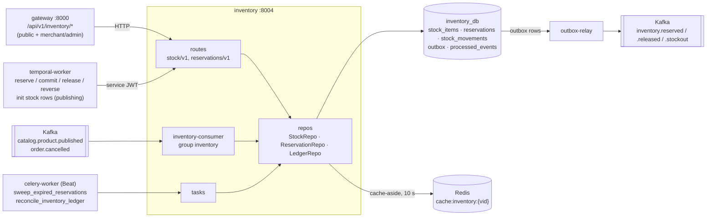

##### 3.1.1.1. Responsibility and boundaries

**Owns** (sole writer, R3):

| Fact | Table | Read elsewhere as |
| --- | --- | --- |
| Stock on hand and reserved, per variant | [`stock_items`](#stock_items) | **Live lookup** via API (`catalog` display, `assistant` hydration D9, product page) |
| Reservations — stock held for in-flight orders | [`reservations`](#reservations) | Live lookup via internal API (`OrderWorkflow`) |
| Stock movement ledger | [`stock_movements`](#stock_movements) | — (merchant/admin API only) |

**Does not own:**

| Fact | Owner | How `inventory` holds it |
| --- | --- | --- |
| Variant, product, SKU, merchant ownership | `catalog` | `variant_id`, `product_id`, `sku` are **snapshots** taken at row creation; `merchant_id` is a snapshot/projection (INV-14) |
| Order, its lines, its status | `order` | `reservations.order_id` is an opaque, indexed UUID — no FK (R2, S15) |
| User identity and role | `identity` | Claims in the verified JWT |
| Workflow execution state | Temporal | Not referenced at all; `inventory` sees only activity calls |

**Ownership-test row** ([RFC 0000 §3.1.1.2](0000-architecture.md#3112-the-ownership-test)):

| # | Candidate | State it would own | Invariant | Independent change | Distinct profile | Verdict |
| --- | --- | --- | --- | --- | --- | --- |
| 5 | `inventory` | stock, reservations, movement ledger | `on_hand ≥ reserved ≥ 0` | yes | hot-row contention; the highest-contention writes in the system | **Service** |

Why it is not folded into `catalog`: a different write profile entirely — high-contention row-level updates under flash-sale load — and the multi-writer consistency problem Part A names in its opening paragraph. Putting it in `catalog` recreates the bug the platform exists to fix. Inventory has multiple writers — orders, returns, warehouse sync — and a `quantity` column on `product_variants` would make `catalog` a second writer on the same fact.

**Rules that bind it** ([RFC 0000 §3.1.1.3](0000-architecture.md#3113-boundary-rules-r1r8), [§3.1.1.5](0000-architecture.md#3115-cross-cutting-decisions-a1a14)):

| Rule | How it applies to `inventory` |
| --- | --- |
| R1 / A1 / A2 | Reads and writes only `inventory_db`, through its own Postgres role; the grant on any other database does not exist |
| R2 / A3 / S15 | No FK leaves `inventory_db`. `order_id`, `variant_id`, `product_id`, `merchant_id` are plain indexed UUIDs |
| R3 | Sole writer of stock. No other service may change a quantity, including `catalog` at publish (it asks `inventory` to initialise rows — §3.1.1.4) |
| R4 | Nobody joins against `inventory_db`; reads go through `/api/v1/inventory/*` |
| R5 / A13 | `inventory` makes **no** synchronous call to another service. It is *called* synchronously (by `OrderWorkflow` activities and display reads), never a caller |
| R6 / A14 | Product data is snapshotted (`sku`, `product_id`, `merchant_id`) at row creation |
| R7 | Serves reads from its own data with local JWT verification; `identity` being down does not stop it |
| R8 | Stock rules live in the entity repos (`services/inventory/app/v1/stock/repo.py`, `app/v1/reservations/repo.py`), never in `common` |
| A4 / A5 | Re-verifies every token itself; the gateway is an early rejection only |
| A6 | Async throughout — `asyncpg`, SQLAlchemy 2.0 async |
| A7 | Every error is an RFC 9457 problem detail |
| A8 / C11 / C12 | Correlation id (the OTel trace id) on every log line, ledger row (`correlation_id`) and outbox row |
| A10 / B11 / S12 | Every state change writes its outbox row in the same transaction |
| A11 / C4 / S13 | Consumers dedupe on `(consumer_group, event_id)` in `processed_events`, in the effect's transaction |
| A12 | Temporal drives reservations; Kafka carries facts in and out; Celery runs the sweeper and reconciliation |
| B1 | Activities are thin adapters; no stock rule lives in workflow or activity code |
| B2 | Workflows carry `order_id` and reservation ids, never quantities-as-state |
| B3 | Every activity is idempotent, keyed by `(order_id, variant_id)` |
| B4 / B5 / B6 | Reserve-before-charge; reservations expire; quantity is stored and ledgered, never computed |

**Internal module layout** ([RFC 0000 §3.1.1.7](0000-architecture.md#3117-module-structure-inside-a-service)):

The entity-first template in [file-structure.md §4](../file-structure.md#4-service-layout-every-service); the entities are `stock/` (`stock_items`, `stock_movements`) and `reservations/` ([§5](../file-structure.md#5-per-service-differences)). Everything one entity alone uses lives under it ([ARC-D27](0000-architecture.md#321-decision-register)); `inventory` already had nothing at `app/` level to move. Entries marked *(planned)* are not built yet.

```
services/inventory/
├── main.py                     create_application(): settings, logging, DB, router, /health
├── alembic/                    per-service history; env.py carries the S4 render_item hook
├── app/
│   ├── router.py               includes only: /api/v1 + /inventory (stock/v1) and
│   │                           /internal/v1/inventory + /reservations, /stock-items
│   ├── models.py               imports every entity's ORM models onto one metadata
│   ├── core/
│   │   ├── config.py           settings (§3.1.1.6)
│   │   ├── db.py, logger.py    session factory, JSON logging
│   │   ├── dependencies.py     principal, role guards, service-token scope guard (inventory:internal)
│   │   ├── errors.py           DomainError subclasses: insufficient-stock, reservation-not-held, …
│   │   ├── enums.py            CallerRole — shared by both entities
│   │   └── schemas.py          Pydantic bases
│   ├── v1/                     the base version: every entity, complete (ARC-D23)
│   │   ├── stock/
│   │   │   ├── models.py       StockItem, StockMovement — SQLAlchemy ORM, no behaviour
│   │   │   ├── repo.py         StockRepo: set, adjust, initialise, read, low-stock queries
│   │   │   ├── ledger_repo.py  LedgerRepo: the only writer of stock_movements; reconciliation check
│   │   │   ├── locking.py      canonical lock order, lock_timeout, bounded retry
│   │   │   ├── access.py       merchant ownership against stock_items.merchant_id (INV-14)
│   │   │   ├── events.py       inventory.* outbox payloads (INV-7)
│   │   │   ├── enums.py        StockMovementReason, StockoutTrigger
│   │   │   ├── dependencies.py  builds the stock repos for a request
│   │   │   ├── routes.py       public + merchant/admin /inventory/*; internal POST /stock-items
│   │   │   └── schemas.py      v1 request/response models
│   │   ├── reservations/
│   │   │   ├── models.py       Reservation
│   │   │   ├── repo.py         ReservationRepo: reserve / commit / release / reverse / expire — the one hard function
│   │   │   ├── enums.py        ReservationStatus
│   │   │   ├── state_machine.py  RESERVATION_TRANSITIONS, transition() — no I/O (INV-D26)
│   │   │   ├── sweeper.py      sweep_once / in-process expiry sweeper driver (INV-10)
│   │   │   ├── consumers/
│   │   │   │   └── order_cancelled.py  order.cancelled → ReservationRepo.release_for_order
│   │   │   ├── tasks/
│   │   │   │   └── maintenance.py      Celery: smartretail.inventory.sweep_expired_reservations
│   │   │   ├── dependencies.py
│   │   │   ├── routes.py       internal (service token) /reservations routes
│   │   │   └── schemas.py
│   │   └── stock/consumers/
│   │       └── catalog_product_published.py  catalog.product.published → StockRepo.insert_initial
│   └── core/
│       ├── consumer.py         the consumer process (group inventory): wires both handlers (INV-D31)
│       ├── celery_app.py       Celery app + Beat schedule, queue inventory.maintenance (PLT-D36)
│       └── tasks.py            Celery: smartretail.inventory.sweep_processed_events (PLT-17)
└── tests/                      unit/v1/<entity>/…, integration/v1/<entity>/…
```

The internal routes live in each entity's `v1/routes.py` (on a second router the entity exports for `app/router.py` to mount under `/internal/v1/inventory`), so a path's full URL is still readable from `app/router.py` alone. Routes never touch the ORM; repos never construct an HTTP response. That seam is what lets a route, a Temporal activity (via the internal route), a Kafka consumer and a Celery task reach one implementation of each rule.

##### 3.1.1.2. Domain model

**Aggregates.**

| Aggregate | Root | Children | Concurrency control |
| --- | --- | --- | --- |
| Stock item | `stock_items` row (one per variant) | its `reservations` (by `variant_id`), its `stock_movements` (append-only) | Pessimistic `SELECT … FOR UPDATE` on every quantity change; S6 `version` incremented on every write and checked on merchant absolute sets (INV-9) |

A reservation belongs to one stock item (one variant) and names one order. An order with *n* distinct variants has *n* reservations, created atomically by one reserve call.

**The quantity model.**

```
   on_hand   = physically present
   reserved  = held for in-flight orders
   available = on_hand - reserved       ← what a customer can buy (generated column)

   reserve : available ≥ qty  →  reserved += qty         (row lock)
   release : reserved  -= qty                            (compensation)
   expire  : reserved  -= qty                            (sweeper)
   commit  : reserved  -= qty ; on_hand -= qty           (payment settled)
   restock : on_hand   += qty                            (merchant / return)
   reverse : on_hand   += qty                            (saga compensation after commit, INV-16)

   every one of the above appends a stock_movements row with reason + reference
```

**Ledger deltas per operation** — the signed pairs `(delta_on_hand, delta_reserved)` written to `stock_movements`:

| Operation | Reason | `(delta_on_hand, delta_reserved)` | `reference_type` / `reference_id` | Trigger |
| --- | --- | --- | --- | --- |
| Row created | `initial` | `(0, 0)` | `product` / `product_id` | Publishing workflow `sync_downstream`, or `catalog.product.published` consumer |
| Reserve | `reserve` | `(0, +q)` | `order` / `order_id` | `reserve_inventory` activity |
| Release | `release` | `(0, −q)` | `order` / `order_id` | `release_inventory` compensation, `order.cancelled` consumer |
| Expire | `expire` | `(0, −q)` | `order` / `order_id` | Sweeper |
| Commit | `commit` | `(−q, −q)` | `order` / `order_id` | `commit_inventory` activity |
| Reverse commit | `compensation` | `(+q, 0)` | `reservation` / reservation id | `reverse_commit_inventory` compensation after a post-commit failure (INV-16) |
| Restock | `restock` | `(+q, 0)` | `adjustment` / `Idempotency-Key` or null | Merchant `adjust` with positive delta |
| Return | `return` | `(+q, 0)` | `adjustment` / key, or `order` / `order_id` | Merchant `adjust` with reason `return` |
| Manual adjustment | `manual_adjustment` | `(new − old, 0)` or `(δ, 0)` | `adjustment` / key or null | Merchant `PUT` (absolute) or `adjust` with reason `manual_adjustment` (e.g. shrinkage, negative δ) |

**Invariants** — each with where it is enforced:

| # | Invariant | Enforced by |
| --- | --- | --- |
| I1 | `on_hand >= reserved AND reserved >= 0` (hence `on_hand >= 0`, `available >= 0`) | `CHECK` constraint (S11) — the last line of defence against oversell; the repo checks first and returns a typed error, the constraint catches anything that slips |
| I2 | `available = on_hand − reserved`, always | Stored generated column — no caller can compute it differently |
| I3 | At most one reservation per `(order_id, variant_id)` | Unique constraint — the idempotency guarantee for retried reserve activities (B3) |
| I4 | `reservations.quantity > 0` | `CHECK` (S11) |
| I5 | `reserved = Σ quantity of held reservations for the variant` | Maintained by every transition in one transaction; verified by `reconcile_inventory_ledger` |
| I6 | `on_hand = Σ delta_on_hand`, `reserved = Σ delta_reserved` over the variant's ledger | Every quantity change writes its ledger row in the same transaction via `app/v1/stock/ledger_repo.py`, the only writer of `stock_movements`; verified daily |
| I7 | A reserve for an order is all-or-nothing across its lines | One transaction for all lines |
| I8 | A `committed` reservation can never return to `held`; terminal states are terminal | `RESERVATION_TRANSITIONS` (§3.1.1.3) |
| I9 | `stock_movements` is append-only | No update or delete path in code; the inventory role is granted `INSERT, SELECT` only on the table (INV-12) |

**`DomainEnum` vocabularies** (S4 — `text` columns, values in `app/v1/reservations/enums.py` (`ReservationStatus`) and `app/v1/stock/enums.py` (`StockMovementReason`, `StockoutTrigger`), enforced by `DomainEnumText` on write and Pydantic at the edge):

| Enum | Column | Values | Read policy |
| --- | --- | --- | --- |
| `ReservationStatus` | `reservations.status` | `held`, `committed`, `released`, `expired` | `fallback` → `held` — a state machine must never branch on a bare string |
| `StockMovementReason` | `stock_movements.reason` | `initial`, `manual_adjustment`, `reserve`, `release`, `commit`, `expire`, `restock`, `return`, `compensation` | `passthrough` — a ledger vocabulary, displayed and filtered, expected to grow |
| `StockoutTrigger` (INV-7) | event payload only (`inventory.stockout.trigger`) | `depleted`, `low_stock`, `reservation_refused` | n/a — not a column |

Adding a value is one line in the entity's `enums.py`, plus an edge in the transition table if it is a state; no Alembic revision, and `alembic check` must report no pending diff. The creating migration comments the column with a pointer to the source of truth (`COMMENT ON COLUMN reservations.status IS 'DomainEnum ReservationStatus — see services/inventory/app/v1/reservations/enums.py; transitions in app/v1/reservations/state_machine.py'`).

##### 3.1.1.3. State machines

**`ReservationStatus`** — the only state machine in `inventory`. `stock_items` has no status; its quantities are governed by I1–I6.

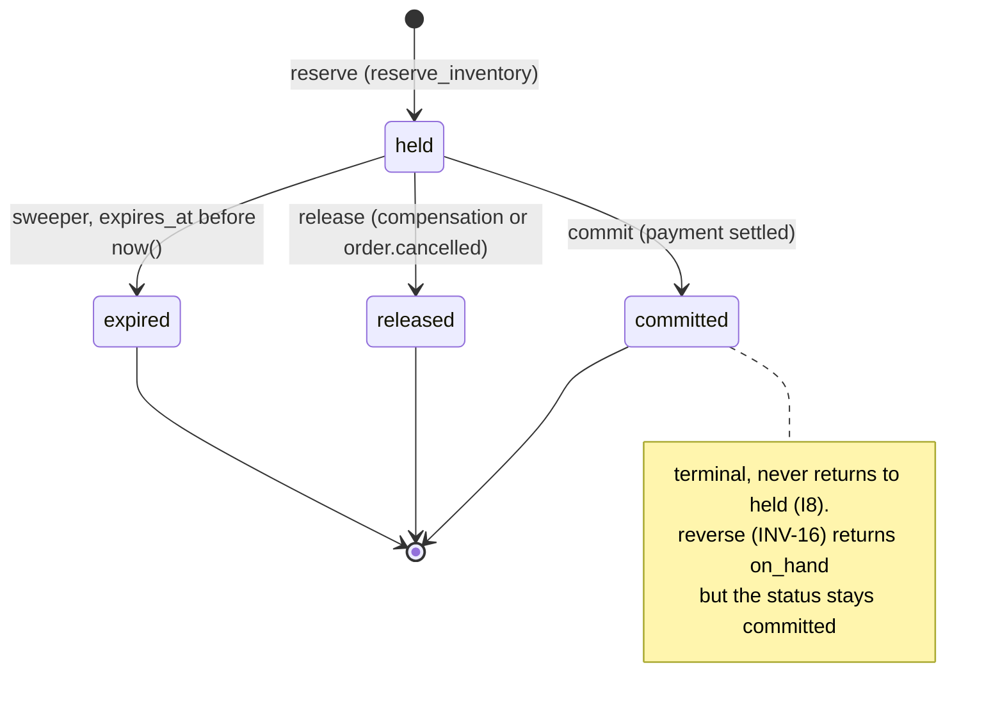

```python
RESERVATION_TRANSITIONS: Mapping[ReservationStatus, frozenset[ReservationStatus]] = {
    R.HELD:      frozenset({R.COMMITTED, R.RELEASED, R.EXPIRED}),
    R.COMMITTED: frozenset(),   # terminal — never returns to held
    R.RELEASED:  frozenset(),   # terminal
    R.EXPIRED:   frozenset(),   # terminal
}
```

| From | To | Triggered by | Guard (checked under the row locks) | Stock effect | Ledger | Event |
| --- | --- | --- | --- | --- | --- | --- |
| *(none)* | `held` | `reserve_inventory` activity → `POST /reservations` | stock row exists; `available >= quantity` for **every** line; no existing row for `(order_id, variant_id)` (else idempotent replay) | `reserved += q` | `reserve (0,+q)` | `inventory.reserved`; `inventory.stockout` if the reserve depletes or crosses the threshold |
| `held` | `committed` | `commit_inventory` activity → `POST /reservations/{id}/commit` | status is `held` (INV-6: an unswept past-expiry `held` may still commit) | `reserved −= q; on_hand −= q` | `commit (−q,−q)` | none (INV-Q2) |
| `held` | `released` | `release_inventory` compensation → `DELETE /reservations/{id}`; `order.cancelled` consumer | status is `held` | `reserved −= q` | `release (0,−q)` | `inventory.released` (`reason: compensation` or `order_cancelled`) |
| `held` | `expired` | `sweep_expired_reservations` | status is `held` **and** `expires_at < now()`, both re-checked under lock | `reserved −= q` | `expire (0,−q)` | `inventory.released` (`reason: expired`) |

**Idempotent re-requests and illegal moves.** Idempotency is resolved *before* `transition()` is called, so a retried activity is a no-op rather than an illegal self-transition:

| Request | Current status | Result |
| --- | --- | --- |
| commit | `committed` | `200`, the existing reservation — no ledger row, no event |
| commit | `released` / `expired` | `409` `reservation-not-held` — **non-retryable**. The workflow compensates (refund, then release, which is a no-op) — see [RFC 0005](0005-order-service.md#3114-workflows-and-async-jobs) |
| release | `released` / `expired` | `200`, no-op — the stock is already back |
| release | `committed` | `409` `reservation-committed` — a committed reservation is never released. Post-commit stock goes back through `reverse` (saga compensation, INV-16) or a merchant `return` adjustment |
| reverse | `committed`, not yet reversed | `200`: `on_hand += q`, one `compensation` ledger row; status stays `committed` (I8 holds) |
| reverse | `committed`, already reversed | `200`, no-op — detected by the existing `compensation` ledger row for this reservation |
| reverse | `held` / `released` / `expired` | `409` `reservation-not-committed` — the saga should have released instead |
| reserve | row exists, same quantity | `200`, the existing reservation(s) — idempotent replay (B3) |
| reserve | row exists, different quantity, or any status other than `held` | `409` `reservation-conflict` |

Every status change goes through one guarded method, which raises `IllegalTransition` (→ `409` via the problem-detail handler) rather than assigning; nothing outside `transition()` assigns to `reservations.status`, which is a review check. Of the 16 ordered pairs over four states, `RESERVATION_TRANSITIONS` accepts 3; the other 13 — including `committed → held`, which a native enum would accept — are each tested (§7).

##### 3.1.1.4. Workflows and async jobs

`inventory` owns no Temporal workflow. It owns the **server side** of four activities: the business rules those activities reach, their idempotency, and their error contract. The workflows themselves — step order, compensation order, retry policies and timeouts — are specified by their owners: `OrderWorkflow` in [RFC 0005](0005-order-service.md#3114-workflows-and-async-jobs), `ProductPublishingWorkflow` in [RFC 0004](0004-catalog-service.md#3114-workflows-and-async-jobs). Their hosting is in [RFC 0001](0001-platform-and-shared-infrastructure.md).

###### Activities served to workflows

| Activity (in `temporal-worker`) | Workflow step | Calls | Idempotency token (B3) | Success | Non-retryable failures | Retryable failures |
| --- | --- | --- | --- | --- | --- | --- |
| `reserve_inventory(order_id, lines)` | `OrderWorkflow` step 1 | `POST /internal/v1/inventory/reservations` | `(order_id, variant_id)` per line — the unique constraint | `201` (or `200` on replay) with reservation ids | `409 insufficient-stock` → order `failed` with `INSUFFICIENT_STOCK`, no payment attempted; `422 unknown-variant`; `409 reservation-conflict` | `503 inventory-contended` (lock retries exhausted), `5xx`, connection errors |
| `commit_inventory(order_id)` | `OrderWorkflow` step 4, after `charge_payment` succeeds | `POST /internal/v1/inventory/reservations/{id}/commit` for each reservation id of the order, in ascending `variant_id` | reservation id; `committed` is a no-op | `200` | `409 reservation-not-held` → compensate: `refund_payment`, `release_inventory` | as above |
| `release_inventory(order_id)` | Compensation after payment decline (step 3), commit or shipment failure (steps 4–5), and cancellation at steps 1–3 | `DELETE /internal/v1/inventory/reservations/{id}` for each reservation id | reservation id; `released`/`expired` is a no-op | `200` | `409 reservation-committed` (a defect in the saga — surfaced, not swallowed) | as above |
| `reverse_commit_inventory(order_id)` | Compensation after a post-commit failure (shipment creation, step 5), serving [RFC 0005](0005-order-service.md#3114-workflows-and-async-jobs) ORD-12 | `POST /internal/v1/inventory/reservations/{id}/reverse` for each reservation id | reservation id; a second reverse is a no-op | `200` | `409 reservation-not-committed` (a defect in the saga — surfaced) | as above |
| `sync_downstream(product_id, variants)` | `ProductPublishingWorkflow` step 4 | `POST /internal/v1/inventory/stock-items` (INV-4) | `variant_id` — the unique constraint; existing rows untouched | `200` with the rows | `422` on a malformed variant list | as above |

**Error contract to the activities (INV-5).** Business outcomes are `4xx` and must be raised as Temporal `NonRetryableError`; contention and infrastructure outcomes are `503`/`5xx` and are retried under the workflow's retry policy. `inventory` never returns `5xx` for a business failure, which is what lets the workflow's retry policy be written without knowing inventory's rules. The policies are the workflow owner's: RFC 0005's ORD-10 table (INV-D29). `reserve_inventory` gets 5 attempts inside 60 s; `commit_inventory` and the compensations retry without an attempt cap inside their windows — all well inside the 15-minute reservation TTL for the forward path, so no forward retry chain can outlive the reservation it is retrying.

**`OrderWorkflow` against `inventory`** — the saga steps that reach this service (step order and compensation order are RFC 0005's; shown here for the calls and outcomes `inventory` serves):

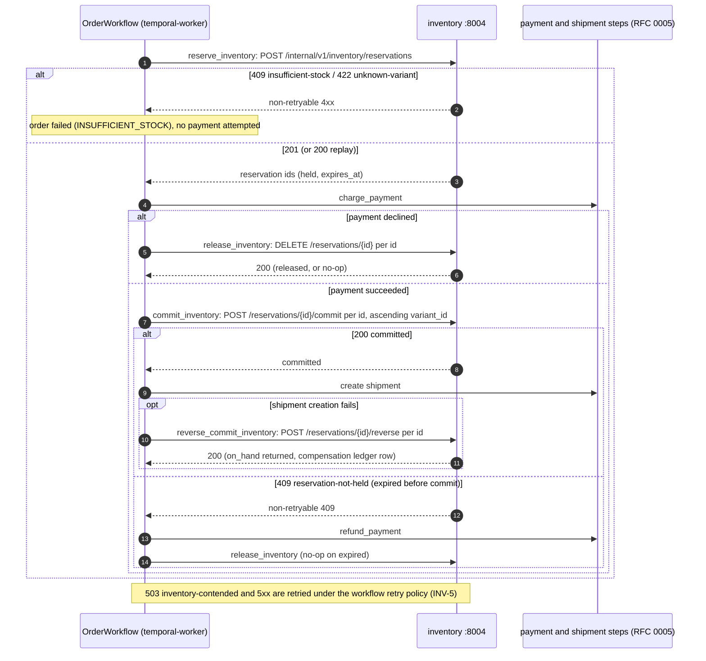

**The reserve path**, `ReservationRepo.reserve(order_id, lines, actor, correlation_id)`:

```
  0. normalise: merge lines with the same variant_id (sum quantities); reject q ≤ 0 (422);
     sort by variant_id ascending                                       ← canonical lock order
  1. fast reject (INV-8): unlocked read of available for the lines; any line with
     available < q → skip to 6 without taking a lock
  BEGIN;  SET LOCAL lock_timeout = :INVENTORY_LOCK_TIMEOUT_MS
  2. SELECT … FROM reservations WHERE order_id = :oid                   ← replay check
        all lines present with the same quantities → COMMIT, return them (200)
        any mismatch → ROLLBACK, 409 reservation-conflict
  3. SELECT id, variant_id, on_hand, reserved, available, low_stock_threshold
       FROM stock_items WHERE variant_id = ANY(:vids)
       ORDER BY variant_id FOR UPDATE                                    ← one statement, ordered
        missing variant → ROLLBACK, 422 unknown-variant
  4. any line with available < q → ROLLBACK, go to 6
  5. per line, in variant_id order:
        UPDATE stock_items SET reserved = reserved + q, version = version + 1, updated_at = now()
        INSERT reservations (order_id, variant_id, q, 'held', now() + TTL)
               ON CONFLICT (order_id, variant_id) DO NOTHING             ← I3 backstop
        INSERT stock_movements (reason 'reserve', (0, +q), 'order', order_id, actor, correlation_id)
        INSERT outbox (inventory.reserved, aggregate stock_item/variant_id)
        if available_after = 0            → INSERT outbox (inventory.stockout, trigger depleted)
        elif crossed low_stock_threshold  → INSERT outbox (inventory.stockout, trigger low_stock)
     COMMIT;  then invalidate cache:inventory:{variant_id} for each line   → 201
  6. insufficient: in a separate short transaction, INSERT outbox (inventory.stockout,
     trigger reservation_refused) per short line, then 409 insufficient-stock with
     violations[] = [{variant_id, requested, available}]
```

The stockout outbox row for a refused reservation is written **after** the reserve transaction has rolled back, because an outbox row inside a rolled-back transaction would vanish with it (G8 cuts both ways). It is the one inventory event not written in the state-change transaction — correctly, because there is no state change.

**Reserve endpoint, sequence** (`POST /internal/v1/inventory/reservations`):

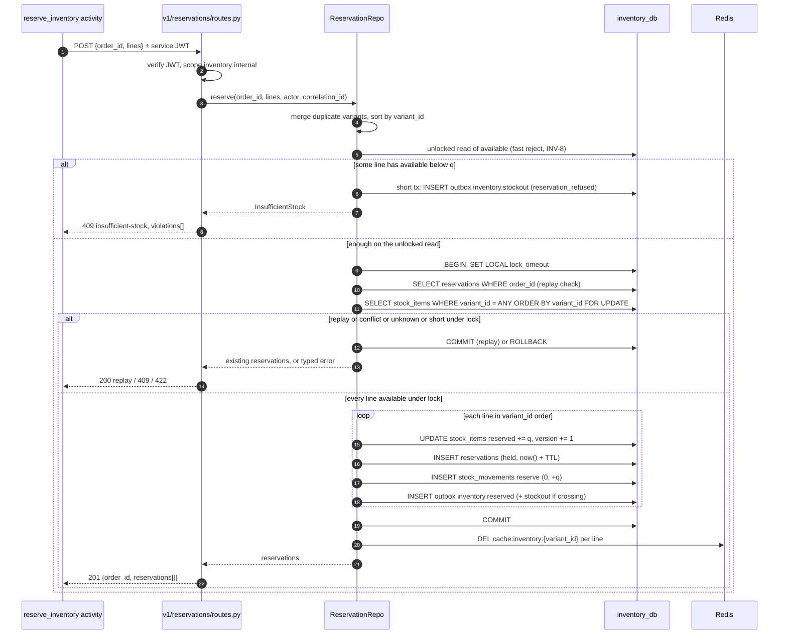

**Reserve decision flow:**

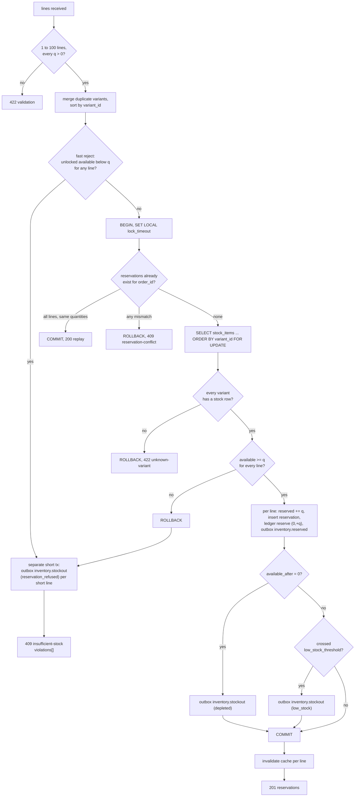

**Commit and release paths** each lock, in canonical order, the variant's `stock_items` row and then the reservation row (`FOR UPDATE`), check the status against the idempotency table above, call `transition()`, update quantities, append the ledger row and the outbox row (release only), and commit. Each is a single-row, single-reservation short transaction.

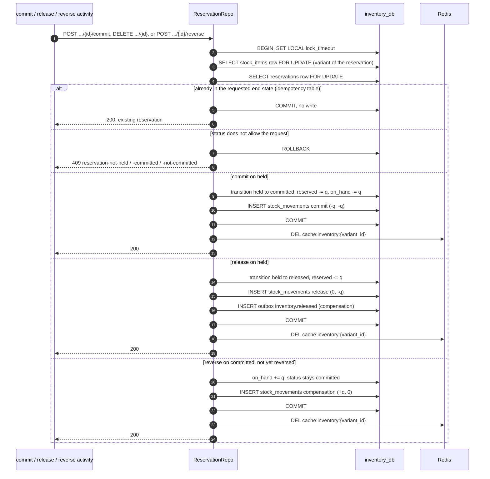

###### Locking strategy (INV-1, INV-2, INV-3)

| Concern | Rule | Why |
| --- | --- | --- |
| Lock target | The variant's `stock_items` row, `SELECT … FOR UPDATE` | One row per variant (unique `variant_id`) is the natural serialisation point. Row-level, never table-level |
| **Lock order** | Within a transaction: **`stock_items` rows first, in ascending `variant_id`, then `reservations` rows**. Multi-row locks are taken by one `SELECT … WHERE variant_id = ANY(:ids) ORDER BY variant_id FOR UPDATE` | Two multi-line orders locking `{A, B}` and `{B, A}` would otherwise deadlock. A total order on lock acquisition makes a cycle impossible. Every path — reserve, commit, release, expire, merchant set/adjust — follows it, including the sweeper, which therefore never locks a reservation before its stock row |
| Transaction length | Short: no network call, no event publish, no cache write inside the transaction; the cache is invalidated after `COMMIT`. Each commit/release/expire touches one stock row | The lock is held for microseconds, which is what makes serialising writers on a hot row acceptable |
| Lock wait bound | `SET LOCAL lock_timeout` (default 2 s); `statement_timeout` as the outer bound | A request never waits indefinitely behind a stuck transaction |
| **Bounded retry** | On `55P03 lock_not_available`, `40P01 deadlock_detected` or `40001 serialization_failure`, the service retries the whole transaction up to 3 attempts with jittered exponential backoff (25 ms base). Exhausted → `503 inventory-contended` with `Retry-After`, which the activity treats as retryable | Deadlocks should be impossible given the lock order, but the retry makes the claim safe rather than load-bearing. The retry is bounded so contention surfaces as a typed, retryable error rather than a hung request |
| Isolation level | `READ COMMITTED` plus explicit row locks | Row locks give the serialisation needed; `SERIALIZABLE` would add aborts on a path that is already serialised |
| Last line of defence | `CHECK (on_hand >= reserved AND reserved >= 0)` | Even a code path that forgot to lock cannot oversell; it fails with `23514`, mapped to `409` |

**Bounded retry (INV-1):**

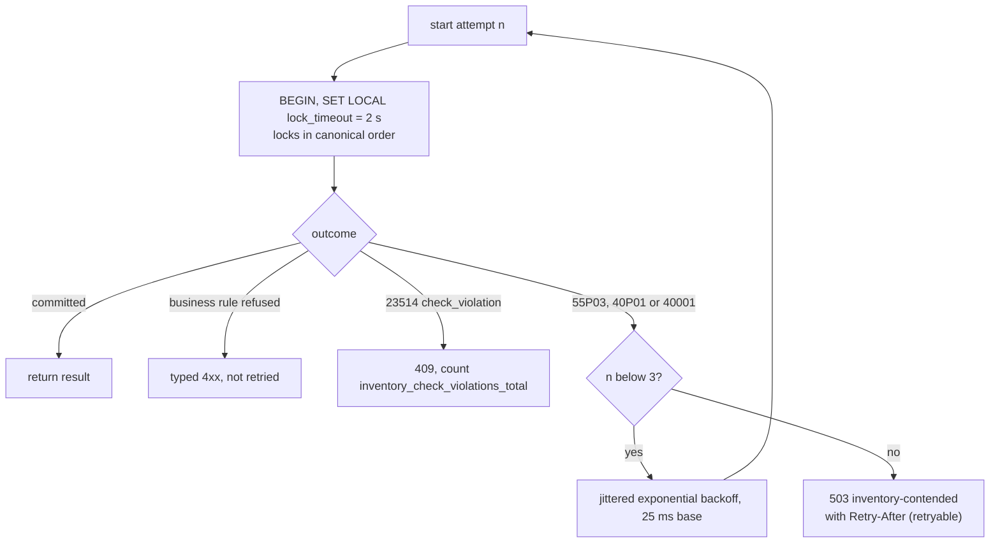

**Flash-sale contention.** Under a flash sale on one variant, every reserve for it queues on one row lock. That is the intended behaviour — oversell is a business failure, queueing is a latency cost — and five measures keep the queue short and honest:

1. **Short transactions** — the lock covers a handful of statements with no I/O beyond Postgres.
2. **Fast reject (INV-8)** — once `available` reaches 0, further reserves are refused by an unlocked read and never join the lock queue. A false refusal against a release committing a microsecond later is indistinguishable from arriving a microsecond earlier, and the unlocked read can only reject, never grant.
3. **Bounded lock wait and bounded retry** — contention beyond 2 s × 3 attempts becomes `503`, retried by Temporal with backoff rather than piling up connections.
4. **Upstream backpressure** — the Temporal task queue buffers when workers are saturated; the gateway rate-limits `POST /api/v1/orders` (30 per minute per user); order creation stays fast because it only persists and starts a workflow.
5. **Visibility** — `inventory_lock_wait_seconds` and the "Checkout is slow → reservation lock wait" walkthrough (§3.1.1.7) make contention diagnosable rather than inferred.

The known ceiling is the one the design accepts: a hot variant row serialises writers. Sharded stock rows are the recorded escape (§5, INV-A1); none of it is a schema decision that blocks scaling.

###### Celery tasks (hosted on `celery-worker`, code owned here)

| Task | Queue | Schedule | What it does |
| --- | --- | --- | --- |
| `sweep_expired_reservations` | `maintenance` | Celery Beat, every minute | Selects up to `INVENTORY_SWEEP_BATCH_SIZE` `held` reservations with `expires_at < now()` (no lock, ordered by `expires_at`); for each, one short transaction in canonical lock order — lock the `stock_items` row, lock the reservation, **re-check** `held` and `expires_at < now()`, transition to `expired`, `reserved −= q`, ledger `expire (0,−q)`, outbox `inventory.released` (`reason: expired`). Loops batches until none remain or the run budget is spent. Safe on two workers and safe to run twice: the re-check under lock makes a lost race a no-op |
| `reconcile_inventory_ledger` | `maintenance` | Celery Beat, daily | For every variant: `Σ delta_on_hand = on_hand`, `Σ delta_reserved = reserved`, `reserved = Σ held quantity`. Emits `inventory_ledger_drift_variants`, logs each drifting variant with its values. **Detects, never corrects** — a correction is a `manual_adjustment` a human makes, so the ledger stays the record |

The sweeper is **a safety net beneath the compensation, not a replacement for it** (B5): the normal path releases through `release_inventory`. It exists so a workflow lost in a way Temporal cannot recover does not strand stock forever, and it is independent of Temporal, so a failure mode Temporal cannot see still self-heals. The same `ReservationRepo.expire_due()` also runs from an in-process asyncio loop when `INVENTORY_SWEEPER_INPROCESS=true` — the driver used before RabbitMQ and Celery are in the stack, and the fallback when they are down (INV-10). Both drivers call the same function; running both at once is safe for the same reason two Celery workers are.

The sweeper does not cancel or fail orders; it cannot, because orders are not its fact. An order whose reservation expired fails at `commit_inventory` (`409 reservation-not-held`) and is compensated by `OrderWorkflow`.

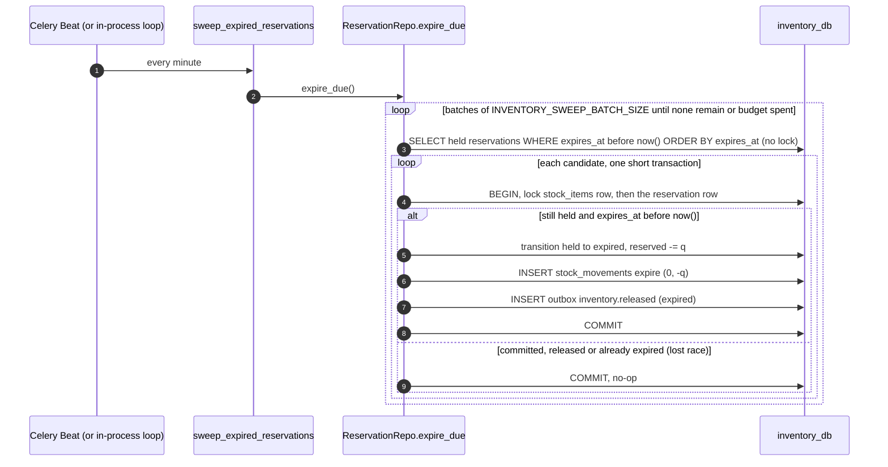

###### Event consumers (process `inventory-consumer`, group `inventory`)

One consumer process per service, subscribing to both topics, dedupe keyed by consumer group (archive/0003 Q2). The consumer base class from `common` gives dedupe, three in-process retries with exponential backoff, then `<topic>.dlq` and an offset commit (C6) — a poison message never stops a partition. Handler logic, each in one transaction with its `processed_events` row:

| Topic | Handler | Effect |
| --- | --- | --- |
| `catalog.product.published` | `app/v1/stock/consumers/catalog_product_published.py` → `StockRepo.insert_initial(product_id, merchant_id, active variants)` (the non-committing half of `initialise`, INV-D31) | For each variant: `INSERT stock_items (variant_id, product_id, merchant_id, sku, on_hand 0, reserved 0, low_stock_threshold default) ON CONFLICT (variant_id) DO NOTHING`; for rows actually inserted, a ledger `initial (0,0)` row. Existing rows — created by the publishing workflow's `sync_downstream`, or by an earlier publish — are untouched; quantities are never reset by a republish (Q4) |
| `order.cancelled` | `app/v1/reservations/consumers/order_cancelled.py` → `ReservationRepo.release_for_order(order_id, reason=order_cancelled)` | Releases every `held` reservation of the order in **one** transaction — the consumer's, shared with its `processed_events` claim — locking stock rows in ascending `variant_id` then the reservations (INV-D31). `released`/`expired` are no-ops; `committed` is left alone and logged (post-commit cancellation is a refund in `order`, not a release). Normally the workflow's cancellation compensation has already released, so this is the backstop for a cancellation that bypassed or outlived the workflow |

**Stock-row initialisation — the two converging paths (Q4, INV-4):**

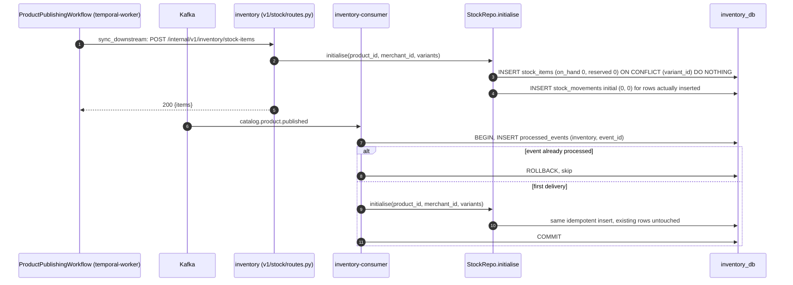

**`order.cancelled` backstop:**

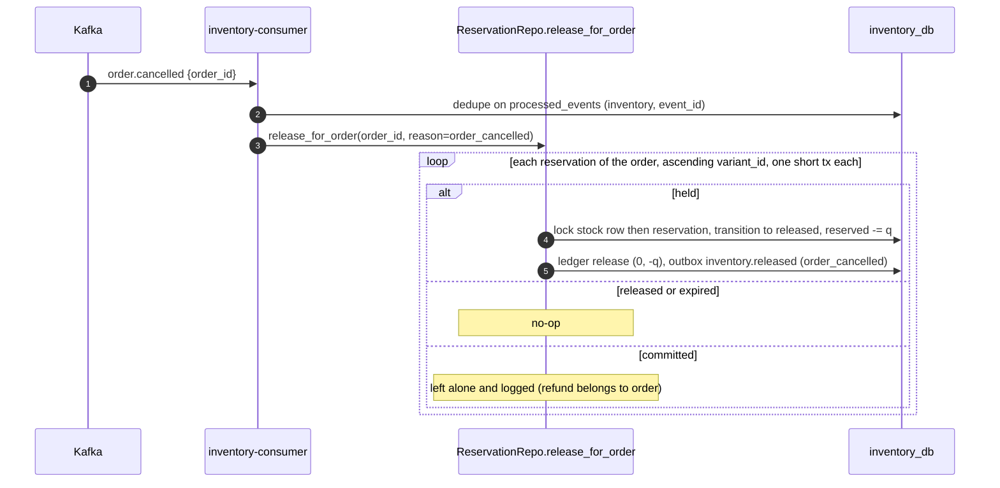

##### 3.1.1.5. Dependencies and degradation

**Synchronous calls in** (inventory is the callee):

| Caller | Path | Auth |
| --- | --- | --- |
| `temporal-worker` (`OrderWorkflow`, `ProductPublishingWorkflow` activities) | internal routes | Service JWT, scope `inventory:internal` |
| `gateway` → customers, anonymous product pages | `GET /api/v1/inventory/{variant_id}` | public |
| `catalog` display path | `GET /api/v1/inventory/{variant_id}` | public (API read; "catalog reads via API for display") |
| `assistant` hydration (D9) | `GET /api/v1/inventory/{variant_id}` through the existing public route, absorbed by the 10 s cache | public |
| Merchants, admins | stock management routes | bearer |

**Synchronous calls out:** none (R5).

**Infrastructure needed and behaviour when each is down:**

| Dependency | Needed for | When it is down |
| --- | --- | --- |
| `inventory_db` (Postgres 16) | Everything | Reserve/commit/release return `503`; the activities retry and, once exhausted, `OrderWorkflow` fails the order cleanly with a recorded reason — no hang, no corrupted state. Reads return `503` (or a cached value, if present) |
| Redis | `cache:inventory:{variant_id}` | Cache failure is not request failure: reads go uncached, writes skip invalidation (the 10 s TTL bounds any staleness from a missed invalidation) |
| Kafka + Schema Registry | Consumers; the relay publishing inventory's outbox | Outbox rows accumulate in `inventory_db` and publish on recovery; consumers lag and catch up. Reservation traffic is unaffected. A product published during the outage still has stock rows, because `sync_downstream` created them synchronously |
| `outbox-relay` | Publishing `inventory.*` events | Same as Kafka down: events are delayed, never lost |
| RabbitMQ / `inventory-celery` / Beat | Sweeper, reconciliation | Expired reservations stay `held` (stock stranded, not lost) until the scheduler returns; the in-process sweeper (`INVENTORY_SWEEPER_INPROCESS=true`) is the fallback |
| Temporal | Nothing inventory does itself | No reservations are requested; the sweeper still returns any stock held by in-flight orders after their TTL |
| `identity` | Service-token minting (by `temporal-worker`), public key (cached) | No effect on verification (local, A4). A worker that cannot mint a fresh service token fails its inventory calls with `401` once its token expires; they are retried |
| `catalog` | Nothing synchronous | No effect. Stock rows for new publishes arrive when the workflow or the event does |
| OTel Collector | Traces and metrics export | Export is dropped; requests are unaffected |

##### 3.1.1.6. Configuration

Settings are read by `app/core/config.py` from the environment. Values marked *(INV)* are proposed by this RFC; the others come from the sources.

| Variable | Default | Meaning |
| --- | --- | --- |
| `INVENTORY_DATABASE_URL` | `postgresql+asyncpg://inventory:…@postgres:5432/inventory_db` | This service's role on its own database only (R1) |
| `INVENTORY_PORT` | `8004` | HTTP port |
| `INVENTORY_RESERVATION_TTL_SECONDS` | `900` | Reservation expiry, 15 minutes (B5, Q2) |
| `INVENTORY_DEFAULT_LOW_STOCK_THRESHOLD` | `5` | Default for `stock_items.low_stock_threshold`; drives the stockout signal and the `low_stock` filter |
| `INVENTORY_LOCK_TIMEOUT_MS` | `2000` *(INV)* | `SET LOCAL lock_timeout` on every locking transaction |
| `INVENTORY_STATEMENT_TIMEOUT_MS` | `5000` *(INV)* | Outer bound on any statement |
| `INVENTORY_LOCK_RETRY_ATTEMPTS` | `3` *(INV)* | Bounded retry on `55P03` / `40P01` / `40001` |
| `INVENTORY_LOCK_RETRY_BASE_MS` | `25` *(INV)* | Base of the jittered exponential backoff |
| `INVENTORY_MAX_LINES_PER_RESERVATION` | `100` *(INV)* | Upper bound on lines per reserve call; `422` above it |
| `INVENTORY_SWEEP_BATCH_SIZE` | `500` *(INV)* | Reservations per sweeper batch |
| `INVENTORY_SWEEPER_INPROCESS` | `false` *(INV)* | Run the in-process sweeper loop (no Celery) |
| `INVENTORY_SWEEPER_INTERVAL_SECONDS` | `60` | Interval of the in-process loop; the Beat schedule is every minute |
| `INVENTORY_CACHE_TTL_SECONDS` | `10` | `cache:inventory:{variant_id}` TTL — short, because stock is the fastest-moving fact in the system |
| `REDIS_URL` | `redis://redis:6379/0` | Cache |
| `KAFKA_BOOTSTRAP_SERVERS`, `SCHEMA_REGISTRY_URL` | from Compose | Consumer |
| `INVENTORY_CONSUMER_GROUP` | `inventory` | The `consumer_group` written to `processed_events` |
| `INVENTORY_SERVICE_SCOPE` | `inventory:internal` *(INV)* | Scope an internal route requires on a service JWT |
| `JWT_PUBLIC_KEY_PATH` | mounted from the gitignored keys directory | RS256 verification (A4) |
| `OTEL_EXPORTER_OTLP_ENDPOINT` | `http://otel-collector:4317` | C10 |

##### 3.1.1.7. Observability

**Metrics** (Prometheus via `/metrics`; RED per route comes from `common`):

| Metric | Type | Labels | Meaning |
| --- | --- | --- | --- |
| `inventory_lock_wait_seconds` | histogram | `operation ∈ {reserve, commit, release, expire, set, adjust}` | Time from issuing `FOR UPDATE` to holding the lock — the flash-sale signal |
| `inventory_lock_retries_total` | counter | `operation`, `sqlstate ∈ {55P03, 40P01, 40001}` | Bounded-retry attempts; any `40P01` means the lock order was violated somewhere |
| `inventory_reservation_attempts_total` | counter | `outcome ∈ {reserved, replayed, insufficient, fast_rejected, unknown_variant, conflict, contended}` | Every reserve call by outcome |
| `inventory_reservation_failures_total` | counter | `reason ∈ {insufficient_stock, unknown_variant, conflict, contended, not_held, committed}` | Failed reserve/commit/release calls |
| `inventory_reserve_duration_seconds` | histogram | `lines_bucket` | End-to-end reserve transaction time |
| `inventory_stockouts_total` | counter | `trigger ∈ {depleted, low_stock, reservation_refused}` | `inventory.stockout` events written |
| `inventory_reservations_held` | gauge | — | Current `held` count |
| `inventory_reservations_expired_total` | counter | — | Reservations the sweeper expired — non-zero means a workflow lost its compensation |
| `inventory_sweeper_run_duration_seconds` | histogram | `driver ∈ {celery, inprocess}` | Sweep run time |
| `inventory_oldest_held_reservation_age_seconds` | gauge | — | Stranded-stock detector; should never exceed the TTL plus one sweep interval |
| `inventory_ledger_drift_variants` | gauge | — | Variants failing reconciliation at the last run; should be 0 |
| `inventory_check_violations_total` | counter | `constraint` | `23514` hits — the last line of defence firing means a code path skipped the lock |
| consumer lag, DLQ depth, outbox backlog | — | per `common` | Exported for `inventory` like every service |

**Spans** (OTel, C10/C11): `inventory.reserve` (attributes `order_id`, `line_count`, `outcome`), child `inventory.lock stock_items` (attribute `lock_wait_ms`), `inventory.commit`, `inventory.release`, `inventory.expire_batch`, `inventory.consume {topic}` restored from the envelope's `traceparent`, and SQLAlchemy spans. A checkout's single trace spans gateway, order, the Temporal workflow, `inventory`, the relay and the consumers (archive/0003 G7).

**Log fields** on every line: `trace_id` (= `X-Request-ID`, C12), `service=inventory`, `actor`, `order_id`, `variant_id`, `reservation_id`, `operation`, `outcome`, `lock_wait_ms`.

**Dashboards.** An *Inventory* row in the per-service Grafana dashboard: reserve rate by outcome, lock-wait p50/p99, lock retries, stockouts by trigger, held reservations and oldest held age, sweeper expirations, ledger drift.

**Alerts.** None wired (archive/0003 Q7 — there is nothing to alert into locally). The panels above carry the thresholds a production alert would use: drift > 0, oldest held age > TTL + 2 min, any `40P01`, any `23514`.

**Diagnosis walkthroughs** (from archive/0003 §7):

| Symptom | Path |
| --- | --- |
| "Checkout is slow" | Grafana latency panel → the slow endpoint → an exemplar trace → the slow span (catalog call, or **reservation lock wait**) |
| "Stock looks wrong" | Ledger reconciliation query → the movement rows → `reference_id` → the order → its trace |

#### 3.1.2. API changes

All routes are under `/api/v1/inventory` and reached through the gateway at `:8000` ([RFC 0000 §3.1.2.1](0000-architecture.md#3121-surface-map)); conventions — RFC 9457 errors with `violations[]`, `{items, total, limit, offset}` pagination with a limit ceiling of 100, `X-Request-ID`, `X-Client-Id` pass-through — are in [RFC 0000 §3.1.2.2](0000-architecture.md#3122-api-conventions).

##### 3.1.2.1. Endpoints

**Public and merchant/admin surface**

| Method | Path | Request | Response | Status codes | Notes |
| --- | --- | --- | --- | --- | --- |
| `GET` | `/api/v1/inventory/{variant_id}` | — | `{variant_id, on_hand, reserved, available, in_stock}` | `200`; `404` no stock row | Public because a product page needs it. Cached in Redis `cache:inventory:{variant_id}`, 10 s TTL, invalidated after every committed write to the row. `in_stock = available > 0` |
| `GET` | `/api/v1/inventory` | `?low_stock=bool&out_of_stock=bool&product_id=&merchant_id=(admin only)&limit&offset` | Paginated `{items: [{variant_id, product_id, sku, on_hand, reserved, available, low_stock_threshold, version, updated_at}], total, limit, offset}` | `200`; `401`; `403` | The caller's stock across variants. Merchant scope from the token's `merchant_id`; admin sees all and may filter by `merchant_id`. `low_stock` = `available <= low_stock_threshold`; `out_of_stock` = `available = 0` |
| `PUT` | `/api/v1/inventory/{variant_id}` | `{on_hand: int ≥ 0, low_stock_threshold?: int ≥ 0, reason_note?: str}`; optional `If-Match: <version>` | The stock item | `200`; `404`; `403`; `409 stock-below-reserved` (`on_hand < reserved`); `409 version-mismatch` (If-Match stale, S6); `422` | **Set absolute `on_hand`.** Writes a ledger row with reason `manual_adjustment` and delta `new − old`. Idempotent by nature (PUT). Safe under concurrency only with `If-Match` (INV-9) |
| `POST` | `/api/v1/inventory/{variant_id}/adjust` | `{delta: int ≠ 0, reason: restock \| return \| manual_adjustment, reference_id?: uuid}`; optional `Idempotency-Key` | The stock item after the change | `200`; `404`; `403`; `409 stock-below-reserved` (a negative δ that would take `on_hand` below `reserved`); `422` (δ = 0, `restock`/`return` with δ < 0, or a reason outside the three) | **Relative change** — preferred over `PUT` because it is safe under concurrency: it applies to whatever the row holds at lock time. `Idempotency-Key` replay returns the same result without a second ledger row (INV-11) |
| `GET` | `/api/v1/inventory/{variant_id}/movements` | `?reason=&from=&to=&limit&offset` | Paginated ledger rows `{id, delta_on_hand, delta_reserved, reason, reference_type, reference_id, actor, correlation_id, created_at}`, newest first | `200`; `404`; `403` | The ledger — the audit trail for stock |

**Public stock read** (`GET /api/v1/inventory/{variant_id}`, cache-aside):

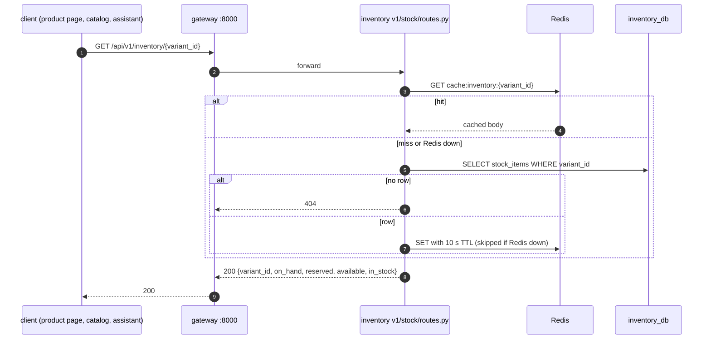

**Merchant adjust** (`POST /api/v1/inventory/{variant_id}/adjust`; `PUT` follows the same path with an absolute value and the `If-Match` check in place of the key replay):

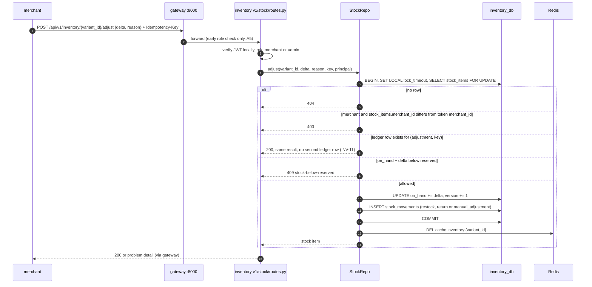

**Internal surface** — service JWT with scope `inventory:internal` only; user tokens are rejected (`403`) even for `admin`.

| Method | Path | Request | Response | Status codes | Idempotency |
| --- | --- | --- | --- | --- | --- |
| `POST` | `/internal/v1/inventory/reservations` | `{order_id, lines: [{variant_id, quantity > 0}]}` (1–100 lines; duplicate variants merged) | `{order_id, reservations: [{id, variant_id, quantity, status, expires_at}]}` | `201` created; `200` idempotent replay; `409 insufficient-stock` with `violations[{variant_id, requested, available}]`; `409 reservation-conflict`; `422 unknown-variant`; `422` validation; `503 inventory-contended` with `Retry-After` | Natural key `(order_id, variant_id)` (B3). All-or-nothing across lines |
| `DELETE` | `/internal/v1/inventory/reservations/{id}` | optional `?reason=compensation` | The reservation | `200` (including already `released`/`expired`); `404`; `409 reservation-committed`; `503` | Release; repeat is a no-op |
| `POST` | `/internal/v1/inventory/reservations/{id}/commit` | — | The reservation | `200` (including already `committed`); `404`; `409 reservation-not-held`; `503` | Commit; repeat is a no-op |
| `POST` | `/internal/v1/inventory/reservations/{id}/reverse` | — | The reservation | `200` (including already reversed); `404`; `409 reservation-not-committed`; `503` | Returns a committed reservation's quantity to `on_hand` (INV-16); repeat is a no-op |
| `POST` | `/internal/v1/inventory/stock-items` | `{product_id, merchant_id, variants: [{variant_id, sku}]}` | `{items: [stock item]}` | `200`; `422` | Initialise zero-quantity rows (INV-4); `variant_id` unique; existing rows unchanged |

No inventory endpoint returns `202`: every operation completes inside its request. The `202` semantics of the platform belong to order creation and publishing, which call these endpoints from their workflows.

**Problem-detail types** (`type` URI suffixes): `insufficient-stock`, `unknown-variant`, `reservation-conflict`, `reservation-not-held`, `reservation-committed`, `reservation-not-committed`, `stock-below-reserved`, `version-mismatch`, `inventory-contended`, `illegal-transition`.

##### 3.1.2.2. Role matrix

| Endpoint | anonymous | customer | merchant | admin | internal (service token) | Scoping rule |
| --- | --- | --- | --- | --- | --- | --- |
| `GET /inventory/{variant_id}` | ✓ | ✓ | ✓ | ✓ | ✗ | None — public read |
| `GET /inventory` | ✗ `401` | ✗ `403` | ✓ own | ✓ all | ✗ | Merchant: `stock_items.merchant_id = token.merchant_id`, applied in the query |
| `PUT /inventory/{variant_id}` | ✗ `401` | ✗ `403` | ✓ owner | ✓ | ✗ | Owner check against the snapshot `stock_items.merchant_id`, never a request field; a non-owner gets `403` |
| `POST /inventory/{variant_id}/adjust` | ✗ `401` | ✗ `403` | ✓ owner | ✓ | ✗ | As above |
| `GET /inventory/{variant_id}/movements` | ✗ `401` | ✗ `403` | ✓ owner | ✓ | ✗ | As above |
| `POST /internal/v1/inventory/reservations` | ✗ `401` | ✗ `403` | ✗ `403` | ✗ `403` | ✓ | Service JWT with `sub: "service:temporal-worker"` and `scope ∋ inventory:internal` |
| `DELETE /internal/v1/inventory/reservations/{id}` | ✗ `401` | ✗ `403` | ✗ `403` | ✗ `403` | ✓ | As above |
| `POST /internal/v1/inventory/reservations/{id}/commit` | ✗ `401` | ✗ `403` | ✗ `403` | ✗ `403` | ✓ | As above |
| `POST /internal/v1/inventory/reservations/{id}/reverse` | ✗ `401` | ✗ `403` | ✗ `403` | ✗ `403` | ✓ | As above |
| `POST /internal/v1/inventory/stock-items` | ✗ `401` | ✗ `403` | ✗ `403` | ✗ `403` | ✓ | As above |

**Internal authentication.** Activities call `inventory` as a service, not as a user. A short-lived service JWT is minted by `identity` from a client-credentials grant ([RFC 0003](0003-identity-service.md)), carrying `sub: "service:temporal-worker"` and a `scope` claim. Internal routes require that scope and reject user tokens; user-facing routes reject service tokens. Sharing a role for both would mean a stolen customer token could call `/internal/v1/inventory/reservations`. This is not a back door: the internal caller authenticates and calls the same HTTP surface ([archive/0006](archive/0006-service-decomposition-and-data-model.md) §3.1.2), and it is the client-credentials amendment [RFC 0000 §3.1.1.4](0000-architecture.md#3114-authentication-and-authorisation-split) anticipates for a call with no user in context.

The gateway's route-level check is an early rejection only (A5); `inventory` makes every decision above itself. The ownership check is on the owning row: merchant `M` may change variant `V` iff `stock_items(V).merchant_id = M`.

##### 3.1.2.3. Events produced

All three topics are in the platform catalogue ([RFC 0000 §3.1.2.3](0000-architecture.md#3123-event-catalogue)), wrapped in the standard envelope ([§3.1.2.4](0000-architecture.md#3124-event-envelope)), Avro with `BACKWARD` compatibility (C5), written to `inventory_db.outbox` in the state-change transaction and published by `outbox-relay` (A10, C1). `aggregate_type = 'stock_item'`, `aggregate_id = variant_id`, so the Kafka key is `variant_id` and all events for one variant are ordered on one partition (C3). `client_id` in the envelope is null — every inventory event is produced by a workflow activity, a consumer or a scheduler, never directly by a client request — except for merchant set/adjust, which produce no event.

The payload fields below are specified here for the first time (INV-7); the sources name the topics, keys and consumers only. Payloads carry ids and the minimum needed to render — no merchant contact data.

| Topic | Key | Trigger | Payload | Consumers |
| --- | --- | --- | --- | --- |
| `inventory.reserved` | `variant_id` | A reservation created (`held`); one event per reservation row | `{reservation_id, order_id, variant_id, product_id, merchant_id, quantity, available_after, expires_at}` | `analytics` |
| `inventory.released` | `variant_id` | A reservation leaves `held` without committing | `{reservation_id, order_id, variant_id, product_id, merchant_id, quantity, available_after, reason: compensation \| order_cancelled \| expired}` | `analytics` |
| `inventory.stockout` | `variant_id` | `depleted` — a reserve took `available` to 0; `low_stock` — a reserve crossed from above `low_stock_threshold` to at or below it; `reservation_refused` — a reserve line was refused for insufficient stock | `{variant_id, product_id, merchant_id, sku, trigger, available, requested?, low_stock_threshold, order_id?}` — `requested` and `order_id` present for `reservation_refused` | `analytics` (Inventory Stockout Rate), `notification` (merchant-facing `stockout`, `all_devices` scope) |

Commit produces no event (INV-Q2): it is ledgered, and the order's own `order.confirmed` carries the business fact.

`depleted` and `low_stock` are edge-triggered — emitted only on the reserve that crosses the boundary — so a variant at zero does not produce an event per refused customer; `reservation_refused` is emitted per refused line, which is what "how often items are unavailable when wanted" counts. Which triggers the stockout rate uses is `analytics`' definition ([RFC 0008](0008-analytics-service.md), archive/0003 Q10).

##### 3.1.2.4. Events consumed

| Topic | Consumer group | Effect | Dedupe |
| --- | --- | --- | --- |
| `catalog.product.published` | `inventory` | Creates a zero-quantity `stock_items` row per variant that has none, plus an `initial` ledger row; never changes an existing row. The merchant then sets quantity through `inventory` (Q4) | `processed_events (inventory, event_id)` in the same transaction; additionally idempotent by `ON CONFLICT (variant_id) DO NOTHING` |
| `order.cancelled` | `inventory` | Releases every `held` reservation of the order (`reason: order_cancelled`), emitting `inventory.released` per reservation | `processed_events (inventory, event_id)`; additionally idempotent because releasing a non-`held` reservation is a no-op |

The consumed payload fields relied on: `catalog.product.published` — `product_id`, `merchant_id`, `variants[{variant_id, sku}]` ([RFC 0004](0004-catalog-service.md#3123-events-produced)); `order.cancelled` — `order_id` ([RFC 0005](0005-order-service.md#3123-events-produced)). Retries and DLQ per C6; replaying either topic from the earliest offset changes nothing (archive/0003 G3).

#### 3.1.3. Data/schema changes

###### `inventory_db`

Owned by `inventory` · PostgreSQL 16. The highest-contention writes
in the platform: a single row per variant is the lock target under a flash sale.

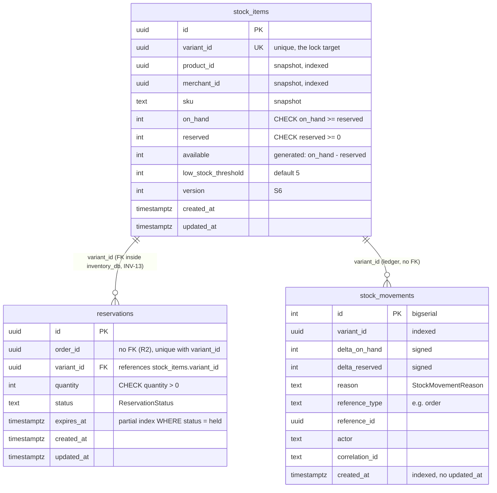

`outbox` and `processed_events` are omitted from the diagram: their DDL is shared and defined once in [RFC 0000 §3.1.3.2](0000-architecture.md#3132-shared-tables--outbox-and-processed_events).

| Table | Purpose |
| --- | --- |
| [`stock_items`](#stock_items) | Current quantities — the lock target |
| [`reservations`](#reservations) | Stock held for in-flight orders |
| [`stock_movements`](#stock_movements) | Append-only signed ledger |
| [`outbox`](0000-architecture.md#3132-shared-tables--outbox-and-processed_events) · [`processed_events`](0000-architecture.md#3132-shared-tables--outbox-and-processed_events) `‡` | S12 / S13 |

| Table | Key | Cols | What it holds |
| --- | --- | --- | --- |
| `stock_items` | `uuid`, unique `variant_id` | 12 | `on_hand`, `reserved`, generated `available`; the lock target |
| `reservations` | `uuid` | 8 | Held stock per order, with expiry for the sweeper |
| `stock_movements` | `bigserial` | 10 | Append-only signed ledger of every delta |
| `outbox` | `bigserial` | 11 | S12 — shared DDL |
| `processed_events` `‡` | `(group, event_id)` | 4 | S13 — consumes `catalog.product.published`, `order.cancelled` |

**Markers**, as in the consolidated catalogue: *(none)* — stated explicitly in a source RFC; `†` — the column is named in a source RFC but its type was not stated there, and the type shown is inferred from S1–S15; `‡` — the column or table is not named in any source RFC and exists because a convention requires it (S1 a primary key, S3 timestamps, S12 an outbox for a producer, S13 a dedupe table for a consumer). Both are **proposals for review**. `inventory_db` carries no `†` cells, one `‡` column (`stock_items.available`) and one `‡` table (`processed_events`).

###### `stock_items`

One row per variant. `on_hand` is what physically exists; `reserved` is what is held for in-flight orders; `available` is what a customer may buy.

| Column | Type | Notes |
| --- | --- | --- |
| `id` | `uuid` PK | |
| `variant_id` | `uuid` | **unique** — one row per variant, the lock target |
| `product_id`, `merchant_id` | `uuid` | snapshots, indexed |
| `sku` | `text` | snapshot, for operator legibility |
| `on_hand` | `integer` | `>= 0` |
| `reserved` | `integer` | `>= 0` |
| `available` | `integer` GENERATED `‡` | `on_hand - reserved`, stored generated column. Described in prose in [archive/0002](archive/0002-core-business-logic-and-workflows.md) but never listed as a column; it is listed here because callers read it. Generated rather than computed so no caller can define it differently |
| `low_stock_threshold` | `integer` | default 5; drives the stockout signal |
| `version` | `integer` | S6 |
| `created_at`, `updated_at` | `timestamptz` | |

Constraint: `CHECK (on_hand >= reserved AND reserved >= 0)` — S11, and the last line of defence against oversell.

DDL sketch: `available integer GENERATED ALWAYS AS (on_hand - reserved) STORED`; `id uuid DEFAULT gen_random_uuid()` (S1); `version integer NOT NULL DEFAULT 1`; every column `NOT NULL` (S10). Indexes: unique `(variant_id)`; `(product_id)`; `(merchant_id)`.

###### `reservations`

| Column | Type | Notes |
| --- | --- | --- |
| `id` | `uuid` PK | |
| `order_id` | `uuid` | indexed; **unique together with `variant_id`** — the idempotency guarantee for retried reserve activities ([archive/0002](archive/0002-core-business-logic-and-workflows.md) B3) |
| `variant_id` | `uuid` | indexed |
| `quantity` | `integer` | `> 0` |
| `status` | `text` | `held` \| `committed` \| `released` \| `expired`. `ReservationStatus` (S4), read policy `fallback` → `held`; a `committed` reservation can never return to `held` |
| `expires_at` | `timestamptz` | indexed — the expiry sweeper's query ([archive/0002](archive/0002-core-business-logic-and-workflows.md) B5), 15 minutes |
| `created_at`, `updated_at` | `timestamptz` | |

Constraints: unique `(order_id, variant_id)` (S11, I3); `CHECK (quantity > 0)` (S11, I4). `variant_id` references `stock_items.variant_id` **inside** `inventory_db` — a real FK is permitted within one database, and is proposed here (INV-13); `order_id` is a cross-boundary UUID with no FK (R2). Indexes: the unique `(order_id, variant_id)` (serves lookups by `order_id`); `(variant_id)`; `(expires_at)` — proposed as the partial `(expires_at) WHERE status = 'held'` (INV-13), which is exactly the sweeper's predicate.

###### `stock_movements`

Append-only ledger ([archive/0002](archive/0002-core-business-logic-and-workflows.md) B6). Quantity is never computed — it is stored in `stock_items` and ledgered here, so a disagreement between the two is detectable.

| Column | Type | Notes |
| --- | --- | --- |
| `id` | `bigserial` PK | S1 exception |
| `variant_id` | `uuid` | indexed |
| `delta_on_hand`, `delta_reserved` | `integer` | signed. `reserve` is `(0, +q)`; `commit` is `(-q, -q)`; `release` is `(0, -q)`; `restock` is `(+q, 0)` |
| `reason` | `text` | `initial` \| `manual_adjustment` \| `reserve` \| `release` \| `commit` \| `expire` \| `restock` \| `return` \| `compensation`. `StockMovementReason` (S4) — a ledger vocabulary, expected to grow |
| `reference_type`, `reference_id` | `text`, `uuid` | e.g. `order`, the order id |
| `actor`, `correlation_id` | `text` | |
| `created_at` | `timestamptz` | indexed |

No `updated_at` — append-only tables are the documented S3 break; nothing is ever updated. `bigserial` is the S1 exception: it never crosses a boundary and benefits from index locality. Indexes: `(variant_id)`; `(created_at)`; proposed `(reference_type, reference_id)` (INV-11) for the "stock looks wrong → `reference_id` → the order" walkthrough and for `Idempotency-Key` replay on `adjust`. Nullability (S10): `reference_type`/`reference_id` null means "no external cause" (a PUT without a key); `actor` is the user id, `service:temporal-worker`, `consumer:inventory` or `task:sweep_expired_reservations`, never null.

**Shared tables.** [`outbox`](0000-architecture.md#3132-shared-tables--outbox-and-processed_events) (S12) — produces `inventory.reserved` / `.released` / `.stockout`; carries `client_id` (C21), always null for inventory's events. [`processed_events`](0000-architecture.md#3132-shared-tables--outbox-and-processed_events) `‡` (S13) — consumes `catalog.product.published` (to initialise stock rows) and `order.cancelled`. Both DDLs are defined once in RFC 0000 and not restated here. The `processed_events` table was mandated generically ("all consumers") but never enumerated for `inventory_db`; it is added because the event catalogue proves the requirement (archive/0006 Q3, flagged for review).

**Constraint summary.**

| Constraint | Table | Kind | Purpose |
| --- | --- | --- | --- |
| `CHECK (on_hand >= reserved AND reserved >= 0)` | `stock_items` | S11 | I1 — oversell is impossible even for an unlocked writer |
| `UNIQUE (variant_id)` | `stock_items` | S11 | One row per variant; the lock target; idempotent initialisation |
| `GENERATED ALWAYS AS (on_hand - reserved) STORED` | `stock_items.available` | Generated | I2 |
| `UNIQUE (order_id, variant_id)` | `reservations` | S11 | I3 — idempotent reserve (B3) |
| `CHECK (quantity > 0)` | `reservations` | S11 | I4 |
| none on `status`, `reason` | — | S4 | Enum values are validated in the model, not the database |

**Migrations** (Alembic, `services/inventory/alembic/`; every revision has a working `downgrade`, additive only — S14):

| # | Revision | Content |
| --- | --- | --- |
| 1 | `0001_initial` | `stock_items`, `reservations`, `stock_movements`, `outbox` (shared DDL), constraints and indexes above; S4 column comments |
| 2 | `0002_processed_events` | `processed_events` (shared DDL) `‡` |
| 3 | `0003_outbox_client_id` | `outbox.client_id text NULL` (C21) |
| 4 | `0004_ledger_reference_index` | `stock_movements (reference_type, reference_id)`; partial `reservations (expires_at) WHERE status = 'held'` replacing the plain index; `reservations.variant_id` FK to `stock_items.variant_id` — all INV-11/INV-13 proposals |
| — | grants | The `inventory` role gets `SELECT, INSERT, UPDATE` on `stock_items`, `reservations`, `outbox`, `processed_events`; `SELECT, INSERT` only on `stock_movements` (I9, INV-12); no grant on any other database (R1) |

Vocabularies (`ReservationStatus`, `StockMovementReason`) are not migrations (S4). Multi-location stock, if ever required, is a future `location_id` added to `stock_items`' unique key.

#### 3.1.4. Breaking changes

`inventory` has no external clients, and the reorganisation moves specification text rather than behaviour. The changes a reader of the archived RFCs will notice:

| Change | Impact | Handling |
| --- | --- | --- |
| `GET /api/v1/inventory/{variant_id}` becomes cached (10 s TTL) | Up to 10 s of staleness on a display read | Documented; invalidated after every committed write, so the common case is fresh. The reserve path never reads the cache — correctness never depends on it |
| Sweeper moves from a bespoke in-process loop to the Celery Beat task `sweep_expired_reservations` | None for callers | Same service function; the loop survives as the `INVENTORY_SWEEPER_INPROCESS` fallback |
| Stock rows are initialised by the publishing workflow **and** by the `catalog.product.published` consumer | None — both are idempotent on `variant_id` | Documented in §3.1.1.4 |
| `inventory_db` gains `processed_events` `‡` and `outbox.client_id` | Additive migrations | S14 |
| Internal routes specified by reservation id; the new internal `POST /internal/v1/inventory/stock-items` (INV-4) | Activities call per reservation id | The archived API table already used `{id}`; this RFC states how an order's reservations map to ids |
| `PUT`/`adjust` require an existing stock row (`404` otherwise) | A merchant sets stock after the variant has been initialised by publishing, not before | See archive/0000's end-to-end step order in §3.3.1 (INV-Q4) |

#### 3.1.5. Action Plan

| # | Task | Output | Depends on |
| --- | --- | --- | --- |
| 1 | `inventory` service skeleton, settings, health, Alembic with the S4 `render_item` hook; `0001_initial` (three tables + outbox) | Migration to head; `alembic check` clean | `common` outbox, idempotency, service-token verify ([RFC 0001](0001-platform-and-shared-infrastructure.md)) |
| 2 | Domain: `stock/enums.py`, `reservations/enums.py`, `RESERVATION_TRANSITIONS` and `transition()` in `reservations/state_machine.py`, `stock/ledger_repo.py` | Unit tests incl. all 13 illegal pairs | 1 |
| 3 | Inventory core: reserve / release / commit with canonical lock order, `lock_timeout`, bounded retry, ledger and outbox writes | **Concurrency test — 50 parallel reserves on 10 units yield 10 successes**; deadlock test | 2 |
| 4 | Internal routes and service-token scope check; `POST /stock-items` initialisation | Contract tests; user tokens rejected | 3, `identity` client-credentials grant |
| 5 | Merchant APIs: read, set (with `If-Match`), adjust (with `Idempotency-Key`), movements, `low_stock` / `out_of_stock` filters | Tests green, ownership enforced | 3 |
| 6 | Reservation expiry sweeper (`expire_due`) with the in-process driver | Test: an expired reservation returns stock and writes a ledger row | 3 |
| 7 | Activity adapters `reserve_inventory`, `commit_inventory`, `release_inventory`, `sync_downstream` wired against the internal routes (with `order`/`catalog` owners) | Failure-injection tests at every step (G3, G5) | 4 |
| 8 | Seed: stock for every seeded variant through the real publish + set path | `make seed` idempotent | 5, 7 |
| 9 | `0002_processed_events`, `0003_outbox_client_id`; `inventory-consumer` for `catalog.product.published` and `order.cancelled` | Stock row created on publish without a synchronous call; replay is a no-op | Kafka, relay, consumer base class |
| 10 | Stockout events (`depleted`, `low_stock`, `reservation_refused`) and their Avro schemas | Order to exhaustion → `inventory.stockout` on its topic | 3, 9 |
| 11 | Celery Beat tasks `sweep_expired_reservations`, `reconcile_inventory_ledger` | Beat fires; drift metric exported | 6, RabbitMQ/Celery |
| 12 | Redis cache-aside on `GET /inventory/{variant_id}` with post-commit invalidation | Hit and invalidation tested; Redis-down test | Redis |
| 13 | Metrics, spans, log fields, Grafana row | `/metrics` non-null; checkout trace includes `inventory` | OTel stack |
| 14 | `0004_ledger_reference_index` and grants hardening once ratified | Migration + grant test | Review of INV-11/12/13 |
| 15 | Review: ratify `‡` cells, INV decisions and open questions | Status → IN-REVIEW → DONE | all |

**Delivery phasing**

| Component | Milestone |
| --- | --- |
| `inventory` service, `inventory_db`, `stock_items`, `reservations`, `stock_movements`, `outbox` | M2 |
| Reserve / commit / release with row locking, lock order, bounded retry, ledger | M2 |
| Internal routes, service-token auth, `sync_downstream` stock-row initialisation | M2 |
| Merchant stock APIs and public stock read | M2 |
| Reservation expiry sweeper (in-process loop) | M2 |
| Outbox rows written for every state change (accumulating, not yet relayed) | M2 |
| Relay publication of `inventory.reserved` / `.released` / `.stockout` | M3 |
| `inventory-consumer` for `catalog.product.published` and `order.cancelled`; `processed_events` | M3 |
| `outbox.client_id` | M3 |
| Sweeper moved to Celery Beat; `reconcile_inventory_ledger` | M3 |
| Redis cache on `GET /inventory/{variant_id}` | M3 |
| Metrics, traces, dashboards | M3 |
| Ratification of `‡` cells (`available`, `processed_events`) and archive/0006 Q3 | M4 (review) |
| `assistant` hydration reads of live stock (D9) | M5–M6 (consumer of the existing endpoint; no inventory change) |
| Architecture and design re-review | M7 (review) |

### 3.2. Rationale

The register lists every significant decision in this RFC in one place; §3.2.2 keeps the full reasoning.

#### 3.2.1. Decision register

Decisions that already carry an ID (B*, Q*, R*, INV-1 to INV-16, INV-A*) keep it: the register row names it with "= ID" in the Decision column rather than renumbering, and `INV-D*` is only the register's row number.

| ID | Decision | Why | Alternatives rejected (and why) | Revisit if |
| --- | --- | --- | --- | --- |
| INV-D1 | `inventory` is its own service and sole writer of stock (R3) | A hot-row write profile unlike `catalog`'s, and several writers (orders, returns, sync) on one fact; [§3.1.1.1](#3111-responsibility-and-boundaries) | A stock column on `product_variants` — makes `catalog` a second writer, the bug Part A names ([§5](#5-alternate-solutions), Alt 6) | Never without re-opening R3 |
| INV-D2 | Stock lives in Postgres `inventory_db`; reservations are Postgres rows | Reservations must survive restarts and reconcile against the ledger; row locks suffice at this scale; [§5](#5-alternate-solutions) | Redis reservations — faster, but not durable or reconcilable (Alt 7); event sourcing — heavy, makes simple reads hard | Lock-wait metrics show Postgres is the ceiling |
| INV-D3 | Stored quantity plus an append-only signed ledger, `stock_movements` (= B6) | Makes drift between stored value and `sum(deltas)` detectable; gives merchants history; [§3.2.2](#322-reasoning) | Current value only — drift undetectable; event sourcing — cost (archive/0006 #5) | Never |
| INV-D4 | `available` is a stored generated column | One definition every caller reads; nobody can compute it differently; [§3.2.2](#322-reasoning) | Computing it in code or per query — callers diverge | Never |
| INV-D5 | Reserve before charge; commit after payment; release on failure (= B4) | The cheap failure (a released hold) comes first, never a refund; [§3.2.2](#322-reasoning) | Charge first — refunds for stock that does not exist; optimistic sell-then-cancel (Alt 5) — customer-facing failure | Never |
| INV-D6 | Row lock (`SELECT … FOR UPDATE`) plus `CHECK (on_hand >= reserved AND reserved >= 0)` | Lock gives a typed refusal with numbers; the `CHECK` stops an unlocked writer; together oversell is impossible; [§3.2.2](#322-reasoning) | Single guarded `UPDATE` (INV-A2) — cannot tell unknown from insufficient; `SERIALIZABLE` (INV-A3) — aborts on the hot path | Hot-variant contention exceeds the budget (then INV-A1 sharding) |
| INV-D7 | Canonical lock order: `stock_items` by ascending `variant_id`, then `reservations`, in one ordered statement (= INV-2) | A total order makes lock cycles, so deadlocks, impossible; [§3.2.2](#322-reasoning) | Lock in request order — `{A,B}` vs `{B,A}` deadlocks under flash sale | Any `40P01` is ever counted |
| INV-D8 | `lock_timeout` 2 s and bounded retry (3 attempts, 25 ms jittered backoff), then `503 inventory-contended` (= INV-1, INV-3) | A request never hangs behind a stuck transaction; contention becomes a typed retryable error; [Locking strategy](#locking-strategy-inv-1-inv-2-inv-3) | Unbounded waits — piled-up connections; no retry — spurious failures | Lock-wait p99 nears the timeout |
| INV-D9 | Fast reject on an unlocked read when `available < q` (= INV-8) | Sold-out variants never join the lock queue; an unlocked read can only reject, never grant; [Locking strategy](#locking-strategy-inv-1-inv-2-inv-3) | Always lock — queue grows with refused buyers | Never |
| INV-D10 | Activity idempotency by natural key `(order_id, variant_id)` and reservation id (= B3) | Attempt-invariant and already unique; [§3.2.2](#322-reasoning) | A separate idempotency-key table — a second mechanism for the same fact | Never |
| INV-D11 | Reservations expire after 15 min, swept by an independent sweeper (= B5, Q2) | Bounds stock stranded by a workflow Temporal cannot recover, without depending on Temporal; [§3.2.2](#322-reasoning) | No expiry — stock stranded forever; shorter TTL — slow payment retries fail | Flash-sale testing shows contention (Q2) |
| INV-D12 | Sweeper on Celery Beat, with an in-process fallback (= INV-10) | Same function under both drivers; safe twice because of the re-check under lock; [§3.1.1.4](#3114-workflows-and-async-jobs) | Bespoke loop only — no shared scheduler; Celery only — no sweep before Celery exists | Celery hosting changes (INV-Q7) |
| INV-D13 | Commit follows status, not the clock (= INV-6) | A `held` past expiry still holds its stock, so committing cannot oversell; refusing would refund a paid order; [§3.2.2](#322-reasoning) | Refuse commit past `expires_at` — needless failure and refund | Never |
| INV-D14 | Post-commit compensation is `reverse` with a `compensation` ledger row, status stays `committed` (= INV-16) | Keeps I8 and the transition table unchanged, no new column; idempotent via the ledger index; [§11](#11-notes) | A new `reversed` state — changes the state machine and schema | RFC 0005 needs a reversed status visible |
| INV-D15 | Error contract: business outcomes `4xx` non-retryable, contention and infra `503`/`5xx` retryable (= INV-5) | Workflow retry policy can be written without knowing inventory rules; [§3.1.1.4](#3114-workflows-and-async-jobs) | `5xx` for business failures — retried uselessly | Never |
| INV-D16 | Stock rows initialised zero-quantity on publish, by `sync_downstream` and by the `catalog.product.published` consumer (= Q4, INV-4) | No synchronous `catalog` → `inventory` call (R5); the activity guarantees readiness, the consumer convergence; [§3.2.2](#322-reasoning) | Merchant pre-stocking before publish (INV-Q4) — needs trusting request ownership | Merchants need pre-publish stock (INV-Q4, INV-Q5) |
| INV-D17 | `inventory` makes no synchronous call out (R5); orchestration is Temporal's (A12) | It is a callee only; workflow owns the sequence, services own the state; [§2](#2-overview) | Choreographed saga over Kafka (Alt 1) — compensation scattered; 2PC/XA (Alt 2) — blocking | Never |
| INV-D18 | Internal routes require a service JWT with scope `inventory:internal`; user tokens rejected | A stolen customer or admin token cannot reserve, commit or release; [§3.1.2.2](#3122-role-matrix) | One role for users and services — opens `/internal/*` to user tokens | mTLS added between services |
| INV-D19 | Merchant ownership checked against snapshot `stock_items.merchant_id` (= INV-14) | Local, fast, independent of `catalog`; claims are the only trusted assertion; [§3.2.2](#322-reasoning) | Request field — untrusted; call `catalog` — breaks R5/R7 | Product ownership becomes transferable |
| INV-D20 | `adjust` (relative) preferred; `PUT` (absolute) only safe with `If-Match` (= INV-9, INV-11) | A relative change never overwrites a concurrent commit; [§3.2.2](#322-reasoning) | Absolute set only — lost updates | Never |
| INV-D21 | Events `inventory.reserved` / `.released` / `.stockout` via the outbox; commit emits none (= INV-7, INV-Q2) | Atomic with the state change (G8); `order.confirmed` already carries the commit fact; [§3.1.2.3](#3123-events-produced) | `inventory.committed` — not in the catalogue, redundant | `analytics` needs a commit event |
| INV-D22 | Stockout for a refused reserve written in a separate transaction after rollback | An outbox row in the rolled-back transaction would vanish; there is no state change to be atomic with; [§3.3](#33-tradeoffs) | Inside the reserve tx — lost on rollback | Never |
| INV-D23 | `stock_movements` append-only by grant (= INV-12); reconciliation detects, never corrects | Ledger stays the record; an automatic fix would erase evidence; [§3.3](#33-tradeoffs) | Auto-correction — destroys the audit trail | Never |
| INV-D24 | Public read cached in Redis for 10 s, invalidated after commit; reserve never reads the cache | Absorbs display and hydration reads; correctness never depends on the cache; [§3.3](#33-tradeoffs) | No cache — every page view hits Postgres; longer TTL — stale stock | Hydration latency (INV-Q8) |
| INV-D25 | Entity-first layout: `stock/` and `reservations/` with `v1/` routes, repos hold the rules | One rule implementation for routes, activities, consumers and tasks; [§3.1.1.1](#3111-responsibility-and-boundaries). *Changed after [mentor review 2026-10-06 §3](../reviews/mentor-reviews.md#3-entity-first-service-layout-with-versions) — previously layer-first: `app/api/v1/` handlers, `app/services/` (rules), `app/domain/` (enums, state machine), `app/models/` and `app/schemas/`.* | Layered `api/` + `services/` trees — entity split across folders ([review §3](../reviews/mentor-reviews.md#3-entity-first-service-layout-with-versions)) | Never |
| INV-D26 | Reservation transitions live in `reservations/state_machine.py`, not `utils.py` (Milestone 2 implementation) | One name for one thing across services: catalog and order already use `state_machine.py`; `utils.py` stays for pure helpers | `utils.py` as written in §3.1.1.1 (two names for the same role) | — |
| INV-D27 | The reserve replay check runs *after* the ordered `FOR UPDATE` on the stock rows, not before (Milestone 2 implementation) | Two concurrent reserves for one order lock the same rows, so the second sees the first's reservations under its lock and replays; checked before the lock, both would pass it and the second would hit the unique constraint after mutating `reserved` | Replay check first (a race that surfaces as a 500 under retries) | — |
| INV-D28 | The unlocked fast reject (INV-8) is skipped for an order that already holds reservations (Milestone 2 implementation) | Otherwise a retried reserve, whose own holding took `available` to zero, is refused against itself and the order fails `INSUFFICIENT_STOCK` while its stock is held | Fast reject unconditionally (as the §3.1.1.4 step order reads) | — |
| INV-D29 | The retry policy for the order workflow's inventory activities is RFC 0005's ORD-10 (`commit` and the compensations retry without an attempt cap inside their windows); §3.1.1.4's "recommended policy … adopted in RFC 0005" is superseded (Milestone 2 implementation) | The workflow's owner sets its policies; a capped retry on a compensation is worse than a late one | Five attempts for every inventory activity (a compensation could give up) | — |
| INV-D30 | An `adjust` `Idempotency-Key` is stored as the ledger reference `uuid5(namespace, "<caller>:<variant>:<key>")` with `reference_type = adjustment` (implements INV-11; Milestone 2 implementation) | `reference_id` is a uuid column, keys are free text; a deterministic uuid scoped to caller and variant makes the replay check one indexed lookup | A key column on `stock_movements` (widens an append-only ledger for one route) | — |
| INV-D31 | The two consumer handlers run inside the consumer base's transaction and never commit: `StockRepo.insert_initial` (split out of `initialise`) and `ReservationRepo.release_for_order` (one transaction for the whole order, under `stock.locking.locked`, which maps lock contention to `InventoryContended`, a `DependencyUnavailable`). Handlers live with the entity they change (`app/stock/consumers/`, `app/reservations/consumers/`); `app/core/consumer.py` wires both (Milestone 3 implementation) | The `processed_events` claim and the effect must commit together (A11, C4), so the handler cannot own the commit. One transaction per reservation (the earlier text) would let a crash leave half an order released with the event marked handled. Contention as `DependencyUnavailable` makes the base wait and retry instead of dead-lettering a healthy event (PLT-D40). *Added after [mentor review 2026-10-13](../reviews/mentor-reviews.md#review-of-2026-10-13) §2–§4.* | Reusing `in_locked_transaction` (commits inside the handler, so the dedupe row and the effect could disagree). One transaction per reservation (not atomic with the claim) | A cancelled order can hold enough reservations that one transaction is too long |

#### 3.2.2. Reasoning

**Why reserve before charging (B4).** If payment runs first and the reservation then fails, money has been taken for stock that does not exist, and the fix is a refund the customer did not ask for. Reserving first means the worst case is a released reservation, which costs nothing and is invisible. The ordering is chosen so that the cheap failure comes first.

**Why the ledger (B6).** Part A's opening complaint is that stock disagrees across systems. A current-value column alone makes disagreement undetectable — the number is simply wrong, with no way to find out when or why. An append-only ledger makes `sum(deltas)` reconcilable against the stored value, so a drift is a detectable, diagnosable event rather than a mystery. It also gives merchants the stock history they will ask for immediately.

**Why `available` is a generated column.** It was described in prose and never listed; listing it as a stored generated column means every caller reads one definition and none can compute it differently. The lock-and-check logic reads it under the lock, so it is always consistent with the row being changed.

**Why row locks and a `CHECK`, rather than one or the other.** The lock gives a typed, explainable refusal (`insufficient-stock` with the numbers) and serialises the read-check-write. The constraint holds even for a code path that forgot to lock. Application-level checks have races; the database is the only thing that can arbitrate concurrent writers (S11). Together they make oversell impossible rather than unlikely.

**Why a canonical lock order (INV-2).** A multi-line order locks several rows. Without a total order, two orders sharing two variants in opposite line order form a lock cycle; Postgres resolves it by aborting one, which under flash-sale load is a steady stream of spurious failures. Sorting by `variant_id` and locking in one ordered statement removes cycles by construction, and the bounded retry covers anything that slips.

**Why reservations expire (B5).** Temporal persists workflows, so compensation normally runs. But "normally" is not "always": a workflow terminated by an operator, a bug in a compensation, or a history lost with the Temporal database would strand stock forever. The TTL plus an independent sweeper bounds that damage to 15 minutes without depending on the system that failed.

**Why 15 minutes (Q2).** Long enough to cover a slow payment retry, short enough that stranded stock returns within a demo.

**Why natural-key idempotency for activities (B3).** `(order_id, variant_id)` is attempt-invariant — it is the same on every retry of the activity — and it is already the thing that must be unique. A separate idempotency-key table would be a second mechanism guarding the same fact.

**Why the stock row is created on publish, zero-quantity (Q4).** `inventory` must know a variant exists before anything can be reserved against it, and it must learn that without a synchronous call from `catalog` into `inventory` on the publish path (R5). The publishing workflow initialises rows through an activity so a published product never lacks them ("no interleaving in which a customer can see a product whose inventory is not ready"); the event consumer converges the same state independently. Zero is the only honest initial quantity: the merchant sets the real one.

**Why merchant ownership is checked against the snapshot `merchant_id`.** Claims are the only trusted cross-service assertion; a request field is not. Holding the owning merchant on the row makes the check local, fast, and independent of `catalog` being up (R7).

**Why `adjust` is preferred over `PUT`.** A relative change applies to whatever the row holds at lock time, so a merchant's restock never overwrites a concurrent commit. An absolute set is correct only if nothing changed since it was read — which is exactly what `If-Match` on `version` checks (S6).

**Why commit follows status, not the clock (INV-6).** A `held` reservation past `expires_at` still holds its stock — `reserved` has not been decremented — so committing it cannot oversell. Refusing it would fail an order whose payment has just succeeded, only to refund it, for a stock position that is perfectly consistent. The sweeper and the commit serialise on the same row lock; whichever arrives first wins, and the loser's outcome is well-defined.

### 3.3. Tradeoffs

| Trade being made | The cost | Why it is acceptable |
| --- | --- | --- |
| Row-level locking on reserve | Writers serialise on a hot variant during a flash sale | Correct behaviour. Oversell is a business failure; queueing is a latency cost. The lock is held for microseconds |
| Reservation expiry sweeper | A background loop and a second path that changes stock | The safety net for a workflow lost beyond Temporal's recovery. Without it, one bad day strands stock permanently |
| A single `stock_items` row per variant | No multi-warehouse or per-branch stock, which Part A's "multi-branch retail" framing hints at | Explicitly out of scope; the ledger's `reference_type` and a future `location_id` make it additive rather than a rewrite |
| `inventory` as its own service | Two new services in the same period as `order`; a cross-service reservation instead of a column | `inventory` is deliberately small (three tables plus the outbox, one hard function), and it lands first so the order workflow has something real to reserve against |
| Cached public stock reads (10 s) | Up to 10 s of staleness on display | Bounded, documented, invalidated on update. Stock uses the short TTL because it moves fastest. Reservation never reads the cache |
| Public `on_hand` and `reserved` | Stock depth is visible to anyone, including competitors | As specified — a product page needs availability. Narrowing the public shape to `{available, in_stock}` is INV-Q3 |
| Two initialisation paths (activity and consumer) | Two callers of one function | Both idempotent on `variant_id`; the activity guarantees readiness, the consumer guarantees convergence |
| Per-reservation commit/release (one transaction each) | An order's commit is not one atomic transaction across lines | Each line's commit is idempotent, so a retried activity converges; holding every line's lock at once would lengthen the hottest transactions for no correctness gain |
| Stockout event on refused reservations written outside the reserve transaction | The one inventory event not atomic with a state change | There is no state change to be atomic with; a crash between the rollback and the outbox insert loses one analytics datum, never stock |
| Ledger reconciliation detects but does not correct | Drift waits for a human | An automatic correction would erase the evidence the ledger exists to keep |

#### 3.3.1. Challenges and Open Questions

Questions carried from the archived RFCs keep their original IDs, qualified by source.

| # | Source | Question | Current position | Needs a decision by |
| --- | --- | --- | --- | --- |
| Q4 | archive/0000 | Where does inventory come from initially — merchant-set, or an event on publish? | `catalog.product.published` creates a zero-quantity stock row; the merchant sets quantity through `inventory`. The publishing workflow's `sync_downstream` also initialises rows, idempotently | Decided |
| Q2 | archive/0002 | Reservation TTL — 15 minutes, or shorter? | 15 minutes. Long enough to cover a slow payment retry, short enough that stranded stock returns within a demo | Revisit if flash-sale testing shows contention |
| Q5 | archive/0002 | Should stock be per-variant only, or per-variant-per-location? | Per-variant. Multi-location is a schema addition (`location_id` in the unique key), not a redesign | Out of scope; recorded so it is not accidental |
| Q10 | archive/0003 | Are the metric definitions what the reviewer expects — particularly stockout rate, where "how often items are unavailable when wanted" admits several readings? | `inventory` emits all three triggers with a `trigger` field; `analytics` chooses the definition ([RFC 0008](0008-analytics-service.md)) | Review |
| Q12 | archive/0003 | Should the SSE stream also carry inventory changes? | No. One stream per concern; a general client event bus deserves its own RFC | Review |
| Q3 | archive/0006 | Is the `‡` `inventory_db.processed_events` genuinely missing, or was the blanket "all consumers" rule enough? | Added, because the event catalogue proves the requirement; the opposite reading costs nothing to adopt — delete one row | Review |
| INV-Q1 | new | How are an order's reservations addressed by `commit_inventory` / `release_inventory`, given the internal routes take a reservation `{id}` but the activities take an `order_id`? | The workflow keeps the reservation ids returned by reserve (B2 permits identifiers) and calls commit/release per id in ascending `variant_id`. An order-scoped route (`POST /reservations:commit?order_id=`) is the alternative if per-id calls prove awkward | Review, with RFC 0005 |
| INV-Q2 | new | Should commit emit `inventory.committed`? | No — not in the catalogue; commit is ledgered and `order.confirmed` carries the fact. Additive later if `analytics` needs it | Review |
| INV-Q3 | new | Should the public read expose `on_hand` and `reserved`, or only `{available, in_stock}`? | Kept as specified. Narrowing is an additive `v1`-safe change for merchants' benefit | Review |
| INV-Q4 | new | archive/0000's end-to-end order is "set stock → publish"; archive/0002's is "creates a product … sets stock → publishes"; but a stock row exists only once publishing initialises it. Which wins? | Rows are created at publish; the merchant sets stock after `sync_downstream` has run. The end-to-end scenario becomes publish → set stock → order. Pre-publish stocking would need either a catalog variant-created event or an upsert that trusts request-supplied ownership — both rejected for now | Review, with RFC 0004 |
| INV-Q5 | new | Should variants added to an already-published product get stock rows? | Not via `catalog.product.updated` (not consumed). A republish re-runs `sync_downstream` and the published event, both of which initialise missing rows. Consuming `.updated` is the additive fix if merchants add variants in place | Review, with RFC 0004 |
| INV-Q6 | new | Should the gateway route the internal paths at all? | Recommended: the gateway does not expose `/internal/v1/inventory/reservations*` or `/internal/v1/inventory/stock-items` at the edge; `temporal-worker` calls `inventory:8004` directly. `inventory` enforces the scope either way | Review, with [RFC 0002](0002-gateway-service.md) |
| INV-Q7 | new | Celery tasks owned by `inventory` run on the shared `celery-worker`. With which database credentials? | The task module is `inventory` code and connects with `inventory`'s own role only (R1 holds per database, not per container); the platform RFC hosts it. The alternative — the task calling an internal `inventory` endpoint — adds an HTTP hop to a maintenance job | Review, with [RFC 0001](0001-platform-and-shared-infrastructure.md) |
| INV-Q8 | new | A batch availability read (`?variant_ids=`) for listing pages and hydration? | Not added. Per-variant reads with the 10 s cache carry the load today | Revisit if hydration latency shows it |

Decided and recorded rather than open: stock is not a column on `product_variants`; reservations are Postgres rows, not Redis keys; the sweeper never changes order state; the ledger is never corrected automatically.

---

## 4. Dependencies/blockers/known issues

**Dependencies.**

| Dependency | Version | Used for |
| --- | --- | --- |
| PostgreSQL | 16 | `inventory_db`; generated columns, row locks, `lock_timeout` |
| SQLAlchemy (async) + `asyncpg` | 2.0.x | ORM and driver (A6) |
| Alembic | per `common` pin | Per-service migrations (S14) |
| `common` | — | Outbox helper, consumer base class (dedupe, retry, DLQ), service-token verification, `DomainEnum`/`DomainEnumText`, problem details, tracing |
| Kafka + Schema Registry | per [RFC 0001](0001-platform-and-shared-infrastructure.md) | Consumed and produced topics |
| Redis (`redis[hiredis]`) | 5.x | Stock read cache |
| Celery + RabbitMQ | per RFC 0001 | Sweeper and reconciliation |
| `identity` client-credentials grant | [RFC 0003](0003-identity-service.md) | Service JWTs for `temporal-worker` |

**Blockers.** None. Every dependency is a public image or package.

**Known issues.**

- A hot variant row serialises writers; throughput on one variant is bounded by one row lock (§6.1).
- Stockout events for refused reservations are not atomic with anything; a crash between the rollback and the outbox insert loses one.
- The public stock read exposes `on_hand` and `reserved` (INV-Q3).
- Pre-publish stock setting is not possible (INV-Q4).
- Before the relay exists, outbox rows accumulate unread; bounded by local test data, and swept by `sweep_published_outbox` once published.
- Before Celery exists, the sweeper runs in-process; a stopped `inventory` process means no sweep.

---

## 5. Alternate solutions

Numbered alternatives keep their archive/0002 §5 numbers.

**Alternative 1 — Choreographed saga over Kafka; no Temporal.** `order` publishes `order.created`; `inventory` reacts and publishes `inventory.reserved`; a payment consumer reacts, and so on.
*Rejected.* Compensation logic ends up distributed across consumers that must each know what to undo; there is no single place that knows where an order is; timeouts and retries are reimplemented per consumer; debugging a stuck order means reading several consumer logs. It also inverts the dependency — `inventory` would need to know the order process. The `inventory.reserved` / `.released` events that do exist are notifications of fact for `analytics`, not saga steps.

**Alternative 2 — Two-phase commit / XA across `order_db` and `inventory_db`.**
*Rejected.* Blocking, poor failure behaviour, and unsupported across the mix of stores involved. Sagas with compensation are the accepted answer.

**Alternative 5 — Optimistic inventory: sell first, reconcile later.** No reservation; decrement on confirmation and handle oversell by cancelling.
*Rejected.* It converts a technical constraint into a customer-facing failure — the customer who receives a cancellation after paying. Acceptable for some businesses at some margins, and explicitly not what Part A asks for, which names inventory consistency as the problem to solve.

**Alternative 6 — Inventory as a column on `product_variants` in `catalog`.** Simpler: no new service, no cross-service reservation.
*Rejected.* It makes `catalog` a second writer on a fact that `order` also needs to change, which is the exact multi-writer inconsistency Part A opens by describing. The catalog's schema declined the column for this reason from the start.

**Alternative 7 — Redis for reservations** rather than Postgres rows.
*Rejected for now.* Faster under contention, and genuinely how high-scale systems do this. But reservations must survive a restart and must be reconcilable against the ledger, and Postgres row locks are sufficient at the demonstrated scale. The reservation interface is narrow enough that a Redis-backed implementation is a later swap.

**Alternative (archive/0006 #5) — Event sourcing as the persistence model for stock.**
*Rejected.* A genuinely good fit for inventory and the natural home for the audit requirement, but a large conceptual cost on the schedule, and it makes every simple read (`available` for a product page) harder. The state table plus append-only ledger gives the audit and reconciliation benefit at a fraction of the cost.

**Alternative INV-A1 — Sharded stock rows for hot variants.** Split a variant's stock across *k* rows and reserve from any shard with stock, so *k* writers proceed in parallel.
*Not adopted.* It removes the single-row ceiling, but `available` becomes a sum, a reserve may need to span shards, and rebalancing is its own job. It is the recorded escape if lock-wait metrics show a real ceiling; nothing in the schema blocks it.

**Alternative INV-A2 — A single guarded `UPDATE` instead of `SELECT … FOR UPDATE`.** `UPDATE stock_items SET reserved = reserved + :q WHERE variant_id = :v AND on_hand - reserved >= :q`, checking the row count.
*Not adopted as the primary path.* It is equally safe (it takes the same row lock implicitly) and one round trip shorter, but a zero row count cannot distinguish "unknown variant" from "insufficient", the refusal cannot report `available`, and the multi-line all-or-nothing case needs the rows locked in order anyway. The explicit lock keeps one shape for every operation.

**Alternative INV-A3 — `SERIALIZABLE` isolation instead of explicit locks.**
*Rejected.* Serialisation failures would replace lock waits on exactly the hot path, producing aborts and retries where queueing is the correct behaviour.

(Alternatives 3 and 4 of archive/0002 — synchronous orchestration inside `order`, and Celery chains — concern the order process and are recorded in [RFC 0005](0005-order-service.md#5-alternate-solutions).)

---

## 6. Production readiness

### 6.1. Scalability and Fault tolerance

- **Oversell prevention under concurrency.** Row lock plus a `CHECK` constraint. Tested at 50 concurrent orders against 10 units (G6).
- **Inventory contention.** Reservations use row-level locking with a short transaction and a bounded retry, which is the flash-sale path and the one place where a hot row is expected.
- **No deadlocks by construction.** Canonical lock order on every path; `40P01` is counted and should stay at zero.
- **Stranded-stock recovery.** The expiry sweeper (B5), independent of Temporal, so a failure mode Temporal cannot see still self-heals. Safe to run twice and on two workers.
- **Blast radius.** `inventory` being down fails reservations, which fails orders cleanly with a recorded reason — it does not hang the API or corrupt state. `inventory` failures cannot affect `catalog` browsing beyond the stock badge (cached).
- **Idempotent everywhere.** Activities keyed by `(order_id, variant_id)` or reservation id; consumers deduped by `processed_events`; tasks re-check under lock.
- **Stateless service.** Scales with `--scale`; the consumer scales up to the partition count (3 locally).
- **Independent scaling.** `inventory` scales on write contention, not on `catalog`'s read volume — the operational profile that made it a service.
- **Known ceilings.** One Postgres; a hot variant row serialises writers. None is a schema decision that blocks scaling (Alternative 7 and INV-A1).

### 6.2. Security considerations

- **Internal endpoints** (`/internal/v1/inventory/reservations*`, `/internal/v1/inventory/stock-items`) require a service-scoped token and reject user tokens outright. A customer token — or an admin token — cannot reserve, commit or release stock.
- **Stock isolation** — a merchant can read, set or adjust stock only for variants of products they own, checked against the snapshot `merchant_id` in `stock_items`, not against a request field. Tenant isolation is the most important recurring test.
- **Claims only.** Role, user id and merchant id come from the verified token (A5), never from a body or header.
- **Ledger integrity.** `stock_movements` is append-only by grant (INV-12); `actor` and `correlation_id` make every change attributable.
- **Event data minimisation.** Payloads carry ids, quantities and a SKU; no merchant contact data, no user data.
- **Injection** — ORM with bound parameters; the lock statements use bound arrays, never string-built SQL.
- **Public read exposure** — `on_hand`/`reserved` visible anonymously (INV-Q3).
- **Accepted gaps** — Kafka unauthenticated locally, so payload minimalism is the actual control; Redis without auth on the internal network; no mTLS between `temporal-worker` and `inventory`.

### 6.3. Deployment strategy

- **Containers.** `inventory` (API, `:8004`) and `inventory-consumer` (same image, consumer entrypoint), both under the Compose `workflow` profile; the consumer requires Kafka, available in the events profile.
- **Migrations** are explicit per service (`make migrate`), never on start-up; every revision has a working `downgrade` (S14).
- **Readiness.** `/health/ready` checks `inventory_db`; the consumer's readiness also reports broker connectivity and consumer lag.
- **Rollback.** Alembic downgrade per service. Because enum columns are `text` (S4), an older build reading a status a newer build wrote degrades `reservations.status` to `held` (fallback) rather than failing — and a frozen `held` reservation is then expired by the sweeper, which is the safe direction.
- **Worker coupling.** Activity adapters live in `temporal-worker` and are redeployed independently of `inventory`; the internal route contract is versioned under `v1` and changes additively only.
- **Seed.** Stock for every seeded variant is set through the real publish-then-set path.

---

## 7. Test Plan

**Unit** — no I/O.

- Inventory arithmetic: reserve, release, commit, expire, restock, return, manual adjustment; the `available` invariant never negative; ledger deltas per operation match the table in §3.1.1.2.
- `RESERVATION_TRANSITIONS`: the 3 legal edges; **all 13 illegal ordered pairs parametrised individually**, asserting `IllegalTransition` and the entity unmutated; structural tests that the keys are exactly `ReservationStatus`'s members, every target is a known state, every state is reachable from `held`, and the terminal set is exactly `{committed, released, expired}`.
- Idempotency table (§3.1.1.3): every request × status cell returns the stated result.
- Line normalisation: duplicate variants merged; lines sorted by `variant_id`; zero or negative quantity rejected.
- Stockout trigger logic: `depleted` and `low_stock` fire only on crossing; `reservation_refused` per refused line.
- Error mapping: every business failure is `4xx` and every contention/infrastructure failure is `503`/`5xx` (INV-5).

**Integration** — real Postgres, per service.

- Reserve with sufficient, insufficient, and exactly-equal stock.
- **50 concurrent reservations against 10 units → exactly 10 succeed, 40 receive an explicit insufficient-stock error, `on_hand` unchanged, `reserved` = 10** (G6).
- **Deadlock freedom:** 100 iterations of two concurrent multi-line reserves `{A, B}` and `{B, A}` → zero `40P01`, correct totals (INV-G2).
- **Lock timeout:** a transaction holding a row lock beyond `lock_timeout` → the competing reserve retries, then returns `503 inventory-contended`; no row changed.
- Multi-line all-or-nothing: one short line refuses the whole reserve; no reservation, ledger or `inventory.reserved` outbox row for any line; a `reservation_refused` stockout outbox row exists.
- Release restores `available`; commit reduces `on_hand`; both write ledger rows.
- Double-reserve for one `(order_id, variant_id)` is rejected by the unique constraint (B3); a retried reserve with the same body returns the same reservations and writes nothing new.
- Commit/release retried twice → exactly one ledger row each (INV-G3).
- Expiry sweeper releases and ledgers; two sweepers concurrently expire each reservation once; a sweep racing a commit on the same reservation produces exactly one of `committed`/`expired`, with consistent quantities (INV-6).
- Ledger reconciliation: `sum(delta_on_hand) == on_hand` (and `sum(delta_reserved) == reserved`, `reserved == Σ held`) after a random sequence of operations; a deliberately injected drift is reported by `reconcile_inventory_ledger` and not corrected.
- `CHECK` enforcement **concurrently**: a raw-SQL writer bypassing the service cannot drive `reserved > on_hand` (S11).
- Ownership: a merchant adjusting another merchant's variant → `403`; `GET /inventory` returns only the caller's rows; admin sees all.
- `PUT` below `reserved` → `409 stock-below-reserved`; stale `If-Match` → `409`; `adjust` replay with one `Idempotency-Key` → one ledger row.
- Auth: user tokens (customer, merchant, admin) on internal routes → `403`; a service token on merchant routes → `403`; a service token without `inventory:internal` → `403`.
- Outbox atomicity: a rolled-back reserve leaves no outbox row; a committed one leaves exactly the expected rows (G8).
- Cache: a read after a write reflects it (invalidation); Redis stopped → reads succeed uncached.
- S4: enum round trip for every `ReservationStatus` and `StockMovementReason` member; unknown value rejected on write; unknown value written by raw SQL reads back as `held` (fallback).

**Consumers** — real Kafka.

- `catalog.product.published` → one zero-quantity row and one `initial` ledger row per new variant; replay (offsets reset to earliest) → nothing changes; a variant that already has stock keeps it.
- `order.cancelled` for an order with `held` reservations → all released with `inventory.released (order_cancelled)`; for an already-released or committed order → no change; replay → no change.
- A malformed event → DLQ; the next event is processed normally.

**Workflow tests** — Temporal test environment, time-skipping (owned with RFC 0005 / RFC 0004).

- Payment declined → inventory released, order `failed` with `PAYMENT_DECLINED`, `available` back to its starting value (G3).
- Shipment creation fails → refund issued, inventory released, order `failed`.
- Insufficient stock → order `failed` immediately, no payment attempted.
- Reservation expired before commit → commit `409` → refund and release (no-op) → order `failed`; stock consistent.
- Activity retried twice then succeeding → exactly one reservation per line, one ledger row each (B3).
- Publishing: `sync_downstream` creates rows; a retried step creates nothing new.

**End-to-end** — through the gateway, cold start.

1. Merchant publishes a product → stock row created (by the workflow and, with events, confirmed by the consumer) at zero.
2. Merchant sets stock → public read shows it.
3. Customer orders → `confirmed`; stock reduced by the ordered quantity; the ledger reconciles.
4. Order a product whose payment token is the declining one → `failed`; stock unchanged from step 3.
5. **Resumability:** kill `temporal-worker` mid-order, restart it; the order reaches a terminal state with no orphaned `held` reservation (G5).
6. Order a product to exhaustion → `inventory.stockout` produced and reflected in the stockout rate.
7. One checkout trace contains `inventory` spans, including the lock span.

**Explicitly not tested** — load and performance beyond the concurrency tests above.

---

## 8. Impact Analysis

**On other services.**

| Service | Impact |
| --- | --- |
| `order` ([RFC 0005](0005-order-service.md)) | `OrderWorkflow` depends on the internal reservation contract and its error mapping (INV-5); it keeps reservation ids (INV-Q1) |
| `catalog` ([RFC 0004](0004-catalog-service.md)) | `ProductPublishingWorkflow` step 4 calls `POST /internal/v1/inventory/stock-items`; `catalog.product.published` must carry `merchant_id` and `variants[{variant_id, sku}]`; `product_variants` carries no stock |
| `identity` ([RFC 0003](0003-identity-service.md)) | Issues client-credentials service JWTs with scope `inventory:internal` |
| `gateway` ([RFC 0002](0002-gateway-service.md)) | Routes `/api/v1/inventory/*`; recommended not to expose internal paths (INV-Q6) |
| `analytics` ([RFC 0008](0008-analytics-service.md)) | Consumes all three inventory topics; owns the stockout-rate definition |
| `notification` ([RFC 0007](0007-notification-service.md)) | Consumes `inventory.stockout` for merchant `stockout` notifications |
| `assistant` ([RFC 0009](0009-assistant-service.md)) | Hydrates live stock through the public read (D9); adds read traffic absorbed by the cache |
| Platform ([RFC 0001](0001-platform-and-shared-infrastructure.md)) | Hosts the activity adapters, Celery tasks, relay and consumer runtime |

**Risks.**

| Risk | Likelihood | Impact | Mitigation |
| --- | --- | --- | --- |
| Compensation logic subtly wrong, failing only under a race | Medium | High | Failure injection at every step is required; the ledger makes any drift detectable; the sweeper bounds stranded stock |
| A code path changing quantity without the lock or the ledger | Medium | High | `app/v1/stock/ledger_repo.py` is the only writer of `stock_movements`; reconciliation detects drift; the `CHECK` stops oversell; `inventory_check_violations_total` shows it firing |
| Lock order violated by a new path, producing deadlocks under load | Low | High | `app/v1/stock/locking.py` is the only place rows are locked; the deadlock test and the `40P01` counter |
| Flash-sale contention exceeding the lock-timeout budget | Medium | Medium | Fast reject at zero; bounded retry; Temporal retry with backoff; upstream rate limit; sharding as the recorded escape |
| Scope creep into multi-warehouse or returns | Medium | Medium | Listed as non-goals with the reason attached |
| Activity code accreting stock rules | Medium | Medium | B1 is a review check; activities only call internal routes |

**On reviewers.** A review should be able to check: a payment that fails leaves stock exactly as it was; 50 orders against 10 units confirm exactly 10; multi-line orders do not deadlock; a killed worker leaves no `held` reservation behind for longer than the TTL; the ledger reconciles; and no stock rule lives in workflow code.

---

## 9. Useful Links/References

**Project documents**

- [RFC 0000 — Architecture](0000-architecture.md) · [RFC 0001 — Platform & Shared Infrastructure](0001-platform-and-shared-infrastructure.md) · [RFC 0004 — `catalog`](0004-catalog-service.md) · [RFC 0005 — `order`](0005-order-service.md)
- [Part A](../part-a.md) · [Milestones](../milestones.md) · [Execution Guidelines](../execution-guidelines.md)
- Archived sources: [0000](archive/0000-system-architecture.md) · [0002](archive/0002-core-business-logic-and-workflows.md) · [0003](archive/0003-events-and-observability.md) · [0006](archive/0006-service-decomposition-and-data-model.md)

**Technical references**

- PostgreSQL explicit locking — https://www.postgresql.org/docs/16/explicit-locking.html
- PostgreSQL `SELECT … FOR UPDATE` / `SKIP LOCKED` — https://www.postgresql.org/docs/16/sql-select.html#SQL-FOR-UPDATE-SHARE
- PostgreSQL generated columns — https://www.postgresql.org/docs/16/ddl-generated-columns.html
- PostgreSQL `lock_timeout` — https://www.postgresql.org/docs/16/runtime-config-client.html
- Saga pattern — https://microservices.io/patterns/data/saga.html
- Transactional outbox — https://microservices.io/patterns/data/transactional-outbox.html
- Temporal Python SDK — https://docs.temporal.io/develop/python

---

## 10. Related tickets/issues

| ID | Title | Maps to |
| --- | --- | --- |
| *(to be created)* | INV-T1 … INV-T15 | The tasks in §3.1.5, one ticket each |
| — | archive/0002 T3–T6 | Inventory skeleton, core, merchant APIs, sweeper |
| — | archive/0003 T20, T21 | Inventory caching; stock row creation on publish |
| — | archive/0006 Q3 | `inventory_db.processed_events` `‡` |

---

## 11. Notes

**Decisions new to this RFC.** Each fills a gap the sources left open; each is a proposal for review.

| ID | Decision |
| --- | --- |
| INV-1 | Bounded retry on lock contention: 3 attempts, jittered backoff from 25 ms, on `55P03` / `40P01` / `40001`; exhausted → `503 inventory-contended` |
| INV-2 | Canonical lock order: `stock_items` before `reservations`; `stock_items` in ascending `variant_id`, locked by one ordered statement |
| INV-3 | `SET LOCAL lock_timeout` (2 s) on every locking transaction; no I/O other than Postgres inside it; cache invalidated after commit |
| INV-4 | Internal `POST /internal/v1/inventory/stock-items` for the publishing workflow's `sync_downstream`, idempotent on `variant_id` |
| INV-5 | Error contract: business failures are `4xx` and non-retryable; contention and infrastructure are `503`/`5xx` and retryable. Recommended activity retry policy stated in §3.1.1.4 |
| INV-6 | Commit follows status, not the clock: an unswept `held` past `expires_at` may commit |
| INV-7 | Payload fields for `inventory.reserved`, `.released`, `.stockout`; the `StockoutTrigger` vocabulary; one event per reservation row |
| INV-8 | Fast reject by an unlocked read when `available < q` |
| INV-9 | `PUT` accepts `If-Match: <version>` (S6) and optional `low_stock_threshold` |
| INV-10 | In-process sweeper driver retained as a fallback (`INVENTORY_SWEEPER_INPROCESS`) |
| INV-11 | Optional `Idempotency-Key` on `adjust`, recorded as `reference_type = 'adjustment'`, `reference_id = key`; index `(reference_type, reference_id)` |
| INV-12 | `stock_movements` append-only by grant (`SELECT, INSERT` only) |
| INV-13 | `reservations.variant_id` FK to `stock_items.variant_id` within `inventory_db`; partial index `(expires_at) WHERE status = 'held'`; `CHECK (quantity > 0)` stated explicitly |
| INV-14 | `stock_items.merchant_id` is treated as a snapshot at creation (catalog ownership of a product does not change); archive/0006 lists it once as a snapshot and once as a projection example — both describe the same frozen copy |
| INV-15 | The `order.cancelled` consumer releases only `held` reservations and never touches `committed` ones |
| INV-16 | **Reversal of a committed reservation** (answers [RFC 0005](0005-order-service.md) ORD-12). Internal `POST /internal/v1/inventory/reservations/{id}/reverse` returns the quantity to `on_hand` with a `compensation` ledger row referencing the reservation. The reservation keeps status `committed`, so I8 and `RESERVATION_TRANSITIONS` are unchanged and the copied schema needs no new column. Idempotency comes from the `(reference_type, reference_id)` index (INV-11): an existing `compensation` row for the reservation makes a repeat a no-op, and the check and the write share the row lock. `StockMovementReason` gains `compensation` (S4, no migration). No event is emitted, as with commit (INV-Q2) |

**Source reconciliation notes.**

- archive/0002 G3 names the column `available_quantity`; the schema names it `available`. `available` is used throughout.
- archive/0002 wrote the constraint as `CHECK (on_hand >= reserved >= 0)`; archive/0006's `CHECK (on_hand >= reserved AND reserved >= 0)` is the valid SQL form of the same rule and is used.
- archive/0002 T3 says "all four tables" for `inventory`: the three domain tables plus `outbox`.
- archive/0000 §3.1.1 says service-to-service calls need no separate trust model and that a no-user call would need a client-credentials token "as an amendment"; archive/0002's service JWT is that amendment.
- archive/0003's delivery-scope table cites "the reservation sweeper" among causes of `order_cancelled`. The sweeper cannot change an order; an expired reservation surfaces as a failed commit and a `failed` order. The notification wording belongs to [RFC 0007](0007-notification-service.md).
- archive/0002's B1 ("an activity calls one service function") and its internal-authentication paragraph ("activities call `inventory` as a service") are reconciled as: the activity calls the internal HTTP route, whose route calls the one repo method. R1 forbids `temporal-worker` a grant on `inventory_db`.

- **Amendment log.**

  | Date | Section | Change | Reason |
  | --- | --- | --- | --- |
  | Oct 11, 2026 | All | Shared package path `libs/common` → `common` | [Mentor review 2026-10-06 §1](../reviews/mentor-reviews.md#1-shared-package-folder) |
  | Oct 11, 2026 | §3.2, §3.2.1 | Added the decision register (INV-D1–INV-D25); existing `INV-` and platform IDs kept and referenced; prose reasoning kept in §3.2.2 | [Mentor review 2026-10-06 §2](../reviews/mentor-reviews.md#2-a-reason-for-every-decision) |
  | Oct 11, 2026 | §3.1.1.1, §3.2.1 | Layer-first layout (`api/v1/`, `services/`, `domain/`, `models/`, `schemas/`) replaced by the `stock/` and `reservations/` entities with `v1/` inside each (INV-D25) | [Mentor review 2026-10-06 §3](../reviews/mentor-reviews.md#3-entity-first-service-layout-with-versions) |
  | Oct 11, 2026 | §3.1.1, §3.1.1.3, §3.1.1.4, §3.1.2.1, §3.1.3 | ASCII diagrams converted to Mermaid; component, state, flow, sequence and ER diagrams added | [Mentor review 2026-10-06 §4](../reviews/mentor-reviews.md#4-diagrams) |
  | Oct 11, 2026 | §3.2.1 | Added INV-D26–INV-D30: `state_machine.py` name, replay check after the lock, fast reject skipped on retry, ORD-10 retry policy, `adjust` key as a uuid5 ledger reference | Milestone 2 implementation (README *Milestone 2 decisions and deviations*) |
  | Oct 12, 2026 | §3.1.1.1 | Module tree checked against ARC-D27 — nothing to move; tree brought in line with the code (`core/enums.py`, `stock/access.py`, `stock/events.py`, `reservations/sweeper.py`; consumers and tasks marked planned) | [Mentor review 2026-10-12 §2](../reviews/mentor-reviews.md#2-every-file-in-its-entity-folder) |
  | Oct 12, 2026 | §3.2.1, §11 | INV-D25 marked with the review that changed it; this amendment log added | [Mentor review 2026-10-12 §3](../reviews/mentor-reviews.md#3-every-change-traced-to-its-review) |
  | Oct 12, 2026 | §3.1 | Diagram index added | [Mentor review 2026-10-12 §4](../reviews/mentor-reviews.md#4-diagram-coverage-per-service) |
  | Oct 14, 2026 | §3.1.1.1, §3.1.1.4, §3.2.1 | Milestone 3: the `inventory` consumer (`catalog.product.published`, `order.cancelled`) and the Celery sweeper built; module tree and consumer table brought in line with the code; INV-D31 (handlers inside the consumer's transaction; `release_for_order` is one transaction) | [Mentor review 2026-10-13 §2–§4](../reviews/mentor-reviews.md#review-of-2026-10-13) |

---

## 12. Comments

*Reviewer comments go here. Please raise objections against the numbered decisions (B3–B6, INV-1–INV-16), a decision-register row INV-D1–INV-D30, the open questions (§3.3.1), or the rejected alternatives in §5, so the discussion attaches to something specific.*

| Reviewer | Section | Comment | Resolution |
| --- | --- | --- | --- |
| | | | |
