# Stock release: Temporal, Kafka and Celery

This page explains how held stock gets back to customers when an order does not
complete, and what each of the three mechanisms involved does:

- the **Temporal order saga**, which releases stock as a compensation;
- the **`order.cancelled` Kafka consumer** in inventory, a safety net for
  cancellations that bypass the saga;
- the **Celery expiry sweep**, the last line that returns any reservation left
  held past its TTL.

It also describes how Kafka is used across the platform, who produces and who
consumes each event, and how to tell from the data which mechanism released a
given reservation.

| Section | Question it answers |
| --- | --- |
| [1. Terms](#1-terms) | What is a stock row, a reservation, held stock? |
| [2. Kafka in SmartRetail](#2-kafka-in-smartretail) | Who produces, who consumes, and what each consumer does |
| [3. Three layers of release](#3-three-layers-of-release) | Why there are three mechanisms and how they relate |
| [4. How no layer repeats another's work](#4-how-no-layer-repeats-anothers-work) | How the consumer knows Temporal already released |
| [5. Scenarios](#5-scenarios) | What happens in each success and failure case, step by step |
| [6. Identifying which case happened](#6-identifying-which-case-happened) | Which data shows who released a reservation, and why |
| [7. Gaps and notes](#7-gaps-and-notes) | Limits of the current design |

---

## 1. Terms

### Stock row

Inventory keeps one row per product variant in `stock_items`
([`stock/models.py`](../services/inventory/app/v1/stock/models.py)). A variant
is a sellable option of a product, for example "T-shirt, red, M".

| Column | Meaning |
| --- | --- |
| `variant_id`, `product_id`, `merchant_id`, `sku` | Which item the row is for |
| `on_hand` | Units physically in stock |
| `reserved` | Units held for orders still in checkout |
| `available` | `on_hand − reserved`, computed by Postgres: what a customer can still buy |
| `low_stock_threshold` | When a stock-out alert is raised |
| `version` | Optimistic concurrency counter |

A variant without a stock row cannot be stocked or sold. The row is the lock
target: every quantity change happens under `SELECT … FOR UPDATE` on it.

Every change to a stock row is also written to the append-only ledger
`stock_movements`, with a `reason` (`reserve`, `release`, `commit`, `expire`, …),
an `actor` and a `correlation_id`. Section 6 uses this ledger to identify
who released a reservation.

### Reservation (held stock)

Between "the customer clicked Buy" and "the payment succeeded" there is a gap.
Without a hold, two customers could both buy the last unit. So checkout first
**reserves** the quantity: a row in `reservations`
([`reservations/models.py`](../services/inventory/app/v1/reservations/models.py))
with `order_id`, `variant_id`, `quantity`, `status` and `expires_at`
(now + 15 minutes, `inventory_reservation_ttl_seconds = 900`).

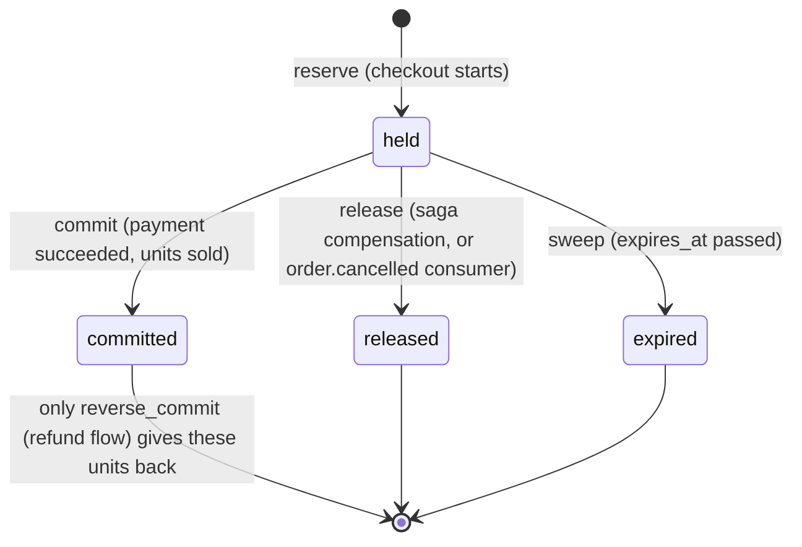

Effect on the stock row, for 2 units of a variant with 10 on hand:

| Step | `on_hand` | `reserved` | `available` | Reservation status |
| --- | --- | --- | --- | --- |
| Before checkout | 10 | 0 | 10 | — |
| Reserve | 10 | 2 | 8 | `held` |
| Commit (sold) | 8 | 0 | 8 | `committed` |
| *or* Release / expire | 10 | 0 | 10 | `released` / `expired` |

**Releasing held stock** means moving a reservation from `held` to `released`
(or `expired`) and returning its quantity to `available`. Only a `held`
reservation can be released. A `committed` one is refused with
`ReservationCommitted`; sold units return only through `reverse_commit`.

---

## 2. Kafka in SmartRetail

Kafka carries **facts**: "this happened". The producing service writes the fact
to its `outbox` table in the same transaction as the state change, and
`outbox-relay` publishes it, keyed by the aggregate id. Consumers react by
updating **their own** data. No producer knows its consumers.

Kafka does not carry **commands** ("reserve 2 units now"). Those go through the
Temporal workflows, which call services over HTTP and wait for the answer.

### 2.1 Producers

| Service | Topics (`smartretail.` prefix omitted) | Key | Written when |
| --- | --- | --- | --- |
| identity | `identity.user.registered` | `user_id` | A user signs up |
| catalog | `catalog.product.published`, `.updated`, `.unpublished` | `product_id` | The publish workflow puts a product live, a live product changes, a product is withdrawn |
| order | `order.created`, `.confirmed`, `.failed`, `.cancelled` | `order_id` | The order saga sets the order's status |
| order | `payment.succeeded`, `payment.failed` | `order_id` | The charge step finishes |
| order | `shipment.status_changed` | `order_id` | The carrier reports a new status |
| inventory | `inventory.reserved`, `.released`, `.stockout` | `variant_id` | Stock is held, returned, or runs out |
| assistant | `assistant.interaction` | `conversation_id` | A chat turn finishes |

The catalogue is [`catalogue.json`](../common/smartretail_common/events/catalogue.json).
Each topic has 3 partitions locally and a `<topic>.dlq` twin.

### 2.2 Consumers

Five consumer groups, each a separate process from its service's FastAPI app.

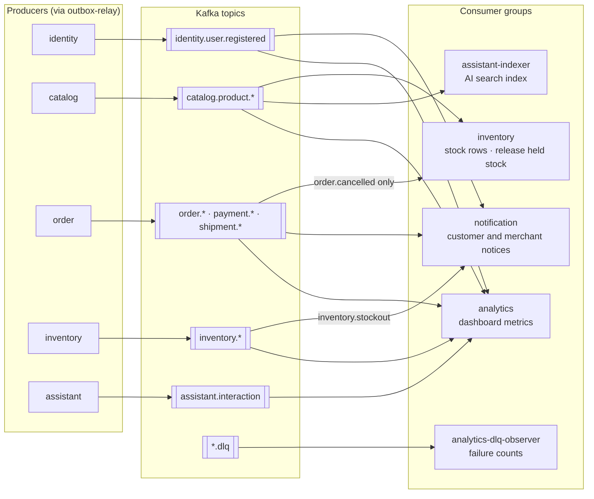

#### inventory (`inventory-consumer`)

[`app/core/consumer.py`](../services/inventory/app/core/consumer.py)

| Event | Effect | Normally already done by |
| --- | --- | --- |
| `catalog.product.published` | Create a stock row for each variant that has none. Existing rows are never touched | The publish workflow's `sync_downstream` activity, over HTTP, before the product goes live |
| `order.cancelled` | Release every reservation of the order that is still `held` | The order saga's `release_inventory` compensation, before it writes `cancelled` |

Both handlers are **safety nets**. Their value is in two situations:

- A path that skipped the workflow step: an operator, a future admin tool.
- Rebuilding inventory. `catalog.product.published` is a compacted topic, so it
  still holds the latest event per product, and re-reading it recreates every
  missing stock row without involving catalog.

#### notification (`notification-consumer`)

[`app/core/consumer.py`](../services/notification/app/core/consumer.py)

| Event | Notification |
| --- | --- |
| `identity.user.registered` | Welcome |
| `order.confirmed` | Order confirmed |
| `order.failed` | Order failed |
| `order.cancelled` | Order cancelled |
| `shipment.status_changed` | Shipped, out for delivery, delivered |
| `inventory.stockout` | Stock-out alert to the merchant |
| `payment.succeeded`, `payment.failed` | Consumed and recorded as processed, **no notification**. The customer already hears through `order.confirmed` / `order.failed`, and notifying twice is what the service exists to prevent |

The consumer writes the notification row in its transaction. After the commit
it hands delivery (email, live SSE stream) to Celery.

#### assistant-indexer (`indexer-worker`)

[`search/consumers/product_events.py`](../services/assistant/app/v1/search/consumers/product_events.py)

| Event | Effect |
| --- | --- |
| `catalog.product.published` | Embed the product and add it to the vector index |
| `catalog.product.updated` | Re-embed it |
| `catalog.product.unpublished` | Remove it from search |

An embedding-provider outage raises `EmbeddingUnavailable`, a
`DependencyUnavailable`, so the consumer waits and the event stays in Kafka
instead of going to the DLQ.

#### analytics (`analytics-consumer`)

[`metrics/rollups.py`](../services/analytics/app/v1/metrics/rollups.py)

Subscribes to every topic that has a schema and turns each event into counter
updates in MongoDB: orders and revenue per day and merchant, failures and
cancellations by reason, stock-outs, assistant usage. These feed the merchant
and admin dashboards. They are business metrics, not application logs.

#### analytics-dlq-observer

[`metrics/consumers/dlq_observer.py`](../services/analytics/app/v1/metrics/consumers/dlq_observer.py)

Reads every `*.dlq` topic and counts failures per original topic and error
class, from headers only (the payload is poison by definition).

### 2.3 Use case: one order, end to end

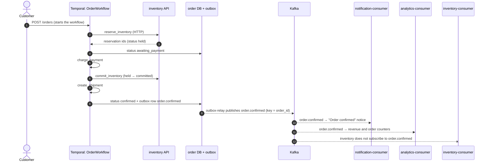

The workflow does the work in order and waits for each answer. Kafka spreads the
outcome to the services that care, in the background.

---

## 3. Three layers of release

| Layer | Mechanism | When it acts | Release reason recorded |
| --- | --- | --- | --- |
| 1 | **Temporal saga** compensation `release_inventory` | Immediately, on payment failure, cancellation, or any failure before commit | `compensation` |
| 2 | **Kafka consumer** on `order.cancelled` | Seconds after an order is set to `cancelled` | `order_cancelled` |
| 3 | **Celery Beat** task `smartretail.inventory.sweep_expired_reservations` | Every 60 s, for reservations whose `expires_at` has passed | `expired` |

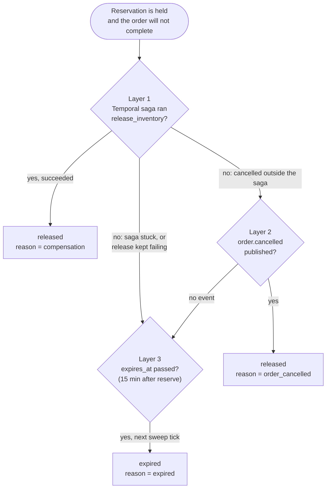

The layers are independent. None tells another that it succeeded or failed.
Each one reads the reservation's current status and acts only if it is still
`held`.

### The Celery sweep

| Item | Value | Source |
| --- | --- | --- |
| Task | `smartretail.inventory.sweep_expired_reservations` | [`reservations/tasks/maintenance.py`](../services/inventory/app/v1/reservations/tasks/maintenance.py) |
| Schedule | Every `INVENTORY_SWEEPER_INTERVAL_SECONDS` (60 s), Beat embedded in the inventory Celery worker | [`core/celery_app.py`](../services/inventory/app/core/celery_app.py) |
| Work | `ReservationRepo.expire_due()`: batches of 500 `held` reservations with `expires_at < now`, oldest first | [`reservations/repo.py`](../services/inventory/app/v1/reservations/repo.py) |
| Per reservation | Own short transaction: lock the stock row and reservation, **re-check** `status = held` and still past due, then `held → expired`, return the quantity, write `inventory.released` with reason `expired` | `_expire_one` |
| Actor in ledger | `task:sweep_expired_reservations` | `SWEEPER_ACTOR` |
| Fallback | An in-process loop ([`sweeper.py`](../services/inventory/app/v1/reservations/sweeper.py)) runs the same `sweep_once` when `inventory_sweeper_inprocess` is on (default off). Both may run at once safely | `run_forever` |

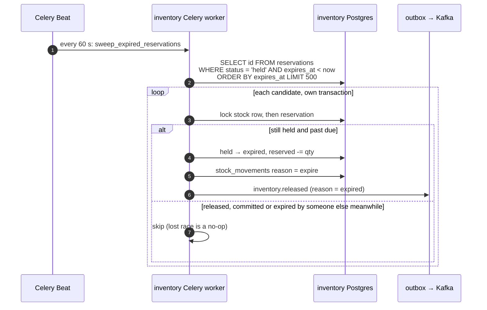

The sweep's docstring calls it "a safety net beneath compensation, not a
replacement". The forward steps of the saga are sized to fit inside the
15-minute TTL (ORD-10), so a slow but healthy workflow never has its
reservation swept away.

---

## 4. How no layer repeats another's work

Nothing reports "Temporal succeeded" or "Temporal failed" to the Kafka consumer
or to the sweep. Each one asks the database a single question under a lock:
**is this reservation still `held`?**

### The consumer's check

`release_for_order` ([`repo.py`](../services/inventory/app/v1/reservations/repo.py)),
called by [`order_cancelled.py`](../services/inventory/app/v1/reservations/consumers/order_cancelled.py):

```python
variant_ids = select(Reservation.variant_id).where(
    Reservation.order_id == order_id,
    Reservation.status == ReservationStatus.HELD,   # only what is still held
)
if not variant_ids:
    return []                                       # nothing held: no-op
items = await self._lock_items(variant_ids)         # lock stock rows first
# re-read the held reservations under the lock, then held → released
```

Its docstring: *"Committed, released and expired reservations are left alone:
normally the order workflow has released them already and this is a no-op
safety net."*

### Why the consumer normally finds nothing

In [`order_workflow.py`](../services/order/app/v1/orders/workflows/order_workflow.py),
`_cancellation()` runs in this order:

1. `REFUND_PAYMENT`, if the order was charged;
2. **`_release`**: the `release_inventory` activity;
3. **`_status("cancelled")`**, which writes `order.cancelled` to the outbox.

The event is written only after the release has completed. By the time the
consumer reads it, the reservations are already `released`.

### Two kinds of duplicate protection

| Layer | Stops | Mechanism |
| --- | --- | --- |
| `processed_events` | The **same Kafka message** being applied twice (redelivery) | `event_id` is claimed in the handler's transaction; a conflict means "already done" |
| Reservation `status` under row lock | **Different actors** (saga, consumer, sweep) applying the same release | Only `held` can change. The check runs after `SELECT … FOR UPDATE`, so a concurrent actor waits, then sees the new status and skips |

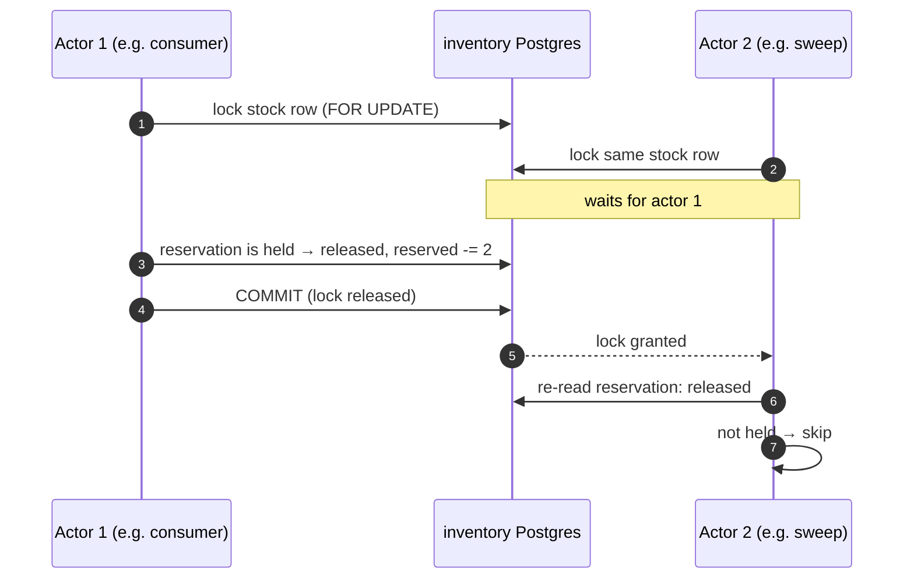

The saga's own `release_inventory` activity treats an already released or
expired reservation as success (`release()`: *"Releasing a released or expired
reservation is success."*), so it does not fail when another layer got there
first.

---

## 5. Scenarios

### Scenario A: customer cancels, saga releases (the normal case)

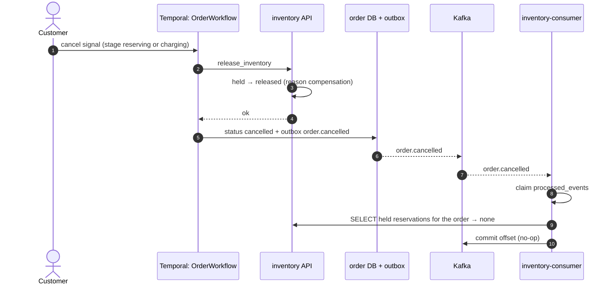

Outcome: one release, by the saga. The consumer does nothing.

### Scenario B: order cancelled outside the saga

An operator or a future admin tool sets the order to `cancelled` without the
saga's release.

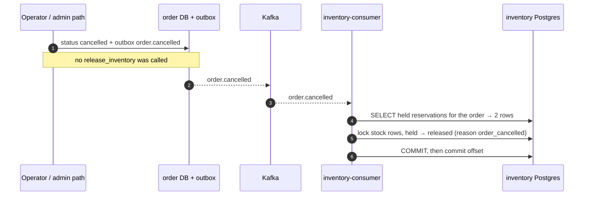

Outcome: the Kafka consumer is the layer that releases. This is the case it
exists for.

### Scenario C: payment declined (saga compensation, no Kafka safety net)

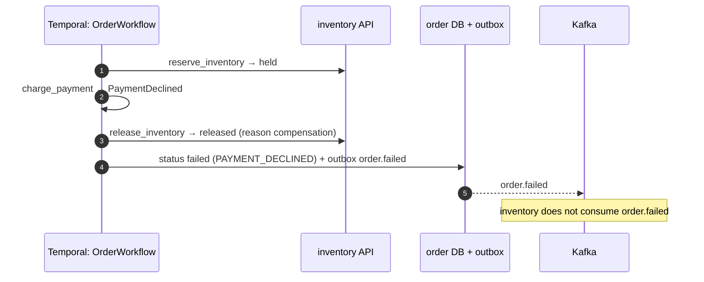

Outcome: the saga releases. Layer 2 does not apply to failed orders, so if this
release never happened, only the sweep (layer 3) would return the stock.

### Scenario D: inventory is down during the compensation

The saga tries to release while the inventory API or its database is
unreachable.

The compensation policy:

```python
# start_to_close 15 s, schedule_to_close 3600 s, retry every 2 s backing off to 60 s,
# maximum_attempts = 0 (unlimited within the hour)
COMPENSATE = _options(15, 3600, _retry(2, 60, 0))
# "A compensation that gives up is worse than one that is late."
```

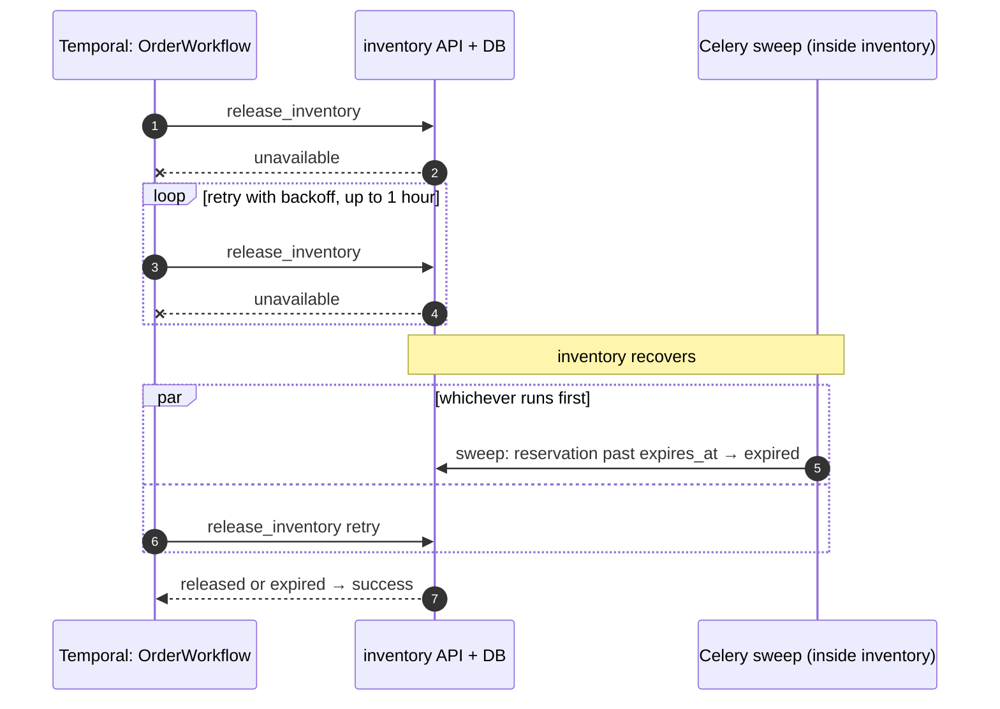

Outcome depends on timing:

| Inventory down for | What returns the stock |
| --- | --- |
| Less than the TTL left on the reservation | The saga's retry (`released`, reason `compensation`) |
| Longer than that | Whichever runs first after recovery. Usually the sweep (`expired`), since the reservation is past due. The saga's retry then succeeds as a no-op |
| More than the full hour of retries | The sweep, after recovery. The `_release` call fails. See below |

**If the release fails for the whole hour.** The `ActivityError` raised inside
`_cancellation()` is caught by `run()`'s handler, which calls `_fail()`. `_fail()`
tries `_release` once more under the same policy. If that also fails, the
workflow execution fails and **neither `order.cancelled` nor `order.failed` is
written**. Layer 2 never sees the order, and the sweep (layer 3) is the only
mechanism left. It runs inside inventory, so it acts as soon as inventory is
back.

### Scenario E: Temporal or the order worker is down

The Temporal server or the `order` worker stops while an order is in checkout.
The workflow does not fail. It pauses with its state saved and resumes when
Temporal is back.

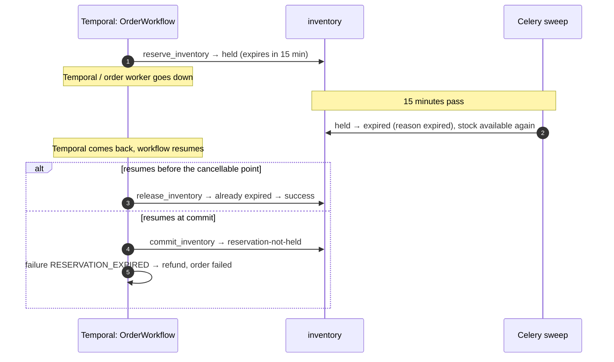

Outcome: the sweep returns the stock while Temporal is unavailable. When the
workflow resumes, it either releases (a no-op) or fails the commit with
`reservation-not-held`. That error is non-retryable in the `COMMIT` policy, so
the saga refunds the payment and ends the order as `failed` with
`RESERVATION_EXPIRED`. The customer is not charged for stock they no longer hold.

### Scenario F: Celery Beat is down

If the inventory Celery worker (which embeds Beat) is down, expired
reservations stay `held` until it comes back. Layers 1 and 2 are unaffected.
The in-process sweeper is the fallback (`inventory_sweeper_inprocess = true`).
Running both at the same time is safe because every expiry is re-checked under
its locks.

### Summary of scenarios

| Scenario | Layer that releases | Reservation ends as | Order ends as |
| --- | --- | --- | --- |
| A. Customer cancels | 1 Temporal | `released` / `compensation` | `cancelled` |
| B. Cancelled outside the saga | 2 Kafka consumer | `released` / `order_cancelled` | `cancelled` |
| C. Payment declined | 1 Temporal | `released` / `compensation` | `failed` / `PAYMENT_DECLINED` |
| D. Inventory down, short | 1 Temporal | `released` / `compensation` | `cancelled` or `failed` |
| D. Inventory down, long | 3 Celery sweep | `expired` / `expired` | `failed`, or workflow execution failed |
| E. Temporal down | 3 Celery sweep | `expired` / `expired` | `failed` / `RESERVATION_EXPIRED` when resumed at commit |
| F. Celery down | 1 or 2 as usual; expiry delayed | as usual | as usual |

---

## 6. Identifying which case happened

Every release leaves three traces: the reservation's final status, a ledger row
with an actor, and an `inventory.released` event with a reason.

| Released by | `reservations.status` | `stock_movements.reason` | `stock_movements.actor` | `inventory.released.reason` |
| --- | --- | --- | --- | --- |
| Temporal saga | `released` | `release` | the order service's identity (`service:…`) | `compensation` |
| Kafka consumer | `released` | `release` | `consumer:order.cancelled` | `order_cancelled` |
| Celery sweep | `expired` | `expire` | `task:sweep_expired_reservations` | `expired` |

### Decision flow

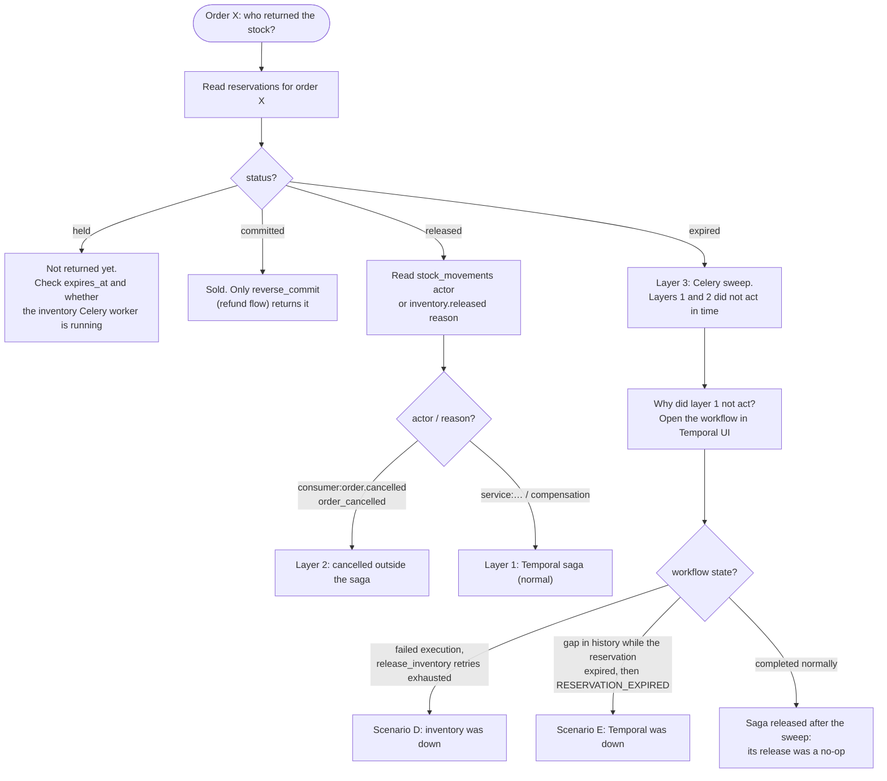

### Queries

Run against the inventory database. Replace the order id.

```sql
-- 1. Final status of each reservation for the order
SELECT id, variant_id, quantity, status, expires_at, updated_at
FROM reservations
WHERE order_id = '<order-id>';

-- 2. Who changed the stock, in order (reservation movements reference the order)
SELECT created_at, variant_id, reason, actor, delta_on_hand, delta_reserved, correlation_id
FROM stock_movements
WHERE reference_type = 'order' AND reference_id = '<order-id>'
ORDER BY id;
```

The `correlation_id` matches the order's request, so the same id finds the
order's logs and the workflow's activities. Sweep rows have no
`correlation_id`: the sweep runs on a timer, not for a request.

### Other signals

| Signal | Where | What it shows |
| --- | --- | --- |
| Workflow history | Temporal UI (`http://localhost:8088` locally, set by `TEMPORAL_UI_PORT`) | Every activity attempt, retries, the final error. A failed `release_inventory` with many attempts means scenario D |
| Order row | `orders.status`, `orders.failure_reason` in the order database | `RESERVATION_EXPIRED` points to scenario E. An order stuck in `awaiting_payment` or `refunding` after its workflow failed points to scenario D |
| Sweep log | inventory Celery worker logs, message `expired reservations` with a `count` | The sweep acted, and how many it expired per tick |
| Consumer lag | `kafka-consumer-groups --describe --group inventory` | Whether layer 2 is keeping up |
| DLQ counts | analytics `failure_stats` (from the DLQ observer) | Whether `order.cancelled` events are failing in the inventory consumer |

A rising rate of `expired` releases is the health signal for this whole area. In
a healthy system nearly every release is `compensation`. Many `expired` releases
mean layer 1 is failing or slow, and are worth an alert.

---

## 7. Gaps and notes

- **Layer 2 covers `order.cancelled` only.** Failed orders (`order.failed`) rely
  on layer 1 and layer 3. That is deliberate: every failure path runs through
  the saga, which releases. It does mean a failed-order release that never
  happened waits up to the TTL plus one sweep interval.
- **If the compensation fails for good, no order event is written.** Scenario D's
  worst case ends with a failed workflow execution and an order row left in an
  intermediate status. The stock is safe (the sweep returns it), but the order
  needs operator attention. The Temporal UI is where this shows.
- **Ordering across topics.** `order.cancelled` and `order.created` are separate
  topics, so Kafka does not order them relative to each other. The inventory
  consumer subscribes only to `order.cancelled`, so this does not affect it.
- **Drift between the counter and the rows is checked daily.** Every layer
  above changes `stock_items.reserved` and the reservation row in one
  transaction. `reconcile_inventory_ledger` (Celery Beat, 03:30) reports any
  variant where `reserved` differs from the sum of held reservations, and never
  corrects it (INV-D23, INV-D32; mentor review 2026-10-20 §1).
- **The release reason is set by the caller.** The HTTP route defaults to
  `compensation`. A new caller that releases for another reason should pass its
  own reason, or section 6's identification breaks.

Binding sources: [RFC 0005](rfcs/0005-order-service.md) (order saga, ORD-10),
[RFC 0006](rfcs/0006-inventory-service.md) (reservations, B5, INV-7, INV-10),
[RFC 0001](rfcs/0001-platform-and-shared-infrastructure.md) (consumer base),
[messaging-and-consistency.md](messaging-and-consistency.md) (Kafka partitioning,
commits, duplicates).
